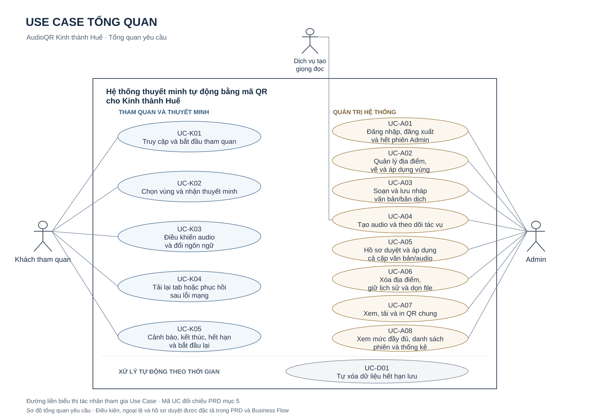

# Đặc tả yêu cầu hệ thống (PRD)

Tài liệu quy định phạm vi, quy tắc nghiệp vụ, yêu cầu chức năng/phi chức năng, Use Case và tiêu chí nghiệm thu của hệ thống. Giữ các mã BR/DR/FR/UC/NFR/AC để truy vết giữa các tài liệu. Đây là đặc tả yêu cầu; trạng thái đáp ứng thực tế được báo cáo riêng.

## 1. Mục tiêu, cách đọc và truy vết

### 1.1. Mục tiêu sản phẩm

Khách truy cập bằng một QR chung hoặc đường dẫn dự phòng, bắt đầu phiên có tên/ngôn ngữ, chọn vùng trên sơ đồ để đọc và nghe thuyết minh. Admin chuẩn bị địa điểm/vùng, văn bản/bản dịch, tạo audio từ văn bản, áp dụng đúng phiên bản được duyệt và theo dõi phiên/lượt xem.

Theo G01, đồ án áp dụng đầy đủ các yêu cầu về nghiệp vụ nhất quán, thao tác rõ, có thể kiểm thử và khối lượng phù hợp nhóm. Phạm vi và tiêu chuẩn nghiệm thu áp dụng thống nhất cho dự án; không tự thêm chức năng nâng cao.

Mục tiêu quan sát: hoàn thành hành trình khách; trình diễn được vòng đời địa điểm và nội dung/audio; thống kê đúng dữ liệu còn giữ; có bộ nội dung chuẩn theo D06. Các tiêu chí cụ thể ở mục 8 chưa phải báo cáo kết quả thực tế.

### 1.2. Tài liệu và quy ước mã

| Tài liệu / mã | Cách dùng |
| --- | --- |
| [business-flow.md mục 1–6](business-flow.md#bf-1) | Nghiệp vụ khách và Admin đã duyệt; không mở lại khi rà soát PRD nếu không có mâu thuẫn thực chất. |
| [decisions.md mục 3–5](decisions.md#dec-3) | Quyết định hiện hành và giới hạn; [mục 7](decisions.md#dec-7)/[mục 8](decisions.md#dec-8) giữ phương án bị thay thế và nhật ký lịch sử. |
| FR-Kxx / FR-Axx / FR-Dxx | Yêu cầu chức năng khách / Admin / lưu dữ liệu tự động. Mã giữ ổn định khi sửa câu chữ; khi hủy thì ghi thay thế, không tái dùng mã cho nghĩa khác. |
| BR-xx / DR-xx / NFR-xx | Quy tắc nghiệp vụ / dữ liệu / phi chức năng. |
| UC-Kxx / UC-Axx / UC-Dxx | Use Case; ở cùng file để tránh lệch phiên bản. |
| AC-Kxx / AC-Axx / AC-Dxx | Tiêu chí nghiệm thu, liên kết FR/UC; bảng FR dẫn quyết định nguồn. Các tiêu chí chưa được chạy. |
| O-xx | Điểm cần thiết kế/xác nhận thêm; chưa phải yêu cầu bắt buộc. |

Phạm vi nguồn: D01–D09 và các bổ sung D01-BS/D02-BS/D03-BS/D04-BS, P01–P08, G01, A01–A07, A02.1–A02.6, A04.1–A04.4, BF-K01/BF-A01/BF-ALL01 và Q1–Q3; bổ sung UI-01/UI-01.1–UI-01.5, UI-02 và UI-P01–UI-P04. UI-02 là mã nguồn lượt xác nhận, không thay mã FR/UC/AC. Khi ghi D03/BS nghĩa là D03 và D03-BS; tương tự các mã khác. Việc gán mã trong PRD không chốt thêm chức năng hoặc công nghệ.

Nếu PRD mâu thuẫn nguồn: ghi rõ mục/ảnh hưởng, xin xác nhận phần khác biệt; không đổi nguồn để hợp thức hóa PRD hoặc code. Không coi phần chưa được cung cấp là đã đọc hoặc kiểm chứng.

### 1.3. Tác nhân và trách nhiệm

| Tác nhân | Trách nhiệm / quyền trong phạm vi |
| --- | --- |
| Khách tham quan | Nhập tên, chọn ngôn ngữ, bắt đầu/kết thúc phiên của tab, chọn vùng và đọc/nghe; không cần tài khoản khách. |
| Admin đã đăng nhập | Một vai trò, tài khoản cấp trước; quản lý địa điểm/vùng/văn bản/audio/QR; xem phiên và thống kê chỉ đọc. |
| Người dùng/chủ đồ án | Duyệt phiên bản nội dung theo hồ sơ tài liệu; xem xét giao diện/vùng riêng. Đây là trách nhiệm ngoài quy trình phê duyệt tự động trong phần mềm, không bổ sung vai trò đăng nhập. |
| Dịch vụ tạo giọng đọc | Cung cấp kết quả tạo audio theo yêu cầu đã tiếp nhận; TTS-01 model/Charon, IN-P03 WAV-MP3/FFmpeg-Linux đã chọn. Ngân sách trả phí/ngưỡng và tích hợp thực/chất lượng bốn ngôn ngữ chưa chốt/kiểm chứng. |
| Hệ thống theo thời gian | Xác định hạn phiên, thực hiện tự xóa dữ liệu và dọn file theo quy tắc; cách tổ chức kỹ thuật để TDD xác định. |

## 2. Phạm vi và cơ sở nghiệm thu

### 2.1. Trong phạm vi

- Khách: hệ thống trực tuyến; QR chung/đường dẫn; tên/ngôn ngữ/phiên theo tab; bản đồ minh họa với vùng tương tác; văn bản, audio Phát/Tạm dừng và thanh tua; đổi ngôn ngữ; khôi phục tab, xử lý lỗi, cảnh báo/hết hạn/kết thúc; đếm lượt xem đúng quy tắc.
- Admin: đăng nhập/đăng xuất; thêm/sửa/ẩn-hiện/xóa địa điểm; trực tiếp vẽ/xem trước/lưu/sửa vùng, áp dụng bản sửa riêng; quản lý nháp văn bản/bản dịch, tạo/nghe thử audio từ bản đã lưu; đối chiếu hồ sơ duyệt rồi áp dụng; theo dõi mức đầy đủ; một QR chung; danh sách và thống kê phiên.
- Toàn vẹn dữ liệu: xóa do ứng dụng điều phối với giao dịch database và FK; giữ lịch sử điểm đã xóa; dọn file riêng có bảo vệ; lưu/xóa phiên và lượt xem theo D08.

### 2.2. Ngoài phạm vi đã thống nhất

GPS, lấy vị trí thiết bị/quyền vị trí, cung cấp tọa độ khách hoặc chỉ đường thực tế; chế độ offline/gửi bù lượt xem; đồng bộ phiên/nghe giữa tab hoặc thiết bị; lịch sử nghe lâu dài, thống kê người duy nhất/lượt nghe/lần quét; QR riêng từng điểm/dịch vụ chuyển hướng; đăng ký công khai/phân quyền nhiều cấp; Admin sửa/gia hạn phiên khách; tự dịch, tự duyệt nội dung, duyệt nhiều cấp/lịch sử phiên bản phức tạp; đổi tốc độ/nghe nền, nút nghe lại riêng; bộ công cụ bản đồ phức tạp; chức năng quản lý thêm ngôn ngữ.

Hướng chỉ tải lên audio chuẩn bị sẵn và giới hạn không được thêm/xóa điểm đã bị thay thế, không dùng làm yêu cầu hiện hành. Chưa tự thêm một luồng tải audio độc lập bên cạnh tạo audio từ văn bản. Công nghệ nền đã xác nhận riêng theo TECH-01, gồm Leaflet/Geoman miễn phí; không mặc định Google Maps, nguồn nền hoặc nhà cung cấp TTS từ bản phác thảo/demo.

### 2.3. Bộ nội dung do người dùng chọn

| Địa điểm | Ngôn ngữ cần đủ khi nghiệm thu | Mục tiêu |
| --- | --- | --- |
| Cổng Ngọ Môn | vi / en / fr / ru | 4 văn bản + 4 audio |
| Điện Thái Hòa | vi / en / fr / ru | 4 văn bản + 4 audio |
| Tử Cấm Thành | vi / en / fr / ru | 4 văn bản + 4 audio; một bài tổng quan mỗi ngôn ngữ, không tách điểm con |
| Cửu Đỉnh | vi / en / fr / ru | 4 văn bản + 4 audio |
| Cung Diên Thọ | vi / en / fr / ru | 4 văn bản + 4 audio |
| **Tổng** | **5 × 4** | **20 văn bản + 20 audio, duyệt đúng từng phiên bản theo D09** |

Đây là bộ chuẩn người dùng chọn, **không phải số lượng do giảng viên quy định hoặc giới hạn số địa điểm hệ thống**. Thêm một điểm để trình diễn CRUD/tạo audio không tự làm tăng bộ nội dung phải chuẩn bị. Điểm thêm muốn hiện cho khách vẫn phải đủ A02.5; thiếu audio/ngôn ngữ khác theo D03/BS, không làm giảm mục tiêu của bộ chuẩn.

Thứ tự chuẩn bị: một điểm tiếng Việt → năm điểm tiếng Việt → bổ sung en/fr/ru. Đã báo cáo có năm bản nháp vi, **chờ tiếp nhận bản lưu và rà soát**, chưa đưa nguyên văn vào tài liệu, chưa được duyệt/kiểm chứng. Tên địa điểm ở đây là danh sách phạm vi, không phải tài liệu thẩm định lịch sử.

## 3. Quy tắc nghiệp vụ và dữ liệu

### 3.1. Quy tắc nghiệp vụ

| Mã | Quy tắc nguồn phải giữ | Quyết định |
| --- | --- | --- |
| BR-01 | Tên 1–50 ký tự hiển thị; bỏ khoảng trắng đầu/cuối, gộp khoảng trắng giữa; không nhận toàn khoảng trắng, xuống dòng hoặc ký tự điều khiển. Unicode, số, dấu câu thông thường được chấp nhận; trùng tên được phép, không xác minh tên thật; tên không định danh người. Đổi tên bằng kết thúc rồi bắt đầu mới. | D02/BS |
| BR-02 | Mỗi tab một phiên; chỉ tạo khi thông tin hợp lệ và bắt đầu thành công. Hết hạn cố định bắt đầu + 8 tiếng dù đang nghe; hoạt động/tải lại/đổi điểm-ngôn ngữ và nghe tiếp theo P01/UI-02 không gia hạn hoặc tạo phiên. Đóng trang không cho biết chính xác lúc kết thúc; tải lại/quay lại không hồi sinh phiên đã kết thúc/hết hạn. | D04, P01/P02/P03, UI-02 |
| BR-03 | Một vùng cho mỗi điểm hiển thị. Chọn vùng lần đầu của lần mở địa điểm hoặc chọn vùng địa điểm khác thì tải trọn MP3 bài hiện tại vào dữ liệu tạm của tab rồi phát từ đầu khi còn quyền; đổi điểm dừng bài cũ/phát bài mới. Bấm lại vùng đang chọn trong cùng lần mở xử lý theo P06/BR-04, không mặc định phát lại từ đầu. Đổi ngôn ngữ giữ điểm/phiên nhưng dừng/về đầu/không tự phát. Khôi phục tab không phải chọn vùng mới. Các thao tác chọn vùng/đổi ngôn ngữ chỉ khi còn hiệu lực; hết hạn P01/UI-02 khóa các thao tác này. | D01/BS, D07, P03/P05/P06, TECH-04 |
| BR-04 | Cùng lần mở: bấm lại vùng đang phát giữ nguyên, tạm dừng thì tiếp tục, hết bài thì từ đầu, đang tải không lặp. Ngoài vùng/kéo/phóng không chọn/phát/cộng lượt. Chồng lấn hỏi ứng viên, mỗi tab một audio, lựa chọn mới nhất ưu tiên. Box ứng viên UI-P01 theo UI-02: nền không thao tác, bài cũ tiếp tục/giữ pause, Hủy không đổi bài; hết hạn đóng box/chuyển P01. | P06–P08 |
| BR-05 | Một bộ chọn “Ngôn ngữ” cho giao diện khách và nội dung/audio vi/en/fr/ru; nhãn/tiêu đề/hướng dẫn/nút/thông báo chuyển theo lựa chọn, tên khách giữ nguyên. Không tự chuyển khi thiếu; chỉ liệt kê ngôn ngữ có văn bản được phép để chọn thay thế hoặc về bản đồ. Bộ chọn đúng ngôn ngữ áp dụng, nội dung cũ khi chuyển không gây nhầm. Bỏ nhãn thường trực Văn bản/Audio/Trạng thái, vẫn phản hồi tải/thiếu/lỗi. Câu vi đã chốt là căn cứ nghĩa; tên/tiêu đề/thông báo dịch rà soát trước dùng, chưa duyệt sẵn. Thiếu audio vẫn đọc, báo “Audio chưa sẵn sàng” ở vi hoặc bản dịch đã rà soát, vô hiệu phát; lỗi thử lại từ đầu. | D03/BS, UI-01.3 |
| BR-06 | Còn trên 0 đến 5 phút dùng cảnh báo nhẹ đúng D04-BS, không chặn/ngắt nghe/nhắc liên tục, tải lại/quay tab vẫn nhận biết. Đúng 8 tiếng: box hết hạn chỉ trong khung bản đồ, nền toàn bản đồ mờ/khóa, không đóng/Hủy, ngôn ngữ khóa; văn bản vẫn cuộn. Không chặn toàn trang; chỉ bài đang phát ở mốc được nghe hết/pause/resume, không tua/Nghe lại/phát bài khác hoặc khôi phục ngoại lệ sau tải lại. Đang tải/chưa phát/pause trước mốc không có ngoại lệ; phản hồi muộn không tự phát, dùng trọn MP3 đã giữ trong tab theo TECH-04. Rời nghe vào form mới dừng bài cũ; không tự tạo/gia hạn/lượt mới. | D04-BS, P01, UI-02 |
| BR-07 | Mỗi lần chủ động mở điểm và tải thành công văn bản được phép hiển thị tính một lượt. Chỉ báo thiếu dịch chưa tính; lần đầu chọn ngôn ngữ có văn bản rồi tải thành công trong lần mở đó mới tính. Đổi ngôn ngữ sau đó/tải lại/nghe lại/bấm lại/thử lại không cộng. A→B→A hoặc về bản đồ rồi chủ động mở lại là lần mở mới. Không ghi lượt mới vào phiên đã hết hạn. | D04, P01/P03/P04/P06 |
| BR-08 | Số phiên theo bắt đầu; lượt theo thời điểm xem/điểm/ngôn ngữ đã ghi. Từ/Đến mặc định hôm nay Asia/Saigon, trọn cả ngày đầu/cuối, nhiều ngày nhóm theo ngày. Hai bảng/tổng riêng: Ngày–Số phiên bắt đầu; Ngày–Điểm/nhận biết lịch sử–Ngôn ngữ–Lượt xem, không cộng hai loại số. Về hôm nay đổi hai ngày, danh sách giữ trạng thái/tên-mã. Không suy người duy nhất/nghe/quét; chỉ dữ liệu còn giữ D08, điểm xóa không gộp theo tên, không thêm bộ lọc hoặc kho thống kê vô hạn. | D04/D08, A06/A02.2, UI-05 |
| BR-09 | Nháp khác áp dụng. Chỉ áp dụng cả cặp của một điểm/ngôn ngữ: văn bản đã lưu/được người dùng duyệt và audio đã nghe trọn/duyệt/khớp D09. Một nút “Áp dụng văn bản và audio”, không áp dụng riêng hoặc tự áp dụng sau lưu/tạo/ghi tham chiếu. Hồ sơ cặp có tham chiếu văn bản/audio riêng, có thể chung mục đủ rõ, ghi chú giới hạn khi cần; không bắt nhập lại ngày/người đã có. Phần mềm không tự thẩm định hồ sơ; sửa nội dung đã duyệt rà soát phần ảnh hưởng. | D09, A03, UI-04 |
| BR-10 | Audio gắn đúng bản văn/ngôn ngữ lúc tạo. Thành công ≠ được duyệt ≠ đã áp dụng. Phải nghe trọn, khớp văn bản/ngôn ngữ đã duyệt, không trống/cắt cụt. Bản dịch thiếu rà soát đủ năng lực phải nêu giới hạn và được người dùng duyệt riêng cho demo; AI/dịch ngược không là thẩm định chuyên gia. | D09, A04.1–A04.3 |
| BR-11 | Tên Admin bắt buộc 1–100 ký tự hiển thị theo Q1; chuẩn hóa khoảng trắng, Unicode/số/dấu câu, không rỗng/xuống dòng/điều khiển; mã ổn định/độc lập tên/không tái dùng. Tên trùng sau chuẩn hóa không phân biệt hoa-thường nhưng giữ dấu: cảnh báo không chặn, không gộp/hậu tố. Lưu được điểm ẩn thiếu vùng/bài/audio. Chỉ bật khi thông tin hợp lệ, vùng hợp lệ đã xem xét/áp dụng và ít nhất cặp vi đã duyệt/áp dụng; không chờ đủ bốn ngôn ngữ. Năm điểm là bộ chuẩn, không trần số điểm; giữ vi/en/fr/ru, không thêm quản lý ngôn ngữ hoặc trường nội dung trùng. | A02/A02.2/A02.4/A02.5, D06, Q1, UI-04 |
| BR-12 | Khi sửa vùng điểm đang hiển thị, giữ vùng hiện hành; “Lưu bản sửa” khác “Áp dụng”. Xem trước/xem xét rồi chủ động áp dụng, hiệu lực lần tải bản đồ tiếp theo; không đẩy tức thì/ngắt audio/ép kết thúc. | A02.6 |
| BR-13 | Cặp thay thế nhất quán ở lần tải/chọn tiếp theo theo A07; thất bại xác định giữ cặp cũ, chưa rõ kiểm tra thực tế trước thử lại. Chưa có cặp cũ thì nội dung mới chưa phục vụ trước thành công. Chỉ thay audio dùng văn bản hiện tại không đổi cùng audio mới đã duyệt, không bắt sửa/duyệt lại văn bản. Không áp dụng nửa cặp. Cặp đã áp dụng nhưng audio thực tế thiếu/tải-phát lỗi vẫn cho đọc và xử lý D03/BS/P04, không audio sai bản/ngôn ngữ. Tạm ẩn không thu hồi tức thì; giữ nội dung đã tải có quyền và ngoại lệ khách P01/UI-02, không gia hạn hoặc khôi phục sau tải lại. | UI-04, A04.3/A07, P01/P03/P04, UI-02 |
| BR-14 | Phiên Admin 30 phút từ hoạt động chủ động gần nhất được ghi nhận khi còn hiệu lực; giữ danh sách tính/không tính Q3, không hồi sinh/ghi bù sau mất mạng. Hết phiên dừng audio nghe thử, che nội dung/yêu cầu đăng nhập lại; không tự phát/gửi lại sau xác thực, không áp ngoại lệ nghe tiếp khách. TTS đã tiếp nhận vẫn tiếp tục A04.4; giữ công việc theo BR-18/Q2/UI-AP05. | A01, A04.4, Q2/Q3, UI-04 |
| BR-15 | Xác nhận xóa rồi ứng dụng xử lý dữ liệu riêng/tham chiếu có kiểm soát trước điểm; tất cả thay đổi database trong một giao dịch. Giữ FK chặn xóa trực tiếp còn tham chiếu, không ON DELETE CASCADE ở quan hệ cần chặn; không tuyên bố chống mọi quyền database. | A02/A02.1 |
| BR-16 | Dọn file chỉ sau database thành công, chỉ file không còn được tham chiếu và không dùng chung, bảo vệ 8 tiếng từ ngừng áp dụng cuối cùng; lỗi chờ/thử lại, báo đúng trạng thái. File không nằm trong giao dịch database; bảo vệ file không gia hạn phiên. | A02.3 |
| BR-17 | Một QR chung dẫn trang bắt đầu, URL chỉ đọc; tải PNG và bản in gọn tên hệ thống/một QR/URL dự phòng. Dùng cả điểm thêm, không QR riêng/ngôn ngữ/đếm quét/chuyển hướng/tùy biến thêm. Chưa URL thật thì chưa sẵn sàng, không QR giả. URL/thư viện chưa chọn; mở hộp in/yêu cầu tải không chứng minh in/lưu thành công, quét/URL cần kiểm tra bản thật. | D01-BS, A05, UI-05 |
| BR-18 | Giữ tạm ba loại công việc Admin trong cùng tab theo Q2: văn bản/bản dịch, thông tin địa điểm, vùng đang vẽ/sửa; phần tham chiếu đang nhập thuộc công việc soạn được bảo vệ cùng công việc theo UI-AP05, không mọi biểu mẫu/kho dài hạn. Qua hết phiên/đăng nhập cùng tài khoản, lưu lỗi/mạng/tải lại bình thường: phục hồi mốc gần nhất đã ghi nhận, đúng đối tượng/ngôn ngữ/bản, rõ chưa lưu; không tự ghi tham chiếu/Lưu/Áp dụng/gửi lại. Không lộ tạm sang tài khoản khác/hồi sinh điểm xóa/ghi đè im lặng. Lưu hoặc ghi phần tương ứng thành công/xác nhận bỏ xóa tạm tương ứng; cảnh báo trước điều hướng/đăng xuất làm mất nội dung. Giới hạn đóng tab/crash/thiết bị khác và vòng đời Q2 giữ nguyên. | Q2, A01/A02/A03/A04.4, UI-04/UI-AP05 |

### 3.2. Dữ liệu nghiệp vụ và thời hạn lưu

Bảng này là khái niệm nghiệp vụ, không chỉ định schema, nơi lưu hoặc công nghệ.

| Mã | Nhóm dữ liệu / mục đích | Người dùng được tiếp cận / giới hạn | Nguồn |
| --- | --- | --- | --- |
| DR-01 | Phiên: mã phiên, tên hiển thị, ngôn ngữ ban đầu, mốc bắt đầu/kết thúc/hết hạn và trạng thái phù hợp; phục vụ tiếp tục phiên và Admin nhận biết. | Khách thấy tên/lựa chọn đang dùng; Admin đăng nhập xem danh sách/thống kê. Không tìm/gộp theo tên; không suy ra hiện diện chỉ từ phiên còn hiệu lực. | D02/D04/D08, A06 |
| DR-02 | Lượt xem được tính: phiên liên quan, địa điểm, ngôn ngữ và thời điểm; phục vụ thống kê theo BR-07/08. | Chỉ dữ liệu được ghi nhận đúng lượt; không lưu lịch sử từng thao tác audio như dữ liệu nghiệp vụ. | D04/D08 |
| DR-03 | Khi xóa điểm, giữ thông tin nhận biết điểm cũ độc lập bản ghi điểm để hiển thị “địa điểm đã xóa”; không gộp điểm mới trùng tên. | Giữ phiên/lượt đến hết hạn D08, không vì xóa điểm mà xóa toàn bộ lượt hoặc giữ vô hạn. Cách xử lý tham chiếu thuộc TDD. | A02.2 |
| DR-04 | Tự động xóa phiên và lượt liên quan sau 30 ngày kể từ kết thúc chủ động hoặc hết hạn cố định. | Hết hạn dùng bắt đầu + 8 tiếng, không lúc audio nghe tiếp phát hết hoặc mốc pause/resume/đóng trang. Thống kê chỉ dữ liệu còn giữ; log/backup có chính sách bổ sung DATA-01, không được coi xóa kho nghiệp vụ là xóa mọi bản sao. UI-02 không đổi hạn 30 ngày. | D08 |
| DR-05 | Trạng thái khôi phục trong tab: lựa chọn hiện tại và mốc nghe gần nhất đã lưu của cùng bài, chỉ phục vụ phiên hiện tại. | Chủ động kết thúc xóa tên điền sẵn/trạng thái khôi phục. Hết hạn điền sẵn tên và ngôn ngữ nếu còn thông tin hợp lệ để xác nhận lại, không tự khởi tạo phiên. Không thêm lịch sử nghe lâu dài/đồng bộ; Blob/object URL/quyền nghe tiếp chỉ thuộc document hiện tại, không lưu để hồi phục sau hết hạn. | P02/P03 |
| DR-06 | Địa điểm có mã/tên/trạng thái Q1; vùng, văn bản/ngôn ngữ và audio quản lý riêng. Cặp phục vụ của một điểm/ngôn ngữ nhận biết đúng bản văn/audio khớp; chỉ chuyển cả cặp. Hồ sơ duyệt của cặp lưu tham chiếu văn bản/audio riêng, có thể cùng mục đủ rõ và ghi chú giới hạn khi cần; không tự thẩm định bên ngoài. | Admin quản lý, khách chỉ nhận cặp được phép; kết quả tạo bốn mức riêng với duyệt/áp dụng. Không kho phiên bản phức tạp hoặc công nghệ/schema được chọn. | A02–A04, D09, Q1/Q2, UI-04 |
| DR-07 | Thông tin phục vụ dọn file: còn tham chiếu/dùng chung, lần ngừng áp dụng cuối cùng, chờ/lỗi/thử lại. | Phân biệt bản ghi và file thật; không tự xóa hồ sơ duyệt tài liệu cùng địa điểm. File sinh muộn không dùng phải vào cơ chế dọn phù hợp. | A02.1/A02.3, A04.4 |
| DR-08 | Không đưa tọa độ khách, điện thoại, email hoặc lịch sử từng thao tác audio vào dữ liệu nghiệp vụ cần lưu. Log kỹ thuật giữ 7 ngày, không secret/thông tin khách/nội dung nhạy cảm; backup giữ mỗi bản 7 ngày từ tạo, bảo vệ/dọn đúng hạn. | DATA-01 chấp nhận đuôi bản sao tới gần 37 ngày; restore riêng, lọc phiên/lượt quá hạn theo mốc gốc trước phục vụ. Không ghi secret vào tài liệu; DATA-02 cho backup cục bộ tách dữ liệu chạy, không bắt ổ ngoài hoặc cứu mất/hỏng laptop; DATA-03 chốt database, WAV/MP3 còn tham chiếu và manifest; cuối ngày có thay đổi và trước deploy/thay cấu trúc database. DATA-04 chốt backup tạm ngừng phục vụ ngoài demo, MySQL giữ hoạt động; restore thật thu hồi quyền/window cũ trước public nhưng giữ mốc/lịch sử, không endedAt giả. Job metadata cũ sau bảy ngày từ terminal rõ chỉ dọn khi hết refs/use/current, không hạn text/audio/unknown. Path/quyền/công cụ/drain/checkpoint/RPO-RTO còn thiết kế/kiểm. Không coi xóa D08 là xóa mọi bản sao. | D05/D08, DATA-01/DATA-02/DATA-03/DATA-04, ràng buộc cộng tác |
| DR-09 | Giữ tạm Admin cùng tab/tài khoản: công việc/đích, biểu mẫu thêm/sửa địa điểm (thêm mới chưa tạo bản ghi), văn bản-ngôn ngữ-bản đang sửa hoặc đỉnh/hình vùng đã đặt; UI-AP05 gồm tham chiếu đang nhập thuộc công việc soạn. Chỉ phục hồi mốc gần nhất đã ghi nhận để tiếp tục, không là nháp đã lưu hoặc cặp đã áp dụng. | Xác thực cùng tài khoản khi cần; đổi tài khoản bỏ tạm cũ; lưu/ghi phần tương ứng thành công hoặc xác nhận bỏ/đăng xuất bỏ thì dọn đúng phần. Giới hạn đóng tab/crash/thiết bị khác Q2; không áp 30 ngày khách cho tạm, không tự ghi/áp dụng sau phục hồi. TTS đã tiếp nhận là dữ liệu tác vụ riêng. | Q2, A01/A03/A04.4, UI-04/UI-AP05 |

## 4. Yêu cầu chức năng và bảng truy vết

**Trạng thái:** kế thừa yêu cầu đã rõ được duyệt theo PRD-01/UI-01, bổ sung đúng UI-02–UI-05 được người dùng xác nhận; các chi tiết còn mở hoặc được dẫn sang mục 9 không được duyệt ngầm. Cột UC/AC cho phép đọc theo chức năng thay vì duyệt lại quyết định nguồn.

### 4.1. Khách

| Mã | Yêu cầu / kết quả cần có | Nguồn quyết định | Use Case | Tiêu chí |
| --- | --- | --- | --- | --- |
| FR-K01 | Trang bắt đầu riêng từ QR/URL; tên BR-01, vi mặc định và bốn ngôn ngữ. Chỉ bắt đầu thành công mới mở tham quan; có phản hồi xử lý/chống gửi lặp do bấm nhiều. Lỗi giữ tên/ngôn ngữ để sửa/thử lại; phân biệt lỗi xác định/chưa rõ kết quả, không báo thành công thiếu căn cứ hoặc tự tạo thêm phiên. | D01-BS, D02/BS, D03-BS, A05, UI-01.4 | UC-K01, UC-A07 | AC-K01–K03 |
| FR-K02 | Quản lý phiên riêng mỗi tab, tiếp tục khi tải lại, không tạo mới khi đổi điểm/ngôn ngữ; hạn cố định 8 tiếng, không đồng nhất với người. Hai tab Bắt đầu có ID riêng dù trùng tên; đổi tiếng/kết thúc A không tác động B. Backend kiểm quyền phiên, không chỉ tin ID/cookie chung; mở/reload không tạo phiên. LIFE-P01/DATA-05: vé ký 24 giờ chỉ tạo lần đầu khi chưa có session; yêu cầu đã tạo tra gốc sau kiểm đủ quyền kể cả vé hết hạn, không gia hạn hoặc tạo lại. | D04, P01/P02/P03, UI-02, TECH-04, DATA-05/LIFE-P01 | UC-K01, UC-K04, UC-K05 | AC-K03, AC-K04, AC-K15, AC-K18, AC-K19, AC-K20 |
| FR-K03 | Sơ đồ dùng được trên điện thoại, mỗi điểm hiện có vùng chạm toàn phần; chọn/đọc/yêu cầu phát và nhánh P06–P08 đúng BR-03/04. Khung bản đồ vẫn nhìn thấy khi chỉ box văn bản cuộn; kéo/phóng thay đổi bản đồ trong khung, không kích hoạt chọn/phát nhầm. Dấu chọn không chỉ màu; điểm không khả dụng báo rõ và cho chọn khác. Nền/vị trí/ranh giới cụ thể chưa duyệt. | D01/BS, D05, P05–P08, A02.5, UI-01.1/UI-01.5 | UC-K02 | AC-K05–K09, AC-K13 |
| FR-K04 | Chỉ hiển thị đúng văn bản được phép theo ngôn ngữ đang chọn; thiếu dịch/thiếu audio áp dụng BR-05, không tự chuyển hoặc dùng nháp. | D03/BS, D09, A03/A04.3 | UC-K02 | AC-K10, K11 |
| FR-K05 | TECH-04: tải trọn MP3 bài hiện tại và giữ tạm cho tab trước phát; không coi cache đã đủ. Một nút biểu tượng Phát/Tạm dừng/Nghe lại có tên chức năng đọc màn hình; thanh tua ngoài/trên box văn bản. Còn hiệu lực: tua đang phát tiếp tục từ mốc mới khi sẵn sàng, đang pause giữ pause; sau hết bài tua về trước giữ pause/nút Phát, Nghe lại từ đầu. Không nút thứ hai/dòng Đã phát hết/popup/dải kết thúc bài. Chọn vùng theo BR-03/P06, một audio/tab đúng bài/ngôn ngữ. Hết hạn chỉ pause/resume đúng bài đang phát ở mốc theo P01/UI-02 tới cuối, không tua/Nghe lại/bài khác/khôi phục sau reload; mở form mới dừng bài cũ. Lỗi retry từ đầu chỉ trong phiên còn hiệu lực; bài đang tải/pause trước expiry không có ngoại lệ, phản hồi muộn không tự phát. Vòng đời/đổi điểm-tiếng/giải phóng và ma trận kiểm ở TDD 10. | D07, D03-BS, P01/P04/P06/P08, UI-01/UI-02, TECH-04 | UC-K02, UC-K03, UC-K04, UC-K05 | AC-K06, K08, K09, K11–K13, K16, K18 |
| FR-K06 | Một bộ chọn chuyển giao diện khách và nội dung/audio vi/en/fr/ru theo BR-05; giữ tên khách/điểm/phiên, dừng bài cũ/về đầu và không tự phát. Xử lý nội dung cũ rõ để không nhầm; tên/tiêu đề/thông báo dịch rà soát trước dùng, không duyệt sẵn bản dịch cụ thể. | D03/BS, D07, UI-01.3 | UC-K03 | AC-K10, K14 |
| FR-K07 | Chỉ khi phiên còn hiệu lực: tải lại khôi phục điểm/ngôn ngữ/mốc gần nhất cùng bài, pause/không auto, không cần chính xác từng giây; thiếu mốc/bài đổi về đầu và báo, không lượt mới. Tải lại sau kết thúc/hết hạn không hồi sinh phiên hoặc khôi phục ngoại lệ nghe tiếp. | P01/P03, A07, UI-02 | UC-K04 | AC-K15 |
| FR-K08 | Lỗi mạng/dịch vụ giữ nội dung/lựa chọn, cho thử lại, audio phần đã tải vẫn phát nếu được; có mạng lại kiểm tra phiên trước tác vụ, không ghi lặp/gia hạn/offline/gửi bù. | P04, D03-BS | UC-K04 | AC-K16 |
| FR-K09 | Giữ cảnh báo nhẹ 5 phút. Hết hạn: box “Phiên tham quan đã hết hạn”/nút bắt đầu mới trong khung bản đồ, toàn nền bản đồ mờ/khóa, không đóng/Hủy hoặc chặn toàn trang; tên/audio vẫn thấy, bài đã tải cuộn đọc, ngôn ngữ khóa. Audio theo ngoại lệ P01/UI-02. Chủ động kết thúc vẫn xử lý/chống lặp/phân biệt lỗi-chưa rõ; chỉ khi thành công mới box “Đã kết thúc tham quan” chặn toàn trang, nền mờ/khóa, không Hủy/đóng/ngoài/Esc. Nút mới mở UI-K01 tên trống/vi; hết hạn điền sẵn nếu hợp lệ/P02. Không xác nhận trước kết thúc hoặc hứa chặn đóng tab/trình duyệt. | D04-BS, P01/P02, UI-01/UI-02 | UC-K05 | AC-K17–K20 |
| FR-K10 | Tính lượt xem theo lần mở thành công, không đếm lặp bởi tải lại/ngôn ngữ/audio/thử lại/bấm lại; ghi đúng điểm/ngôn ngữ/thời điểm của lượt; phiên không phải số người. | D04/D08, P01/P03/P04/P06, A06 | UC-K02, UC-K03, UC-K04, UC-A08 | AC-K21, K22, AC-A23 |

### 4.2. Admin và dữ liệu tự động

| Mã | Yêu cầu / kết quả cần có | Nguồn quyết định | Use Case | Tiêu chí |
| --- | --- | --- | --- | --- |
| FR-A01 | Đăng nhập/đăng xuất tài khoản cấp trước, một vai trò; hạn 30 phút theo Q3. Hết phiên dừng audio nghe thử, che nội dung và yêu cầu đăng nhập lại; không tự phát/gửi lại thao tác sau xác thực, không ngoại lệ nghe tiếp khách. Giữ/khôi phục công việc Q2/UI-AP05 trong cùng tab/tài khoản, cảnh báo trước mất phần chưa lưu; không tự lưu/áp dụng, giữ giới hạn phục hồi đã chốt. | A01, A04.4, Q2/Q3, UI-04 | UC-A01, UC-A04 | AC-A01, AC-A02, AC-A13 |
| FR-A02 | Thêm/sửa/ẩn-hiện/xóa, không trần năm điểm; tên/mã/trùng tên theo Q1. Lưu điểm ẩn dù thiếu vùng/bài/audio. Bật hiện cần thông tin hợp lệ, vùng hợp lệ xem xét/áp dụng và ít nhất cặp vi duyệt/áp dụng theo A02.5/UI-04; không tự bật khi áp dụng cặp hoặc đợi đủ bốn ngôn ngữ. Giữ Q2 và bộ chuẩn D06. | A02/A02.2/A02.5, A07, D06, Q1/Q2, UI-04 | UC-A02, UC-A06 | AC-A02, AC-A03, AC-A04, AC-A16 |
| FR-A03 | Vẽ vùng trực tiếp/xem trước/lưu/sửa-vẽ lại; giữ tạm các đỉnh/hình đã đặt kể cả chưa hoàn chỉnh theo Q2. Giữ vùng hiện hành khi sửa điểm đang hiện, Lưu bản sửa khác Áp dụng; khôi phục hoặc lưu tạm không áp dụng vùng. Xem xét rồi chủ động áp dụng, hiệu lực lần tải bản đồ tiếp theo. | A02.4/A02.6, Q2 | UC-A02 | AC-A02, AC-A05, AC-A06 |
| FR-A04 | Soạn theo điểm/vi-en-fr-ru; máy tính có Bản đang soạn/Bản khách đang dùng chỉ đọc, sửa tạo nháp thay thế không đổi cặp phục vụ. Điện thoại xếp dọc/đối chiếu mở-thu gọn; mức đầy đủ là trang riêng. Hồ sơ/tạo-nghe thử/áp dụng cùng công việc, rõ tên/mã/ngôn ngữ. Giữ tạm/khôi phục đúng Q2/UI-AP05; không tự dịch/gắn audio cũ vào bản sửa hoặc áp dụng sau lưu. | A03, D09, Q1/Q2, UI-04/UI-AP04/UI-AP05 | UC-A03 | AC-A02, AC-A07 |
| FR-A05 | Từ bản văn đã lưu, Admin chủ động Tạo audio/nghe thử nháp; bốn trạng thái, chống yêu cầu lặp, kiểm tra yêu cầu chưa rõ kết quả, lỗi thử lại chủ động. | A04.1/A04.2 | UC-A04 | AC-A08–A10, AC-A13 |
| FR-A06 | Gắn kết quả đúng bản/ngôn ngữ, không gắn sang bản sửa; tác vụ đã tiếp nhận tiếp tục qua hết phiên/đóng trang, xem sau đăng nhập; không tự áp dụng, không khôi phục điểm bị xóa bởi kết quả muộn. | A04.3/A04.4 | UC-A04, UC-A06 | AC-A11–A13, AC-A15, AC-A18 |
| FR-A07 | Gom Hồ sơ duyệt của cặp nội dung: tham chiếu văn bản/audio riêng, đúng bản/ngôn ngữ; được chung mục đủ xác định cả hai; giới hạn khi cần, không bắt nhập lại người/ngày có trong hồ sơ. Chỉ ghi cho đối tượng đã lưu, không âm thầm lưu; bảo vệ tham chiếu đang nhập cùng công việc theo UI-AP05. Tóm tắt cặp đang dùng/cặp chuẩn bị thay rồi một nút “Áp dụng văn bản và audio”; chỉ cả cặp đủ D09, không áp dụng riêng hoặc tự áp dụng. Nhất quán/lỗi/chưa rõ/chỉ đổi audio theo BR-13; hiệu lực A07; runtime D03/BS giữ nguyên. | A03/A04.3/A07, D03/D09, UI-04 | UC-A05 | AC-A02, AC-A14, AC-A15, AC-A26 |
| FR-A08 | Xác nhận xóa; ứng dụng xử lý dữ liệu riêng/liên kết yêu cầu/tham chiếu trước điểm trong một giao dịch database, FK chặn xóa trực tiếp còn tham chiếu; giữ lịch sử nhận biết điểm cũ và dữ liệu dùng chung/hồ sơ tài liệu. | A02/A02.1/A02.2 | UC-A06 | AC-A16–A18 |
| FR-A09 | Dọn file riêng sau database thành công, chỉ file đủ điều kiện, bảo vệ 8 tiếng, có chờ/thử lại, báo đúng trạng thái; không gộp với giao dịch database. | A02.3, A04.4 | UC-A06 | AC-A19–A21 |
| FR-A10 | Trang QR chung có một QR và URL trang bắt đầu chỉ đọc; tải PNG, bản in gọn tên hệ thống+QR+URL dự phòng. Chưa URL thật thì báo chưa sẵn sàng/không QR giả; không chọn URL/thư viện hoặc báo in/lưu thành công thiếu căn cứ. Thêm điểm vẫn QR chung, không theo điểm/ngôn ngữ/đếm quét/chuyển hướng/tùy biến ngoài nhu cầu. | A05, D01-BS, UI-05 | UC-A07 | AC-A22, AC-K01 |
| FR-A11 | Danh sách phiên chỉ đọc, lọc ngày/trạng thái/tên-mã, mặc định hôm nay Asia/Saigon. Xem đúng phiên mở box UI-A21 trên danh sách, nền không thao tác, có Đóng/cuộn trong box, điện thoại vừa chiều rộng; đóng giữ lọc, không trang riêng. Box có tên/mã/ngôn ngữ ban đầu/mốc/trạng thái và lượt đã tính theo DR-01/02/03; giữ tải/lỗi/rỗng/không còn dữ liệu/hết phiên. Thống kê hai bảng/tổng/ngày trọn ngày/Về hôm nay theo BR-08; chú thích D08 30 ngày, điểm đã xóa nhận biết riêng. Không sửa/xóa/gia hạn/kết thúc phiên thay khách, lọc mới/xuất báo cáo/dashboard hoặc thống kê ngoài phạm vi. | A06/A02.2, D04/D08, UI-05 | UC-A08 | AC-A17, AC-A23, AC-A24, AC-D02 |
| FR-A12 | Theo dõi đủ văn bản/audio theo điểm-ngôn ngữ, nhận biết nháp/tạo/duyệt/cặp đang dùng. Bộ chuẩn 20 văn bản+20 audio (20 cặp khớp) không đạt chỉ vì có file/nháp/tham chiếu chưa đối chiếu; không giảm mẫu số hoặc tăng bộ chuẩn theo điểm thêm. | A03, D06/D09, A04.3, UI-04 | UC-A08, UC-A05 | AC-A25, AC-A26 |
| FR-D01 | Tự động xóa phiên và lượt liên quan theo DR-04; thống kê chỉ dữ liệu còn giữ, không giữ vô hạn lịch sử điểm đã xóa. | D08, A02.2, A06 | UC-D01 | AC-D01, D02 |

## 5. Use Case

Các điều kiện “nội dung hợp lệ/được phép” bao gồm đúng phiên bản/ngôn ngữ, hồ sơ duyệt theo D09 và trạng thái áp dụng; không đồng nghĩa chỉ cần tồn tại trong database. Chọn vùng/đổi ngôn ngữ/tua/Nghe lại/phát bài mới/ghi lượt chỉ khi còn hiệu lực; **ngoại lệ P01/UI-02** cho đúng bài đang phát ở mốc hết hạn tiếp tục/pause/resume tới cuối, không gia hạn phiên. Không khôi phục ngoại lệ sau tải lại, không retry từ đầu sau hết hạn. Mở form bắt đầu mới dừng bài cũ. Khi hết hạn, khách vẫn được đọc văn bản đã tải theo P01; mở màn hình bắt đầu, sửa thông tin trên màn hình này và chủ động xác nhận phiên mới không đòi hỏi phiên cũ còn hạn theo P02. Tải lại/kiểm tra phiên có thể dẫn đến nhánh hết hạn hoặc không thể tiếp tục phiên trước. Chỉ tạo phiên mới khi khách chủ động bấm bắt đầu thành công; không tự tạo hoặc gia hạn. Mọi tác vụ Admin cần quyền phải có phiên Admin hợp lệ. Các ngoại lệ không tự đổi ngôn ngữ.

### Sơ đồ Use Case tổng quan

Nguồn chỉnh sửa là [use-case-overview.drawio](use-case-overview.drawio), bản xem và đưa vào báo cáo là [SVG xuất từ cùng nguồn](use-case-overview.svg). Bố cục một trang A3 ngang thể hiện ranh giới hệ thống, Khách tham quan, Admin và dịch vụ tạo giọng đọc hỗ trợ UC-A04. Hình bao quát đủ UC-K01–K05, UC-A01–A08 và UC-D01 theo mô tả tại mục này.

UC-D01 thuộc xử lý tự động theo thời gian bên trong hệ thống. Việc duyệt nội dung theo hồ sơ và xem xét vùng được thực hiện theo Business Flow/D09, Admin đối chiếu khi áp dụng. Các điều kiện phiên, ngoại lệ, luồng thay thế và tiêu chí nghiệm thu tiếp tục được đặc tả trong từng UC bên dưới.

Đây là hình tổng quan yêu cầu dùng trong hồ sơ đồ án. Phân công theo G02 giao Thành tổng hợp T01, Hòa và Nghĩa góp ý phần liên quan. Mọi chỉnh sửa sơ đồ thực hiện trên nguồn .drawio rồi xuất lại SVG. Draw.io Integration (`hediet.vscode-drawio`) là công cụ tùy chọn để thành viên mở và chỉnh nguồn trong VS Code.

### UC-K01 — Truy cập và bắt đầu tham quan

- **Tác nhân:** Khách. **FR:** K01, K02. **Nguồn:** D01-BS, D02/BS, D03-BS, D04, P02, A05. UI-01.
- **Điều kiện trước:** Có QR chung hoặc đường dẫn; truy cập trực tuyến.
- **Luồng chính:** (1) Quét QR/mở URL dự phòng. (2) Hiện màn hình bắt đầu riêng, vi được chọn sẵn; nhãn/nút theo ngôn ngữ chọn (UI-01.3). (3) Nhập tên và có thể chọn en/fr/ru. (4) Bấm “Bắt đầu tham quan”; kiểm tra tên/ngôn ngữ. (5) Khi xử lý có phản hồi/ngăn gửi lặp do bấm nhiều (UI-01.4); chỉ khi có căn cứ bắt đầu thành công tạo phiên của tab, ghi ngôn ngữ ban đầu/hạn cố định, về bản đồ.
- **Ngoại lệ:** QR không đọc được dùng URL; tên không hợp lệ cho sửa, không tạo phiên thành công; lỗi bắt đầu/mạng giữ tên/ngôn ngữ, cho sửa/thử lại; phân biệt lỗi xác định và chưa biết kết quả, không báo thành công thiếu căn cứ hoặc tự tạo thêm phiên. Có phiên trước xử lý UC-K04/05, không tìm theo tên.
- **Kết quả:** Phiên có mã độc lập tên; chưa có lượt xem chỉ vì đã bắt đầu. Trùng tên không bị gộp.
- **Tiêu chí nghiệm thu liên quan:** AC-K01, AC-K02, AC-K03, AC-K04.

**Bổ sung UC-K01 theo DATA-05/LIFE-P01:** vé Bắt đầu ký/gắn quyền tab có hạn 24 giờ được cấp ở nền, chưa tạo phiên. Request đã tạo tra đúng signature/quyền/epoch/fingerprint thì trả cùng ID/mốc gốc kể cả vé hết hạn; không session chỉ tạo bằng vé còn hạn. Pending giữ vé/key/quyền, không tự tạo lần khác; vé hết trước lần gửi đầu thì chuẩn bị mới nền/giữ form. Không xác định/tiếp tục được thì thông báo phù hợp và khách chủ động xác nhận lần mới, không nói chắc phiên đã hết hạn. Cùng mã khác nội dung không đổi session. Không start_generation/context/purge gate hoặc thay hạn 8 giờ/D08; tiêu chí AC-K03/K04 và ma trận V-START01.01–10 được giữ để truy vết; phạm vi đã kiểm và phần còn thiếu theo [ma trận kiểm chứng](../03-ky-thuat/operations-design.md#ops-start-checks).

### UC-K02 — Chọn vùng và nhận thuyết minh

- **Tác nhân:** Khách. **FR:** K03, K04, K05, K10. **Nguồn:** D01/BS, D03/BS, D04, D05/D09, P05–P08, UI-02.
- **Điều kiện trước:** Phiên khách còn hiệu lực; bản đồ đã tải.
- **Luồng chính — chọn vùng lần đầu của lần mở hoặc chọn địa điểm khác:** (1) Chạm trong vùng địa điểm. (2) Nếu nhiều ứng viên: box nhỏ đúng danh sách + Hủy, nền không thao tác; bài cũ phát tiếp/pause giữ pause. Hủy không đổi điểm/bài/tua/phát lại/lượt; chọn ứng viên theo P06 nếu cùng điểm. (3) Ghi nhận lựa chọn mới nhất, dừng bài cũ nếu đổi điểm. (4) Tải văn bản được phép theo ngôn ngữ đã chọn. (5) Khi văn bản thành công, tính lượt nếu đây là lần mở mới đủ BR-07. (6) Tải trọn MP3 tương ứng vào dữ liệu tạm của tab, kiểm còn đúng lựa chọn/phiên/bản và còn quyền rồi phát từ đầu; hiện ngôn ngữ. Không phát phản hồi cũ/đến sau hết hạn (TECH-04).
- **Ngoại lệ:** Điểm không khả dụng báo/chọn khác. Thiếu dịch cho chủ động chọn ngôn ngữ có văn bản hoặc về bản đồ; không có văn bản nào thì về bản đồ. Thiếu audio vẫn đọc, báo/khóa Phát; audio lỗi thử lại từ đầu. Bấm lại vùng đang chọn trong cùng lần mở theo P06/BR-04 và AC-K13: đang phát thì tiếp tục, tạm dừng thì tiếp tục từ mốc giữ, đã hết bài thì phát lại từ đầu, đang tải thì không tạo yêu cầu lặp; không coi là lần mở mới để cộng lượt. Ngoài vùng/kéo-phóng theo P07/BR-04. Kết quả cũ đến muộn không thay lựa chọn mới. Hết hạn khi box mở thì đóng danh sách, không nhận ứng viên mới; chuyển UC-K05/P01 ngoại lệ nghe tiếp UI-02.
- **Kết quả:** Chỉ đúng nội dung lựa chọn hiện tại được hiển thị/phát, tối đa một audio mỗi tab; lượt xem chỉ khi đủ điều kiện, không ghi lặp. Tử Cấm Thành mở một bài tổng quan, không chia điểm con.
- **Tiêu chí nghiệm thu liên quan:** AC-K05, AC-K06, AC-K07, AC-K08, AC-K09, AC-K10, AC-K11, AC-K13, AC-K21, AC-K22.

### UC-K03 — Điều khiển audio và đổi ngôn ngữ

- **Tác nhân:** Khách. **FR:** K05, K06, K10. **Nguồn:** D03/BS, D07, D04, P06. UI-01/UI-02.
- **Điều kiện trước:** Có địa điểm/bài đang xem; thao tác thông thường cần phiên còn hiệu lực. Riêng khi hết hạn chỉ pause/resume đúng bài đang phát tại mốc theo P01/UI-02.
- **Luồng chính:** (1) Tạm dừng bằng nút biểu tượng có tên chức năng “Tạm dừng”, giữ mốc. (2) Bấm Phát để tiếp tục từ mốc giữ. Khi còn hiệu lực, tua đang phát thì tiếp tục từ mốc mới khi sẵn sàng; đang pause thì giữ pause chờ Phát (UI-P02). (3) Khi đổi ngôn ngữ, giữ điểm/phiên, dừng audio cũ, tải văn bản và trọn MP3 ngôn ngữ mới về đầu, giải phóng dữ liệu cũ khi không còn dùng hợp lệ theo TECH-04. (4) Audio mới tạm dừng cho đến khi khách yêu cầu phát. (5) Khi còn hiệu lực, hết bài bình thường: nút thành Nghe lại mũi tên vòng, thanh ở cuối; bấm phát từ đầu, nút thành Tạm dừng. (6) Khi còn hiệu lực, sau hết bài tua về trước cuối thì tạm dừng tại mốc mới/nút Phát, Phát nghe từ mốc đó. Không nút thứ hai hoặc thông báo kết thúc; nút có tên chức năng cho công cụ đọc màn hình (UI-01.2).
- **Ngoại lệ:** Thiếu dịch/audio hoặc phát lỗi theo BR-05. Bấm lại vùng đang chọn tuân P06, không đồng nhất với đổi ngôn ngữ. Khi hết hạn chỉ đúng bài đang phát ở mốc được nghe tiếp/pause/resume tới cuối; khóa tua/Nghe lại/phát mới/đổi điểm-ngôn ngữ. Không phục hồi ngoại lệ sau tải lại hoặc retry từ đầu sau lỗi. Rời nghe để mở form mới dừng bài cũ. Một bộ chọn chung chuyển giao diện và nội dung/audio; xử lý nội dung cũ rõ, không nhầm ngôn ngữ (UI-01.3).
- **Kết quả:** Ngôn ngữ và trạng thái nút/mốc nghe khớp nội dung; đổi ngôn ngữ/nghe lại không cộng lượt mới.
- **Tiêu chí nghiệm thu liên quan:** AC-K10, AC-K12, AC-K13, AC-K14, AC-K18, AC-K21.

### UC-K04 — Tải lại tab hoặc phục hồi sau lỗi mạng

- **Tác nhân:** Khách. **FR:** K02, K07, K08, K05, K10. **Nguồn:** P03/P04, D03-BS, A07, UI-02.
- **Điều kiện trước:** Đã có phiên trong tab/lựa chọn; hoặc trang đang gặp lỗi kết nối.
- **Luồng chính — tải lại:** (1) Xác định phiên trước còn hiệu lực. (2) Khôi phục điểm/ngôn ngữ/mốc gần nhất đã lưu của cùng bài, audio tạm dừng. (3) Không tạo phiên/lượt xem hoặc gia hạn.
- **Luồng chính — lỗi mạng:** (1) Giữ nội dung/lựa chọn, báo và cho thử lại. (2) Không ép dừng phần audio vẫn phát được. (3) Khi có mạng lại, kiểm tra phiên trước tác vụ tiếp theo; thử lại không ghi lượt trùng.
- **Ngoại lệ:** Không khôi phục mốc hoặc bài đổi → từ đầu và thông báo. Audio tải/phát lỗi khi còn hiệu lực → thử lại từ đầu, khác khôi phục mốc khi tải lại. Đã hết hạn thì không mở quyền retry từ đầu; chỉ ngoại lệ bài đủ điều kiện còn phát được, không hứa mạng/browser/file đáp ứng. Phiên hết hạn/không tìm thấy → UC-K05. Tải lại sau hết hạn không khôi phục quyền nghe bằng mốc P03. Trang chưa tải được thì không hứa giao diện có thể hiển thị lỗi; không bổ sung offline hoặc gửi bù.
- **Kết quả:** Tiếp tục đúng phiên/lựa chọn nếu hợp lệ, hoặc thông báo đúng trạng thái; không lặp thống kê, không phát tự động do khôi phục.
- **Tiêu chí nghiệm thu liên quan:** AC-K04, AC-K15, AC-K16, AC-K21, AC-K22.

### UC-K05 — Cảnh báo, kết thúc, hết hạn và bắt đầu lại

- **Tác nhân:** Khách; hệ thống theo thời gian. **FR:** K02, K05, K09. **Nguồn:** D04/BS, P01/P02, D02-BS/D08. UI-01/UI-02.
- **Điều kiện trước:** Có phiên khách hoặc thông tin phiên trước.
- **Luồng chính:** (1) Còn trên 0 đến 5 phút hiển thị cảnh báo D04-BS không gián đoạn. (2) Đủ 8 tiếng: phiên hết hạn; đóng box ứng viên nếu mở. Box “Phiên tham quan đã hết hạn”/nút mới chỉ trong khung bản đồ; toàn nền bản đồ mờ/khóa, không đóng/Hủy, không chặn toàn trang. Văn bản cuộn đọc/tên/audio vẫn thấy; khóa điểm/ngôn ngữ/tua/Nghe lại/phát mới. Chỉ bài đang phát tại mốc được nghe tiếp/pause/resume tới cuối, xong không Nghe lại. (3) Khách bấm “Bắt đầu phiên mới”: dừng bài cũ trước rời nghe/vào UI-K01, điền sẵn tên/ngôn ngữ nếu còn hợp lệ, được sửa và phải xác nhận. (4) Chỉ khi bắt đầu thành công mới tạo phiên mới và về bản đồ.
- **Luồng thay thế — chủ động kết thúc:** Bấm “Kết thúc tham quan” ở vị trí tách Ngôn ngữ → phản hồi xử lý/ngăn gửi lặp vì bấm nhiều (UI-01.4); khi có căn cứ thành công kết thúc/dừng audio, xóa tên điền sẵn và trạng thái khôi phục tab; giữ bản ghi Admin theo D08. Muốn đổi tên cũng đi qua kết thúc/bắt đầu mới. Lỗi xác định khác chưa biết kết quả, không báo thành công thiếu căn cứ; UI-P04: box “Đã kết thúc tham quan” chỉ sau thành công, chặn toàn trang ứng dụng/nền mờ-khóa; chỉ nút “Bắt đầu phiên mới”, không Hủy/đóng/chạm ngoài/Esc để đóng. Nút về UI-K01 tên trống/vi, chỉ bắt đầu hợp lệ/thành công tạo phiên. Không hộp xác nhận trước kết thúc hoặc hứa ngăn đóng tab/trình duyệt.
- **Ngoại lệ:** Không tìm thấy/không thể tiếp tục phiên trước → “Không thể tiếp tục phiên trước. Vui lòng bắt đầu phiên mới”, không khẳng định hết hạn thiếu căn cứ. Tải lại/quay tab trong 5 phút cuối vẫn nhận biết; đã hết hạn không dùng cảnh báo sắp hết hạn. Đóng trang không ghi tùy ý mốc kết thúc. Tải lại/quay lại không hồi sinh phiên đã kết thúc/hết hạn hoặc ngoại lệ nghe tiếp.
- **Kết quả:** Phiên kết thúc/hết hạn không được gia hạn/tạo lại tự động hoặc ghi lượt mới; dữ liệu Admin không bị xóa ngay bởi thao tác kết thúc; 30 ngày tính từ hết hạn cố định/kết thúc chủ động, không lúc audio hết bài.
- **Tiêu chí nghiệm thu liên quan:** AC-K17, AC-K18, AC-K19, AC-K20.

### UC-A01 — Đăng nhập, đăng xuất và hết phiên Admin

- **Tác nhân:** Admin. **FR:** A01. **Nguồn:** A01, A04.4, Q2/Q3, UI-04.
- **Điều kiện trước:** Tài khoản Admin được cấp trước.
- **Luồng chính:** (1) Đăng nhập hợp lệ bằng tài khoản cấp trước để vào quản trị, bắt đầu khoảng 30 phút không hoạt động. (2) Thực hiện các hành động chủ động theo Q3; hoạt động được ghi nhận khi còn hiệu lực bắt đầu lại khoảng 30 phút, tác vụ tự động không tính. (3) Soạn và bảo vệ bản chưa lưu theo Q2/BR-18, thông báo rõ giữ tạm khác lưu/áp dụng. (4) Khi điều hướng hoặc đăng xuất gây mất phần chưa lưu, chọn quay lại soạn hoặc xác nhận bỏ. Đăng xuất xác nhận thì xóa tạm trong phạm vi Q2, không xóa bản đã lưu và không hủy tác vụ TTS đã nhận.
- **Ngoại lệ:** Đăng nhập sai không vào tác vụ cần quyền. Hết 30 phút từ hoạt động chủ động gần nhất được ghi nhận thì dừng nghe thử Admin, che nội dung/yêu cầu đăng nhập lại và giữ công việc soạn/tham chiếu theo Q2/UI-AP05. Đăng nhập lại không tự phát hoặc gửi lại thao tác; không ngoại lệ nghe tiếp khách. Đăng nhập lại cùng tài khoản trong cùng tab khôi phục đúng công việc/bản tạm gần nhất đã ghi nhận với nhãn chưa lưu; tài khoản khác không được thấy bản tạm cũ và bản đó bị loại bỏ. Lưu lỗi/mất mạng giữ dữ liệu, khi nối lại kiểm tra phiên/trạng thái trước thử lại chủ động; không ghi bù hoạt động để hồi sinh phiên, không tự Lưu/Áp dụng/Tạo audio. Tải lại bình thường theo Q2 không tự gia hạn. Đóng tab/crash/thiết bị khác ngoài cam kết khôi phục; tác vụ TTS đã nhận vẫn tiếp tục theo A04.4. Không báo lưu/giữ tạm/khôi phục thành công nếu chưa có căn cứ; điều kiện dữ liệu đích và vòng đời theo Q2, kiểm tra tại AC-A02.
- **Kết quả:** Quyền quản trị phụ thuộc phiên Admin hợp lệ; không tác động hạn phiên khách.
- **Tiêu chí nghiệm thu liên quan:** AC-A01, AC-A02, AC-A13.

### UC-A02 — Quản lý địa điểm, vẽ và áp dụng vùng

- **Tác nhân:** Admin; người dùng xem xét vùng. **FR:** A02, A03. **Nguồn:** A02/A02.2/A02.4–A02.6, A07, Q1/Q2.
- **Điều kiện trước:** Admin đăng nhập; có bản đồ để vẽ/xem trước.
- **Luồng chính — điểm mới:** (1) Nhập tên theo Q1: 1–100 ký tự hiển thị sau chuẩn hóa; mã do hệ thống cấp, không là ô Admin phải nhập. (2) Lưu thông tin hợp lệ tạo điểm ẩn, dù chưa có vùng/bài; tên trùng chỉ cảnh báo không chặn kèm mã, không gộp/hậu tố. Vùng, văn bản/audio quản lý riêng. (3) Vẽ/xem trước/lưu/áp dụng đúng vùng theo UI-03 và chuẩn bị cặp vi đã duyệt/áp dụng theo UI-04. (4) Chủ động bật hiện chỉ khi đủ A02.5; lưu thông tin không đồng nghĩa bật hiện.
- **Luồng chính — sửa vùng điểm đang hiện:** (1) Mở bản sửa, vẫn giữ vùng hiện hành cho khách. (2) Vẽ/sửa, xem trước và “Lưu bản sửa”. (3) Xem xét rồi chủ động “Áp dụng”. (4) Lần tải bản đồ tiếp theo nhận vùng mới.
- **Luồng thay thế:** Sửa thông tin hoặc tạm ẩn/hiện; ẩn ngừng truy cập mới theo A07, không thu hồi ngay nội dung hợp lệ đã tải.
- **Ngoại lệ:** Tên thiếu/quá 100 ký tự sau chuẩn hóa hoặc có xuống dòng/điều khiển thì báo để sửa, giữ nội dung đang nhập và không báo tạo/lưu thành công; tên trống dùng “Vui lòng nhập tên địa điểm”. Thiếu điều kiện hiện báo đúng điều kiện, giữ ẩn. Biểu mẫu điểm/vùng chưa lưu bảo vệ theo Q2/AC-A02 qua hết phiên/lưu lỗi/mạng/tải lại cùng tab; khôi phục đúng đối tượng và các đỉnh/hình đã đặt kể cả chưa hoàn chỉnh, không cần con trỏ/khung nhìn chính xác. Không khôi phục điểm đã xóa hoặc ghi đè im lặng dữ liệu thay đổi; thông báo để đối chiếu hoặc bỏ tạm, không tự gửi lại tác vụ. Lưu/giữ tạm/khôi phục vùng không Áp dụng, không báo thành công giả. Xóa đi UC-A06. Không tự duyệt ranh giới hoặc chọn công nghệ bản đồ.
- **Kết quả:** Điểm/vùng có hiệu lực đúng trạng thái; không ngắt audio hoặc ép kết thúc phiên khách do sửa vùng. Thêm điểm không thay bộ nội dung chuẩn hay phát sinh QR riêng.
- **Tiêu chí nghiệm thu liên quan:** AC-A02, AC-A03, AC-A04, AC-A05, AC-A06.

### UC-A03 — Soạn và lưu nháp văn bản/bản dịch

- **Tác nhân:** Admin. **FR:** A04. **Nguồn:** A03, D09, Q1/Q2, UI-04.
- **Điều kiện trước:** Admin đăng nhập; địa điểm tồn tại, chọn vi/en/fr/ru.
- **Luồng chính:** (1) Chọn điểm/ngôn ngữ/bản văn đang sửa; Bản khách đang dùng chỉ đọc để đối chiếu. (2) Nhập/sửa, giữ tạm Q2 với nhãn chưa lưu; hồ sơ/tạo-nghe thử/áp dụng nằm trong cùng công việc, giữ ngữ cảnh UI-AP04/UI-AP05. (3) Chủ động Lưu nháp thành công thì xóa tạm tương ứng, giữ riêng bản đang áp dụng; không gọi giữ tạm là đã lưu nháp. (4) Chuẩn bị hồ sơ để người dùng rà soát/duyệt; chỉ tạo/nghe thử từ bản đã lưu theo UC-A04, không sao chép thuyết minh sang thông tin địa điểm.
- **Ngoại lệ:** Lưu lỗi/mất mạng/hết phiên hoặc tải lại bình thường xử lý Q2/AC-A02: giữ/khôi phục bản tạm gần nhất đúng điểm-ngôn ngữ-bản đang sửa, cùng tài khoản trong tab, rõ chưa lưu. Không tự Lưu/Áp dụng/gửi lại TTS, không ghi đè im lặng hoặc phục hồi điểm đã xóa; điều hướng/đăng xuất gây mất thay đổi phải chọn quay lại hoặc xác nhận bỏ. Sửa nội dung đã duyệt vẫn cần rà soát phần bị ảnh hưởng; không tự dịch/gắn audio cũ vào bản mới.
- **Kết quả:** Nháp đã lưu chưa thay bản khách đang dùng; phiên bản/ngôn ngữ rõ ràng.
- **Tiêu chí nghiệm thu liên quan:** AC-A02, AC-A07.

### UC-A04 — Tạo audio và theo dõi tác vụ

- **Tác nhân:** Admin; dịch vụ tạo giọng đọc. **FR:** A01, A05, A06. **Nguồn:** A04.1–A04.4, UI-04/UI-AP07.
- **Điều kiện trước:** Admin có phiên hợp lệ khi yêu cầu; văn bản đã lưu, xác định đúng phiên bản/ngôn ngữ.
- **Luồng chính:** (1) Admin chủ động bấm “Tạo audio”. (2) Yêu cầu được tiếp nhận, hiển thị đang tạo, không nhận bấm lặp. (3) Nhận thành công/lỗi. (4) Thành công cho nghe thử trong Admin, kể cả từ nháp; duyệt/áp dụng đi UC-A05.
- **Ngoại lệ:** Lỗi cho thử lại chủ động; chưa rõ kết quả kiểm tra yêu cầu cũ trước tạo mới. Văn bản đổi trong/sau khi tạo không gắn kết quả cũ sang bản mới. Hết phiên/đóng trang sau tiếp nhận vẫn xử lý; hết phiên dừng nghe thử/che nội dung/yêu cầu đăng nhập lại. Sau xác thực không tự phát/gửi lại thao tác/áp dụng; không ngoại lệ khách. Điểm bị xóa vô hiệu liên kết/bỏ kết quả muộn, không phục hồi điểm; file không dùng vào dọn phù hợp, không hứa hủy dịch vụ ngoài luôn được.
- **Kết quả:** Kết quả thuộc đúng bản/ngôn ngữ ban đầu; bốn trạng thái chưa tạo/đang tạo/thành công/lỗi được phân biệt, bản hợp lệ đang phục vụ không hỏng do tạo mới/lỗi.
- **Tiêu chí nghiệm thu liên quan:** AC-A08, AC-A09, AC-A10, AC-A11, AC-A12, AC-A13, AC-A15.

### UC-A05 — Hồ sơ duyệt và áp dụng cả cặp văn bản/audio

- **Tác nhân:** Admin; người dùng duyệt ngoài hệ thống. **FR:** A07, A12. **Nguồn:** D09, A03/A04.3/A07, UI-04.
- **Điều kiện trước:** Admin có phiên hợp lệ; văn bản/audio đích đã lưu, đúng một điểm/ngôn ngữ. Muốn áp dụng cần văn bản được người dùng duyệt và audio nghe trọn/duyệt/khớp D09.
- **Luồng chính:** (1) Người dùng duyệt đúng bản văn/audio theo hồ sơ, kể cả giới hạn bản dịch khi có. (2) Admin đối chiếu Hồ sơ duyệt của cặp, ghi hai tham chiếu riêng; có thể chung một mục đủ xác định cả hai, không bắt nhập lại người/ngày đã có. Ghi không tự duyệt/áp dụng. (3) Xem tóm tắt cặp đang dùng và cặp chuẩn bị thay. (4) Chủ động bấm **Áp dụng văn bản và audio**. (5) Thành công chuyển cả cặp nhất quán; khách nhận ở lần tải/chọn tiếp theo, không ngắt bài có quyền theo A07/P01/UI-02 hoặc tự bật hiện.
- **Luồng thay thế:** Chỉ đổi audio thì dùng văn bản hiện tại không đổi cùng audio mới đã duyệt, không bắt sửa/duyệt lại văn bản. Không đợi đủ bốn ngôn ngữ để áp dụng một cặp.
- **Ngoại lệ:** Thiếu điều kiện thì chưa áp dụng và nêu phần thiếu; không áp dụng riêng/âm thầm sau lưu/tạo/ghi tham chiếu. Lỗi xác định giữ cặp cũ; chưa rõ kiểm tra thực tế trước thử lại. Chưa có cặp cũ thì nội dung mới chưa phục vụ trước thành công. Cặp đã áp dụng nhưng audio thực tế thiếu/tải-phát lỗi vẫn cho đọc văn bản/xử lý D03/BS/P04 đúng quyền phiên, không audio cũ hoặc khác ngôn ngữ. Audio mới không nhận mốc bài cũ. Tham chiếu chỉ ghi cho đối tượng đã lưu; phần đang nhập bảo vệ theo Q2/UI-AP05, không âm thầm lưu văn bản đang sửa hoặc tự ghi/áp dụng sau khôi phục.
- **Kết quả:** Cặp phục vụ nhất quán và đúng hồ sơ, phần mềm không tự thẩm định bên ngoài; không cần lịch sử nhiều cấp.
- **Tiêu chí nghiệm thu liên quan:** AC-A02, AC-A13, AC-A14, AC-A15, AC-A25, AC-A26.

### UC-A06 — Xóa địa điểm, giữ lịch sử và dọn file

- **Tác nhân:** Admin; hệ thống thực hiện quy trình và dọn file. **FR:** A02, A06, A08, A09. **Nguồn:** A02/A02.1–A02.3, A04.4, D08.
- **Điều kiện trước:** Admin đăng nhập, địa điểm cần xóa tồn tại; xác định dữ liệu riêng, dùng chung và các tham chiếu.
- **Luồng chính:** (1) Bấm Xóa, xem xác nhận rồi xác nhận thực hiện. (2) Ứng dụng xử lý văn bản/bản dịch/nháp/bản ghi audio/liên kết vùng thuộc riêng, tham chiếu lịch sử có kiểm soát, vô hiệu liên kết yêu cầu tạo. (3) Xóa điểm; toàn bộ thay đổi database cùng giao dịch. (4) Giữ phiên/lượt và nhận biết điểm cũ “địa điểm đã xóa” đến hạn D08. (5) Chỉ sau database thành công, đưa file không dùng vào dọn riêng; chỉ xóa nếu không còn được tham chiếu và không dùng chung, đồng thời đủ bảo vệ 8 tiếng từ ngừng áp dụng cuối cùng.
- **Ngoại lệ:** Không xác nhận thì không thực hiện xóa. Lỗi database hoàn tác toàn bộ thay đổi database; không dùng giao dịch đó để hứa hoàn tác file. FK chặn câu xóa trực tiếp khi còn tham chiếu ở quan hệ cần chặn, không ON DELETE CASCADE cho các quan hệ đó. Dọn lỗi có chờ/thử lại, không báo file đã xóa chỉ vì xóa bản ghi. Kết quả tạo đến muộn không phục hồi điểm; không xóa nhầm tài nguyên dùng chung/hồ sơ duyệt tài liệu.
- **Kết quả:** Database nhất quán; lịch sử không gộp điểm mới trùng tên; trạng thái dọn file được nói đúng. Giữ file bảo vệ nội dung đã tải theo A07 nhưng không gia hạn phiên khách.
- **Tiêu chí nghiệm thu liên quan:** AC-A16, AC-A17, AC-A18, AC-A19, AC-A20, AC-A21.

### UC-A07 — Xem, tải và in QR chung

- **Tác nhân:** Admin; khách sử dụng QR. **FR:** A10, K01. **Nguồn:** A05, D01-BS, UI-05/UI-AP10.
- **Điều kiện trước:** Admin có phiên hợp lệ để vào quản trị QR; URL thật cần có trước khi tạo/tải/in mã dùng thực tế.
- **Luồng chính:** (1) Mở trang QR chung: một QR/URL trang bắt đầu chỉ đọc. (2) Chủ động tải PNG hoặc mở bản in gọn tên hệ thống/một QR/URL dự phòng. (3) Khi có bản thật, đối chiếu quét/URL thực tế; khách dùng QR/URL vào UC-K01. Điểm thêm và mọi ngôn ngữ dùng cùng QR.
- **Ngoại lệ:** Chưa URL thật thì báo chưa sẵn sàng, không sinh QR giả; lỗi tải/ảnh/in báo đúng và cho thử lại phù hợp. Yêu cầu tải hoặc mở hộp in không chứng minh đã lưu/in thành công. QR không đọc được có URL dự phòng; lỗi truy cập theo UC-K04. Không thêm tùy biến/trang trí, QR riêng, đếm quét/chuyển hướng hoặc tự chọn URL/thư viện.
- **Kết quả:** QR/bản in giữ một đường vào chung, không thay chọn vùng hoặc quy tắc phiên.
- **Tiêu chí nghiệm thu liên quan:** AC-K01, AC-A22.

### UC-A08 — Xem mức đầy đủ, danh sách phiên và thống kê

- **Tác nhân:** Admin. **FR:** A11, A12, K10. **Nguồn:** A03/A06, D04/D06/D08/D09, A02.2, UI-05.
- **Điều kiện trước:** Admin đăng nhập; chỉ dùng dữ liệu còn giữ.
- **Luồng chính:** (1) Xem mức đầy đủ văn bản/audio theo địa điểm-ngôn ngữ, phân biệt nháp/kết quả tạo với bản được phép dùng. (2) Mở phiên/thống kê, mặc định hôm nay Asia/Saigon. (3) Danh sách lọc ngày/trạng thái/tên hoặc mã; bấm Xem/chọn đúng phiên mở box UI-A21 chỉ đọc, nền không thao tác, có Đóng/vùng cuộn và đủ dữ liệu DR-01/02/03; đóng giữ bộ lọc. (4) Thống kê có hai bảng/tổng riêng theo BR-08, nhiều ngày nhóm theo ngày; Từ/Đến trọn ngày đầu/cuối, mặc định hôm nay Asia/Saigon. Về hôm nay đổi hai ngày, danh sách giữ trạng thái/tên-mã. (5) Đọc chú thích D08/điểm đã xóa; không cộng phiên+lượt hoặc suy người/nghe/quét.
- **Ngoại lệ:** Không có dữ liệu thì không suy ra số người/lượt nghe hoặc tự tạo dữ liệu. Lỗi tải không báo số liệu thành công giả. Box giữ trạng thái tải/lỗi/rỗng/không còn dữ liệu, điện thoại vừa chiều rộng và cuộn trong box; hết phiên Admin che nội dung/đăng nhập lại, không mở quyền qua box. Không sửa/xóa/gia hạn/kết thúc phiên thay khách hoặc thêm lọc điểm/ngôn ngữ/xuất báo cáo/dashboard. Lọc tên có thể ra nhiều phiên trùng tên, không gộp chúng.
- **Kết quả:** Thống kê chỉ đọc, có ngữ nghĩa rõ và giới hạn dữ liệu; đủ 20+20 phải kèm duyệt phiên bản theo D09, không chỉ đếm số file.
- **Tiêu chí nghiệm thu liên quan:** AC-A17, AC-A23, AC-A24, AC-A25, AC-A26, AC-D02.

### UC-D01 — Tự xóa dữ liệu hết hạn lưu

- **Tác nhân:** Hệ thống theo thời gian. **FR:** D01. **Nguồn:** D08, A02.2, A06.
- **Điều kiện trước:** Phiên đã kết thúc/hết hạn; xác định mốc theo DR-04.
- **Luồng chính:** (1) Xác định phiên đã tới hạn lưu 30 ngày từ kết thúc/hết hạn. (2) Tự xóa phiên và lượt liên quan, gồm thông tin nhận biết điểm cũ thuộc lịch sử đó. (3) Thống kê chỉ dùng phần dữ liệu còn giữ.
- **Ngoại lệ:** Không xóa sớm do đóng trang không biết mốc kết thúc hoặc do xóa địa điểm. Log hạ tầng/bản sao lưu cần chính sách kỹ thuật riêng, không tuyên bố đã được xóa bởi Use Case này. Cách chạy lịch/xử lý lỗi để TDD thiết kế theo D08. Điều kiện đánh giá thời gian xóa và độ trễ cần được thống nhất theo O-06/mục 9.2; không tự dùng lựa chọn kỹ thuật để kéo dài chính sách lưu hoặc đặt một ngưỡng tùy ý.
- **Kết quả:** Có chức năng xóa tự động theo chính sách, không thay bằng nhắc xóa thủ công; không có tuyên bố đã chạy hoặc đáp ứng thực tế.
- **Tiêu chí nghiệm thu liên quan:** AC-D01, AC-D02.

## 6. Yêu cầu phi chức năng

Các dòng dưới đây mô tả chất lượng cần giữ từ nghiệp vụ đã chốt. Không tự ấn định số giây phản hồi, số người đồng thời, dung lượng/định dạng file hoặc công nghệ.

| Mã | Yêu cầu / giới hạn | Nguồn và cách đánh giá dự kiến |
| --- | --- | --- |
| NFR-01 | Dùng trên điện thoại: đầu trang gọn; bản đồ/tên điểm/audio vẫn thấy khi chỉ box văn bản cuộn; audio ngoài/trên box. Chiều cao thích ứng còn chỗ đọc, chưa chốt pixel; khung bản đồ kéo/phóng không chọn nhầm. Vùng/nhãn/viền dễ phân biệt, dấu chọn không chỉ màu; cảnh báo 5 phút không che/chặn. Trước chọn chỉ hướng dẫn, không bài giả; không mã phiên/kỹ thuật nội bộ, Khoảng cách tới tâm hoặc nút quét QR trong trang đã vào. UI-02 phân biệt box chặn toàn trang sau kết thúc với box chỉ trong khung bản đồ khi hết hạn; giữ đọc/cuộn và điều khiển audio có quyền ngoại lệ. | D01-BS, P07/P08, D04-BS, UI-01.1/UI-01.5; AC-K01/K05/K07/K09/K17. Thiết kế chi tiết/môi trường còn xem xét. |
| NFR-02 | Tính nhất quán/toàn vẹn: một audio khách mỗi tab, lựa chọn mới nhất thắng/không lượt lặp; áp dụng cặp không để lộ nửa cặp, giữ cặp cũ khi lỗi xác định/kiểm tra thực tế khi chưa rõ. Xóa toàn bộ/hoàn tác và giữ lịch sử; ngoại lệ khách đúng bài tại mốc, không hồi sinh/gia hạn/đổi 30 ngày. | P08/D04, A04.3/A02.1/A02.2, UI-04; AC-K08/K21/K22, AC-A11/A15–A18. |
| NFR-03 | Quản trị cần phiên hợp lệ; 30 phút Q3 độc lập khách. Hết phiên dừng nghe thử/che nội dung, đăng nhập lại không tự phát/gửi lại, không ngoại lệ khách. Giữ tạm Q2/UI-AP05 chỉ đúng công việc/tab/tài khoản, không lộ sang tài khoản khác/kho dài hạn. Dữ liệu khách tối thiểu D08, khách không xem dữ liệu Admin. | A01/A06, D08, Q2/Q3, UI-04; AC-A01/A02/A13/A23, AC-D01/D02 và 8.2.1. Công nghệ nền Spring Security/session-cookie theo TECH-01; TECH-03 chọn thử ngrok, DATA-01 chốt đúng phần file/log/backup. DATA-04/LIFE-P02 chốt window 24 giờ từ cấp độc lập login 30 phút, không replay sau hạn/login không gia hạn; REC-P01 thu hồi quyền chỉ restore thật. TECH-05 chốt CD riêng, DATA-03 chốt phạm vi/nhịp backup cục bộ; cấu hình bảo mật/quyền cụ thể, path/công cụ/checkpoint backup, chi tiết log và RPO-RTO còn thiết kế/kiểm; không coi ngrok thay xác thực hoặc app xóa được log nhà cung cấp. |
| NFR-04 | Phục hồi/báo đúng trạng thái: không báo lưu/xóa/tạo thành công giả. Q2 bảo vệ ba loại nội dung qua hết phiên/lưu lỗi/mạng/tải lại cùng tab; khôi phục bản gần nhất đã ghi nhận, rõ chưa lưu và không tự tác vụ. Không cam kết đóng tab/crash/thiết bị khác; dọn vòng đời không giả nhận biết chính xác thời điểm đóng. Giữ bản phục vụ khách, xử lý mạng/audio/tác vụ/dọn file theo trạng thái. | P03/P04, A01/A04/A02.3, Q2; AC-K15/K16, AC-A02/A05–A07/A09–A13/A19–A21. Cách lưu tạm và ngưỡng kỹ thuật chưa chọn. |
| NFR-05 | Đa ngôn ngữ/nội dung có căn cứ: bộ chọn chung cho giao diện khách và nội dung/audio, tên khách nguyên vẹn; nút biểu tượng có tên chức năng phù hợp ngôn ngữ/công cụ đọc màn hình. Tên/tiêu đề/thông báo dịch phải rà soát trước dùng; câu vi làm căn cứ nghĩa, không duyệt sẵn ví dụ dịch. Unicode/tên khách và tên điểm giữ hai giới hạn riêng; phiên bản duyệt/giới hạn thẩm định ghi nhận trung thực, AI/dịch ngược không là thẩm định chuyên gia. | D02-BS, D03/BS, D09, Q1, UI-01.2/UI-01.3; AC-K02/K10/K12/K14, AC-A03/A14/A26. TTS/bản dịch cụ thể chưa xác minh. |
| NFR-06 | Hoạt động trực tuyến, lỗi không làm mất lựa chọn/nội dung đã có; giữ phần audio vẫn phát được nhưng không hứa hoạt động offline. TECH-04 tải trọn vào tab trước phát, nghe tiếp A1 không cần đọc thêm file server sau expiry; browser/OS vẫn có thể bỏ tab/bộ nhớ, không hứa giữ tài nguyên mọi tình huống; không biến thành offline/khôi phục quyền sau tải lại. | D08, P04; AC-K16 và O-01/O-03. Chưa có cam kết số giây/độ sẵn sàng/tải đồng thời. |

**Cần xác nhận trước khi đặt tiêu chí định lượng:** ngân sách/thời gian TTS, giới hạn độ dài văn bản và file nếu cần, thời gian phản hồi/tạo audio, mức tải đồng thời, môi trường thiết bị/trình duyệt, quy tắc bảo mật và log/bản sao lưu. Đây là các mục cần làm rõ theo rủi ro/môi trường thực tế, **không phải các giá trị bắt buộc đã được duyệt**. Các thời hạn 8 tiếng, 5 phút, 30 phút và 30 ngày trong nghiệp vụ vẫn là yêu cầu đã chốt, không bị gộp vào nhóm ngưỡng chưa chốt.

## 7. Cách sử dụng tiêu chí nghiệm thu

Mục 8 là **cơ sở tiêu chí trong phạm vi yêu cầu đã rõ được duyệt theo PRD-01**, để chuẩn bị kế hoạch kiểm thử/TDD sau này. Phần còn mở tại mục 9 và môi trường/ngưỡng chưa chốt không được duyệt ngầm. Không có tiêu chí nào được đánh dấu “đạt”, “đã test” hoặc coi yêu cầu đã được hiện thực.

Mỗi AC dẫn FR và UC; quyết định nguồn truy theo bảng mục 4. Các trường hợp lỗi/thời gian/đồng thời cần bằng chứng phù hợp ở giai đoạn kiểm thử, không chỉ đọc mô tả hay đếm file. Cách tạo dữ liệu, mô phỏng thời gian/lỗi và công cụ kiểm tra chưa chỉ định ở PRD.

Không dùng nghiệm thu chức năng để thay duyệt nội dung, và không dùng duyệt nội dung để thay kiểm thử phần mềm. Các ngưỡng chưa chốt tại mục 9 không được ngầm đưa thành điều kiện đạt/trượt. Có thể dùng một kịch bản minh chứng cho nhiều AC nếu vẫn chứng minh rõ từng kết quả.

## 8. Tiêu chí nghiệm thu có thể quan sát

**UI-01.3:** các câu vi được trích trong AC giữ nguyên làm căn cứ nghĩa; giao diện en/fr/ru dùng bản dịch tương ứng đã rà soát trước sử dụng. Không tự coi bản dịch đã duyệt hoặc thay nghĩa. Chi tiết còn mở không được biến thành tiêu chí bắt buộc.

### 8.1. Khách

| Mã | Cho trước / Khi / Thì | Yêu cầu / Use Case |
| --- | --- | --- |
| AC-K01 | **Cho trước** QR chung và URL dự phòng đã xác định; **khi** khách quét QR hoặc mở URL; **thì** đều đến trang bắt đầu, vi được chọn sẵn và có thể chọn en/fr/ru; không tự chọn địa điểm/tạo phiên chỉ vì mở trang. Trang bắt đầu riêng, không đặt form dưới bản đồ lớn hoặc thêm nút quét QR trong trang đã vào; nhãn/tiêu đề/nút theo ngôn ngữ chọn, tên khách giữ nguyên (UI-01). | FR-K01, FR-A10; UC-K01, UC-A07 |
| AC-K02 | **Cho trước** ô tên; **khi** nhập tên hợp lệ có Unicode/số/dấu câu thông thường và khoảng trắng thừa; **thì** chuẩn hóa đầu/cuối/giữa đúng BR-01, chấp nhận độ dài 1 và 50 ký tự hiển thị. Với rỗng/toàn khoảng trắng, tên có xuống dòng/ký tự điều khiển hoặc dài quá 50, không bắt đầu phiên thành công và cho sửa. Không dùng chuẩn hóa để bỏ qua lỗi xuống dòng/điều khiển. | FR-K01; UC-K01 |
| AC-K03 | **Cho trước** thông tin hợp lệ, kể cả tên trùng một phiên khác; **khi** khách bấm bắt đầu thành công; **thì** tạo phiên có mã riêng và ngôn ngữ ban đầu, về bản đồ. Bắt đầu không thành công không được báo đã có phiên thành công; không tìm/gộp phiên bằng tên. Khi đang Bắt đầu có phản hồi xử lý, bấm nhiều không gửi lặp; lỗi giữ tên/ngôn ngữ. Phân biệt thất bại xác định với chưa biết kết quả; không tự tạo phiên khác hoặc báo thành công thiếu căn cứ (UI-01.4). Theo DATA-05/LIFE-P01, cùng vé/requestId/quyền/nội dung dù bấm lặp/concurrent/mất response vẫn một session và mốc gốc; cùng mã khác thông tin không sửa/tạo mới. Vé 24 giờ hết hạn chỉ chặn tạo lần đầu khi không có session, không chặn lookup kết quả đã tạo sau kiểm signature/quyền/epoch/yêu cầu. D08 dọn ledger thì vé cũ đã hết nên không tạo lại. Không thêm thao tác/đồng hồ hoặc đổi hạn 8 giờ. | FR-K01/K02; UC-K01; DATA-05/LIFE-P01 |
| AC-K04 | **Cho trước** phiên còn hiệu lực trong một tab; **khi** đổi điểm/ngôn ngữ hoặc tải lại; **thì** giữ mã và hạn bắt đầu + 8 tiếng. Tab khác dùng phiên riêng, không đồng bộ/gộp vì trùng tên; không suy ra một người khác. Hai tab bắt đầu thành công có hai ID; đổi tiếng/kết thúc A không đổi B; không tạo phiên do mở/reload hoặc dùng ID không kiểm quyền. | FR-K02; UC-K01, UC-K04 |
| AC-K05 | **Cho trước** bản đồ và phiên hợp lệ; **khi** khách chọn vùng lần đầu của lần mở địa điểm hoặc chọn vùng địa điểm khác bằng cách chạm các vị trí nằm trong vùng, không chỉ tên/biểu tượng; **thì** chọn đúng điểm, hiển thị đúng văn bản/ngôn ngữ và yêu cầu phát bài tương ứng từ đầu khi sẵn sàng. Bấm lại vùng đang chọn trong cùng lần mở áp dụng P06/AC-K13, không mặc định phát lại từ đầu. Tử Cấm Thành mở một bài tổng quan. Không yêu cầu GPS/quyền vị trí. Theo UI-01.1, cuộn box văn bản thì bản đồ/tên điểm/audio vẫn nhìn thấy; audio ngoài/phía trên box, chiều cao thích ứng chưa có pixel bắt buộc. Trước chọn chỉ hướng dẫn, không bài giả; dấu vùng chọn không chỉ màu (UI-01.5). | FR-K03; UC-K02 |
| AC-K06 | **Cho trước** đang nghe tại A; **khi** chọn vùng B có nội dung/audio sẵn sàng; **thì** dừng bài A, hiển thị B và tải trọn MP3 B giữ riêng tab rồi phát từ đầu khi vẫn còn quyền/đúng lựa chọn, giữ phiên/ngôn ngữ, chỉ một audio. | FR-K03/K05; UC-K02; TECH-04 |
| AC-K07 | **Cho trước** đã chọn hoặc chưa chọn điểm; **khi** chạm ngoài vùng hoặc kéo/phóng bản đồ; **thì** không đổi điểm/phát lại/dừng audio/cộng lượt/tự chọn gần nhất. Khi chưa chọn giữ hướng dẫn nhẹ, không báo lỗi mỗi lần chạm ngoài; kéo/phóng không vô tình kích hoạt vùng. | FR-K03; UC-K02 |
| AC-K08 | **Cho trước** yêu cầu tải A chậm; **khi** khách chọn B sau A rồi kết quả A về muộn; **thì** B vẫn là lựa chọn hiện tại, A không thay nội dung/phát chồng. Mỗi tab tối đa một audio. | FR-K03/K05; UC-K02 |
| AC-K09 | **Cho trước** phiên còn hiệu lực và một chạm khớp nhiều vùng; **khi** mở box ứng viên nhỏ; **thì** đúng danh sách + Hủy, nền không nhận thao tác, audio cũ đang phát tiếp tục/đang pause giữ pause. Hủy chỉ đóng, không đổi điểm/bài/tua/phát lại hoặc cộng lượt; chọn ứng viên theo quy tắc vùng/P06, gồm chọn lại cùng điểm. Nếu hết hạn khi mở, đóng danh sách/chuyển AC-K18, không nhận điểm mới. Điểm không khả dụng vẫn báo/chọn khác; vùng/nhãn/viền dễ phân biệt trên điện thoại, ranh giới chưa duyệt. | FR-K03/K05; UC-K02 |
| AC-K10 | **Cho trước** điểm không có văn bản được phép ở ngôn ngữ đang chọn; **khi** mở điểm; **thì** báo thiếu, chỉ liệt kê ngôn ngữ có văn bản được phép để khách chọn hoặc quay bản đồ; nếu không có ngôn ngữ nào thì quay bản đồ. Không tự chuyển ngôn ngữ/hiện nháp; chọn ngôn ngữ thay thế không tự phát. | FR-K04/K06; UC-K02, UC-K03 |
| AC-K11 | **Cho trước** cặp đã được áp dụng nhưng audio thực tế không sẵn sàng/không tải được bản khớp để phát; **khi** xem điểm; **thì** văn bản vẫn đọc, báo “Audio chưa sẵn sàng” và vô hiệu phát khi thiếu; nếu là lỗi tải/phát thì báo/cho thử lại từ đầu theo D03-BS/P04 và quyền phiên. Không dùng audio ngôn ngữ/phiên bản khác, không cấp quyền thử lại mới sau hết hạn. Đây không phải cho phép Admin áp dụng nửa cặp. | FR-K04/K05; UC-K02 |
| AC-K12 | **Cho trước** phiên còn hiệu lực và audio hợp lệ; **khi** pause rồi Phát; **thì** nút/tên chức năng đúng trạng thái, giữ mốc và tiếp tục. Tua khi đang phát: tiếp tục từ mốc mới khi sẵn sàng; tua khi pause: vẫn pause chờ Phát. Hết bình thường: chính nút thành Nghe lại mũi tên vòng/thanh ở cuối, bấm từ đầu; tua về trước cuối sau hết bài thì pause/nút Phát, Phát từ mốc mới. Không nút thứ hai/dòng Đã phát hết/popup/dải kết thúc; nút có tên chức năng cho công cụ đọc màn hình, không bắt buộc chữ thường trực. Sau hết hạn không dùng tiêu chí này để vượt AC-K18/P01. | FR-K05; UC-K03 |
| AC-K13 | **Cho trước** phiên còn hiệu lực và cùng lần mở điểm; **khi** bấm lại vùng đang chọn; **thì** đang phát tiếp tục không về đầu, đang tạm dừng tiếp tục từ mốc giữ, đã hết bài phát từ đầu, đang tải không tạo yêu cầu lặp; không cộng lượt. Thiếu/lỗi vẫn theo D03/BS. | FR-K03/K05; UC-K02, UC-K03 |
| AC-K14 | **Cho trước** đang xem/nghe một điểm; **khi** đổi ngôn ngữ; **thì** giữ điểm và phiên, dừng bài cũ/về đầu bài mới, không tự phát; hiển thị rõ ngôn ngữ văn bản và audio. Không cộng lượt chỉ do đổi ngôn ngữ. UI-01.3: bộ chọn chung chuyển nhãn/tiêu đề/hướng dẫn/nút/thông báo khách, tên khách giữ nguyên; bỏ nhãn thường trực Văn bản/Audio/Trạng thái. Bộ chọn đúng ngôn ngữ áp dụng, nội dung cũ xử lý rõ để không nhầm; vẫn phản hồi tải/thiếu/lỗi. Tên/tiêu đề/thông báo dịch rà soát trước dùng, câu vi làm căn cứ nghĩa, không duyệt sẵn bản dịch. | FR-K06; UC-K03 |
| AC-K15 | **Cho trước** phiên còn hiệu lực, có lựa chọn/mốc lưu; **khi** tải lại; **thì** cùng điểm/ngôn ngữ/mốc gần nhất cùng bài, pause/không tự phát/tạo phiên/lượt/gia hạn; không cần đúng từng giây. Thiếu mốc/bài đổi thì về đầu và báo, không mốc bài cũ. **Nếu đã hết hạn/kết thúc**, không khôi phục quyền nghe theo mốc lưu hoặc hồi sinh phiên; xử lý AC-K18/K19/K20. | FR-K02/K07; UC-K04 |
| AC-K16 | **Cho trước** đang xem/nghe; **khi** lỗi mạng/dịch vụ; **thì** giữ nội dung/lựa chọn, báo/cho thử lại, không ép dừng phần audio vẫn phát được. Retry audio từ đầu chỉ khi còn hiệu lực; hết hạn không cấp quyền đó, chỉ giữ ngoại lệ AC-K18 cho bài đủ điều kiện nếu vẫn phát được. Nối lại kiểm tra trạng thái/quyền trước tác vụ, không ghi trùng/gia hạn/gửi bù; không hứa mạng/browser cho nghe tiếp. Tải lại còn hiệu lực khôi phục theo AC-K15, không khôi phục ngoại lệ sau hết hạn. | FR-K05/K08; UC-K04 |
| AC-K17 | **Cho trước** phiên còn hiệu lực; **khi** còn đúng 5 phút hoặc dưới 5 phút nhưng trên 0; **thì** hiện “Phiên tham quan sẽ hết hạn trong vòng 5 phút”, không che/chặn/ngắt audio/buộc đóng hộp thoại, không nhắc lặp liên tục. Tải lại/quay tab vẫn nhận biết; khi còn hơn 5 phút chưa cảnh báo, đã hết hạn dùng thông báo hết hạn. | FR-K09; UC-K05 |
| AC-K18 | **Cho trước** phiên đang đọc/nghe hoặc box ứng viên đang mở; **khi** đủ bắt đầu + 8 tiếng; **thì** phiên hết hạn, đóng ứng viên và hiện box “Phiên tham quan đã hết hạn”/“Bắt đầu phiên mới” chỉ trong bản đồ, toàn nền bản đồ mờ/khóa, không đóng/Hủy, không chặn toàn trang; khóa vùng/ngôn ngữ/tua/phát mới/Nghe lại, tên/audio vẫn thấy, bài đã tải cuộn đọc. Chỉ bài đã tải trọn và đang phát tại mốc được nghe tiếp tới cuối/pause-resume bằng dữ liệu giữ trong tab; đang tải/chưa phát/pause trước mốc không có ngoại lệ, phản hồi muộn không tự phát; xong không Nghe lại. Mở form mới dừng/giải phóng dữ liệu bài cũ phù hợp, về UI-K01 điền sẵn nếu hợp lệ và phải xác nhận. Không gia hạn/tạo phiên/lượt mới hoặc dời mốc 30 ngày sang lúc hết bài; không khôi phục ngoại lệ sau tải lại hoặc cấp quyền retry từ đầu. Các ca đối chiếu tại 8.1.1. | FR-K02/K05/K09; UC-K03, UC-K05; TECH-04 |
| AC-K19 | **Cho trước** phiên đã hết hạn hoặc không tìm thấy; **khi** khách quay lại; **thì** hết hạn: “Điền sẵn tên và ngôn ngữ nếu còn thông tin hợp lệ; khách được sửa và phải xác nhận trước khi tạo phiên mới.” Không tìm thấy: “Không thể tiếp tục phiên trước. Vui lòng bắt đầu phiên mới”, không khẳng định hết hạn thiếu căn cứ. Chỉ sau bấm bắt đầu thành công tạo mới rồi về bản đồ. | FR-K02/K09; UC-K05 |
| AC-K20 | **Cho trước** khách bấm Kết thúc ở vị trí tách Ngôn ngữ; **khi** đang xử lý; **thì** phản hồi/chặn gửi lặp, phân biệt lỗi xác định/chưa rõ, không báo thành công thiếu căn cứ. **Chỉ khi có căn cứ thành công**, audio dừng, xóa tên điền sẵn/trạng thái tab, giữ bản ghi Admin theo D08; box “Đã kết thúc tham quan” chặn toàn trang ứng dụng, nền mờ/khóa, chỉ nút “Bắt đầu phiên mới”, không Hủy/đóng/ngoài/Esc để đóng. Nút về UI-K01 tên trống/vi mặc định; chỉ thông tin hợp lệ/Bắt đầu thành công tạo phiên. Không hỏi xác nhận trước kết thúc, không hứa chặn đóng tab/trình duyệt; tải lại/quay lại không hồi sinh phiên. Muốn đổi tên vẫn kết thúc/bắt đầu mới; đóng trang không là mốc kết thúc chính xác. | FR-K02/K09; UC-K05 |
| AC-K21 | **Cho trước** phiên hợp lệ; **khi** mở A và văn bản thành công, đổi ngôn ngữ/tải lại/nghe lại/bấm lại/thử lại trong lần mở, sau đó mở B thành công rồi quay A thành công; **thì** tổng là 3 lượt, không cộng các thao tác giữa. Về bản đồ rồi chủ động mở lại và tải văn bản thành công là lần mở mới. Mỗi lượt ghi điểm/ngôn ngữ/thời điểm tại lượt được tính. | FR-K10; UC-K02, UC-K03, UC-K04 |
| AC-K22 | **Cho trước** lần mở chưa có văn bản thành công do thiếu dịch hoặc lỗi; **khi** chỉ hiển thị thông báo; **thì** chưa có lượt xem văn bản. Khi khách chọn ngôn ngữ có văn bản và lần đầu tải thành công trong lần mở đó, tính một lượt theo ngôn ngữ ấy; thử lại không nhân đôi, đổi ngôn ngữ sau lượt đã tính không tạo lượt mới; phiên hết hạn không nhận lượt mới. | FR-K10; UC-K02, UC-K04 |

#### 8.1.1. Ca đối chiếu AC-K18/AC-K20 — ngoại lệ và hai loại box

Các dòng là tình huống chi tiết dưới mã AC đã có, không chức năng mới hay bằng chứng đã chạy đạt.

| Tình huống cho trước / thao tác | Kết quả quan sát bắt buộc |
| --- | --- |
| Đang phát bài A tại mốc +8 tiếng; để tiếp hoặc pause rồi Phát | Phiên đã hết hạn; chỉ A tiếp tục tới cuối, pause giữ mốc/resume A, không tua/Nghe lại/chọn vùng/ngôn ngữ; box chỉ ở bản đồ, bài đọc cuộn được. |
| Tại mốc hết hạn chưa phát, đang tải chưa phát, đã hết bài hoặc đã pause trước mốc | Không tự cấp ngoại lệ, không bắt đầu/resume bằng nút thường hoặc bấm lại vùng. Không dùng mốc nghe lưu để cấp quyền sau hết hạn. |
| Đang nghe tiếp A rồi A kết thúc | Không cho Nghe lại hoặc tự phát bài khác; phiên vẫn hết hạn, không lượt/phiên mới. |
| Đang nghe tiếp A rồi bấm Bắt đầu phiên mới | Dừng A trước khi rời nghe/mở UI-K01; thông tin điền sẵn nếu hợp lệ, được sửa/xác nhận; chưa tạo phiên khi chỉ mở form. Không để A tiếp tục sang phiên mới. |
| Đang nghe tiếp hoặc đã pause sau mốc rồi tải lại | Không hồi sinh phiên, không khôi phục quyền nghe bằng P03; giữ luồng hết hạn/P02. |
| Box ứng viên mở, bài cũ phát/pause, sau đó đủ +8 tiếng | Đóng danh sách; không nhận lựa chọn mới; chuyển box hết hạn trong bản đồ; chỉ bài đang phát đúng mốc có ngoại lệ. |
| Chủ động kết thúc chưa rõ kết quả / thất bại xác định | Không hiện box xác nhận thành công; giữ phân biệt lỗi/chưa rõ, không giả đã xóa/kết thúc thành công. |
| Chủ động kết thúc có căn cứ thành công; thử Hủy/đóng/chạm ngoài/Esc/điều khiển nền | Không có Hủy/đóng; thao tác ngoài/Esc không đóng; toàn nền không nhận thao tác, audio dừng, xóa tên điền sẵn/trạng thái tab. Chỉ nút mới mở UI-K01 tên trống/vi. Không kiểm tra hay tuyên bố ngăn đóng tab/trình duyệt. |
| Dữ liệu hết hạn sau 30 ngày, audio nghe tiếp hết sau mốc +8 tiếng | AC-D01 dùng mốc +8 tiếng để đến hạn lưu, không lúc hết bài; thống kê chỉ dữ liệu còn giữ. |

### 8.2. Admin

| Mã | Cho trước / Khi / Thì | Yêu cầu / Use Case |
| --- | --- | --- |
| AC-A01 | **Cho trước** tài khoản cấp trước; **khi** đăng nhập đúng/sai hoặc chưa đăng nhập mà vào phần cần quyền; **thì** chỉ phiên Admin hợp lệ được quản trị/xem dữ liệu Admin, sai thì thông báo phù hợp. Đăng xuất kết thúc quyền phiên; không có đăng ký công khai/phân quyền nhiều cấp trong phạm vi. | FR-A01; UC-A01 |
| AC-A02 | **Cho trước** công việc đang soạn theo Q2 hoặc phần tham chiếu thuộc UI-AP05; **khi** hết phiên/lỗi/mạng/tải lại/điều hướng/đăng xuất/khôi phục; **thì** đúng mọi ca [8.2.1](#ac-a02-detail), giữ tạm đúng công việc/tab/tài khoản và giới hạn. Không tự Lưu/Ghi tham chiếu/Áp dụng/gửi lại hoặc hồi sinh phiên. Phần tham chiếu không mở rộng thành mọi biểu mẫu/kho dài hạn. | FR-A01/A02/A03/A04/A07; UC-A01, UC-A02, UC-A03, UC-A05; Q2/Q3/UI-04 |
| AC-A03 | **Cho trước** Admin thêm/sửa địa điểm; **khi** nhập và lưu thông tin; **thì** chỉ tên là trường Admin bắt buộc nhập, hợp lệ 1–100 ký tự hiển thị sau chuẩn hóa; Unicode/số/dấu câu được chấp nhận, rỗng/toàn khoảng trắng/xuống dòng/điều khiển hoặc quá 100 không lưu thành công và báo cho sửa. Tên trùng cảnh báo không chặn theo Q1, hiển thị mã để phân biệt; mã hệ thống cấp ổn định, không đổi theo tên/tái dùng mã đã xóa, không gộp/hậu tố. Lưu mới thành công ở trạng thái ẩn dù chưa có vùng/bài; không chặn vì đã có năm điểm, không tự tăng bộ bài/ngôn ngữ/QR. Tình huống chi tiết tại [mục 8.2.2](#ac-place-detail); chưa lưu chỉ là bản tạm Q2. | FR-A02; UC-A02; Q1/Q2 |
| AC-A04 | **Cho trước** điểm ẩn; **khi** bật hiện; **thì** chỉ thành công nếu thông tin hợp lệ, vùng hợp lệ đã xem xét/áp dụng và ít nhất cặp vi đã duyệt/áp dụng. Thiếu điều kiện báo rõ/giữ ẩn; chỉ có văn bản vi chưa đủ. Lưu điểm ẩn được khi thiếu bài/audio; áp dụng cặp không tự bật hiện; không bắt đủ bốn ngôn ngữ. Ngôn ngữ khác thiếu không tự đổi; tạm ẩn vẫn theo A07. | FR-A02; UC-A02; Q1/UI-04 |
| AC-A05 | **Cho trước** địa điểm trong Admin; **khi** vẽ trực tiếp/xem trước/lưu rồi sửa-vẽ lại; **thì** vùng được nhận biết đúng điểm. Khi Q2 cho phép phục hồi, các đỉnh/hình đã giữ tạm kể cả chưa hoàn chỉnh trở lại đúng trình sửa; không cần giữ con trỏ tức thời/khung nhìn chính xác từng điểm ảnh. Giữ tạm không phải lưu/áp dụng vùng. Bố cục/thao tác/ranh giới vẫn xem xét riêng, không coi đạt chỉ vì đã duyệt khả năng này. | FR-A03; UC-A02; Q2 |
| AC-A06 | **Cho trước** điểm đang hiển thị có vùng hiện hành; **khi** sửa, giữ tạm/khôi phục hoặc “Lưu bản sửa”; **thì** khách vẫn dùng vùng hiện hành. Lưu bản sửa thành công chỉ xóa bản tạm tương ứng, không tự Áp dụng. Sau xem trước/xem xét và chủ động “Áp dụng”, lần tải bản đồ tiếp theo nhận vùng mới; không đẩy tức thì/ngắt audio/ép kết thúc phiên. Lưu bản sửa/Áp dụng phân biệt rõ, không cần duyệt nhiều cấp. | FR-A03; UC-A02; A02.6, Q2 |
| AC-A07 | **Cho trước** công việc điểm/ngôn ngữ có cặp đang dùng; **khi** sửa/giữ tạm/khôi phục/lưu nháp thay thế; **thì** bản đang dùng chỉ đọc/không bị thay trực tiếp, soạn về đúng bản với nhãn chưa lưu Q2. Lưu nháp xóa tạm tương ứng nhưng không tạo audio/duyệt/áp dụng. Hướng UI-AP04 có hai phần trên máy tính, xếp dọc/đối chiếu mở-thu gọn trên điện thoại, cùng ngữ cảnh hồ sơ/audio/áp dụng, mức đầy đủ là trang riêng. Lỗi không báo đã lưu hoặc làm mất phần soạn. | FR-A04; UC-A03; A03/Q2/UI-04 |
| AC-A08 | **Cho trước** văn bản đã lưu, kể cả nháp; **khi** Admin chủ động “Tạo audio”; **thì** gửi yêu cầu gắn đúng bản/ngôn ngữ, có thể nghe thử kết quả trong Admin. Chỉ lưu văn bản không tự tạo audio; khách không nhận nháp chỉ vì đã tạo/nghe thử. | FR-A05; UC-A04 |
| AC-A09 | **Cho trước** các kết quả tạo tương ứng; **khi** xem trạng thái; **thì** phân biệt chưa tạo/đang tạo/thành công/lỗi. Đang tạo không nhận bấm lặp; lỗi cho thử lại chủ động, không làm hỏng bản hợp lệ đang phục vụ. | FR-A05; UC-A04 |
| AC-A10 | **Cho trước** chưa rõ kết quả yêu cầu cũ; **khi** Admin yêu cầu kiểm tra/thử lại; **thì** kiểm tra yêu cầu cũ trước tạo mới, không coi chờ lâu/mất kết nối là căn cứ tự tạo trùng. | FR-A05; UC-A04 |
| AC-A11 | **Cho trước** yêu cầu tạo theo văn bản V1; **khi** văn bản được sửa thành V2 trong hoặc sau khi tạo; **thì** kết quả vẫn thuộc V1/ngôn ngữ ban đầu, không tự gắn vào V2; bản đang phục vụ còn hợp lệ không bị thay bằng lỗi hoặc kết quả sai bản. | FR-A06; UC-A04 |
| AC-A12 | **Cho trước** yêu cầu đã tiếp nhận; **khi** Admin đóng trang hoặc hết phiên; **thì** yêu cầu tiếp tục xử lý; đăng nhập lại xem trạng thái/kết quả, không tự áp dụng hoặc tạo yêu cầu trùng chỉ do quay lại. | FR-A06; UC-A04 |
| AC-A13 | **Cho trước** audio tạo thành công từ nháp và Admin đang nghe thử; **khi** nghe/đến cuối; **thì** không tự duyệt/áp dụng cho khách. **Khi phiên Admin hết hạn**, dừng bài thử, che nội dung/yêu cầu đăng nhập lại; không áp ngoại lệ khách. Sau xác thực không tự phát/gửi lại; giữ soạn/tham chiếu theo Q2/UI-AP05. TTS đã tiếp nhận tiếp tục độc lập A04.4. | FR-A01/A05/A06; UC-A01, UC-A04, UC-A05; UI-04/UI-AP07 |
| AC-A14 | **Cho trước** cặp đích đã lưu; **khi** ghi/đối chiếu Hồ sơ duyệt của cặp; **thì** tham chiếu văn bản/audio riêng đúng bản/ngôn ngữ, được chung mục nếu rõ cả hai; có giới hạn khi cần, không bắt nhập lại người/ngày có trong hồ sơ. Không ghi cho phần văn bản chưa lưu hoặc âm thầm lưu; ghi không tự duyệt/áp dụng. Audio có căn cứ nghe trọn/khớp/không trống-cắt cụt; bản dịch giới hạn theo D09 được duyệt rõ. Phần mềm không tự thẩm định ngoài, AI/dịch ngược không là chuyên gia; giữ tạm theo AC-A02. | FR-A07; UC-A05; D09/UI-04 |
| AC-A15 | **Cho trước** cặp cũ hoặc chưa có cặp và cặp đích một điểm/ngôn ngữ; **khi** áp dụng; **thì** chỉ một nút “Áp dụng văn bản và audio” sau tóm tắt hai cặp, đủ D09 mới cho áp dụng, không hành động riêng hoặc tự áp dụng. Thành công chuyển cả cặp nhất quán; lỗi xác định giữ cặp cũ; chưa rõ kiểm tra thực tế trước thử lại; chưa có cặp cũ thì chưa phục vụ nội dung mới trước thành công. Chỉ thay audio không bắt sửa/duyệt lại văn bản không đổi; không chờ đủ bốn ngôn ngữ/tự bật hiện/ngắt bài có quyền. Cặp đã áp dụng nhưng audio thực tế lỗi vẫn cho đọc/xử lý D03/BS/P04 đúng quyền, không audio sai bản/ngôn ngữ; mốc bài cũ không dùng cho audio mới. Ca chi tiết ở [8.2.3](#ac-pair-apply). | FR-A06/A07; UC-A04, UC-A05; UI-04 |
| AC-A16 | **Cho trước** điểm có dữ liệu tham chiếu; **khi** Admin bấm Xóa; **thì** cần xác nhận, không xác nhận không xóa. Khi thực hiện, ứng dụng xử lý dữ liệu riêng/tham chiếu trước điểm; lỗi bất kỳ thay đổi database thuộc quy trình phải hoàn tác toàn bộ phần database. FK vẫn chặn xóa điểm trực tiếp còn tham chiếu ở các quan hệ cần chặn, không ON DELETE CASCADE tại đó. | FR-A02/A08; UC-A06 |
| AC-A17 | **Cho trước** điểm có phiên/lượt còn hạn giữ; **khi** xóa điểm rồi thêm điểm khác trùng tên; **thì** giữ lịch sử cũ đến hạn D08, hiển thị nhận biết “địa điểm đã xóa”, không gộp sang điểm mới, không phụ thuộc bản ghi điểm cũ còn tồn tại. | FR-A08/A11; UC-A06, UC-A08 |
| AC-A18 | **Cho trước** điểm có yêu cầu tạo đang chạy và có tài nguyên dùng chung; **khi** xóa điểm; **thì** vô hiệu liên kết yêu cầu liên quan, kết quả muộn không phục hồi điểm và file không dùng vào cơ chế dọn phù hợp. Không xóa nhầm dùng chung hoặc hồ sơ duyệt tài liệu; không hứa dịch vụ ngoài luôn hủy được yêu cầu. | FR-A06/A08; UC-A06 |
| AC-A19 | **Cho trước** quy trình database chưa thành công/đã hoàn tác; **khi** xét dọn file do xóa; **thì** chưa dọn theo kết quả xóa chưa thành công. Database thành công chỉ là điều kiện cho bước dọn riêng, không được báo file đã xóa chỉ vì xóa bản ghi. | FR-A09; UC-A06 |
| AC-A20 | **Cho trước** file từng được áp dụng; **khi** còn tham chiếu/dùng chung hoặc chưa đủ 8 tiếng từ lần ngừng áp dụng cuối cùng; **thì** không xóa. Chỉ khi hết bảo vệ, không còn được tham chiếu và không dùng chung mới đủ điều kiện dọn; bảo vệ file không gia hạn phiên hoặc gộp thao tác file vào giao dịch database. | FR-A09; UC-A06 |
| AC-A21 | **Cho trước** file đủ điều kiện dọn; **khi** xóa file bị lỗi; **thì** có trạng thái chờ/thử lại, báo đúng trạng thái, không báo đã xóa. Chỉ xác nhận đã dọn khi thao tác file thực sự thành công. | FR-A09; UC-A06 |
| AC-A22 | **Cho trước** Admin vào trang QR; **khi** có URL thật; **thì** chỉ một QR và URL chỉ đọc, tải PNG hoặc bản in gọn tên hệ thống+QR+URL dự phòng; cùng QR khi thêm/sửa/ẩn/xóa điểm hoặc đổi ngôn ngữ. Chưa URL thật thì chưa sẵn sàng/không QR giả. Không thêm tùy biến/QR riêng/đếm quét/chuyển hướng/tự chọn URL-thư viện. Mở hộp in/yêu cầu tải không tự báo in/lưu thành công; đối chiếu quét/URL bằng bản thật. Ca tại [8.2.4](#ac-admin-session-qr). | FR-A10; UC-A07; UI-05 |
| AC-A23 | **Cho trước** dữ liệu còn giữ có mốc/điểm/ngôn ngữ khác nhau; **khi** lọc/xem; **thì** Từ/Đến mặc định hôm nay Asia/Saigon, trọn ngày đầu/cuối, nhiều ngày nhóm theo ngày; hai bảng/tổng riêng đúng BR-08, không cộng phiên+lượt. Phiên theo bắt đầu, lượt theo thời điểm/điểm/ngôn ngữ đã ghi. Về hôm nay đổi hai ngày, danh sách giữ trạng thái/tên-mã. Chú thích D08/30 ngày, điểm đã xóa riêng; không người duy nhất/lượt nghe/quét, kho vô hạn, lọc điểm/ngôn ngữ/xuất báo cáo mới. Ca tại [8.2.4](#ac-admin-session-qr). | FR-A11/K10; UC-A08; UI-05 |
| AC-A24 | **Cho trước** danh sách kể cả tên trùng; **khi** Xem/chọn đúng phiên; **thì** box UI-A21 trên danh sách, nền không thao tác; có tên/mã/ngôn ngữ ban đầu/mốc/trạng thái và lượt đã tính: thời điểm/điểm-nhận biết lịch sử/ngôn ngữ. Có Đóng, phần dài cuộn trong box; đóng giữ bộ lọc. Điện thoại vừa chiều rộng/vùng cuộn, không bắt mở trang riêng. Tải/lỗi/rỗng/dữ liệu không còn/hết phiên Admin báo đúng theo quyền; không gộp theo tên, sửa/xóa/gia hạn/kết thúc phiên thay khách. Ca tại [8.2.4](#ac-admin-session-qr). | FR-A11; UC-A08; UI-05 |
| AC-A25 | **Cho trước** bộ chuẩn và các nháp/tác vụ/kết quả; **khi** xem mức đầy đủ; **thì** nhận biết văn bản/audio theo điểm-ngôn ngữ và cặp đang phục vụ, không coi tạo thành công/ghi tham chiếu/nháp là hoàn thành. Không đánh đồng đủ gate bật hiện cặp vi với đủ bộ 20+20 hoặc hạ bộ theo lỗi audio. | FR-A12; UC-A08, UC-A05; UI-04 |
| AC-A26 | **Cho trước** bộ nội dung chuẩn để nghiệm thu; **khi** đối chiếu ma trận và hồ sơ; **thì** năm điểm có đủ 20 văn bản và 20 audio đúng vi/en/fr/ru được duyệt/áp dụng theo D09; audio nghe trọn/khớp bản. Thiếu nội dung xử lý tốt vẫn chưa đủ bộ chuẩn. Năm bản nháp vi đã được báo cáo là có nhưng chưa xác minh bản lưu/rà soát/duyệt không được tính là nội dung đã duyệt; không tự tăng bộ này theo mọi điểm thêm. | FR-A12/A07; UC-A08, UC-A05; D06/D09 |

#### 8.2.1. Các tình huống thuộc AC-A02 — Q2/Q3

Đây là phân rã phép quan sát của **AC-A02 hiện có**, không đổi mã hoặc thêm chức năng. Phải xét đủ các tình huống trong phạm vi được xác nhận; chưa có kết quả phần mềm.

| Tình huống cho trước / khi | Kết quả phải quan sát |
| --- | --- |
| Đang nhập tham chiếu hồ sơ thuộc công việc soạn | Giữ cùng công việc theo UI-AP05/Q2, cảnh báo trước mất; không tự ghi/áp dụng sau khôi phục, không mở rộng mọi biểu mẫu hoặc kho dài hạn. |
| Đang soạn văn bản/bản dịch, thông tin điểm hoặc vùng | Giữ đúng nội dung công việc: văn bản-điểm-ngôn ngữ-bản đang sửa; giá trị biểu mẫu thêm/sửa điểm; đỉnh/hình vùng đã đặt kể cả chưa hoàn chỉnh. Điểm mới chưa lưu chưa là bản ghi; không cần con trỏ tức thời/khung nhìn chính xác từng điểm ảnh. |
| Hết phiên rồi đăng nhập lại cùng tài khoản trong tab | Chặn tác vụ cần quyền, giữ dữ liệu; sau đăng nhập lại trở về đúng biểu mẫu/trình vẽ và mốc tạm gần nhất đã ghi nhận, rõ chưa lưu. Không tự Lưu/Áp dụng/gửi lại TTS hoặc hồi sinh phiên cũ. |
| Lưu lỗi, mất mạng hoặc chưa rõ đã lưu | Giữ giá trị/bản tạm, báo đúng “Chưa lưu được” hoặc “Chưa xác nhận đã lưu”; không xóa tạm khi chưa biết lưu thành công. Có mạng lại kiểm tra phiên/trạng thái rồi Admin thử lại chủ động, không gửi lại tự động. |
| Tải lại bình thường cùng tab | Phục hồi mốc tạm gần nhất đúng công việc; nếu cần đăng nhập lại cùng tài khoản trước xem/sửa. Không tự tác vụ hoặc gia hạn; lỗi phục hồi phải báo, không báo khôi phục giả. |
| Giữ tạm chưa được xác nhận thành công | Không hiển thị như đã giữ tạm thành công hoặc hứa bảo vệ qua tải lại. Phân biệt trạng thái chưa lưu/đã giữ tạm/đã lưu nháp hoặc điểm hoặc bản sửa vùng/đã áp dụng; không đặt ngưỡng thời gian ghi tạm chưa chốt. |
| Lưu thành công hoặc xác nhận Bỏ thay đổi | Xóa bản tạm của đúng công việc tương ứng; lưu nháp/bản sửa vùng vẫn không tự Áp dụng. Không xóa bản ghi nghiệp vụ đã lưu chỉ vì dọn tạm. Bỏ thay đổi quay lại dữ liệu đã lưu, cần xác nhận khi có thay đổi chưa lưu. |
| Điều hướng hoặc chủ động đăng xuất làm mất thay đổi | Có lựa chọn quay lại soạn hoặc xác nhận bỏ. Quay lại giữ nội dung; xác nhận đăng xuất/bỏ thì xóa tạm trong phạm vi Q2, không xóa bản đã lưu. |
| Đăng nhập bằng tài khoản khác | Không hiển thị/phục hồi tạm của tài khoản trước, loại bỏ bản tạm cũ. Không suy ra mô hình phiên Admin theo tab từ phạm vi giữ tạm. |
| Đóng tab/crash/thiết bị khác | Nằm ngoài cam kết phục hồi; không cung cấp kho bản tạm dài hạn cho lần mở mới. Không hứa trình duyệt luôn cảnh báo đóng tab hoặc biết chính xác lúc đóng/xóa vật lý. TDD phải chỉ rõ kết thúc vòng đời dữ liệu tạm, kể cả khi không nhận tín hiệu đóng; bản đã Lưu nháp thành công không bị coi là tạm cần xóa. |
| Điểm đích đã xóa hoặc dữ liệu đích thay đổi | Không tự phục hồi điểm đã xóa hoặc ghi đè im lặng; thông báo để đối chiếu trước lưu/áp dụng, hoặc cho bỏ tạm khi không còn điểm. Không gộp theo tên, không thêm cộng tác thời gian thực/lịch sử phức tạp. |
| TTS đã tiếp nhận trong lúc soạn/khôi phục | Yêu cầu cũ tiếp tục độc lập qua hết phiên/đóng trang; đăng nhập lại xem trạng thái/kết quả, không tự tạo trùng. Chưa rõ kết quả thì kiểm tra yêu cầu cũ theo A04.2. Kết quả tác vụ không phải bản tạm đầu vào. |
| Hoạt động chủ động trong phiên còn hiệu lực | Tính nhập/sửa, vẽ, chọn chức năng/đối tượng/ngôn ngữ/bộ lọc/tìm kiếm, mở/xem trước/chủ động cuộn, Lưu/Áp dụng/ẩn-hiện/Xóa/xác nhận, yêu cầu TTS/kiểm tra/thử lại và Phát/Tạm dừng/tua nghe thử. Tính hoạt động được ghi nhận kể cả thao tác báo lỗi hợp lệ/lưu thất bại; không báo đã lưu chỉ vì có hoạt động. |
| Chỉ tác vụ nền/tự tải trạng thái/giữ tạm tự động/audio tự phát/trang mở/con trỏ/đổi tiêu điểm | Không bắt đầu lại khoảng 30 phút. Không coi tự chuyển/tự cuộn/tiến độ bài nghe là thao tác chủ động; không đổi kỹ thuật bắt/gửi sự kiện thành yêu cầu nghiệp vụ mới. |
| Hoạt động cuối được ghi nhận 09:20, không có hoạt động tiếp | Hết phiên 09:50. Nếu có hành động được ghi nhận lúc 09:25 trước hết hạn thì mốc mới 09:55; chỉ TTS/tự tải trạng thái sau đó không thay mốc, TTS đã nhận vẫn tiếp tục. |
| Tương tác sau hết hạn hoặc mất mạng rồi quay lại | Không gia hạn/hồi sinh phiên cũ hoặc ghi bù hoạt động để làm sống lại phiên đã hết. Nội dung vẫn theo Q2; nối lại phải kiểm tra phiên trước tác vụ cần quyền. Đăng xuất chủ động kết thúc phiên, không là hoạt động kéo dài phiên. |

#### 8.2.2. Các tình huống thuộc AC-A03/AC-A04 — Q1

| Tình huống | Kết quả phải quan sát |
| --- | --- |
| Tên hợp lệ ở biên 1 và 100 ký tự hiển thị sau chuẩn hóa; có Unicode/số/dấu câu | Được lưu; bỏ khoảng trắng đầu/cuối, gộp khoảng trắng giữa. Giữ dấu/chữ hoa khi hiển thị, không áp quy tắc tên khách 1–50 cho địa điểm. |
| Tên rỗng/toàn khoảng trắng, quá 100 sau chuẩn hóa, xuống dòng hoặc ký tự điều khiển | Không lưu thành công; giữ dữ liệu đang nhập, báo để sửa, tên trống dùng câu “Vui lòng nhập tên địa điểm”, quá giới hạn báo rõ 100. Không âm thầm bỏ ký tự lỗi để coi là hợp lệ hoặc báo đã tạo mã/bản ghi thành công. |
| Tên trùng sau chuẩn hóa không phân biệt hoa/thường nhưng không bỏ dấu | Cảnh báo không chặn và hiển thị mã phân biệt; vẫn được lưu, không gộp/ghi đè/tự thêm hậu tố vào tên khách thấy. |
| Đổi tên hoặc tạo điểm mới cùng tên điểm đã xóa | Mã điểm đang có không đổi theo tên; điểm mới có mã mới không tái dùng mã đã xóa. Lịch sử điểm cũ không chuyển/gộp sang điểm mới. |
| Lưu mới chỉ có tên hợp lệ, chưa có vùng/văn bản/audio | Lưu được điểm ẩn; mã hệ thống cấp, Admin không nhập mã. Không có trường thuyết minh thứ hai hoặc trường nội dung tùy chọn mới; các quan hệ được bổ sung riêng. |
| Bật hiện thiếu thông tin hợp lệ/vùng hợp lệ xem xét-áp dụng/cặp vi duyệt-áp dụng | Báo đúng thiếu/giữ ẩn; văn bản vi riêng chưa đủ. Đủ ba điều kiện mới bật; không đợi đủ bốn ngôn ngữ, không giảm bộ 20+20. |
| Lưu tên/giữ tạm/khôi phục hoặc lưu sửa lỗi | Không tự bật điểm mới/áp dụng vùng hoặc cặp, không mất bản đã lưu. Vùng đang dùng giữ A02.6; cặp đang dùng giữ UI-04. |

#### 8.2.3. Các ca AC-A15/AC-A04/AC-A13 — UI-04

Các ca dưới cụ thể hóa mã hiện có, không bổ sung FR/UC/AC mới hoặc chọn giao dịch/công nghệ. Chưa có kết quả chạy phần mềm.

| Cho trước / Khi | Kết quả phải quan sát |
| --- | --- |
| Văn bản mới đã lưu/duyệt nhưng audio chưa có/chưa khớp/chưa duyệt; bấm áp dụng | Chưa áp dụng, nêu đúng thiếu; không phục vụ văn bản mới riêng, cặp cũ giữ nguyên hoặc chưa phục vụ nếu chưa có cặp cũ |
| Cặp đích đủ hồ sơ đúng điểm/ngôn ngữ, xem trước thao tác | Có tóm tắt cặp đang dùng/cặp mới và đúng một nút Áp dụng văn bản và audio; không nút áp dụng riêng |
| Áp dụng thành công một ngôn ngữ, các ngôn ngữ khác chưa đủ | Chỉ chuyển nhất quán cặp đích, không buộc đủ bốn ngôn ngữ; lần tải/chọn tiếp theo nhận đúng cả cặp |
| Lỗi xác định trong thao tác áp dụng | Cặp cũ còn nguyên, không trạng thái văn bản mới/audio cũ hoặc nửa cặp do thao tác |
| Mất kết nối/chưa rõ kết quả | Không báo thành công/thất bại thiếu căn cứ; kiểm tra cặp thực tế trước thử lại, không tự gửi lặp |
| Chưa có cặp cũ và thao tác chưa thành công | Nội dung đích chưa được phục vụ; chỉ khi thành công mới có cặp dùng cho khách |
| Chỉ đổi audio, văn bản hiện tại không đổi và hồ sơ văn bản còn đúng | Dùng văn bản đó cùng audio mới đã nghe trọn/duyệt thành cặp; không bắt sửa/duyệt lại văn bản |
| Vừa Lưu nháp/Tạo audio/Ghi tham chiếu hoặc phục hồi sau xác thực | Không tự áp dụng, không có nút áp dụng nửa cặp; ghi tham chiếu không được gọi là phần mềm đã duyệt |
| Bật điểm có thông tin/vùng đạt nhưng chỉ có văn bản vi | Chưa bật; cần cặp vi duyệt/áp dụng; lưu điểm ẩn vẫn được, không giảm bộ 20+20 |
| Cặp đã áp dụng nhưng audio thực tế không sẵn sàng hoặc tải/phát lỗi | Văn bản vẫn đọc; thiếu thì Audio chưa sẵn sàng/khóa phát, lỗi thì báo/thử lại theo D03/BS/P04 đúng quyền; không dùng audio cũ/khác ngôn ngữ, không thêm quyền sau hết hạn |
| Admin đang nghe thử rồi hết 30 phút không hoạt động | Audio thử dừng, nội dung che, cần đăng nhập lại; không ngoại lệ khách, không tự phát/gửi lại sau xác thực; soạn/tham chiếu được giữ đúng phạm vi, TTS đã nhận tiếp tục |

#### 8.2.4. Ca AC-A22–AC-A24 — UI-05

Cụ thể hóa mã hiện có, không thêm tiêu chí độc lập hoặc xác nhận kết quả phần mềm.

| Cho trước / Khi | Kết quả phải quan sát |
| --- | --- |
| Danh sách có bộ lọc trạng thái/tên-mã, mở đúng phiên | Box đúng mã/dữ liệu DR-01/02/03, nền không nhận thao tác; không trang riêng hoặc gộp phiên trùng tên |
| Nội dung box dài; dùng điện thoại | Cuộn trong box và có Đóng, vừa chiều rộng/vùng cuộn phù hợp; đóng trở lại danh sách giữ bộ lọc |
| Box đang tải/lỗi/không lượt hoặc dữ liệu không còn | Phản hồi đúng, không giả dữ liệu trống thành thật hoặc khẳng định nguyên nhân mất dữ liệu thiếu căn cứ; vẫn có Đóng |
| Hết phiên Admin khi box mở | Che nội dung/yêu cầu đăng nhập lại theo A01/UI-04; box không vượt quyền, không tác vụ quản lý phiên |
| Từ/Đến gồm nhiều ngày, có sự kiện ở cả ngày đầu/cuối | Trọn cả hai ngày theo Asia/Saigon; bảng phiên Ngày–Số phiên bắt đầu, bảng lượt Ngày–Điểm/nhận biết lịch sử–Ngôn ngữ–Lượt, có tổng riêng không cộng hai loại |
| Bấm Về hôm nay ở danh sách có trạng thái/tên-mã đang lọc | Chỉ hai ngày về hôm nay, các trường trạng thái/tên-mã giữ nguyên |
| Điểm đã xóa và điểm mới trùng tên còn dữ liệu | Hai nhận biết lịch sử riêng, thống kê chỉ phần còn giữ D08, không kho vô hạn/nhóm theo tên hoặc suy lượt nghe/quét/người duy nhất |
| Chưa có URL thật hoặc ảnh QR tải lỗi | Chưa URL báo chưa sẵn sàng/không QR giả; có URL nhưng ảnh lỗi báo đúng, giữ URL dự phòng |
| Có URL thật, tải PNG hoặc mở bản in | Một QR/URL chỉ đọc; bản in gọn tên hệ thống+QR+URL, không tự báo đã lưu/in vì chỉ yêu cầu tải/mở hộp in; không sinh mã riêng theo điểm/ngôn ngữ |

### 8.3. Dữ liệu và thời hạn

| Mã | Cho trước / Khi / Thì | Yêu cầu / Use Case |
| --- | --- | --- |
| AC-D01 | **Cho trước** phiên đã đến hạn lưu 30 ngày từ kết thúc chủ động hoặc hết hạn cố định theo D08, các lượt liên quan kể cả địa điểm đã xóa, và phiên chưa đến hạn để đối chiếu; **khi** cơ chế tự động xóa xử lý dữ liệu đến hạn; **thì** bản ghi phiên đến hạn và toàn bộ lượt xem liên quan phải được xóa khỏi kho dữ liệu nghiệp vụ; kiểm tra dữ liệu lưu, danh sách và thống kê không còn các bản ghi đó, chỉ phản ánh phần còn được giữ. Không xóa phiên đối chiếu trước hạn chỉ vì đóng trang hoặc xóa địa điểm. Chỉ đưa vào hàng chờ, ẩn khỏi giao diện hoặc đánh dấu trạng thái trong khi vẫn giữ dữ liệu phải xóa chưa đạt kết quả này; cần bằng chứng xóa thực tế do cơ chế tự động thực hiện. Mốc đến hạn không đổi; lịch chạy/độ trễ vận hành chưa chốt, xem O-06 và mục 9.2. Không suy rộng sang xóa log/bản sao lưu. Với phiên hết hạn được nghe tiếp UI-02, tính 30 ngày từ bắt đầu + 8 tiếng, không từ pause/resume hoặc lúc bài kết thúc. | FR-D01; UC-D01 |
| AC-D02 | **Cho trước** dữ liệu nghiệp vụ phiên/lượt; **khi** rà soát phần lưu và quyền xem; **thì** chỉ có dữ liệu tối thiểu theo DR-01/02 và nhận biết điểm cũ theo DR-03, không thêm tọa độ/điện thoại/email/lịch sử từng thao tác audio; Admin đăng nhập xem, khách chỉ cần tên/lựa chọn đang dùng. Không tuyên bố log hạ tầng/bản sao lưu đã được xóa theo cơ chế này. | FR-D01, FR-A11; UC-D01, UC-A08; D08 |

#### 8.3.1. DATA-01 — chính sách bổ sung đã xác nhận, chưa kiểm chứng thực thi

Đối chiếu [DATA-01](decisions.md#data-01) cùng FR-A06/A09/FR-D01, AC-A18–A21/AC-D01/D02, DR-08/NFR-03; giữ mã hiện có. AC-D01/D02 chỉ quan sát xóa nghiệp vụ/quyền dữ liệu đã nêu, không tự chứng minh mọi file/log/bản sao được xóa. Khi thiết kế test chi tiết phải có quan sát riêng cho:
- File hoàn chỉnh chưa áp dụng: chỉ đủ điều kiện dọn sau 24 giờ kể từ khi xác nhận đồng thời không tham chiếu/không dùng chung/không tác vụ dùng; nháp còn tham chiếu được giữ.
- Workspace/tạm: sau 1 giờ khi tác vụ kết thúc/không worker/đủ an toàn; job đang chạy/chưa rõ kết quả không bị coi là rác.
- Log kỹ thuật: dữ liệu nhạy cảm không xuất hiện; hạn giữ 7 ngày. Backup: hạn mỗi bản 7 ngày từ tạo, bảo vệ/dọn đúng hạn; có thể còn bản sao gần 37 ngày theo xác nhận. DATA-03 chốt database, WAV/MP3 đang tham chiếu và manifest phục hồi; cuối ngày có thay đổi và trước deploy/thay cấu trúc database, cục bộ tách dữ liệu đang phục vụ. Khi kiểm sau này cần đối chiếu thành phần/nhịp/hạn và kết quả restore đã lọc theo mốc gốc; chưa có bằng chứng chạy hoặc công cụ/checkpoint đã chọn.
- Restore riêng: phiên/lượt đã quá hạn theo mốc gốc không trở lại phục vụ/danh sách/thống kê sau mở hệ thống. Không tính lại hạn theo lúc restore hoặc audio hết.
Các điều kiện đã chốt; cách dựng dữ liệu/mô phỏng thời gian/quan sát kho và lịch/độ trễ cụ thể để thiết kế tiếp, chưa chạy hoặc ghi đạt. Giữ 8 giờ A02.3/30 ngày D08; không tự áp TTL mới cho Q2.

#### 8.3.2. DATA-04 — cụ thể hóa đúng phần xác nhận 04/11, chưa có kết quả

| Nhóm yêu cầu/tiêu chí hiện có | Kết quả cần quan sát khi triển khai kiểm sau |
| --- | --- |
| FR-A01/A07; UC-A01/A05; AC-A02/A15 | Window lệnh 24 giờ từ cấp, login lại không gia hạn. Sau hạn request cũ không tự thực hiện lại, Admin đối chiếu trạng thái thực; không thay login 30 phút hoặc Q2. |
| FR-A06/A09; UC-A04/A06; AC-A12/A18–A21; DR-08 | Job cũ terminal rõ quá bảy ngày chỉ dọn khi không ref/use/current cần giữ; active/unknown/liên kết cần thiết còn. Không dọn văn bản/audio theo hạn job hoặc reset last-unapply. |
| DR-08/NFR-03; AC-D01/D02 và mục 8.3.1 | Restore B còn hạn vào môi trường riêng, lọc quá hạn theo mốc gốc trước public; REC-P01 thu hồi quyền/window cũ, giữ lịch sử chưa quá hạn/không endedAt giả. Khách xác nhận Bắt đầu mới, Admin login/đối chiếu; không auto session/provider request. Dữ liệu sau B có thể mất. |
| FR-K02/K05/K07; P01/P04/Q2; NFR-03/06 | BKP-P02 ngoài demo cho phép tạm ngừng phục vụ, giữ MySQL/chụp DB-file khớp và job đã nhận. Backup/restart thường không đổi epoch/gia hạn mốc; giữ P04/Q2, không hứa text/Blob bị xóa tức thì hoặc browser luôn giữ tab. Thời lượng chưa đo/chưa đặt ngưỡng. |
| FR-K01/K02; UC-K01; AC-K03/K04 | LIFE-P01/DATA-05 chốt vé ký 24 giờ từ cấp, kiểm signature/quyền/epoch/yêu cầu. Có session trả ID/mốc gốc kể cả vé hết hạn; không session chỉ tạo bằng vé còn hạn. Lưu key UNIQUE/fingerprint cùng session một TX/D08; không generation/context. Pending giữ vé/key/quyền; chưa gửi thì refresh vé hết hạn nền, không bước/đồng hồ mới. Chuẩn bị ma trận V-START01.01–10, chưa ca nào đạt. |

Giữ mã hiện có, không tăng FR/UC/AC vì thêm chi tiết vận hành. Không đánh dấu tiêu chí đạt chỉ do cập nhật tài liệu.

## 9. Phụ thuộc và phạm vi nghiệm thu còn mở

Nghiệp vụ hai vai trò, Q1–Q3, cặp nội dung và chính sách DATA đã chốt trong phạm vi tương ứng. Phần này ghi điều kiện thực hiện/kiểm chứng, không mở lại các quyết định đã rõ hoặc tự thêm ngưỡng đạt–trượt.

| Mã | Nội dung giữ nguyên | Điều kiện còn cần chứng minh |
|---|---|---|
| O-01 | Gemini TTS/Charon, WAV nguồn/MP3 khách, FFmpeg-Linux; đủ năm điểm × bốn ngôn ngữ. | Pipeline thật đã chạy; còn năm audio ru, nghe trọn/hồ sơ D09 và phát âm Thái Hòa fr. Quota/ngân sách không được suy từ lần gọi trước. |
| O-02 | Q1, một đa giác đơn giản; Lưu khác Áp dụng; UI-03–05 và gate cặp vi. | Giao diện Leaflet/OSM đã có; vùng áp dụng cần rà đúng dữ liệu phục vụ. Không coi vùng UX là ranh giới pháp lý hoặc tự thêm công cụ bản đồ. |
| O-03 | Khách Android/Chrome, iPhone/Safari; Admin Windows/Chrome. | Bổ sung model/OS/browser/mạng và đầy đủ ca luồng chính/ngoại lệ/tab/expiry/audio. Báo cáo hai loại điện thoại chạy được chưa thay toàn ma trận. Chưa tự đặt mức tải/số giây/dung lượng bắt buộc. |
| O-04 | Q2/Q3, phiên Admin 30 phút, tab khách độc lập và mốc nghe cùng bài. | Cơ chế đã có mã/kiểm; còn đối chiếu đầy đủ hành vi trên thiết bị và lỗi mất mạng/phiên. Không bổ sung đồng bộ tab/thiết bị hoặc lịch sử nghe lâu dài. |
| O-05 | Log 7 ngày, backup 7 ngày; DB + WAV/MP3 tham chiếu + manifest, cuối ngày có thay đổi/trước deploy-schema; restore riêng/lọc mốc gốc. | Backup/restore V14 đã diễn tập riêng; quyền/lịch chạy/log/retention/RPO-RTO trên môi trường phục vụ và CD còn thiếu. Giữ giới hạn backup cục bộ của DATA-02. |
| O-06 | File đã áp dụng: 8 giờ từ ngừng áp dụng đủ điều kiện; file hoàn chỉnh chưa áp dụng: 24 giờ đủ điều kiện; tạm: 1 giờ đủ an toàn; phiên/lượt: 30 ngày theo anchor gốc. | Kiểm lịch/độ trễ và owner/claim sau crash đủ căn cứ. HTTPS/QR đã có lượt Ngọ Môn; phải kiểm lại URL/live mỗi buổi, không xem ngrok là CD. |

Các nhận định “chưa kiểm/chưa có kết quả” trong bảng thiết kế phép kiểm mục 8 mô tả giới hạn tại lúc lập tiêu chí; không là nguồn tiến độ hiện hành. [Bàn giao](../01-tong-quan/handoff.md), [báo cáo kiểm thử](../06-kiem-thu/README.md) và [roadmap](../01-tong-quan/roadmap.md) ghi kết quả thực tế và 27 ô chưa đủ toàn điều kiện.

Mọi thay đổi ngưỡng nghiệm thu, ngân sách, dịch vụ hoặc nghiệp vụ phải được rà riêng; chưa coi toàn TDD/API/ERD, nội dung lịch sử/bản dịch/audio hay vận hành đã được duyệt theo phê duyệt PRD.

