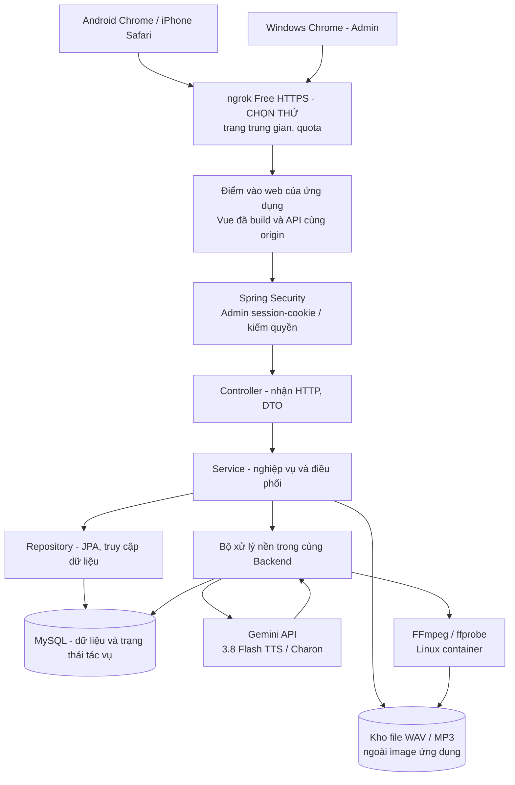
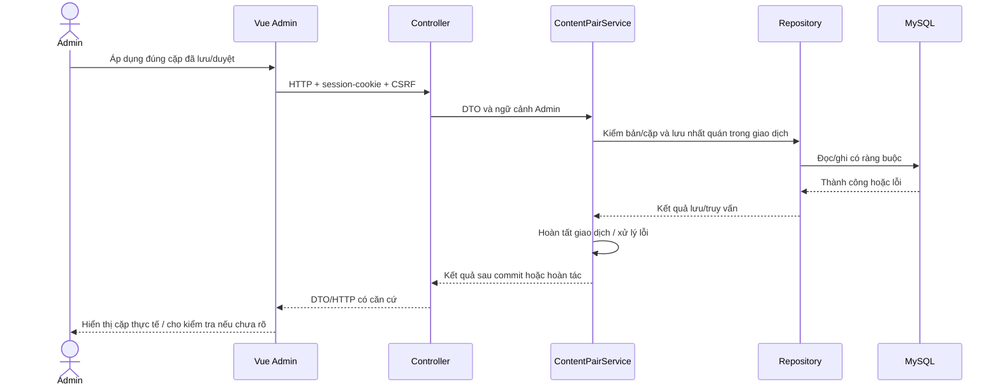
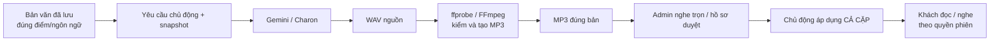
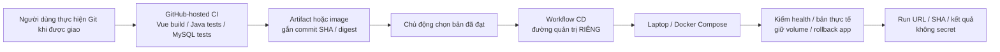

# TDD — Thiết kế kỹ thuật theo từng phần

**Phiên bản nội dung:** 0.7; biên tập 08/11/2026. **Trạng thái:** dự thảo; các hướng đã xác nhận theo [TECH/DATA trong decisions](../02-nghiep-vu/decisions.md) không đồng nghĩa duyệt toàn TDD hoặc đã chạy tương thích.
**Mục đích:** giải thích kiến trúc/module/ba lớp, API-quyền, tab/audio, môi trường và CI/CD; dẫn tới mô hình, DTO, vận hành và kiểm chứng chi tiết.
**Trạng thái triển khai:** sản phẩm và bằng chứng xem [mục 16](#tdd-open); điểm bàn giao/Git có nguồn chính tại [handoff](../01-tong-quan/handoff.md#next-step). Phần thiết kế dưới đây giữ rõ các mục đã chốt và còn dự thảo.
**Đọc cùng:** [PRD](../02-nghiep-vu/PRD.md), [đầu vào](../01-tong-quan/technical-inputs.md), [data-model](data-model.md), [API](api-transactions.md), [operations](operations-design.md), [DFD](dfd.md), [UI](../04-giao-dien/ui-design.md).

**Mục lục:** [1. Đầu vào](#tdd-inputs) · [2. Tổng thể](#tdd-overview) · [3. Module](#tdd-modules) · [4. Ba lớp](#tdd-layers) · [5. API/quyền](#tdd-api-security) · [6. MySQL/tác vụ](#tdd-data-jobs) · [7. Mô hình dữ liệu](#tdd-erd) · [8. Phiên/lượt/xóa](#tdd-visits-data) · [9. Tab](#tdd-tab-session) · [10. Audio trong tab](#tdd-full-audio) · [11. WAV/MP3/file](#tdd-audio) · [12. Backup/restore](#tdd-local-backup) · [13. Môi trường](#tdd-runtime) · [14. CI/CD](#tdd-cicd) · [15. Truy vết](#tdd-trace) · [16. Điểm mở/kiểm chứng](#tdd-open) · [17. Hướng đọc/nhật ký](#tdd-guide)

<a id="tdd-inputs"></a>

## 1. Đầu vào đã chốt và phạm vi thiết kế

- Một repo, frontend Vue 3/JavaScript/CSS, Vite/npm/Node chỉ cho công cụ; Backend một ứng dụng Java 21/Spring Boot/Maven Wrapper chia module nghiệp vụ. MySQL/JPA/Flyway; Spring Security session/cookie, OpenAPI, Spring Boot tests/Testcontainers, Compose và GitHub Actions.
- Bộ phiên bản **đã được chọn làm mốc** theo TECH-03/IN-P01 và bảng ở technical-inputs mục 4. Chưa kiểm khả dụng/resolve/build/tương thích; không tự đổi patch/BOM khi gặp lỗi, phải nêu bằng chứng và ảnh hưởng.
- Bản đồ Leaflet/Geoman Free: mỗi điểm một đa giác kín đơn giản, Admin vẽ/sửa/xem trước/Lưu bản sửa/Áp dụng; chưa duyệt nền/ranh giới. Không GPS/vùng tròn/Haversine.
- Khách Android/Chrome và iPhone/Safari; Admin Windows/Chrome, máy tính/laptop với chuột/bàn phím. Đã có hai loại điện thoại, chưa ghi model/OS/build thật. Không dùng mốc minh họa Chrome 142/iOS 18.6 trước đây thành yêu cầu; không hứa mọi thiết bị.
- Gemini gemini-3.8-flash-tts/Charon; WAV nguồn còn tham chiếu, MP3 phục vụ khách, FFmpeg/ffprobe Linux container. Nghe trọn/duyệt từng bài theo D09; kiểm codec/duration không duyệt thay.
- Chọn **thử ngrok Free**, chấp nhận trang trung gian; chưa URL thật, chưa đăng ký/chạy/kiểm khác mạng. Đường CD riêng nay đã chọn TECH-05: Actions → Tailscale riêng → OpenSSH Windows → PowerShell; ngrok không làm deploy.
- Các quy tắc 8 giờ khách, 30 phút Admin/Q2/Q3, 30 ngày phiên/lượt, 8 giờ file từng áp dụng và DATA-01 giữ đúng từng lớp. Một QR chung, 20 văn bản +20 audio của bộ chuẩn năm điểm; không giới hạn số điểm hệ thống.
- Lượt 2 bổ sung ERD logic/định danh/ràng buộc/vòng đời xóa, tab/audio/full-download và backup. Chưa có schema vật lý/DDL/migrations hoặc kế hoạch test/cấu hình CI/CD. Lượt 3 có hợp đồng API/giao dịch; lượt 4 đã hợp nhất mô hình tại data-model, DTO mục 10 API và state/vòng đời/backup/ma trận kiểm tại operations-design. Các file là phần của một TDD, không nguồn nghiệp vụ khác; chưa JSON schema/OpenAPI thực thi/code.

<a id="tdd-overview"></a>

## 2. Kiến trúc tổng thể — hướng đóng gói đã xác nhận, chi tiết còn dự thảo

Frontend là nơi khách/Admin thao tác. Backend quyết định quyền, phiên, bản nội dung được dùng và dữ liệu. MySQL giữ dữ liệu có cấu trúc; audio ở kho file riêng có bản ghi tham chiếu. Cả hai giao diện dùng cùng một Backend, không tách microservices.

**Bổ sung DFD dự thảo:** [dfd.md 0.3](dfd.md) là vị trí chính duy nhất: ngữ cảnh mức 0, nhóm xử lý/kho mức 1 và mức 2 chọn lọc Bắt đầu/TTS/áp dụng cả cặp. Mũi tên DFD có tên dữ liệu; sơ đồ kiến trúc ngay dưới vẫn biểu diễn cấu trúc/trách nhiệm, không dùng thay DFD. DFD không thay ERD, sequence, state machine hoặc hợp đồng API; duyệt phạm vi bổ sung không duyệt từng sơ đồ/toàn TDD.



Sơ đồ thể hiện trách nhiệm logic, không tạo thêm dịch vụ mạng cho từng ô. Worker thao tác dữ liệu qua Service/Repository tương ứng, không bỏ qua quy tắc do vẽ mũi tên DB. Gemini chỉ được gọi từ Backend, key không vào trình duyệt. Ngrok không là lớp đăng nhập Admin và không lưu MySQL/audio thay laptop.

**Hướng đóng gói đã xác nhận TECH-04:** lúc demo, Vue được build rồi phục vụ cùng ứng dụng Spring Boot qua một cổng HTTP nội bộ; ngrok đưa cổng đó ra HTTPS. Nhờ vậy cookie và API cùng origin, chưa cần chọn thêm reverse proxy. DEV có thể dùng Vite cùng Backend riêng, proxy API để tránh cấu hình chéo không cần thiết. Hướng phục vụ demo đã chốt; chi tiết DEV/asset path/cache/proxy/cổng vẫn dự thảo, chưa cấu hình/kiểm tương thích.

<a id="tdd-modules"></a>

## 3. Frontend/Backend và module nghiệp vụ

Định hướng thư mục frontend/backend đã chốt. Ngày 05/11/2026, người dùng điều chỉnh lựa chọn package Backend sang chia theo lớp trước, các file của từng thực thể/nghiệp vụ đặt trong package lớp tương ứng; thay lựa chọn trước đó chia theo nghiệp vụ rồi theo trách nhiệm. Cấu trúc thực tế và phần dự kiến tại [mục 3.1](#tdd-packages). Bảng dưới mô tả các nhóm trách nhiệm logic của toàn hệ thống, không ánh xạ mỗi nhóm thành một package bao ngoài.

| Module/nhóm | Trách nhiệm | Ranh giới |
| --- | --- | --- |
| Frontend khách | Trang bắt đầu riêng; bản đồ/vùng, nội dung/ngôn ngữ/audio, khôi phục tab và các box/cảnh báo theo UI-K | Không tự xác định nội dung đã duyệt, không dùng tên làm định danh hoặc tự gia hạn. |
| Frontend Admin | Đăng nhập, địa điểm/vùng, soạn/đối chiếu/hồ sơ/cặp, TTS/nghe thử, phiên/thống kê/QR | Q2 giữ phần chưa lưu đúng tab/tài khoản; không tự lưu/áp dụng/gửi lại sau xác thực. |
| Frontend dùng chung | API client, nhãn vi/en/fr/ru, xử lý lỗi/đang xử lý, thành phần giao diện cần dùng lại | Không tự dịch bài hoặc thêm hành vi ngoài UI đã chốt; không lưu key. |
| Backend guest-session | Bắt đầu/kết thúc/kiểm hiệu lực, quyền khách và ghi lượt có chống lặp | Fixed 8 giờ; phiên khác người, lượt xem khác lượt nghe/quét. |
| Backend place-region | CRUD/ẩn-hiện địa điểm, bản sửa vùng và vùng đang áp dụng, gate bật hiện | Mã độc lập tên, vùng/lưu khác áp dụng; xóa do ứng dụng điều phối có kiểm soát. |
| Backend content-pair | Bản văn theo điểm/ngôn ngữ, nháp, tham chiếu hồ sơ và cặp đang phục vụ | Chỉ đổi cả cặp khớp đã duyệt; không tự thẩm định hồ sơ bên ngoài hoặc áp dụng riêng. |
| Backend audio-generation | Tiếp nhận/theo dõi yêu cầu tạo từ bản đã lưu, snapshot, worker và adapter Gemini | T07 cung cấp tạo/theo dõi; T05 giữ quyền quản trị/áp dụng/xóa-dọn. Không vòng phụ thuộc tác vụ. |
| Backend media-storage | Ghi/đọc file, metadata WAV/MP3, kiểm tra/convert và dọn file đúng điều kiện | Không phơi thư mục audio công khai; database xóa không đồng nghĩa file đã dọn. |
| Backend admin-security | Đăng nhập/đăng xuất, mật khẩu băm, session-cookie/CSRF và mốc hoạt động Q3 | Một vai trò cấp trước, không JWT/đăng ký công khai/phân quyền nhiều cấp. |
| Backend reporting-qr | Phiên chỉ đọc/box, hai bảng thống kê và thông tin một QR chung | Mốc ngày Asia/Saigon/dữ liệu còn giữ; không người duy nhất/lượt nghe/quét/xuất báo cáo. |
| Backend maintenance | Xóa phiên/lượt đến hạn, dọn file và hỗ trợ quy trình backup/restore | Chính sách nguồn quyết định hạn/điều kiện; worker/lịch chạy là kỹ thuật, không tự gia hạn. |

Mỗi nhóm trách nhiệm Backend có Controller/Service/Repository theo nhu cầu thực, các lớp được đặt trong package controller/service/repository tương ứng, không ép tạo lớp rỗng nếu không có truy cập dữ liệu. Service có thể dùng Service khác để giữ quy tắc; không Controller nhảy thẳng sang Repository, không frontend gọi MySQL. Adapter Gemini/file là tích hợp ngoài, do Service điều phối, không biến thành Repository nghiệp vụ.

<a id="tdd-packages"></a>

### 3.1. Package chia theo lớp trước — lựa chọn hiện hành

**Căn cứ:** người dùng điều chỉnh lựa chọn ngày 05/11/2026; thay cấu trúc theo nghiệp vụ rồi theo trách nhiệm đã áp dụng ở lượt trước. Package gốc giữ `vn.hueqr.backend`, BackendApplication ở gốc. File của các thực thể/nghiệp vụ nằm trong package lớp tương ứng, không tạo package guestsession/place bao ngoài. Không thay nghiệp vụ, mapping hoặc mô hình dữ liệu.

**Mã nguồn hiện có**, tính từ `backend/src/main/java/vn/hueqr/backend`:

```text
BackendApplication.java
config/
├── AdminSecurityConfiguration.java
├── AdminSecurityErrorHandler.java
├── AdminSessionFilter.java
└── GuestRuntimeConfiguration.java
controller/
├── AdminAuthController.java
├── AdminCommandController.java
├── AdminErrorHandler.java
├── AdminPlaceController.java
├── GuestSessionController.java
└── GuestSessionErrorHandler.java
dto/
├── AdminActivityRequest.java
├── AdminCommandWindowResponse.java
├── AdminCsrfResponse.java
├── AdminErrorResponse.java
├── AdminLoginRequest.java
├── AdminOperationLookupResponse.java
├── AdminOperationResponse.java
├── AdminPlaceResponse.java
├── AdminSessionResponse.java
├── CreatePlaceRequest.java
├── GuestErrorResponse.java
├── SessionResponse.java
├── StartRequest.java
├── StartTicketResponse.java
└── UpdatePlaceRequest.java
entity/
├── AdminAccount.java
├── AdminCommandWindow.java
├── GuestSession.java
├── OperationReceipt.java
├── Place.java
└── RegionRevision.java
repository/
├── AdminAccountRepository.java
├── AdminCommandWindowRepository.java
├── GuestSessionRepository.java
├── OperationReceiptRepository.java
├── PlaceRepository.java
└── RegionRevisionRepository.java
service/
├── AdminAccountDetailsService.java
├── AdminAuthService.java
├── AdminCommandException.java
├── AdminCommandService.java
├── AdminPlaceService.java
├── AdminSessionException.java
├── AdminSessionService.java
├── DisplayNamePolicy.java
├── GuestInputPolicy.java
├── GuestSessionException.java
├── GuestSessionService.java
├── StartTicketCodec.java
├── StartTicketService.java
├── StartTicketSigner.java
└── StartTicketTimePolicy.java
```

**Kiểm thử hiện có**, tính từ `backend/src/test/java/vn/hueqr/backend`:

```text
BackendApplicationTests.java
TestBackendApplication.java
config/
└── GuestRuntimeConfigurationTests.java
controller/
├── AdminAuthApiTests.java
├── AdminAuthHttpTests.java
├── AdminCommandApiTests.java
├── AdminPlaceApiTests.java
├── GuestSessionApiTests.java
└── GuestSessionEndApiTests.java
support/
├── GuestSessionTestClock.java
└── TestcontainersConfiguration.java
repository/
├── GuestSessionRepositoryTests.java
└── PlaceRegionRepositoryTests.java
schema/
├── AdminCommandSchemaTests.java
├── GuestSessionSchemaTests.java
└── PlaceRegionSchemaTests.java
service/
├── AdminCommandTransactionTests.java
├── GuestInputPolicyTests.java
├── GuestSessionEndTests.java
├── StartTicketCodecTests.java
├── StartTicketSignerTests.java
└── StartTicketTimePolicyTests.java
```

`entity` ánh xạ bảng; `repository` truy cập dữ liệu. Test repository kiểm ánh xạ/đọc lại qua JPA, test schema kiểm ràng buộc bằng JDBC. `support` chứa cấu hình test dùng chung: TestcontainersConfiguration là **public** để các test ở package con và TestBackendApplication import được; phương thức `@Bean` giữ nguyên phạm vi vì không được gọi trực tiếp từ các package đó. BackendApplication và annotation khởi động giữ nguyên; chưa thêm cấu hình scan riêng.

**Hiện có trong service.** Nhóm StartTicket/GuestSession giữ vé/binding/lookup/expiry/replay/K04 và tách giao dịch UNIQUE như các mốc thực hành. AdminAccountDetailsService đọc tài khoản qua Repository, AdminAuthService điều phối xác thực/session/CSRF, AdminSessionService giữ Q3 và mốc server. AdminCommandService điều phối window/receipt trong giao dịch mới. AdminPlaceService đọc thông tin cơ bản, tạo điểm ẩn và sửa tên theo Q1/If-Match qua giao dịch receipt; sửa tên khóa WINDOW → PLACE rồi kiểm version. DisplayNamePolicy dùng chung cho tên khách và tên điểm với hai giới hạn riêng. [Hợp đồng phần địa điểm](api-transactions.md#admin-place-implementation)

**Các package đã có:** `controller/` nhận HTTP/gọi Service; `dto/` chứa hợp đồng JSON; `config/` nhận Clock, khóa ký và epoch từ cấu hình ngoài repo, không tự sinh mỗi boot. `support/` chỉ là hỗ trợ test với fixture key/epoch và clock, không cấu hình triển khai. AdminPlaceController/AdminPlaceService có tạo điểm ẩn, đọc dữ liệu cơ bản và sửa tên. Tổng hợp điều kiện bật hiện, bật hiện/xóa, vùng/cặp và các nhóm dữ liệu/nội dung khác chỉ bổ sung khi tới việc tương ứng; cùng nằm trong controller/service theo lớp, không package place bao ngoài hoặc lớp rỗng. Test Service/Controller theo service/controller; test nhiều thực thể nhóm theo mục đích kiểm thử.

Luồng trách nhiệm vẫn **Controller → Service → Repository**; Entity và DTO là thành phần hỗ trợ, không phải lớp thứ tư/thứ năm của luồng này. Cây package giúp tìm file, không tự chứng minh đã cài đủ ba lớp.

**Kiểm chứng:** bộ 7 sau sắp xếp giữ tại [mục A.10](practice-01-start-session.md#practice-mapping-test-result); về sau các ca đó vẫn đạt trong [64 test clean test](practice-01-start-session.md#practice-start-api-result) trong lần hồi quy đã ghi nhận. Test support public dùng được qua package; DynamicPropertyRegistrar chỉ cấp fixture cho context import nó. V1/mapping/test nền giữ nguyên. Chưa kiểm lại HTTP test-run/đóng gói JAR hoặc áp dụng cấu hình runtime thật. Lệnh hồi quy khi có thay đổi là `.\mvnw.cmd clean test` tại backend, không yêu cầu chạy lại chỉ để lặp bằng chứng.

<a id="tdd-layers"></a>

## 4. Controller → Service → Repository

| Lớp | Làm gì / vì sao | Không đặt ở đây |
| --- | --- | --- |
| Controller | Nhận request, kiểm hình thức DTO, lấy ngữ cảnh xác thực, gọi Service, trả DTO/HTTP. Điểm vào gọn để client hiểu kết quả. | Không giữ luật áp dụng cặp, gọi Gemini dài, điều phối xóa hoặc viết truy vấn. |
| Service | Kiểm quyền/hiệu lực theo ngữ cảnh, luật nghiệp vụ, chọn ranh giới giao dịch và phối hợp các module/file/job. Đây là nơi quyết định thao tác có được thực hiện. | Không phụ thuộc component Vue, không giả vờ giao dịch DB bao trùm file/API ngoài. |
| Repository | Lưu/truy vấn/khóa dữ liệu qua JPA theo yêu cầu Service, dựa trên schema/ràng buộc. | Không điều khiển UI, tự áp dụng nội dung hoặc đổi chính sách lưu. |

### Ví dụ xuyên ba lớp — Admin bấm “Áp dụng văn bản và audio”

1. Vue hiển thị đúng điểm/mã/ngôn ngữ, cặp hiện hành và cặp sắp thay. Admin chủ động bấm; chặn gửi lặp trong lúc xử lý.
2. Spring Security xác thực phiên Admin/quyền/CSRF. Controller nhận định danh các phiên bản đã lưu và chuyển yêu cầu cho Service; không nhận một đoạn văn chưa lưu rồi âm thầm lưu.
3. Service kiểm lại phiên bản còn tồn tại, text/audio cùng bản và ngôn ngữ, tham chiếu hồ sơ đủ để Admin đối chiếu, trạng thái được duyệt theo quy trình, file sẵn sàng. Không tự đọc hiểu tài liệu rồi nhận là đã duyệt.
4. Trong giao dịch DB, Repository đọc/kiểm cạnh tranh và lưu liên kết cặp áp dụng nhất quán. Chi tiết khóa/version/idempotency để lượt dữ liệu/API, không khẳng định đã có code.
5. Commit thành công mới trả kết quả. Lỗi xác định giữ cặp cũ; mất phản hồi thì client kiểm cặp thực tế trước thử lại, không tự kết luận thất bại hoặc áp dụng lần nữa.
6. Khách nhận cặp mới lần tải/chọn tiếp; không đẩy tức thì/ngắt bài đã tải, không tự bật hiện điểm. Nếu audio thực tế lỗi sau áp dụng, giữ văn bản đọc được và D03 đúng quyền.



Repository không tự có quyền “duyệt”. Việc người dùng duyệt ở hồ sơ, Admin đối chiếu/ghi tham chiếu, Service thực thi điều kiện là ba việc khác nhau. Ví dụ này là thiết kế dự thảo dựa FR-A07/UC-A05/AC-A14–A15/UI-04, không chứng minh chức năng đã chạy.

<a id="tdd-api-security"></a>

## 5. Giao tiếp API và ranh giới xác thực

**Thiết kế dự thảo hiện hành:** HTTP JSON/byte media đúng Content-Type, cùng HTTPS origin demo, DTO thay entity. Hợp đồng canonical tại [API/giao dịch 0.4](api-transactions.md): /api/v1/guest/…, /api/v1/admin/…, /api/v1/auth/…, quyền/precondition/key/ACK/grant/TX và lỗi. Path minh họa cũ không còn là hợp đồng thứ hai; chưa có endpoint đã triển khai.

| Ngữ cảnh | Ai được làm | Kiểm tra bắt buộc từ nghiệp vụ |
| --- | --- | --- |
| Truy cập trang bắt đầu | Khách chưa đăng nhập Admin; mở QR/URL, đi qua trang ngrok nếu xuất hiện | Chưa tạo phiên chỉ vì mở trang/QR. Không thu quyền vị trí. |
| Phiên khách | Định danh/credential riêng theo tab đề xuất ở client, Backend tra phiên; không tên, không lấy HttpSession Admin làm phiên khách | Tạo thành công mới có phiên; 8 giờ cố định và quyền theo P01; payload sửa giờ không có quyền gia hạn. Cookie dùng chung trình duyệt không đủ phân biệt tab, cần thiết kế riêng phần tab/nhân bản ở lượt sau. Không tự chọn JWT. |
| Quản trị | Spring Security với tài khoản cấp trước, password hash, cookie session và CSRF | Mọi API Admin kiểm quyền phía server; chặn chỉ ở menu chưa đủ. Frontend khách không có quyền gọi CRUD/hồ sơ/job/thống kê. |
| Media | Service kiểm đúng bản/cặp và ngữ cảnh phục vụ; WAV/nháp chỉ Admin có quyền | Không dùng URL file đoán được để vượt duyệt/phiên. Cách Range/tải đệm/grant cho nghe tiếp P01 chưa chốt. |
| Tác vụ nền | Backend xử lý job đã tiếp nhận độc lập phiên Admin | Không cần trình duyệt giữ mở hoặc giả hoạt động Admin; không tự áp dụng kết quả. |

Session-cookie Admin là lựa chọn đã chốt, CSRF là biện pháp thiết kế cần giữ khi dùng cookie; không tắt CSRF để nối Vue cho nhanh. Cookie bảo vệ theo HTTPS/HttpOnly/SameSite, cách làm cụ thể/proxy headers được kiểm khi có môi trường. [Spring Security session](https://docs.spring.io/spring-security/reference/servlet/authentication/session-management.html), [CSRF cho ứng dụng Servlet](https://docs.spring.io/spring-security/reference/servlet/exploits/csrf.html).

**Q3 không được thay bằng mặc định “mỗi HTTP request gia hạn”:** polling trạng thái TTS/giữ tạm hoặc audio tự chạy không là hoạt động. Backend cần mốc hoạt động chủ động được ghi nhận khi còn hiệu lực, so sánh 30 phút trước nhận hoạt động mới; không hồi sinh phiên đã hết. Cơ chế ánh xạ/tần suất gửi hoạt động/mất mạng để thiết kế tiếp. Q2 giữ ba công việc và tham chiếu đang nhập theo đúng tab/tài khoản, không lộ khi đổi tài khoản hoặc ghi đè im lặng dữ liệu đã thay.

Guest/Admin có thông báo/cách phục hồi khác nhau theo nguồn; Admin hết hạn dừng preview/che nội dung, khách chỉ được nghe tiếp đúng bài đang phát ở mốc hết hạn. Không suy ra quyền Admin từ khách hoặc ngược lại.

<a id="tdd-data-jobs"></a>

## 6. Vai trò MySQL, giao dịch và tác vụ TTS

MySQL là nguồn dữ liệu nghiệp vụ và trạng thái bền cho địa điểm/mã, vùng nháp-hiện hành, bản văn/ngôn ngữ/hồ sơ/cặp, metadata file, yêu cầu tạo, phiên/lượt và nhận biết điểm đã xóa. ERD/trường logic tại mục 7–8. V1–V9 đã có migration/mapping cho phiên, địa điểm/vùng, tài khoản/window/receipt, văn bản, job, file, lượt và audio/cặp; script riêng khởi tạo năm điểm ẩn/20 ngăn trống đã được kiểm. Opening/grant/claims và các bảng vận hành còn tiếp tục theo phụ thuộc; schema không thay quyền áp dụng hoặc nội dung được duyệt. Dữ liệu lớn WAV/MP3 để kho file. [Phạm vi dữ liệu mới nhất và giới hạn](data-model.md#model-audio-pair-result)

- Flyway quản lý thay đổi schema khi triển khai được giao; JPA không tự đổi schema trái migrations. MySQL/Flyway/Testcontainers đúng bộ phiên bản phải kiểm thật trước dùng.
- Áp dụng cả cặp là một thay đổi DB nhất quán. Xóa điểm do ứng dụng xử lý dữ liệu riêng trước trong cùng giao dịch; FK chặn xóa trực tiếp khi còn tham chiếu ở quan hệ đã yêu cầu, không ON DELETE CASCADE ở đó. Giữ lịch sử A02.2 và hồ sơ tài liệu ngoài hệ thống.
- File/API Gemini không thuộc giao dịch DB. Sau commit mới dọn file đúng điều kiện; dọn lỗi có chờ/thử lại, không báo xóa hết file.
- Đề xuất job bền trong MySQL, worker ở cùng Backend. Service nhận yêu cầu → ghi job/snapshot đúng bản/ngôn ngữ/model/voice → sau commit mới worker gọi Gemini. Không giữ giao dịch chờ TTS. Không cần Redis/Kafka hoặc dịch vụ worker riêng.
- “Đã tiếp nhận” khác “đã tạo xong”. Đóng trang/hết phiên Admin không hủy job đã nhận. Timeout/chưa rõ kết quả phải kiểm job cũ, không gửi lại mù; 429 không tự chứng minh hết tiền. Retry là chủ động theo A04.2; chi tiết phục hồi job sau restart và reconcile provider chưa thiết kế, không hứa exactly-once tới API ngoài.
- Văn bản đổi không tự nhận audio của bản trước. Kết quả về sau xóa điểm chỉ chuyển vòng đời file an toàn, không tái tạo điểm. Tạo thành công chưa duyệt/áp dụng.

<a id="tdd-erd"></a>

## 7. Mô hình dữ liệu hiện hành — một vị trí chính

**Dùng [data-model 0.3](data-model.md) cho TDD hiện hành/API 0.4.** ERD nội dung ở model 2; phiên/opening/grant/view ở model 3; window/receipt/job/file ở model 4; khóa/index/xóa ở model 5. Không ghép ERD TDD 0.2 với bảng bổ sung API 0.1.

Mô hình giữ id độc lập tên, SLOT×4 tiếng, TEXT/AUDIO/PAIR đúng bản, vùng draft khác active, hồ sơ tham chiếu không tự duyệt; chỉ áp dụng cả cặp/gate vi. Bổ sung kỹ thuật:

- **Opening:** ngữ cảnh lần mở, giữ sau ACK cho P06/reload/đổi tiếng; chủ động quay map/đổi điểm mới kết thúc lần mở.
- **Grant:** snapshot đúng văn bản/MP3, owner session và deadline không vượt hạn phiên; không FK bắt giữ bản văn/điểm đã xóa.
- **Receipt/window:** kết quả commit của đúng lệnh Admin, có cửa sổ nhận key; dọn kết quả không làm key cũ được thực hiện lại.
- **LIFE-P01/DATA-05:** vé ký 24 giờ gắn requestId/quyền tab/epoch, ledger trong session + UNIQUE/TX chống lặp. Có ledger trả gốc sau kiểm đầy đủ kể cả vé hết hạn; không ledger chỉ insert vé còn hạn. Không start_generation/purge gate/context hoặc đồng hồ khách.

UUID/kiểu thời gian/UK-FK/index đề xuất cụ thể ở mô hình; chưa DDL/MySQL/Flyway thực thi. [Mô hình TDD 0.3 nguyên văn](../99-luu-tru/data-model-history.md) đã chuyển sang lịch sử, không bản hiện hành thứ hai.

<a id="tdd-visits-data"></a>

## 8. Phiên/lượt xem, trạng thái và xóa — mô hình/API hiện hành

[Model 3](data-model.md#model-guest) mô tả session→opening→grant và PLACE_VIEW độc lập vòng đời kỹ thuật; [model 5](data-model.md#model-constraints) là thứ tự FK/transaction/delete. API-K01–K11/TX-K*, A11/TX-A05 và [DTO mục 9](api-transactions.md#api-dto) dùng đúng mô hình này.

Ví dụ: mở Ngọ Môn O1/text thành công → V1; đổi tiếng/reload/bấm lại O1 không thêm; chọn Thái Hòa rồi Ngọ Môn → O2/O3/V2/V3. Quay về bản đồ thật sự đóng opening, khác map còn nhìn thấy/kéo/phóng/ngoài vùng/hủy box. Hai tab bắt đầu cùng tên vẫn hai phiên.

Xóa điểm giữ V1/snapshot id/tên/tiếng, đặt live FK NULL; điểm mới trùng tên id khác, không gộp. G1 đã cấp ghim đúng A1 cho đọc/ACK trong hạn, không tạo quyền chọn mới hoặc phục hồi PLACE/TEXT. Xóa DB một transaction, dọn bytes sau commit và đủ điều kiện. Hồ sơ tài liệu bên ngoài không xóa.

State job QUEUED→DISPATCHING→RESULT_STAGED→CONVERTING→SUCCEEDED và nhánh FAILED/UNCERTAIN/DISCARDED ở [operations 2](operations-design.md#ops-jobs); không auto retry provider sau unknown. LIFE-P02 chốt window 24 giờ từ cấp, LIFE-P03 chốt bảy ngày job cũ terminal đủ điều kiện; không TTL văn bản/audio/unknown. LIFE-P01 nay chốt vé ký 24 giờ theo DATA-05, độc lập window Admin/8 giờ guest/D08; crypto/TX cần kiểm thực, không generation.

<a id="tdd-tab-session"></a>

## 9. Gắn phiên với tab và kiểm quyền — giải pháp dự thảo theo TECH-04

### 9.1. Danh tính và dữ liệu giữ ở đâu

**Thiết kế theo DATA-05:** client chuẩn bị credential ngẫu nhiên mật mã riêng cho tab; API-K11 cấp vé có chữ ký/requestId ở nền. Client giữ đúng vé/requestId/credential và pending payload trong sessionStorage, không tự sinh key khác thay requestId đã ký; server cấp session_id sau Bắt đầu hợp lệ thành công, chỉ lưu **hash credential**, không lấy tên/ID client làm quyền. Credential là bằng chứng sở hữu phiên, không là tài khoản/người duy nhất; không nhét vào URL, log, QR, localStorage chung hoặc cookie Admin. Mọi tác vụ phiên kiểm cặp session_id+credential bằng hash và thời gian/quyền server. Đoán/đổi session_id mà không credential không truy cập/kết thúc được phiên khác.

Việc tạo credential kỹ thuật ở client không tạo bản ghi GUEST_SESSION; mở trang/reload chỉ kiểm/khôi phục, không tự Bắt đầu. Cùng pending request/credential và fingerprint gửi lại khi kiểm kết quả bắt đầu chưa rõ trả cùng một phiên; không tạo thêm bằng cách phát token mới mù. Hai tab bấm bắt đầu riêng tạo hai credential/request key và hai ID. Hợp đồng start/resume/key/quyền tại [API 2–3](api-transactions.md#api-guest); cách sinh/độ dài/mapping hash và owner vẫn cần kiểm, không ghi token mẫu thật.

[sessionStorage](https://developer.mozilla.org/en-US/docs/Web/API/Window/sessionStorage) sống qua reload nhưng có thể được copy từ opener. Vì vậy sessionStorage một mình hoặc cookie chung **không đủ**. Đề xuất thêm quyền sở hữu document bằng [Web Locks](https://developer.mozilla.org/en-US/docs/Web/API/Web_Locks_API) trong HTTPS, tên lock theo id kỹ thuật không chứa credential; BroadcastChannel nếu dùng chỉ trao đổi owner nonce/trạng thái, không chia sẻ token/nội dung/ngôn ngữ. Đây là phối hợp nội bộ tránh dùng nhầm phiên, không tính năng đồng bộ nghiệp vụ giữa tab.

### 9.2. Tải lại, nhân bản và các giới hạn cần kiểm

| Tình huống | Xử lý đề xuất | Điều phải giữ |
| --- | --- | --- |
| Mở QR/tab mới không có phiên | UI-K01; chưa có session row, chưa dữ liệu audio. | Chỉ tạo sau Bắt đầu thành công. |
| Reload cùng tab còn hiệu lực | Document cũ nhả lock, document mới giữ cùng credential/memento; xác thực server rồi khôi phục điểm/tiếng/mốc nghe cùng audio revision. | Audio tạm dừng, không tự phát/không lượt mới; Blob URL cũ không khôi phục. Có thể tải lại đúng bài còn được phép rồi đặt mốc, bài đổi thì đầu bài/thông báo P03. |
| Nhân bản tab khi phiên gốc còn document sở hữu | Bản copy không chiếm được lock; bỏ credential/pending request/memento sao chép ở tab mới, về UI-K01 cho bắt đầu riêng. Không gửi Kết thúc hoặc đổi trạng thái phiên gốc. | UI-K01 tên trống/mặc định vi là cách trình bày đề xuất; không tự sinh phiên. |
| Reload đang chuyển document/owner chưa rõ | Hiện kiểm tra phiên, chờ document cũ giải phóng và đối chiếu owner; không coi timeout BroadcastChannel là bằng chứng không còn tab gốc. | Không vội xóa phiên hợp lệ, không cướp lock/rotate credential làm tab khác mất phiên. Thời gian chờ/UX và fallback phải kiểm trên matrix thật. |
| Hai tab đã bắt đầu riêng | Mỗi tab key/id/memento/audio instance riêng; mutate chỉ gửi credential của chính nó. | Đổi tiếng/kết thúc A không đổi B. Không dùng sự kiện storage để đồng bộ lựa chọn/đăng xuất khách toàn browser. |
| Reload hoặc quay lại sau hết hạn | Server xác nhận expired, UI hết hạn/form theo P02; chỉ giữ tên/ngôn ngữ hợp lệ để xác nhận mới. | Không tải lại A1 hoặc phục hồi ngoại lệ nghe tiếp; đóng tab rồi mở mới cũng không có quyền đó. |
| Quay lại sau chủ động kết thúc | Dữ liệu phiên/memento/prefill đã xóa theo P02/UI-P04; server từ chối token đã kết thúc. | Không resurrect bằng URL/BFCache, không tìm bằng tên. |
| Browser phục hồi tab/thiếu API lock hoặc không xác định được owner | Kiểm capability/owner trước gắn phiên; không tự coi cùng ID trong storage là đủ quyền. | Đây là cổng kỹ thuật cần giải quyết/kiểm, không được âm thầm bỏ độc lập tab hoặc đổi P03; báo giới hạn/đề xuất bổ sung nếu cơ chế không đạt. |

Web Locks không xác thực thay server, không ngăn một client đã bị lộ credential hành động như chủ phiên. Không hứa nhận biết chắc thao tác Duplicate/Restore trên mọi trình duyệt; phải kiểm opener/duplicate/BFCache/reload/background trên Android/Chrome và iPhone/Safari. Nhánh khó phân biệt document cũ vừa đóng với snapshot được phục hồi được giữ là câu kỹ thuật chưa khép, không mở lại yêu cầu tab độc lập.

<a id="tdd-full-audio"></a>

## 10. Audio tải trọn trong tab, hết hạn và vòng đời bộ nhớ

### 10.1. Trình tự đề xuất

1. Chọn vùng còn quyền: dừng audio cũ đúng D07/P06, tăng selection generation; hiển thị văn bản đúng bản/tiếng và trạng thái đang tải audio. Văn bản thành công có thể tính lượt, không chờ audio.
2. Backend kiểm credential/phiên/cặp được phép, trả MP3 đúng revision và metadata nhận biết (id/checksum/size nếu có), không WAV nháp. File còn trên server không là quyền truy cập tự do.
3. Client đọc toàn bộ response thành Blob; kiểm HTTP/không rỗng/đúng định dạng và bản. [Response.blob](https://developer.mozilla.org/en-US/docs/Web/API/Response/blob) đọc stream tới hoàn tất, không chỉ gán audio.src tới URL mạng hoặc thấy canplay rồi khẳng định đủ bytes.
4. Trước gắn/phát, kiểm generation, điểm/tiếng/audio revision, document vẫn đúng phiên và quyền còn hiệu lực. Response cũ/đến muộn bỏ và giải phóng; abort chỉ là hỗ trợ, không thay kiểm generation.
5. Tạo object URL cho Blob; phát từ đầu do chọn vùng, hoặc giữ tạm dừng/mốc cho reload P03/đổi tiếng theo quy tắc. play() bị browser từ chối thì phản hồi theo D03-BS, không báo đang phát giả.
6. Lưu mốc nghe/ID bản trong memento phiên, **không lưu Blob/object URL làm kho audio lâu dài**; không Cache API/Service Worker/IndexedDB audio offline.

Đổi ngôn ngữ: dừng bài cũ/reset vị trí, tải bài mới cùng điểm đúng tiếng nhưng **không tự phát**. Nếu nội dung thiếu hoặc lỗi, văn bản/trạng thái phải ghi rõ đúng ngôn ngữ, không gắn nhãn mới lên bài cũ. Bấm lại cùng vùng theo P06 không tạo tải lặp; đang pause tiếp tục mốc, đã hết nghe lại đầu trong phiên còn quyền. Kéo/phóng bản đồ không kích hoạt tải/phát.

### 10.2. Mốc hết hạn và dữ liệu A1/A2

Tại expires_at server gốc, map mờ/khóa/box hết hạn, ngôn ngữ khóa và giữ box văn bản cuộn đọc. Tab chỉ latch quyền continueCurrent khi **cùng MP3 đã tải trọn, đúng bài đang phát tại mốc**, chưa ended; trạng thái đang tải/chưa phát/đã pause trước mốc không đủ. Giữ đúng blob đó cho pause/resume; không tua/nghe lại/bài mới, không tải thêm file cũ từ server sau expiry.

Nếu pause trước 8 giờ rồi qua hạn mới bấm vùng/Phát thì không được nghe tiếp. Nếu đang tải đúng lúc hết hạn, hủy/loại kết quả và không phát dù bytes tới sau. Nếu bài đã kết thúc, không Nghe lại. Play/pause sau expiry chỉ trên audio instance có latch đã có, không suy từ việc đang còn Blob hoặc UI nút Phát.

**A1 → phiên mới → A2:** nút Bắt đầu phiên mới dừng A1/nhả URL/Blob/các pending request, về form với tên/tiếng còn hợp lệ theo nhánh hết hạn; chưa tạo phiên. Sau Bắt đầu thành công mới về bản đồ, chọn vùng lấy cặp hiện hành A2. Không tự phát A2 do mở form/reload, không phục hồi lượt cũ. Dữ liệu trong tab A không bị thao tác phiên tab B giải phóng.

Server giữ D08/8 giờ và lịch dọn file như đã chốt. Khi A1 đã tải đủ, server xóa file cũ sau đủ điều kiện không làm tab phải fetch A1 nữa; vẫn không bảo đảm browser/OS không giải phóng tab hoặc bộ nhớ. Reload/đóng tab làm mất document/blob/latch, **không khôi phục nghe tiếp sau hết hạn**.

### 10.3. Bảng giữ/giải phóng

| Sự kiện | Audio/Blob/object URL | Quyền phát |
| --- | --- | --- |
| Pause/tua/kết thúc bài trong phiên còn hiệu lực | Giữ dữ liệu bài hiện tại để resume/tua/nghe lại theo UI; không revoke ngay chỉ vì loaded/ended. | Theo P06/UI-P02/UI-P03. |
| Chọn vùng khác/đổi ngôn ngữ | Dừng và detach audio cũ, hủy generation/request cũ; nhả object URL và reference khi bài cũ không còn dùng hợp lệ. Tải một bài mới. | Vùng mới yêu cầu phát, đổi tiếng không tự phát. |
| Response cũ đến muộn | Không gắn src/không play; bỏ bytes/object URL đã tạo nếu có. | Không đổi lựa chọn mới, không audio chồng. |
| Hết hạn có latch hợp lệ | Giữ đúng bài A1 tới cuối hoặc khách rời phần nghe; pause/resume giữ reference. | Không seek/replay/new track. |
| Hết hạn không latch hoặc A1 nghe hết | Dừng/khóa và nhả phần audio không còn được dùng, giữ văn bản/prefill hợp lệ. | Không phát hoặc tự cấp lại latch. |
| Kết thúc chủ động/đi form mới | Dừng, detach, hủy pending, nhả dữ liệu cũ và memento theo nhánh. | Chỉ phiên mới thành công rồi chọn vùng mới có yêu cầu phát. |
| Page unload/browser discard | Không hứa chạy cleanup hook; browser có vòng đời riêng. Không persist blob/latch để phục hồi. | Sau reload hết hạn không nghe lại A1. |

[Blob URL memory](https://developer.mozilla.org/en-US/docs/Web/URI/Reference/Schemes/blob) cho biết URL giữ tài nguyên tới khi nhả; không gọi revokeObjectURL quá sớm khi UI vẫn cho thao tác hợp lệ. Phải bỏ cả source và references khi nhả, không chỉ đổi nhãn UI.

**Đánh đổi:** chờ tải hết làm bắt đầu nghe chậm hơn streaming; cần dữ liệu mạng cho cả bài dù nghe ít; một MP3/đôi lúc bytes tải đang chuyển làm tăng bộ nhớ. Không đặt ngưỡng MB/giây chưa chốt; đề xuất chỉ giữ bài hiện tại + request mới cần thiết, không prefetch đủ 20 bài. Không hứa RAM luôn ở một mức hoặc browser luôn giữ tab nền.

### 10.4. Cách kiểm chứng sau này — chưa chạy, chưa toàn bộ kế hoạch test

| Tình huống cần kiểm trên ENV-KA/ENV-KI với model/OS/build thật | Quan sát cần có |
| --- | --- |
| Tải trọn A1/phát trong phiên, sau đó không còn file A1 trên server khi dọn hợp lệ | Audio đang nghe tiếp/pause-resume không có request MP3 A1 mới; không dùng thí nghiệm xóa sớm trái 8 giờ. Dùng đồng hồ/dữ liệu test khi được giao. |
| Đang phát / pause trước hạn / đang tải / response về sau expiry | Chỉ nhánh đang phát đúng mốc được latch; box/map/tiếng/quyền khác khóa; văn bản vẫn đọc-cuộn. |
| Đổi vùng/tiếng liên tục, tải lỗi, bấm lại vùng | Đúng bản mới nhất, một audio, không tải/phát lặp hoặc phát lại bài cũ; đổi tiếng không tự phát, D03 đúng lỗi. |
| Reload trước hạn và sau hạn; đóng/mở lại | Trước hạn P03 tạm dừng/không lượt; sau hạn không phục hồi blob/quyền cũ. |
| Tab nền/khóa màn hình/OS pause/browser discard/pageshow BFCache | Ghi trạng thái và thời điểm play/pause/ended theo đồng hồ phiên; không suy một timer chạy muộn là đúng lúc expiry. Document mới không grant; không tự resume sau browser reload. |
| Pause/tua/replay hợp lệ trước hạn, nhiều lần đổi điểm rồi rời form | Không revoke sớm; kiểm nhả URL/reference sau không còn dùng, không coi số đo bộ nhớ giả là pass. |

Ở tab bị freeze, muốn xác định “đang phát tại mốc” cần theo dõi chuyển trạng thái media trong bộ nhớ và tương quan expires_at server/đồng hồ đơn điệu; không dùng lịch sử thao tác audio bền trong DB. Nếu browser không cung cấp đủ chứng cứ thời điểm thì báo giới hạn và tiếp tục thiết kế/kiểm, **chưa được coi đã đáp ứng TECH-04**. Không đổi nghiệp vụ thành “đang phát lúc quay lại tab” hoặc tự thêm quyền nghe nền.

<a id="tdd-audio"></a>

## 11. WAV/MP3, lưu trữ và chính sách



Đã chốt giữ WAV còn tham chiếu và MP3 phục vụ khách trong Linux container; vị trí thư mục/volume, bitrate, mẫu tên, codec flags, ngưỡng dung lượng/thời gian chờ và cơ chế phục vụ chi tiết chưa chốt; hướng khách tải trọn MP3 vào tab trước phát đã được TECH-04 xác nhận. Đề xuất kho audio riêng ngoài image, metadata trỏ bản file; đọc qua API có kiểm quyền, không expose toàn bộ thư mục WAV/nháp.

Kiểm file không rỗng/đúng codec/duration giúp bắt lỗi kỹ thuật; không chứng minh đọc đúng tên di tích, không cắt câu hoặc bản dịch chính xác. D09 vẫn yêu cầu nghe trọn/duyệt từng bản, đủ 20+20 trước nghiệm thu; lỗi tạo không làm hỏng cặp cũ, lỗi audio của cặp đang áp dụng vẫn cho đọc D03.

| Lớp dữ liệu | Chính sách nguồn hiện hành | Thiết kế tiếp, không tự đặt thêm |
| --- | --- | --- |
| File từng áp dụng | Sau DB thành công, không tham chiếu **và** không dùng chung, đủ bảo vệ 8 giờ từ ngừng áp dụng cuối cùng | Kiểm lại trước xóa; TECH-04 tải trọn cho tab nghe tiếp, không dựa Range sau expiry. Không tăng 8 giờ hoặc cấp lại quyền sau reload. |
| WAV/MP3 hoàn chỉnh chưa áp dụng | DATA-01: chờ 24 giờ từ khi xác nhận không tham chiếu, không dùng chung, không tác vụ dùng; bản nháp còn tham chiếu phải giữ | Đánh dấu đủ điều kiện và kiểm lại; có tham chiếu/tác vụ mới thì chưa được xóa theo mốc cũ. |
| Workspace/tạm | DATA-01: sau 1 giờ khi tác vụ đã kết thúc, không worker dùng, đủ an toàn | Không coi job đang chạy/chưa rõ kết quả là rác; mốc chính xác/lịch dọn/thử lại ở lượt job. |
| Phiên/lượt | D08 30 ngày từ kết thúc/hết hạn gốc; lịch sử điểm xóa vẫn theo hạn | Không từ lúc audio phát hết; kiểm xóa thực tế, không chỉ hàng chờ. |
| Log kỹ thuật | DATA-01 giữ 7 ngày, không secret hoặc thông tin khách/nội dung nhạy cảm | Kiểm fields/redaction/quyền/từng lớp ngrok/provider/container, lịch/xoay dung lượng; không mặc định app xóa log của bên thứ ba. |
| Backup | Mỗi bản 7 ngày từ tạo; chấp nhận bản sao có thể còn gần 37 ngày từ kết thúc/hết hạn gốc | Bảo vệ/dọn đúng hạn; restore riêng, lọc phiên/lượt quá hạn theo thời gian gốc **trước phục vụ**. DATA-02 cho lưu cục bộ tách dữ liệu chạy, không mục tiêu cứu hỏng toàn laptop; DATA-03 chốt DB + WAV/MP3 còn tham chiếu + manifest, cuối ngày có thay đổi/trước deploy-schema; công cụ/quyền/path/checkpoint nhất quán/RPO-RTO còn thiết kế/kiểm. |

**Hướng giải quyết đã chọn TECH-04:** tải trọn A1 rồi dùng dữ liệu tạm trong tab, nên máy chủ dọn file đủ điều kiện không làm tab phải tải tiếp A1. Cơ chế Blob/vòng đời/late response/expiry ở [mục 14](#tdd-full-audio) mới đề xuất cần kiểm trên hai nền tảng; không đổi 8 giờ, thêm offline hoặc khôi phục sau reload.

<a id="tdd-local-backup"></a>

## 12. Backup cục bộ — BKP-P02 stop phục vụ và REC-P01 đã chốt

DATA-01–04 giữ DB + WAV/MP3 đang tham chiếu + manifest, cuối ngày có thay đổi/trước deploy-schema, cục bộ tách live, mỗi bản bảy ngày. **Ngày 04/11 người dùng chọn tạm ngừng phục vụ ngoài demo**, không đặt thời lượng khi chưa đo. BKP-P01 online + MySQL tạm lập catalog không còn mặc định; dấu vết ở [lịch sử](../99-luu-tru/data-model-history.md).

Quy trình [operations 3](operations-design.md#ops-backup): đóng nhận việc/dispatch/dọn mới → drain request/TX/TTS/ghi file có kiểm soát → dừng app/worker/cleaner, giữ MySQL → xác minh không writer → dump/catalog từ chính DB đứng yên → copy/hash/manifest → COMPLETE → kiểm housekeeping/quyền/mốc gốc và mở lại. Không thêm DB tạm mỗi backup; restore thử vẫn riêng. Chưa chứng minh quiescent thì hoãn/lỗi, không có bản COMPLETE giả.

TTS QUEUED giữ việc đã nhận; DISPATCHING còn chạy ưu tiên chờ lưu kết quả trước dừng; unknown đã không còn writer thì giữ metadata/refs, không tự gửi lại provider hoặc dọn như rác. Trạng thái/claim chưa rõ không là bằng chứng được kill/xóa. Thời lượng drain/dump/copy/check phải đo, không hứa provider có thể hủy.

Backup/restart thường **không** thu hồi guest credential/đổi epoch/gia hạn phiên; 8 giờ/30 ngày/window 24 giờ vẫn trôi qua, Q2 giữ tạm đúng phạm vi. Mất mạng/downtime theo P04, không phiên mới tự tạo. REC-P01 đã duyệt **chỉ restore thật** thu hồi quyền/window cũ trước mở, khách xác nhận mới/Admin login/đối chiếu, giữ lịch sử/mốc gốc và không endedAt giả; không xóa Blob tức thì.

Ví dụ B tạo lúc S kết thúc 29 ngày, hai ngày sau B còn hạn nhưng S đã 31 ngày: restore riêng lọc S/lượt trước public. Chưa backup/restore/CD thực hoặc RPO/RTO được đo.

<a id="tdd-runtime"></a>

## 13. Windows, Docker Desktop/Linux container và ngrok thử nghiệm

Laptop vẫn chạy Windows/VS Code/PowerShell. Docker Desktop dùng nền WSL 2 để chạy Linux containers; không có nghĩa phải cài lại máy thành Linux. FFmpeg/ffprobe chạy trong môi trường container, không kế thừa pipeline Windows demo hoặc yêu cầu hai bản FFmpeg trên Windows/Linux. [Docker WSL](https://docs.docker.com/desktop/features/wsl/).

**Đề xuất runtime Compose:** một container ứng dụng Spring Boot kèm Vue đã build và công cụ audio, một container MySQL; volume DB và audio tách vòng đời image. Build frontend dùng Node, runtime nghiệp vụ vẫn Java. Ngrok agent đề xuất chạy phía Windows và trỏ cổng ứng dụng nội bộ; chưa chọn cách cài/service/cổng. Volume tồn tại qua thay container không tự là backup. DATA-02 không đặt mục tiêu cứu mất/hỏng laptop; backup vẫn phải tách dữ liệu chạy/bảo vệ/dọn/restore đúng quy tắc. [Docker volumes](https://docs.docker.com/engine/storage/volumes/).

| Đường truy cập | Mục đích / ranh giới |
| --- | --- |
| Điện thoại khác Wi-Fi/4G → ngrok HTTPS → app laptop | Thử hành trình QR qua Internet, không giới hạn cùng LAN; laptop/Docker/app/agent phải bật và có Internet. Chưa URL thật thì QR chưa sẵn sàng. |
| Admin → cùng URL HTTPS → đăng nhập ứng dụng | Spring Security vẫn bảo vệ; trang ngrok không thay đăng nhập, không mở DB hoặc private audio ra Internet. |
| Laptop localhost → app | Hỗ trợ phát triển/chẩn đoán; chạy được ở đây chưa chứng minh khác mạng hoặc QR đạt. |
| CI/CD → đường quản trị riêng | Không lấy URL web ngrok làm SSH/deploy endpoint. Không thêm API công khai nhận lệnh deploy. |

**Đã kiểm nguồn chính thức 03/11:** ngrok Free cấp một dev domain gắn tài khoản, không đổi chỉ vì restart agent; hậu tố/URL thật phải ghi khi thực hiện, không sinh QR từ ví dụ. Trang trung gian HTML được người dùng chấp nhận để thử; cần kiểm Safari/Chrome/QR lần đầu và lần sau, không lách bằng cách yêu cầu khách cài extension. [Dev domain](https://ngrok.com/blog/free-static-domains-ngrok-users), [Free plan](https://ngrok.com/docs/pricing-limits/free-plan-limits).

Nguồn [Pricing/limits](https://ngrok.com/docs/pricing-limits) công bố Free 1 GB outbound và 20.000 HTTP request/tháng. Đây là trần tài khoản, không 20.000 khách; MP3/ảnh/assets/Range và API cùng tiêu hao. Cần đo file/lượt thật và xem quota còn lại trước buổi chấm, không hứa đủ theo phép tính minh họa. Việc mua domain/hosting/gói trả phí hoặc tạo tài khoản được kiểm soát riêng, không thuộc phê duyệt thiết kế này.

Khi kiểm môi trường mới, đối chiếu Windows build/WSL/ảo hóa/Docker engine/quyền/dung lượng, image/BOM/Compose và ghi kết quả thực tế. Boot/MySQL/Flyway/Testcontainers đã có bằng chứng trong các mốc backend. Các cổng còn mở gồm frontend build, Geoman draw-edit-preview, TTS→MP3, ngrok HTTPS/QR khác mạng, CD và restore. Phiên bản không có hoặc không tương thích cần báo bằng chứng, ảnh hưởng và đề xuất điều chỉnh.

<a id="tdd-cicd"></a>

## 14. CI/CD — CD-L01 đã chọn, chi tiết/kiểm chứng còn thực hiện

**CI** tự build và kiểm tra thay đổi. **CD** đưa đúng bản CI đã đạt vào môi trường chạy bằng quy trình tự động có bằng chứng; việc mở ngrok, copy file thủ công hoặc thấy CI xanh chưa chứng minh CD.



**CD-L01 ĐÃ CHỌN theo TECH-05, CHƯA KIỂM CHỨNG.** Actions → Tailscale riêng → OpenSSH Windows → PowerShell triển khai vào laptop. Ngrok chỉ website khách/Admin, không Funnel. Trước triển khai đầy đủ phải kiểm SSH và quyền/context Docker Desktop của tài khoản triển khai.

| Câu hỏi người mới | Phương án cụ thể đề xuất / giới hạn |
| --- | --- |
| Cần thêm gì? | Đã chọn hướng dùng Tailscale client trên Windows và danh tính/quy tắc mạng riêng cho workflow; OpenSSH Server Windows, key/host verification và quyền tài khoản triển khai; Docker Desktop/WSL 2/Compose hoạt động. Tailscale Action trên GitHub-hosted runner tạo node tạm với quyền tới đúng laptop/cổng SSH. Không cài/đăng ký/cấu hình trong lượt tài liệu. |
| Vào Windows hay WSL? | **Đã chọn SSH vào Windows**, chạy công việc deploy bằng PowerShell; không đồng thời mở SSH WSL hoặc hai Docker Engine. Docker Desktop cung cấp Linux containers qua WSL. Cần kiểm tài khoản SSH có truy cập được Docker Desktop engine đang chạy trong phiên Windows thực; không mặc định một service/tài khoản mới có daemon/context. |
| Cập nhật app thế nào? | CI build Vue/Java/test, tạo artifact/image gắn SHA/digest. Workflow nhận bản đã đạt rồi qua SSH gọi quy trình deploy kiểm soát: xác nhận backup/checkpoint cần thiết, giữ cấu hình runtime riêng, cập nhật app image. MySQL/audio volumes không bị thay/xóa/reseed chỉ vì cập nhật app. Không đưa secret vào artifact hoặc nhận lệnh deploy tùy ý từ URL ngrok. |
| Khi deploy lỗi? | Kiểm health/version thật; lỗi trước đổi app thì giữ bản cũ. Nếu app mới lỗi và schema còn tương thích, quay image app trước, giữ volumes. Migration đã thay schema thì không hứa rollback chỉ bằng đổi image; dừng switch/báo lỗi, dùng quy trình phục hồi riêng đã kiểm nếu cần, lọc hạn gốc trước phục vụ. Không ghi đè DB hoặc xóa volumes để làm xanh pipeline. |
| Quyền và rủi ro? | Mạng riêng chỉ workflow tin cậy → laptop/SSH, không mở WAN SSH/MySQL/Funnel. Quyền Docker có tác động lớn tới máy; cần giới hạn danh tính/nhánh/workflow/secret và kiểm quyền thực, không gọi đó là an toàn tuyệt đối. Tài khoản/điều kiện gói/host key/path chưa chọn. |

Nguồn kiểm 03/11: [Tailscale GitHub Action](https://tailscale.com/docs/integrations/github/github-action), [OpenSSH Windows](https://learn.microsoft.com/en-us/windows-server/administration/openssh/openssh_install_firstuse), [Docker Desktop/WSL](https://docs.docker.com/desktop/features/wsl/). Đây là căn cứ khả năng công cụ và hướng đã chọn, chưa kết nối Windows/WSL/Docker thật.

Không đặt self-hosted runner lâu dài trên laptop repo public làm mặc định; [GitHub secure use](https://docs.github.com/en/actions/reference/security/secure-use) nêu rủi ro. CD-L01 đã chọn, không lấy ngrok web thành shell/deploy hoặc quay Funnel. **Chưa kiểm SSH/Docker không chặn thiết kế ERD/API**, nhưng chặn việc coi triển khai đầy đủ đã sẵn sàng.

Bằng chứng sau triển khai: run URL, SHA/digest, app version/health, DB/audio vẫn còn, rollback/restore thực và giới hạn; CI xanh/ngrok chạy chưa đủ chứng minh CD. Không gọi TTS thật trong CI hoặc ghi future run thành pass.

<a id="tdd-trace"></a>

## 15. Truy vết kiến trúc tới nguồn

| Phần thiết kế | Nguồn yêu cầu/quyết định | Bằng chứng cần có khi thực hiện sau này |
| --- | --- | --- |
| Ba lớp/module | TECH-01/02/03, G01/G02, T01/T02/T03/T05 | Code và giải thích một luồng Controller→Service→Repository; test ranh giới nghiệp vụ. |
| Khách/tab/quyền hết hạn | D01–D04/BS, P01–P08/UI-02; FR-K01–K10, UC-K01–K05, AC-K01–K22 | Android/Chrome+iPhone/Safari, main/error/audio/tua/map/language/expiry theo ma trận thực. |
| Admin/quyền/giữ tạm | A01/Q1–Q3/UI-03–05; FR-A01–A03, UC-A01/A02, AC-A01–A07/A13 | Windows/Chrome; bảo vệ dữ liệu chưa lưu, Q3 không refresh bởi tác vụ nền. |
| Nội dung/cặp/TTS | A03/A04/A07/D09/UI-04/TTS-01/IN-P03; FR-A04–A07/A12, UC-A03–A05, AC-A08–A15/A25/A26 | Snapshot đúng bản, pipeline Linux/MP3, tạo khác duyệt/áp dụng, D03 runtime. |
| DB/file/history/retention | A02.1–A02.3/D08/DATA-01; FR-A08/A09/FR-D01, UC-A06/UC-D01, AC-A18–A21/AC-D01/D02 | Giao dịch/xóa/history/file/restore đúng lớp; chi tiết tiêu chí DATA-01 bổ sung ở lượt test, không dùng số liệu giả. |
| Thống kê/QR | A05/A06/UI-05; FR-A10/A11, UC-A07/A08, AC-A22–A24 | Hai bảng/số đếm/Asia/Saigon, dữ liệu còn giữ/điểm xóa; QR thật/PNG/in/khác mạng. |
| CI/CD/demo | TECH-02/03/IN-P04, NFR-03/06, T09/T10/T11 | CI và CD thực thi, app đúng bản/volume còn giữ/ngrok khác mạng; không dùng sơ đồ làm chứng cứ chạy. |

Các nhóm mã bao phủ kiến trúc, không thay bảng truy vết đầy đủ trong PRD hoặc tuyên bố AC/NFR đã đạt. Không thêm số người đồng thời/giây phản hồi/định dạng ngưỡng chưa được duyệt.

<a id="tdd-open"></a>

## 16. Phần đã chốt, thiết kế tiếp và cổng kiểm chứng

**Bằng chứng hiện tại.** Backend V1–V10, nội dung khách/grant/ACK/tải MP3/READ claim và nền Admin/worker có [bằng chứng chính tại API 11.9](api-transactions.md#guest-content-test-result). Nguồn frontend Vue khách tại [frontend/README](../../frontend/README.md) chưa resolve/build hoặc kiểm browser; 13 ca Playback V8 không thay kiểm DOM/Web Locks/codec. Các mốc 64–366 test giữ đúng thời điểm. Không suy môi trường phục vụ, toàn TDD hoặc nghiệm thu hệ thống đã đạt.

Không hỏi lại DATA-05/DATA-04/TECH-05/DATA-03 hoặc hành vi đã duyệt. Các chi tiết kỹ thuật là dự thảo để triển khai theo từng bước.

| Loại | Hiện hành | Việc còn lại |
| --- | --- | --- |
| LIFE-P01/DATA-05 | Vé ký 24 giờ từ cấp, lookup đã tạo sau signature/quyền/epoch/fingerprint dù vé hết hạn; không có ledger chỉ tạo vé còn hạn. Bỏ generation/context/10 phút | Backend ticket/crypto/DTO/TX đã có kiểm chứng; còn owner/browser, runtime bền vững, D08 và restore. Ma trận V-START01.01–10 ghi phạm vi từng ca |
| LIFE-P02/P03 | Window Admin 24 giờ từ cấp không gia hạn; metadata job cũ bảy ngày từ terminal rõ và đủ điều kiện, active/unknown/current refs giữ | Window/mapping/security/receipt đã có kiểm chứng; dọn metadata và vòng đời job còn cần triển khai, không coi hạn job là xóa text/audio |
| REC-P01 | Restore thật thu hồi quyền/window cũ, giữ timestamp/lịch sử; không backup/restart thường | Epoch/runtime/đối chiếu và phép kiểm restore |
| BKP-P02 | Stop phục vụ/ghi/dọn có kiểm soát ngoài demo, MySQL còn chạy; không catalog DB tạm mỗi lần | Quy trình drain/TTS/checkpoint/backup/mở lại, đo downtime/disk; chưa checkpoint không COMPLETE |
| Cổng thực tế | V-TAB owner/reload, V-AUDIO Blob/expiry/freeze, V-TX/FK/lock/replay, V-TTS/backup/restore/SSH account Docker | Người dùng thực hiện sau; không suy từ ERD/tài liệu thành đã đạt |
| Nội dung/vùng/đánh giá | Các phần nguồn/hồ sơ/ranh giới/quota/ngưỡng đã ghi mở | Tiếp tục đúng phạm vi, không tự thêm điều kiện nghiệm thu hoặc đóng R06 |

LIFE-P01 giữ vé 24 giờ ngắn hơn thời điểm purge ledger D08, phương án generation tiếp tục được loại khỏi thiết kế theo DATA-05. K11/K01/K02/K04, nền xác thực Admin, window/receipt, tạo điểm ẩn và đọc/sửa tên đã kiểm hồi quy trong bộ 168 ca. Cấu hình key/epoch thật, restart/restore/D08/browser và dọn grant/metadata, owner/Blob/clock/browser còn cần triển khai hoặc kiểm chứng. Tiến độ, quyền test/Git và điểm dừng theo [handoff](../01-tong-quan/handoff.md#guidance-protocol), bằng chứng mới tại [API](api-transactions.md#guest-content-test-result). Các ô T03/T05 giữ điều kiện nghiệm thu toàn ô.


<a id="tdd-lifecycle-cleanup-result"></a>

### 16.1. Triển khai vòng đời ngày 10/11/2026

A11 và cơ chế dọn vòng đời tiếp tục theo Controller → Service → Repository. Receipt/giao dịch xóa địa điểm tách khỏi unlink; scope runtime giữ an toàn công việc đọc/ghi file bên ngoài TX. Cleaner mặc định tắt và không dùng TTL để kết luận tiến trình chết. Không thêm tầng trung gian hoặc đổi kiến trúc Vue + Spring Boot. Nguồn quy tắc, kiểm chứng và phần còn mở tại [operations 6.3](operations-design.md#ops-lifecycle-cleanup-result), cấu trúc V11 tại [data-model 7.9](data-model.md#model-lifecycle-cleanup-result).

<a id="tdd-guide"></a>

## 17. Cách đọc cho người mới và nhật ký

Đọc kiến trúc mục 2 và ví dụ ba lớp mục 4, rồi [DFD](dfd.md#dfd-context) để theo dữ liệu qua ranh giới hệ thống. Tiếp theo là mô hình/phiên ở mục 7–8, tab/audio ở mục 9–11, backup ở mục 12, môi trường/CI-CD ở mục 13–14. Mục 15 giữ truy vết, mục 16 giữ điểm mở và bằng chứng. [API/giao dịch](api-transactions.md) giải thích một lệnh từ UI qua Service tới commit. Mỗi phần thực hành cần nêu mục tiêu, cách thực hiện, kết quả mong đợi và giới hạn kiểm chứng.

Câu hỏi ôn tập:
1. Vì sao Vue không được quyết định cặp đã duyệt hoặc thời hạn phiên?
2. Vì sao Service giữ giao dịch áp dụng/xóa, còn gọi Gemini phải ra ngoài giao dịch dài?
3. Vì sao phiên khách theo tab khác cookie Admin và tên khách?
4. Vì sao polling job không được kéo dài 30 phút Admin?
5. Vì sao volume không là backup, và restore phải lọc theo mốc gốc trước phục vụ?
6. Vì sao ngrok có URL công khai chưa chứng minh CI/CD, hoặc MP3 nghe được chưa chứng minh 20 cặp được duyệt?


### Nhật ký biên tập


Nhật ký theo thời điểm được giữ nguyên trong [hồ sơ biên tập](../99-luu-tru/document-history.md#official-20261107-03-ky-thuat-tdd-journal). Phần hiện hành không thay thế kết quả hoặc căn cứ lịch sử.
