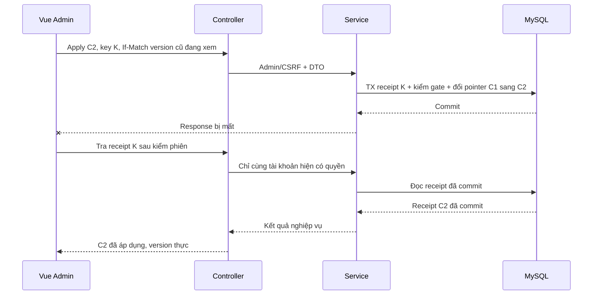

# TDD — API và giao dịch

**Phiên bản nội dung:** 0.4, biên tập 08/11/2026. **Trạng thái:** hợp đồng tổng thể còn dự thảo. K11/K01/K02/K04, nền xác thực Admin A01–A05, cửa sổ lệnh/receipt/tạo địa điểm ẩn A31/A06/A08 và phần đọc/sửa tên A07/A09 có sản phẩm và bằng chứng riêng, chưa toàn API/OpenAPI thực thi.
**Mục đích:** tra quyền, điều kiện, hợp đồng khách/Admin, thao tác lặp, giao dịch, đồng thời và lỗi. LIFE-P01 dùng vé ký 24 giờ theo DATA-05; LIFE-P02/P03/REC/BKP-P02 theo DATA-04.
**Nguồn:** [PRD](../02-nghiep-vu/PRD.md), [decisions](../02-nghiep-vu/decisions.md), [TDD](TDD.md), [mô hình hiện hành](data-model.md), [vòng đời/kiểm chứng](operations-design.md). Không lấy thiết kế làm kết quả triển khai.

Mục lục: [1. Quy ước](#api-conventions) · [2. Quyền](#api-auth) · [3. Khách](#api-guest) · [4. Admin](#api-admin) · [5. Lặp/chưa rõ](#api-idempotency) · [6. Giao dịch/cạnh tranh](#api-transactions) · [7. Job/file/backup](#api-jobs) · [8. Lỗi](#api-errors) · [9. DTO/ví dụ](#api-dto) · [10. Truy vết/còn mở](#api-trace) · [11. Triển khai/kiểm chứng](#api-implementation)

## 1. Quy ước đề xuất

- Base path **/api/v1**; JSON UTF-8 cho dữ liệu, MP3/PNG đúng media type cho bytes. Không trả entity JPA, đường file hệ điều hành, stacktrace, password/token/key hoặc raw provider response.
- DTO dùng id/version/hash của đối tượng đã lưu; thời điểm do server ghi và trả dạng ISO-8601 UTC kèm serverNow/expiresAt khi cần. Client không tự đặt bắt đầu/kết thúc/lượt xem hoặc hạn phiên; hiển thị/thống kê ngày theo Asia/Saigon.
- Mỗi response có kết quả/trạng thái thực; lỗi có **code, message, fieldErrors nếu cần, retryable, correlationId**, không đưa thông tin nội bộ lên giao diện khách. correlationId không là mã phiên hoặc quyền.
- Header **If-Match** chứa version/ETag đối tượng đang chỉnh; thiếu điều kiện ở lệnh cần nó thì 400 PRECONDITION_REQUIRED, version cũ trả 412 VERSION_CONFLICT và giữ dữ liệu chưa lưu Q2. Không tự ghi đè bằng last-write-wins.
- Header **Idempotency-Key** là quy ước ứng dụng cho lệnh quan trọng; cùng actor/window/key/phạm vi/body/precondition dùng lại kết quả cũ trong window còn hạn, khác payload thì 409 KEY_REUSED. Window không còn/hết hạn không nhận key cũ như lệnh mới; LIFE-P02 đã duyệt 24 giờ từ cấp, login không gia hạn. Đây không phải giả định Gemini hỗ trợ exactly-once hoặc một tiêu chuẩn provider đã được kiểm chứng.
- Không đặt page size, dung lượng/độ dài bài/giây chờ/tải đồng thời tùy ý làm AC bắt buộc. Nếu cần phân trang kỹ thuật danh sách thì hoàn thiện DTO sau, không thêm bộ lọc hoặc chức năng export.
- HTTP GET không tạo phiên/ghi lượt/Áp dụng/gọi TTS. “Kiểm tra kết quả” chủ động là POST riêng; GET trạng thái không tự gửi lại yêu cầu ngoài.

Lựa chọn ETag/HTTP có cơ sở [RFC 9110](https://www.rfc-editor.org/rfc/rfc9110.html); cách đặt DTO/key/version là đề xuất của dự án, không tuyên bố framework tự thực hiện. Toàn bộ path/tên field dưới đây có thể điều chỉnh nhất quán khi duyệt hợp đồng, giữ mã API để truy vết.

## 2. Quyền truy cập và mốc thời gian

| Nhóm | Bằng chứng quyền / kiểm server | Không được làm |
| --- | --- | --- |
| Public | Trang bắt đầu/assets nhãn được phép, thông tin bootstrap cần thiết | Không tạo phiên vì mở QR; không đọc nháp/Admin/key/database. |
| Guest | sessionId + **X-Guest-Credential** riêng tab; server so hash ngẫu nhiên, trạng thái/hạn và ownership của opening/grant | Không tin ID/tên/cookie chung hoặc client isActive; không dùng cookie Admin thay quyền khách. |
| Admin | Cookie session Spring Security, một role Admin; CSRF cho lệnh ghi, cookie HTTPS/HttpOnly/SameSite theo cấu hình sẽ kiểm | Không JWT mặc định/đăng ký công khai; không dựa menu ẩn để phân quyền. |
| Worker/ops | Service nội bộ/đường CD-L01 đã chọn, không endpoint công khai nhận shell/backup/SQL | Không dùng URL ngrok để deploy hoặc frontend gọi Gemini trực tiếp. |

**Guest lifecycle:** xác thực credential trước; session còn hiệu lực nếu chưa ended và serverNow < expiresAt. GET trạng thái có thể trả ended/expired để điều hướng; điều đó không mở quyền nội dung mới. Hết hạn, tiếp tục A1 bằng Blob đã tải theo TECH-04, **không API cấp lại audio sau hạn**. Trả trạng thái đã kết thúc để giải quyết phản hồi bị mất không làm phiên còn hiệu lực.

**Admin Q3:** kiểm 30 phút từ lastInteractiveAt được ghi nhận khi còn hiệu lực; polling/status/CSRF/bootstrap/giữ tạm/audio tự phát không gia hạn. POST activity hoặc lệnh chủ động đủ quyền dùng timestamp server, không timestamp khách. Hết hạn 401 ADMIN_SESSION_EXPIRED, dừng preview/che nội dung; Q2 giữ công việc. Đăng nhập lại không tự gửi lại thao tác hoặc phát audio.

GET phục vụ xem chủ động và GET do tự tải có cùng URL nhưng không tự chứng minh hoạt động; UI gửi sự kiện Q3 được phép khi thực có thao tác xem/cuộn/chọn. Cách chống spam/batching chỉ là kỹ thuật, không dùng mất mạng để ghi bù/hồi sinh. [Spring Security CSRF](https://docs.spring.io/spring-security/reference/servlet/exploits/csrf.html).

## 3. Hợp đồng khách — phân biệt bắt đầu, khôi phục, chọn và nghe

**Triển khai hiện có:** K11 (mục 9.1), K01/K02 qua Controller → Service → Repository đã kiểm trong [64 test ngày 05/11](practice-01-start-session.md#practice-start-api-result). Ngày 08/11 bổ sung phần kết thúc phiên K04, [88 test toàn bộ đạt](practice-01-start-session.md#practice-end-session-result) với MySQL 8.4.13 tạm. K03, grant và các API nội dung chưa triển khai. Trạng thái và giới hạn từng phần nằm tại bằng chứng thực hành.

| Mã | Method/path sau /api/v1 | Input/quyền | Kết quả / điều kiện |
| --- | --- | --- | --- |
| API-K01 | POST /guest/sessions | startTicket ký từ K11, displayName,initialLanguage; credential riêng tab; key=requestId đã ký | Kiểm signature/quyền/epoch/fingerprint. Có ledger trả cùng session/mốc gốc kể cả vé hết hạn; chưa ledger chỉ tạo vé còn 24 giờ. ID/key/fingerprint cùng TX và UK chống lặp, không gate/generation. |
| API-K02 | GET /guest/sessions/{sid} | Guest credential khớp sid | 200 effectiveState, mốc gốc/metadata cần UI; ended/expired không là lỗi mất phiên. Không thấy/không chứng minh quyền: không cho tra phiên theo tên hoặc lộ tên người khác. |
| API-K03 | POST /guest/sessions/{sid}/resume | Guest, documentNonce mới của document đã qua kiểm owner tab | Tiếp tục phiên hiện có, trả bản đồ/lựa chọn được phép và trạng thái, không tạo ID/lượt hoặc gia hạn. Reload trước hạn pause; nếu bài thay, tải cặp hiện hành và báo đầu bài. Sau hạn chỉ điều hướng P02, không trả grant audio mới. |
| API-K04 | POST /guest/sessions/{sid}/end | Guest + Idempotency-Key | Kết thúc còn hiệu lực: endedAt server, 200 ENDED; lần lặp của cùng kết thúc đã commit trả cùng kết quả. Nếu đã expired nhưng chưa ended, trả 409 SESSION_EXPIRED, không ghi endedAt muộn hoặc box “đã kết thúc” giả. |
| API-K05 | GET /guest/sessions/{sid}/map | Guest còn hiệu lực | Điểm hiển thị/vùng đang áp dụng đúng map space/version, không draft. Không tạo opening/lượt. |
| API-K06 | POST /guest/sessions/{sid}/openings | Guest còn hiệu lực; placeId, language, documentNonce, selectionSeq; key | Chủ động chọn điểm: tạo/chuyển opening hiện tại và trả snapshot văn bản/cặp/availability/contentGrantId khi có text. Chọn lại cùng điểm của cùng lần mở trả opening cũ, không cộng thêm; P06 do UI xử lý audio cục bộ. Chuyển B rồi quay A là opening mới. |
| API-K07 | PUT /guest/sessions/{sid}/openings/{oid}/language | Guest; language, documentNonce/selectionSeq, If-Match openingVersion; key | Giữ oid/phiên/điểm, lấy đúng tiếng và grant mới nếu có nội dung; không tự phát hoặc tạo lượt thứ hai. initialLanguage của phiên không bị sửa. Thiếu dịch trả availability/availableLanguages được phép, không auto fallback. |
| API-K08 | POST /guest/sessions/{sid}/openings/{oid}/view-ack | Guest còn hiệu lực; contentGrantId của văn bản thực đã hiển thị | 201 ghi PLACE_VIEW một lần cho opening đủ điều kiện; lặp trả cùng viewId/count. Lấy điểm/tên/tiếng/bản từ grant server, không từ snapshot client tùy gửi. Không ghi lượt chỉ vì nhận request chọn hoặc GET audio. |
| API-K09 | GET /guest/sessions/{sid}/content-grants/{gid}/audio | Guest còn hiệu lực; grant thuộc sid, có audio MP3 được phép | 200 toàn bộ MP3 đúng immutable file, Content-Type/length/checksum metadata; không nhận WAV/đường lưu do client chọn. Frontend tải đủ Blob rồi kiểm generation/quyền trước phát. Hết hạn từ chối, không “resume server” A1. |
| API-K10 | POST /guest/sessions/{sid}/openings/{oid}/leave | Guest còn hiệu lực; documentNonce/selectionSeq, oid hiện tại; key | Ghi việc quay lại bản đồ theo luồng đã có, kết thúc ngữ cảnh lần mở hiện tại; không ghi lượt hoặc phiên mới. Lần chủ động mở điểm sau là opening mới, kể cả cùng điểm. Request cũ không được xóa lựa chọn mới hơn. |

Chi tiết K04 đã triển khai ngày 08/11 nhận body rỗng và key UUID chuẩn chữ thường. Khóa bản ghi trước khi xét hạn và ghi endedAt, kiểm credential/epoch trước khi replay. Kết quả kết thúc được xác định theo phiên, key hợp lệ khác trên cùng phiên đã ended cũng trả mốc cũ với `replayed=true`. Cách này dùng ended_at hiện có, chưa thêm receipt riêng. Các quy tắc grant/D08 trong TX-K04 còn chờ triển khai theo dữ liệu tương ứng.

### 3.1. DTO kết quả chọn/đổi tiếng, thiếu nội dung và tải audio

Một kết quả lựa chọn gồm openingId/openingVersion, placeId/tên/nhận biết bản, language, textRevisionId/text/contentHash nếu có, pairId/audioRevisionId/audioAvailability nếu có, contentGrantId, availableLanguages, expiresAt/serverNow. Không trả raw hồ sơ duyệt hoặc nội dung dự thảo cho khách.

- **Thiếu dịch:** trả 200 với trạng thái nội dung NOT_AVAILABLE và danh sách chỉ các ngôn ngữ có văn bản được phép; text/audio không giả. Nếu không có, về bản đồ. Đây là kết quả nghiệp vụ dự kiến, không nhất thiết lỗi HTTP.
- **Thiếu audio runtime của cặp đã áp dụng:** văn bản vẫn đọc, audioAvailability=NOT_READY; không thay bản cũ/sai tiếng. Audio endpoint 404/503 phù hợp căn cứ, UI D03/BS và retry từ đầu chỉ khi còn quyền.
- **Điểm không khả dụng ở lần chọn mới:** 404 PLACE_UNAVAILABLE/409 NOT_VISIBLE với thông báo chọn điểm khác, không tạo lượt/grant giả. Không cho client tự chọn cặp chưa áp dụng.
- **Đã cấp snapshot trước khi cặp thay/ẩn/xóa:** không đẩy cập nhật ép dừng phần đã tải. Grant chỉ dùng đúng file đã cấp tới hạn phiên, không tạo lại điểm/cặp; chọn mới/reload phải đối chiếu tình trạng hiện hành A07/P03.
- **Full MP3:** luồng fetch khách phải nhận đủ response 200; đề xuất từ chối Range ở endpoint này bằng 400 FULL_DOWNLOAD_REQUIRED, không nhầm 206/canplay/cache với đủ bài. Audio trong tab dùng Blob cho tua, không cần Range tới server sau hạn. Không thêm ngưỡng MB chưa chốt.
- Abort request không chứng minh server chưa xử lý; client dùng generation và nonce/sequence để loại phản hồi cũ. play() bị browser từ chối xử lý D03-BS, không báo đang phát giả.

### 3.2. Tab, thứ tự chọn và giao thức đếm lượt

documentNonce/selectionSeq **không phải credential**; server vẫn kiểm sid+credential. Resume chỉ gắn document đã qua cơ chế owner của TDD 9, không là “cướp phiên bằng ID”. Server ghi generation của document, chỉ chấp nhận lựa chọn mới hơn trong document đó; request cũ tới muộn trả STALE_SELECTION. Frontend cũng loại response cũ, một audio/tab; không tin việc abort đã hủy request phía server. Owner/Web Locks/duplicate/freeze vẫn cần kiểm trên thiết bị thật.

Để tuân D04/P06, opening hiện tại giữ place identity độc lập request key. Bấm lại cùng vùng không được client gắn key mới rồi làm tăng lượt. Đổi tiếng dùng API-K07, không gọi chọn vùng mới; reload dùng API-K03/GET hiện tại, không tạo opening mới hoặc ACK từ bản khôi phục.

**Quay lại bản đồ:** API-K10 chỉ dùng khi khách thực sự chọn hành động quay lại bản đồ trong nhánh nghiệp vụ đã có; kết thúc current opening nhưng giữ grant/ACK đang bay tối thiểu. Sau đó mở lại A là lần mở mới theo D04. Bản đồ vẫn nhìn thấy trên trang, kéo/phóng, chạm ngoài vùng hoặc mở/hủy box ứng viên **không** là leave, không reset opening/đếm lượt. API này là giao thức cho hành vi sẵn có, không thêm nút/luồng UI mới.

**ACK đề xuất:** server cấp grant gắn text snapshot đã được phép tại lúc trả; UI chỉ ACK **lần đầu văn bản của opening thực hiển thị**, giữ đúng key/grant của lần đó khi phản hồi chưa rõ. ACK không chờ audio. Nếu ban đầu thiếu text rồi khách đổi sang tiếng có text trong cùng opening, lần đầu text thành công có thể tính một lượt, đúng ngôn ngữ của lần đó; sau đã tính thì đổi tiếng không thêm.

ACK đang bay của lần chọn thật có thể đến sau lựa chọn tiếp theo: server đối chiếu grant đã cấp và UNIQUE của opening, không dùng tên hoặc “đang xem điểm nào” để đếm lặp. Đây là ghi nhận thao tác gốc, **không lượt do reload hoặc hàng chờ gửi bù offline**. Request/response cũ chưa từng được hiển thị không được frontend ACK. Khi session đã hết hạn, không nhận ACK mới; không backdate client clock. Mất ACK có thể chưa có lượt trong kho giữ lại; không tự tạo sự kiện để làm thống kê đẹp.

## 4. Hợp đồng Admin

### 4.1. Đăng nhập, hoạt động và kết quả thao tác

| Mã | Method/path sau /api/v1 | Quyền/input | Kết quả / ngoại lệ |
| --- | --- | --- | --- |
| API-A01 | GET /auth/csrf | Public/anonymous context theo Spring Security | Cấp thông tin CSRF cần đăng nhập/gọi lệnh, không tạo phiên khách, không gia hạn Q3. Không public token đăng nhập/secret. |
| API-A02 | POST /auth/login | Tài khoản/mật khẩu, CSRF; không log body | 200 Admin context/session cookie; sai thông tin 401 thông báo chung. Không tài khoản đăng ký mới. Cookie/session fixation/CSRF cụ thể kiểm theo BOM đã chọn. |
| API-A03 | GET /admin/session | Admin có session | Trạng thái/lastInteractiveAt/expiresAt cần UI, không gia hạn vì polling; hết hạn 401. |
| API-A04 | POST /admin/session/activity | Admin còn hiệu lực + CSRF; activityType thuộc Q3 | Timestamp server; nhập/vẽ/chọn/view-scroll/lưu/tạo-kiểm-thử lại/nghe thử theo Q3. Không dùng timer/background/audio tự phát hoặc client timestamp để hồi sinh. |
| API-A05 | POST /auth/logout | Admin + CSRF | 204 sau khi vô hiệu session. Client dọn đúng dữ liệu Q2 ở tab sau xác nhận. TTS đã nhận vẫn xử lý, không xóa nháp đã lưu. Không auto logout trước khi khách chọn bỏ công việc chưa lưu. |
| API-A06 | GET /admin/operations/{key} | Admin hiện đã xác thực, chỉ receipt của chính tài khoản | Trả kết quả commit/target ID của lệnh bị mất phản hồi; chưa thấy receipt không khẳng định chắc thất bại. Không trang lịch sử/xuất báo cáo mới. |

Login/logout cũng có phản hồi đang xử lý, không auto gửi lại sau mất mạng/xác thực. Cookie an ninh và credential guest tuyệt đối không lẫn vai trò. Lỗi API trả JSON 401/403, không HTML login page làm client hiểu nhầm dữ liệu hợp lệ.

### 4.2. Địa điểm và vùng

| Mã | Method/path sau /api/v1 | Input / precondition | Kết quả |
| --- | --- | --- | --- |
| API-A07 | GET /admin/places ; GET /admin/places/{pid} | Admin | Dữ liệu quản trị/điều kiện hiển thị/version; danh sách rỗng/lỗi riêng. Không tự đặt trần năm điểm. |
| API-A08 | POST /admin/places | Admin+CSRF+key; displayName Q1 | 201 id/version/hidden. Trùng tên chỉ warning kèm mã, không chặn/gộp/hậu tố. Không bắt vùng/bài khi lưu ẩn. |
| API-A09 | PATCH /admin/places/{pid} | Admin+CSRF+key+If-Match; tên | Cập nhật đúng version, giữ visible và vùng/cặp hiện hành. 412 giữ soạn Q2, tải đối chiếu trước ghi lại; không tự merge/ghi đè. |
| API-A10 | PUT /admin/places/{pid}/visibility | Admin+CSRF+key+If-Match; visible | Bật chỉ khi thông tin hợp lệ, vùng đã xem xét/áp dụng, ít nhất cặp vi được duyệt/áp dụng; trả missingConditions cụ thể. Ẩn chặn truy cập mới lần tải/chọn tiếp, không thu hồi Blob đang nghe. |
| API-A11 | DELETE /admin/places/{pid} | Admin+CSRF+key+If-Match; UI đã xác nhận đúng điểm | 200 placeDeleted=true/fileCleanupState=PENDING hoặc kết quả có căn cứ. Giữ session/views/history, không báo mọi file đã xóa. Retry key sau commit trả receipt, không xóa nhầm điểm mới trùng tên. |
| API-A12 | POST /admin/places/{pid}/region-revisions | Admin+CSRF+key+If-Match place; polygon,mapSpaceKey,geometryHash | Lưu hình kín hợp lệ đã xem trước; tạo revision riêng, không đổi active region. Hình dở chỉ Q2, không lưu thành bản hợp lệ. Không chốt ranh giới thật. |
| API-A13 | GET /admin/places/{pid}/region-revisions/{rid} | Admin; rid thuộc pid | Bản lưu/hash để xem trước/đối chiếu; chưa thêm editor công nghệ ngoài TECH-01. Xem trước tại client không bắt buộc một endpoint mới. |
| API-A14 | PUT /admin/places/{pid}/active-region | Admin+CSRF+key+If-Match place; savedRevisionId,previewedGeometryHash | Áp dụng đúng bản đã lưu/đã xem không đổi. Không âm thầm save hình đang sửa; lưu không đổi hình đã xem thì không bắt preview lại. Không tự bật visible/đẩy ngay vào tab khách. |

Đọc hash/nhập reference không thể chứng minh con người đã xem xét ranh giới hoặc được chủ đồ án duyệt. UI giữ bước xem trước/xem xét đã chốt; Service kiểm bản/hash/điều kiện, không tự thẩm định bản đồ ngoài hệ thống.

### 4.3. Văn bản, hồ sơ, TTS và áp dụng cặp

| Mã | Method/path sau /api/v1 | Input / quyền | Kết quả / điều kiện |
| --- | --- | --- | --- |
| API-A15 | GET /admin/places/{pid}/content/{lang} | Admin; lang vi/en/fr/ru | Slot/version, bản đang soạn đã lưu, cặp khách chỉ đọc, hồ sơ và job hiện có. Không tự tạo bản dịch hoặc thay text đang gõ. |
| API-A16 | POST /admin/places/{pid}/content/{lang}/text-revisions | Admin+CSRF+key+If-Match slot/place base; body,baseTextId | Lưu text revision và draft pointer, không đổi active pair hoặc tạo audio. Đã có job/audio trỏ T1 thì không sửa nội dung T1 tại chỗ; sinh T2. |
| API-A17 | PUT /admin/text-revisions/{tid}/review-reference | Admin+CSRF+key+If-Match; locator,limitations | Chỉ text đã lưu. Ghi ref đúng tid/hash, không tự lưu phần đang soạn; không bắt retype ngày/người duyệt từ hồ sơ hoặc auto duyệt/áp dụng. |
| API-A18 | POST /admin/text-revisions/{tid}/tts-jobs | Admin+CSRF+key; tid/hash | 202 job đã commit/accepted, snapshot đúng bản/ngôn ngữ/model/Charon. Một job đang tạo/unknown cho cùng text thì trả job cũ, không thêm provider request; không giữ TX chờ Gemini. |
| API-A19 | GET /admin/tts-jobs/{jid} | Admin | Trạng thái nội bộ/result/cause có căn cứ; polling không Q3 và không tự gọi tạo lại. Chưa rõ kết quả có outcomeUncertain riêng, không gán failed giả. |
| API-A20 | POST /admin/tts-jobs/{jid}/check | Admin+CSRF+key, thao tác chủ động | Kiểm yêu cầu cũ/provider nếu có cách truy hồi; không tạo TTS mới. Không có provider ID/khả năng tra thì vẫn UNKNOWN, không hứa reconcile được. |
| API-A21 | POST /admin/tts-jobs/{jid}/retry | Admin+CSRF+key; lỗi xác định, không job cũ đang chạy/unknown | Tạo attempt mới gắn đúng tid sau kiểm trạng thái; đã received vẫn xem job cũ. Không auto retry khi login/reload/429/timeout. |
| API-A22 | GET /admin/audio-revisions/{aid}/preview | Admin session hợp lệ | MP3 của đúng audio/text đã lưu, chưa duyệt vẫn được nghe trong Admin; nghe thử không phát cho khách. Hết session dừng preview/che UI, không ngoại lệ nghe tiếp khách. |
| API-A23 | PUT /admin/audio-revisions/{aid}/review-reference | Admin+CSRF+key+If-Match; locator,limitations | Audio đã tạo/sẵn sàng, ref riêng đúng aid/text/lang; không tự thẩm định/áp dụng hoặc coi kiểm codec là nghe duyệt. |
| API-A24 | PUT /admin/places/{pid}/content/{lang}/active-pair | Admin+CSRF+key+If-Match slot; textRevisionId,audioRevisionId,expected hashes | Chỉ cả cặp đủ D09/đúng bản/tiếng/file/hồ sơ, đổi pointer nhất quán. Lỗi giữ C1, chưa rõ tra receipt/current pair. Chỉ đổi A thì dùng T hiện tại+A mới duyệt, không bắt sửa T. Không tự bật hiện/chờ đủ 4 tiếng. |
| API-A25 | GET /admin/content-completeness | Admin | Ma trận địa điểm×4 tiếng: draft/ref/applied text/audio/pair thiếu gì. Không trộn có-file/tạo-xong với duyệt/áp dụng; không chức năng quản lý thêm ngôn ngữ. |

Text body ở đây là văn bản/DTO, không tự chọn rich HTML hoặc giới hạn ký tự/file bắt buộc mới. Kiểm tên đã chốt Q1 khác giới hạn bài TTS còn phải có căn cứ. Hồ sơ có thể chung mục cho text/audio nhưng record tham chiếu vẫn gắn đúng hai đối tượng; không server đọc hiểu tài liệu rồi kết luận đã được người dùng duyệt. Chỉ phê duyệt rõ theo D09 mới được Admin áp dụng.

### 4.4. Phiên khách, thống kê và một QR

| Mã | Method/path sau /api/v1 | Query/quyền | Kết quả / giới hạn |
| --- | --- | --- | --- |
| API-A26 | GET /admin/guest-sessions | Admin; fromDate,toDate,status,searchNameOrId đúng bộ lọc đã chốt | Danh sách chỉ đọc, default hôm nay Asia/Saigon. UI-A21 box chi tiết không thêm trang riêng, không sửa/gia hạn/kết thúc thay khách. |
| API-A27 | GET /admin/guest-sessions/{sid} | Admin | Tên/id/ngôn ngữ ban đầu/mốc/trạng thái + lượt đã tính (thời gian/nhận biết điểm/tiếng). Không còn dữ liệu trả 404 DATA_NOT_RETAINED, không bịa thời điểm đóng tab. |
| API-A28 | GET /admin/statistics | Admin; fromDate,toDate, default hôm nay | Hai tổng/hai nhóm: phiên theo ngày bắt đầu; lượt theo ngày/địa điểm snapshot/tiếng. Không thêm filter điểm/tiếng, biểu đồ/export/người duy nhất/lượt nghe/quét. |
| API-A29 | GET /admin/qr | Admin | URL chỉ đọc/trạng thái ready; một QR chung cho mọi điểm/tiếng, chưa URL thật thì unavailable. Không tự chọn domain/thư viện. |
| API-A30 | GET /admin/qr.png | Admin, URL thật đã được cấu hình/đối chiếu | PNG đúng QR chung. Chưa URL thật trả 409 QR_NOT_READY, không QR từ URL giả. Print dùng bố cục trình duyệt theo UI-05, không endpoint đếm in/quét; request tải/in không chứng minh đã lưu/in. |

Ngày đầu/cuối tính trọn ngày: chuyển khoảng local [Từ 00:00, ngày sau Đến 00:00) Asia/Saigon sang UTC để query, không kết thúc 23:59:59 làm rơi phần giây. from>to hoặc ngày sai trả 422 giữ bộ lọc. Về hôm nay do UI đặt lại hai ngày, danh sách giữ status/search. Query chỉ dùng dữ liệu còn giữ D08, kể cả nhận biết điểm đã xóa; grouping theo stable snapshot ID, không tên.

## 5. Thao tác lặp và mất phản hồi — không retry mù

| Tình huống | Thiết kế |
| --- | --- |
| Bắt đầu khách | Signed requestId/credential/epoch/issuedAt/expiresAt và fingerprint; lookup ledger trước phân nhánh expiry. UNIQUE + TX cho concurrent; expired có ledger trả gốc, expired không ledger không insert. Mất response giữ đúng vé/key/quyền, không tự tạo vé khác/session khác. |
| Đếm lượt | UK(session_id, opening_id) hoặc khóa tương quan tương đương ở PLACE_VIEW; ACK lặp/đổi tiếng/reload/audio không tạo view mới. Số đếm lấy DB, không cộng lạc quan vào client rồi coi đã ghi. |
| Admin lệnh DB | ADMIN_COMMAND_WINDOW + OPERATION_RECEIPT, UK(account,window,key), fingerprint method/resource/body/precondition. Xác thực/window còn hạn rồi receipt + thay đổi DB cùng TX; window cũ thiếu/hết hạn không thi hành lại. |
| Kiểm tra receipt | Chỉ Admin cùng tài khoản đã xác thực, kể cả sau login lại. Kiểm quyền **trước** replay; không cho người khác đọc receipt. Kết quả delete đã commit có thể replay dù target đã mất, không phụ thuộc tên trùng. |
| Thứ tự replay/precondition | Xác thực → window/account/epoch/hạn → receipt/fingerprint → replay kết quả commit nếu có → nếu lệnh mới kiểm If-Match/điều kiện. Không báo version conflict sai cho replay còn hợp lệ hoặc hứa receipt là trạng thái hiện tại mãi. |
| Lệnh đang chạy/chưa thấy | Chưa commit có thể chưa thấy receipt; không khẳng định thất bại. Retry cùng key dựa UK/TX đối chiếu, có thể trả OPERATION_IN_PROGRESS/cho kiểm lại; không key mới cho thao tác chưa rõ. |
| TTS | Receipt accepted trỏ jobId, không là audio đã tạo. Job request_key/khóa text ngăn bấm lặp; không suy receipt bảo đảm provider exactly-once. Retry provider chỉ chủ động sau lỗi xác định. |
| Lỗi HTTP/mất kết nối | 5xx/timeout của client không chứng minh rollback. Tra current state/receipt/job và replay đúng key nếu cần. Sau hết phiên Admin, login lại không auto replay; Q2 chỉ phục hồi soạn. |

Receipt chỉ là kỹ thuật giải quyết kết quả, không menu nhật ký mới; lưu hash payload thay nội dung/secret, chỉ thông tin tối thiểu không sao chép tên khách. [Vòng đời](operations-design.md#ops-lifecycle) cập nhật LIFE-P02/P03 đã duyệt và hướng LIFE-P01 đơn giản; vé ký 24 giờ LIFE-P01 đã duyệt, độc lập window Admin/8 giờ guest/30 ngày ledger. Không giữ metadata vô hạn hoặc coi thiết kế là test. Không áp log 7 ngày/D08 30 ngày máy móc cho mọi metadata. Lỗi validation/precondition đã rollback không là receipt thành công; client không tự lặp, khi chủ động thay payload/điều kiện dùng operation mới. Chỉ receipt commit mới là căn cứ không thi hành cùng lệnh lần hai.

## 6. Ranh giới giao dịch và xử lý đồng thời

Controller nhận DTO/quyền, Service quyết định/giữ TX, Repository thực hiện đọc/ghi/khóa. Không Controller gọi trực tiếp Repository để bypass luật. TX phải đi qua cơ chế Spring proxy tương ứng; tự gọi method trong cùng object không tự tạo giao dịch mới. Chưa viết code, không thay BOM đang chọn bằng version hiển thị trên trang docs. [Spring transactions](https://docs.spring.io/spring-framework/reference/data-access/transaction/declarative/annotations.html).

### 6.1. Danh sách giao dịch

| Mã | Bên trong TX ngắn | Ngoài TX / lỗi |
| --- | --- | --- |
| TX-K01 Bắt đầu | Xác minh signature/epoch/credential/key, đọc ledger và đối chiếu; có trả gốc, không có kiểm clock vé rồi insert session/key/fingerprint/timestamp-digest vé cùng TX | UNIQUE race: rollback TX lỗi rồi đọc/đối chiếu trong TX mới, không query trong TX đã hỏng. Không tự sinh key mới hoặc gia hạn mốc, không start/purge gate. |
| TX-K02 Chọn/đổi tiếng/quay bản đồ | Kiểm phiên/generation; đọc đúng điểm/vùng/cặp hiện hành trong snapshot; tạo/update hoặc kết thúc opening/grant + GUEST_REQUEST_RESULT đúng key/seq/fingerprint, không ghi view | Lấy bytes MP3 ngoài TX; clientrender/Blob ngoài DB. Chọn lại cùng point không opening mới. |
| TX-K03 ACK view | Kiểm credential/hạn, grant đã cấp/đúng opening, snapshot server; insert view một lần với live_place_id còn sống hoặc NULL nếu điểm đã xóa, giữ stable ID/name/lang; mark counted | Không giữ TX chờ audio hoặc client render. Đã có view thì trả gốc; không dựa cặp hiện hành A2 để viết lại view A1. |
| TX-K04 Kết thúc | Khóa/kiểm session; nếu active ghi endedAt một lần, vô hiệu grant chưa dùng thêm; anchor D08 đúng endedAt | Expired không ghi end muộn. Đã ended trả trạng thái cũ; tab khác ID không bị đụng. |
| TX-A01 Lưu/ẩn-hiện/vùng | Khóa PLACE/version; lưu revision/hash hoặc kiểm gate; đổi đúng pointer nếu Apply | Không save ngầm, không xem lại hình đã preview không đổi chỉ vì vừa lưu. |
| TX-A02 Áp dụng cặp | Khóa PLACE → SLOT/version; kiểm text/audio cùng slot/bản/tiếng/hồ sơ/file; tạo/reuse pair và đổi active pointer + receipt, ghi last-unapply của file cũ đúng lúc | Không gọi provider/đọc file dài trong TX; file existence-check cần có protocol tránh cleaner, không kiểm rồi nhả race. C1 giữ khi TX rollback, client mất response tra receipt. |
| TX-A03 Tạo job | Khóa text/slot; kiểm không active/unknown job; snapshot/create job + receipt accepted, commit | Worker gọi Gemini sau commit; không sự kiện RAM duy nhất rồi mất job khi restart. |
| TX-A04 Kết quả job | Theo job/target đã snapshot, kiểm target_valid/text/hash/tiếng, ghi AUDIO_REVISION + WAV/MP3 metadata đúng bản, phase success | Gọi provider/convert/check file ngoài TX; nếu target xóa thì bỏ liên kết/đưa orphan, không phục hồi PLACE. |
| TX-A05 Xóa điểm | Khóa PLACE và các aggregate theo thứ tự; bỏ pointers/phụ thuộc riêng, void liên kết TTS, giữ views/grants kỹ thuật cần phục vụ đã cấp, chuyển live refs/snapshots, metadata dọn file + receipt; DELETE place; commit toàn bộ hoặc rollback | Dọn file sau commit, không xóa hồ sơ tài liệu/dữ liệu dùng chung. Trả fileCleanupPending, không tuyên bố mọi file đã mất. |
| TX-D01 Xóa phiên đến hạn | Kiểm lại anchor+30 ngày, xử lý view/request-result/opening/grant và session/ledger đúng FK trong TX | Không tăng/khóa start_generation; request vé cũ sau purge đã hết 24 giờ nên không tạo lại. Không đổi D08 hoặc giữ tombstone ngoài hạn. |
| TX-F01 Dọn asset | Khóa/kiểm refs + job/read-claim + mốc đủ hạn, đánh dấu cleanup-claimed để ngăn ref mới | File delete bên ngoài TX, sau đó finalize deleted/retry trong TX mới. File đã absent được xác nhận là kết quả dọn, không giả lúc chưa kiểm. |
| TX-O01 Receipt | Khóa command window, kiểm account/expiry/epoch rồi receipt cùng TX lệnh DB; result chỉ committed sau commit | Dọn window/receipt không khi TX đang dùng; không bao trùm provider/file hoặc hồi sinh key sau dọn. |

### 6.2. Các cuộc đua bắt buộc xử lý

- **Hai Admin sửa:** If-Match/version cũ trả 412; Q2 giữ soạn và cho tải đối chiếu. Không âm thầm merge/publish hoặc biến conflict thành mất dữ liệu.
- **Apply với Delete/Hide:** khóa PLACE trước, đọc lại gate/target trong TX. Delete thắng thì Apply thất bại không tạo lại; Hide thắng không cho Apply tự bật hiện. Apply thành công rồi Hide thì cặp vẫn có nhưng truy cập mới chặn.
- **Hai tạo audio cùng text:** lock text trước kiểm active job, tạo tối đa một job đang tạo/unknown; không dựa kiểm ngoài TX rồi cùng gọi provider. T2/T3 là hai bản khác, không gắn audio nhầm dù hai job cùng tồn tại.
- **Worker với Delete:** worker không giữ job lock rồi đi lấy PLACE ngược chiều. Đọc snapshot để biết target, TX finalize lấy PLACE → SLOT/text → JOB → FILE theo thứ tự phù hợp; target đã mất thì nhánh orphan không cố khóa/insert PLACE. Không giữ DB lock suốt Gemini.
- **Cleaner với Apply/Download/Backup:** mọi bước có thể thêm/tháo ref phải nhìn cleanup state và claim cùng protocol. Khi cleaner đã claim, không nhận ref mới; khi đọc/copy đang giữ read-claim thì chưa xóa. File vừa tạo không được áp dụng trước hoàn tất/kiểm metadata.
- **Hai chọn liên tục:** docNonce+selectionSeq trong authenticated session tránh request cũ tới muộn làm server current selection sai; clientgeneration cũng kiểm khi response/Blob/play về. Không cộng lượt cho phản hồi chưa hiển thị.
- **ACK với cặp thay/xóa:** lấy snapshot được cấp, không đọc tên/cặp hiện hành để gộp lịch sử. ACK hợp lệ ghi một view của lần chọn gốc, live FK nullable theo kết quả xóa; không tạo quyền chọn điểm đã xóa.
- **End/Expiry với ACK/grant:** kiểm serverNow khi quyết định TX; nếu đã hết hạn không cấp thêm grant hoặc view mới. Khi cạnh tranh, thứ tự commit/kiểm dưới khóa là căn cứ; không dùng timestamp client để backdate.
- **Deadlock/timeout khóa:** rollback toàn TX. Có thể thử lại **phần DB thuần đã biết rollback** với cùng key theo chính sách kỹ thuật sẽ kiểm; không retry lời gọi TTS hoặc lệnh có kết quả commit chưa rõ. Không cam kết không bao giờ deadlock.

Thứ tự lock dự kiến: Admin window → PLACE → SLOT/TEXT → JOB → FILE; chọn/ACK khách SESSION → PLACE còn sống → OPENING/GRANT, không khóa opening rồi quay lấy PLACE. Download SESSION/GRANT → FILE, không lấy PLACE sau FILE. Xóa điểm không khóa/sửa session khách, giữ opening/grant snapshot; purge session không mở quyền/place lại. Cleaner kiểm OPS_GUARD trước FILE/claims. Khóa ngầm FK/deadlock vẫn cần kiểm thật và xử lý rollback, không hứa mô tả đã loại bỏ mọi deadlock.

Ưu tiên version lạc quan cho sửa form và khóa row ngắn cho chuyển pointer/gate/delete/job. Dùng locking read đúng transaction và index, không khóa mọi bảng suốt request. FK vẫn chặn thao tác xóa trực tiếp ở quan hệ cần bảo vệ; không ON DELETE CASCADE để né. [MySQL locking reads](https://dev.mysql.com/doc/refman/8.4/en/innodb-locking-reads.html). Thứ tự lock dự kiến phải kiểm cả lock ngầm FK trên MySQL thật, chưa có bằng chứng chạy.

### 6.3. Ví dụ áp dụng cặp bị mất response

Không thấy response không đổi C2 về C1, không gọi Apply key mới mù. Nếu login lại, chỉ khi Admin chủ động kiểm/tiếp tục mới gọi; Q2 không là hàng đợi tự phát lệnh.

## 7. Mô hình và vòng đời hiện hành — một vị trí chính

### 7.1. Mô hình dữ liệu

[Mô hình 0.3](data-model.md) là nguồn chính cho bảng/ERD/ràng buộc TDD hiện hành/API 0.4. Nó đã hợp nhất opening/grant/receipt của API 0.1, bỏ context/10 phút/start_generation, dùng vé ký 24 giờ/ledger session và giữ window/claim theo DATA-05/DATA-04. [Bản mô hình TDD 0.3](../99-luu-tru/data-model-history.md) chỉ là lịch sử; không tự ghép ERD TDD 0.2–0.4 với bảng bổ sung của API cũ.

Opening giữ đúng P06/đổi tiếng/reload và chủ động quay map; grant ghim đúng text/MP3/deadline; PLACE_VIEW không FK buộc giữ opening tới 30 ngày. Download sau hạn bị chặn, Blob đủ điều kiện là quyền nghe tiếp ở tab. Window Admin và expiry vé guest 24 giờ ngăn key cũ được nhận như lệnh mới sau khi dọn kết quả; GUEST_REQUEST_RESULT giữ tương quan request guest tạm tới end/expiry, không dùng receipt Admin cho guest.

### 7.2. Job/file và thao tác lặp

[Operations 1–2](operations-design.md#ops-lifecycle) mô tả tạo/giữ/vô hiệu/dọn, marker DISPATCHING trước provider, owner token/phase version, xử lý unknown/local retry/target xóa và phân biệt WAV hoàn chỉnh 24 giờ với workspace 1 giờ. LIFE-P01 vé ký 24 giờ đã duyệt DATA-05, LIFE-P02/P03 giữ nguyên; hết hạn vé không chặn lookup gốc có quyền hoặc đổi mốc session. Cookie Admin/Q3 và guest credential không bị thay bằng window/start ticket.

### 7.3. Backup/restore và CD

[Operations 3–5](operations-design.md#ops-backup) mô tả **BKP-P02 đã chọn**: stop phục vụ/dispatch/ghi/dọn có kiểm soát, giữ MySQL, dump/catalog/copy cùng checkpoint, không MySQL tạm mỗi lần backup. REC-P01 đã duyệt thu hồi quyền/window cũ khi restore thật; không backup/restart thường.

Khi app QUIESCING có thể trả 503 SERVICE_MAINTENANCE; khi app dừng có thể không truy cập được. P04/Q2 giữ lựa chọn/soạn, kiểm hiệu lực lúc mở lại; không gửi lặp hoặc reset 8 giờ/24 giờ/30 phút. Job đã nhận giữ, không provider retry/auto Apply. Chi tiết error/mode là kỹ thuật dự thảo, không thêm endpoint public vận hành.

CD-L01 vẫn Actions → Tailscale riêng → OpenSSH Windows → PowerShell → Docker Desktop; ngrok chỉ web. Chưa SSH/context/quyền/CD, V-CD01 phải kiểm trước triển khai đầy đủ.

## 8. Ma trận lỗi và phản hồi đúng nghiệp vụ

| HTTP / code đề xuất | Khi nào | UI/hành động được phép |
| --- | --- | --- |
| 400 MALFORMED_REQUEST / PRECONDITION_REQUIRED | Sai cấu trúc/thiếu điều kiện kỹ thuật | Giữ dữ liệu, chỉ rõ trường cần sửa/kiểm lại; không gửi lặp mù. |
| 401 GUEST_CREDENTIAL_INVALID / ADMIN_SESSION_EXPIRED | Thiếu/sai quyền hoặc Admin hết phiên | Không tiết lộ dữ liệu phiên khác; Admin che/dừng preview/Q2/login lại. Guest không khẳng định “hết hạn” khi chỉ không xác thực được phiên. |
| 403 FORBIDDEN / CSRF_INVALID | Có ngữ cảnh nhưng không đủ quyền/CSRF | Chặn thao tác, không “thành công”; không thử bỏ bảo mật để chạy. |
| 404 SESSION_NOT_FOUND / DATA_NOT_RETAINED / PLACE_UNAVAILABLE | Không còn dữ liệu được phép truy cập | Guest theo P02: “Không thể tiếp tục phiên trước. Vui lòng bắt đầu phiên mới” nếu không có căn cứ state; Admin box/detail phản hồi đúng không còn. |
| 409 SESSION_EXPIRED / SESSION_ENDED | Guest có chứng cứ phiên nhưng lệnh cần active | UI box đúng nhánh/mốc; văn bản đã tải đọc được, chỉ Blob đủ điều kiện được pause/resume, không tải mới. |
| 409 REQUIREMENTS_NOT_MET / WRONG_REVISION / TARGET_DELETED | Gate vùng/cặp/visibility thiếu hoặc sai bản | Liệt kê thiếu gì/đối tượng đã đổi; không Apply/Lưu ngầm hoặc phục hồi điểm. |
| 409 KEY_REUSED / OPERATION_IN_PROGRESS / OUTCOME_UNCERTAIN / STALE_SELECTION | Key khác body, đang xử lý, chưa rõ provider, request chọn cũ | Tra receipt/current state/job; không key mới/auto retry/đổi lựa chọn mới bằng response cũ. |
| 412 VERSION_CONFLICT | If-Match không còn đúng | Giữ soạn Q2, tải đối chiếu bản hiện hành; không ghi đè. |
| 422 VALIDATION_FAILED | Tên/tiếng/ngày/geometry sai theo quy tắc đã chốt | Giữ input/chỉ lỗi; không tự thêm giới hạn văn bản/file tùy ý. |
| 429 RATE_LIMITED / PROVIDER_QUOTA | Có căn cứ giới hạn dịch vụ/request | Báo đúng lý do có thể biết, cho kiểm/thử lại chủ động phù hợp; không tự bật billing/tạo key né quota hoặc nói chắc hết tiền. |
| 503 SERVICE_UNAVAILABLE / MEDIA_NOT_READY | Mạng/dịch vụ/file tạm không sẵn sàng | Giữ nội dung/lựa chọn/Q2, retry đúng quyền. Khách audio đã tải đủ có thể tiếp tục theo trạng thái phiên, không ép dừng vì một API lỗi. |
| 500 INTERNAL_ERROR / kết nối mất | Lỗi không dự kiến hoặc client chưa biết commit | Không nói chắc rollback; tra receipt/job/state. Không trả stacktrace/secret hoặc “đã xóa file” thiếu kiểm. |

Thông báo khách chuyển theo ngôn ngữ đã rà soát; câu vi P02/D04-BS là căn cứ nghĩa. Error code là cho client/kiểm tra, không phải dòng kỹ thuật phải hiện thường trực cho khách.

## 9. DTO hiện hành cho các luồng trọng yếu

**Quy ước:** bảng chỉ rõ trường gửi/nhận để triển khai DTO, chưa JSON schema/OpenAPI thực thi. Mã S1/O1/T2/A2/C2 trong ví dụ là nhãn giả định, API thật dùng UUID; hash/token chỉ là chỗ giữ minh họa, không key thật. Timestamp mẫu dùng UTC, giao diện đổi theo ngôn ngữ/múi giờ. Nullable được ghi rõ, server không tin field ngoài hợp đồng.

### 9.1. Start ticket và cửa sổ lệnh — không phải phiên/nghiệp vụ mới

| Mã / path sau /api/v1 | Request | Response / quy tắc |
| --- | --- | --- |
| **API-K11** POST /guest/start-ticket | Public; X-Guest-Credential riêng tab, body rỗng | 201 {startTicket,requestId,issuedAt,ticketExpiresAt,serviceEpoch,serverNow}; payload ký gắn credentialHash, ticketExpiresAt=issued+24 giờ. Không session row/thao tác/đồng hồ mới; không startGeneration/context. |
| **API-A31** POST /admin/command-windows | Admin còn hạn + CSRF, body rỗng | 201 windowId,serviceEpoch,issuedAt,expiresAt=issued+24 giờ theo LIFE-P02 đã duyệt. Cấp ở nền không tự Q3/login mới; login lại không gia hạn window cũ. |

K11/A31 phục vụ K01/A06, **không thêm FR/UC/màn hình**. K11 cấp vé ký 24 giờ theo DATA-05, không context/10 phút/generation; path context cũ chỉ lịch sử, không hợp đồng song song. Không JWT Admin. Client không gửi secret qua query/URL hoặc nhận lại credential trong response.

**Chi tiết triển khai K11:** chỉ nhận body rỗng; credential chuẩn 32 byte/Base64URL không padding và cấu hình khóa/epoch theo [operations](operations-design.md#ops-start-runtime). Không tạo session row. K11/K01/K02 trả `Cache-Control: no-store`; lỗi dữ liệu trả đủ code/message/fieldErrors/retryable/correlationId. Sai credential dùng 401 GUEST_CREDENTIAL_INVALID; sai định dạng/chữ ký vé 401 INVALID_START_TICKET; epoch khác 403 SERVICE_EPOCH_MISMATCH. Đây là mã hợp đồng cho client, không đưa chuỗi kỹ thuật thường trực lên màn hình khách.

### 9.2. Bắt đầu, đọc trạng thái, khôi phục — K01/K02/K03

| DTO | Trường bắt buộc / tùy chọn | Kiểm / kết quả |
| --- | --- | --- |
| StartRequest | startTicket,displayName,initialLanguage; Idempotency-Key=requestId đã ký; credential header | Raw control/newline từ chối trước normalize. Kiểm signature/epoch/quyền, ledger + fingerprint + ticket metadata; đã có trả gốc dù expiry vé, không có chỉ insert vé còn hạn. Không đổi key/body để tái dùng vé tạo nhiều phiên. |
| SessionResponse | sessionId, state ACTIVE/ENDED/EXPIRED, displayName, initialLanguage, currentLanguage, startedAt, expiresAt, endedAt nullable, serverNow, created, replayed | 201 tạo mới, 200 replay đã có. Không trả credential hash; currentLanguage có thể null sau end/expiry (form dùng memento hợp lệ trong tab); state expired không đổi mốc bắt đầu hoặc retention. Không dùng tên tìm lại phiên. |
| ResumeRequest | documentNonce mới, previousDocumentNonce nullable; header credential | Backend CAS nonce dưới khóa session sau kiểm credential; gửi lại cùng documentNonce không tăng generation hoặc tạo phiên/lượt. Client chỉ resume sau kiểm owner theo TDD 9; nonce không thay xác thực. |
| ResumeResponse | SessionResponse + documentNonce, selectionSeq, currentOpening nullable, content nullable, restoreReason | Trước hạn lấy bản hiện hành được phép để đối chiếu audioRevision/hash với memento **trong tab**; cùng bài mới đặt mốc rồi pause. Bài đổi hoặc mốc không dùng được về đầu/thông báo. Sau hạn content/grant mới null, chỉ trạng thái/P02. Không gửi/lưu lịch sử mốc nghe vào DB. |

**Ví dụ thành công:** Start “  An   Bình ”/vi → displayName="An Bình", sessionId=S1, startedAt=2026-11-03T02:00:00Z, expiresAt=2026-11-03T10:00:00Z, created=true. Reload S1 → created=false, cùng hai mốc, content.source=RESTORE, không tự phát/lượt mới.

**Lỗi:** 422 VALIDATION_FAILED, fieldErrors.displayName nêu tên không hợp lệ; chưa session row. Vé hết hạn và không ledger: 409 START_TICKET_EXPIRED, giữ tên/tiếng, không khẳng định sai phiên đã hết hạn hoặc request gốc chắc chưa commit. Nếu chưa gửi lần đầu, chuẩn bị vé mới nền; nếu pending chưa rõ thì không tự đổi key/gửi như phiên mới. Sai chữ ký/credential/epoch từ chối quyền, cùng key khác body 409 KEY_REUSED.

**Mất phản hồi:** giữ vé/requestId/credential. Đã có session thì kiểm signature/quyền/epoch/fingerprint/timestamp vé và trả S1/hạn gốc **kể cả vé đã quá 24 giờ**; không tự tạo S2 hoặc sửa tên/initialLanguage. Chưa ledger chỉ vé còn hạn được insert. Sau purge đúng D08, vé cũ đã quá 24 giờ → START_TICKET_EXPIRED, không S2. Khi không thể xác định/tiếp tục, thông báo phù hợp và khách chủ động xác nhận lần mới. Không expiry validator chặn mọi lookup trước khi đọc ledger.

### 9.3. Chọn điểm, đổi tiếng, quay bản đồ và ghi lượt — K06/K07/K08/K10

| DTO | Trường gửi / nhận | Ý nghĩa |
| --- | --- | --- |
| SelectionRequest K06 | placeId, language, documentNonce, selectionSeq; key | Không nhận pairId/audioId do khách tùy chọn. Server lấy cặp hiện hành đúng điểm/tiếng, key và freshness kiểm cùng session. |
| LanguageRequest K07 | language, documentNonce, selectionSeq; If-Match openingVersion; key | Chỉ opening hiện tại; giữ session/điểm, cập nhật currentLanguage, không sửa initialLanguage, không phát tự động. |
| ContentResponse | openingId, openingVersion, selectionKind NEW_OPENING/SAME_OPENING, place{id,name}, language, source SELECT/LANGUAGE/RESTORE, availability, availableLanguages | SAME_OPENING dùng P06 và audio cục bộ, không trở thành yêu cầu play-from-zero; bản đồ kéo/phóng/ngoài vùng không gửi K10. |
| ContentResponse.text | null hoặc {revisionId,hash,body} | Chỉ văn bản được phép; thiếu dịch trả null, availableLanguages chỉ tiếng có nội dung được phép. |
| ContentResponse.audio | null hoặc {revisionId,mp3FileId,checksum,byteSize,durationSeconds,availability READY/NOT_READY} | Không URL filesystem/WAV/provider key; trạng thái file runtime không đổi việc cặp đã được áp dụng. |
| ContentResponse.grant | null hoặc {id,expiresAt,viewEligible}; kèm serverNow | Deadline bằng hạn phiên; session+credential vẫn cần để tải. Không quyền audio sau expiry; full response MP3 rồi Blob trước phát. |
| ViewAckRequest | contentGrantId | UI chỉ ACK văn bản thực đã hiển thị lần đầu trong opening; backend kiểm grant/owner/phiên/viewEligible. Lấy snapshot server, không nhận viewedAt/name/lang do client đặt. |
| ViewAckResponse | viewId, created, viewedAt, language, openingId | 201 mới; 200 đã tính trả view gốc. UK(session,opening) là nguồn chống lặp, không counter client. |
| LeaveRequest K10 | documentNonce,selectionSeq; oid path; key | Chỉ quay về bản đồ theo nhánh đã có. Đóng current opening, không cộng lượt; không làm mất ACK gốc đang bay. |

**Ví dụ thành công:** chọn P1/vi → O1, T1/A1/C1/G1, NEW_OPENING; hiển thị text rồi ACK G1 → V1/created=true. Bấm P1 lại → SAME_OPENING, P06 giữ/tiếp tục/phát lại đúng trạng thái; đổi en → O1/G2/source=LANGUAGE, dừng audio cũ và pause đầu, ACK lại không tạo V2. Chọn P2 rồi P1 → O2/O3; mỗi lần text thành công có một lượt. Chủ động Quay bản đồ rồi mở P1 cũng là opening mới, không suy từ map vẫn nhìn thấy.

**Thiếu/lỗi:** thiếu fr → text=null, availability=TEXT_NOT_AVAILABLE, availableLanguages=["vi","en"] nếu đúng dữ liệu được phép; chưa lượt, không auto fallback. Audio runtime thiếu → text vẫn có, audio.availability=NOT_READY, nút phát khóa; tải lỗi có căn cứ trả 503 MEDIA_NOT_READY và retry từ đầu khi còn hạn. 409 STALE_SELECTION chỉ bỏ request cũ, không thay lựa chọn mới.

**Mất phản hồi:** GUEST_REQUEST_RESULT lưu key + documentNonce/seq/fingerprint và khóa kết quả opening/grant, không body text trùng; giống request trả kết quả cũ, không seq mới chỉ vì timeout. Replay không đổi current selection đã mới hơn. Nếu text gốc đã xóa thì báo không còn khả dụng, không tráo bản khác hoặc tạo lượt. Mất ACK response thì cùng grant trả V1/created=false. Reload RESTORE không tạo ACK mới; không hàng chờ gửi bù offline. ACK cũ hợp lệ tới sau delete dùng snapshot/null live FK, không hồi sinh điểm; sau session expiry từ chối ghi lượt mới.

### 9.4. Tạo, kiểm và thử lại TTS — A18–A21

| DTO | Trường | Điều kiện |
| --- | --- | --- |
| CreateTtsRequest | textRevisionId ở path, expectedTextHash; operation key/window | Server tự lấy body/tiếng của bản đã lưu, model/Charon đã chọn; không lấy phần chưa Lưu hoặc cho client chọn provider/model ngoài quyết định. |
| TtsJobResponse | jobId,textRevisionId,textHash,language,model,voice,state,phase,targetValid,outcomeUncertain,acceptedAt,updatedAt,terminalAt nullable | state cho UI: PROCESSING/SUCCEEDED/FAILED/UNCERTAIN/DISCARDED; phase nội bộ chi tiết trong operations-design. Tạo thành công request=accepted, không audio success. |
| TtsJobResponse.result | null hoặc {audioRevisionId,wavFileId,mp3FileId,checksum,durationSeconds} | Chỉ result đúng bản đã kiểm metadata; không hồ sơ “đã nghe duyệt” tự động. |
| TtsJobResponse.failure | null hoặc {code,stage,retryAction} | REPROCESS_LOCAL nếu WAV hợp lệ và lỗi convert, CREATE_PROVIDER_ATTEMPT chỉ lỗi xác định, INSPECT_ONLY nếu unknown. Không raw provider body/secret/prompt. |
| CheckRequest / RetryRequest | Path jobId; operation key/window; body rỗng hoặc expectedPhaseVersion khi Retry | Check không gọi tạo mới. Retry kiểm active/unknown/phase và target; accepted tiếp tục dù Admin hết phiên; không auto gửi khi login. |

**Ví dụ thành công:** A18(T2,H2) → 202 {jobId:J2,state:PROCESSING,phase:QUEUED,reused:false}. Poll A19 sau đó → SUCCEEDED/result=A2; chưa được duyệt/áp dụng. Hai request cùng text khi J2 active trả J2/reused=true, không hai lần provider.

**Lỗi:** text chưa lưu/đã xóa → 409 TARGET_DELETED hoặc WRONG_REVISION, không tự Lưu. Có response provider lỗi xác định → FAILED và mã phù hợp; convert lỗi sau WAV tốt cho retry local. DISPATCHING mất kết quả → UNCERTAIN, Check chỉ kiểm yêu cầu cũ, không gán lỗi để mở retry mù.

**Mất phản hồi:** tra receipt/job sau xác thực; có J2 thì tiếp tục xem. Chưa thấy receipt chưa chứng minh rollback. Worker crash sau DISPATCHING không tự gọi lại Gemini; target bị xóa trong lúc chạy thì kết quả muộn bị loại và file xử lý đúng lớp vòng đời.

### 9.5. Áp dụng cả cặp — A24/TX-A02

| DTO | Trường | Kiểm |
| --- | --- | --- |
| ApplyPairRequest | textRevisionId,audioRevisionId,expectedTextHash,expectedMp3Checksum,textReviewVersion,audioReviewVersion; If-Match slotVersion; operation key/window | Khóa PLACE→SLOT/TEXT→JOB/FILE theo protocol. Text/audio cùng slot/bản/tiếng, file READY, review references đúng bản/version; không ghi hồ sơ/lưu draft ngầm. |
| ApplyPairResponse | operationId,placeId,language,previousPairId nullable,appliedPair{id,textRevisionId,audioRevisionId},slotVersion,appliedAt,replayed | Một TX đổi cả cặp + receipt; không tự bật hiện hoặc chờ bốn tiếng. Response commit là sự kiện tại appliedAt, không chứng minh không có thay đổi khác sau đó. |
| Apply error | 412 VERSION_CONFLICT hoặc 409 REQUIREMENTS_NOT_MET với missingConditions | Giữ Q2 và cặp cũ khi thất bại xác định. T2+A1 không khớp, hồ sơ/file thiếu thì không áp dụng nửa cặp. |

**Ví dụ thành công:** C1=(T1,A1) → C2=(T2,A2); response appliedPair=C2, khách nhận ở lần tải/chọn tiếp. Chỉ đổi audio: T1+A3 hợp lệ, không bắt sửa/duyệt lại T1.

**Ví dụ lỗi:** 409 {code:"REQUIREMENTS_NOT_MET",missingConditions:["AUDIO_REVIEW_REFERENCE_MISSING"]}; không đổi pointer. Tham chiếu có đủ không chứng minh người dùng đã duyệt: **Admin phải đối chiếu hồ sơ bên ngoài D09 trước chủ động Apply**; server không tự thẩm định lịch sử/ngôn ngữ/audio hoặc coi locator là chữ ký duyệt.

**Mất phản hồi:** A06 cho biết key đã commit C2 lúc nào; gọi lại cùng key trong window trả cùng kết quả dù If-Match gốc đã cũ. Sau đó GET slot đối chiếu bản hiện hành (có thể đã là C3 do thao tác khác), không trình receipt C2 như lời khẳng định C2 vẫn đang phục vụ. Không tìm thấy/hết window thì không tự dùng key mới Apply lại.

### 9.6. Xóa địa điểm — A11/TX-A05

Request: pid path + If-Match placeVersion + operation key/window; UI đã xác nhận đúng tên/mã. Không cần nhét SQL/FK vào form hoặc gửi danh sách “xóa mọi file”.

**Thành công:** 200 {operationId:D1,placeId:P1,databaseState:"DELETED",fileCleanup:{state:"PENDING"},historyPreserved:true,replayed:false}. Cùng DB transaction xử lý riêng/dùng chung/target TTS/history; dọn bytes ngoài transaction sau đủ hạn. Kết quả này không báo mọi file đã xóa.

**Lỗi:** 412 place đã đổi, giữ danh sách/cho xem lại; lỗi xác định rollback DB giữ điểm/phụ thuộc. Nếu timeout/500 không biết commit thì chưa nói giữ/xóa thành công.

**Mất phản hồi:** tra receipt D1 theo account/window rồi reload danh sách; key cũ replay kết quả P1, không tra tên và không đụng P2 mới trùng tên. Receipt trỏ ID logical nên vẫn trả kết quả khi P1 không còn. Nếu chưa biết file cleanup thì giữ PENDING/RETRY đúng thực tế.

### 9.7. Kiểu lỗi thống nhất và kết quả chưa rõ

Ví dụ 412: {code:"VERSION_CONFLICT",message:"Dữ liệu đã thay đổi. Vui lòng đối chiếu trước khi lưu.",fieldErrors:{},retryable:false,correlationId:"MINH-HOA"}. Message là bản nháp câu chữ/được dịch trước dùng; code cho client, không đưa chi tiết kỹ thuật lên giao diện khách.

Không response ≠ một error DTO đã xác định: UI giữ pending ticket/key (khách) hoặc window/key (Admin) và phần soạn, hiển thị chưa xác định, kiểm A06/K02/job hoặc cùng key. Phân biệt kiểm kết quả với gửi lại tác động. Admin không auto làm lại sau login; guest lỗi audio retry từ đầu khác P03 khôi phục mốc.

Window hết hạn trả 409 COMMAND_WINDOW_EXPIRED; window không có/sai chủ trả 403 FORBIDDEN, sai epoch trả 403 SERVICE_EPOCH_MISMATCH theo phần triển khai đã kiểm. Không thi hành key cũ. Start ticket quá 24 giờ/ledger mất: 409 START_TICKET_EXPIRED, không insert; ledger còn và quyền hợp lệ thì trả kết quả gốc, không coi hết hạn vé là mất quyền tra. Sai signature/credential/epoch 401/403 phù hợp. Window 24 giờ/job metadata bảy ngày/vé 24 giờ là ba phạm vi riêng đã chốt. Window/vé đã có bằng chứng backend; job/worker và các phần UI/vận hành vẫn cần triển khai hoặc kiểm chứng.

## 10. Truy vết, phần còn mở và cách đọc

| Nhóm hợp đồng/giao dịch | Nguồn | Phần còn cần hoàn thiện/kiểm |
| --- | --- | --- |
| API-K01–K04/K11, TX-K01/K04/TX-D01 | FR-K01/K02/K07/K09, UC-K01/K04/K05, AC-K01–K04/K15/K18–K20, D04/P02/P03/TECH-04 | Credential/owner-capability thật, mã hóa/hash, clock/expiry và idempotency test; không thêm unique person. |
| API-K05–K10, TX-K02/K03 | FR-K03–K06/K08/K10, UC-K02/K03, AC-K05–K14/K16/K18/K21/K22; P06–P08/D03/A07 | Opening/grant/ACK race, full Blob/tab nền/late fetch, không count reload/tiếng/audio. |
| API-A01–A06/A31 | FR-A01, UC-A01, AC-A01/A02/A13; Q2/Q3/UI-04 | Security/cookie/CSRF/activity và UX chưa lưu; không auto replay sau login. |
| API-A07–A14, TX-A01/A05 | FR-A02/A03/A08/A09, UC-A02/A06, AC-A03–A06/A16–A21; A02/Q1/UI-03 | FK/geometry space/version/delete-history/file claims. Không duyệt ranh giới. |
| API-A15–A25, TX-A02–A04 | FR-A04–A07/A12, UC-A03–A05, AC-A07–A15/A25/A26; D09/A04/UI-04 | DTO cụ thể/state/reconcile/claim, audio limits/quota thật, hồ sơ đủ từng bản. |
| API-A26–A30, TX-D01 | FR-A10/A11/FR-D01, UC-A07/A08/UC-D01, AC-A22–A24/AC-D01/D02; D08/UI-05 | Index/ngày/retention/URL-PNG-print thực. Không export/QR riêng/đếm quét. |
| Ops file/backup/CD | DATA-01–03/TECH-04/05, NFR-03/04/06 | Checkpoint DB-file, công cụ/quyền/window cleanup/receipt; SSH/Docker/CD/restore chưa kiểm. |

**Nguồn thiết kế và triển khai:** data-model giữ mô hình/ràng buộc, mục 9 giữ DTO và operations-design giữ vòng đời/state/backup. Mục 11 ghi riêng phần backend đã triển khai và kiểm chứng. Các API còn lại, frontend/owner/Blob, job/file/backup/restore và SSH/Docker/CD tiếp tục theo phụ thuộc; không dùng thiết kế thay kết quả hoặc yêu cầu chọn lại hành vi đã chốt.

**Chỉ cần quyết định người dùng nếu có căn cứ ảnh hưởng thật:** giới hạn bài/file/độ trễ/ngưỡng nghiệm thu mới, ngân sách/đổi dịch vụ, hoặc phương án backup cần chặn thao tác có ảnh hưởng vượt xử lý lỗi đang có. Chưa đặt các giá trị ấy làm bắt buộc trong API này.

Ví dụ dễ hiểu: “Lưu” gửi nội dung một lần với key; mất response thì tra kết quả của key đó. “Áp dụng” gửi cả T2/A2 cùng version đang xem; người khác đã sửa thì giữ bản soạn và báo đối chiếu. “Tạo audio” trả jobId trước, không đồng nghĩa nghe/duyệt/Áp dụng. Các bảng là bản thiết kế để người dùng/nhóm đọc, không kết quả phần mềm.

## 11. Sản phẩm đã triển khai và bằng chứng kiểm chứng

Phần này ghi kết quả theo thời điểm sau các hợp đồng và bảng truy vết. Chỉ kết luận trong phạm vi kiểm chứng đã nêu, không suy toàn API hoặc issue đã hoàn thành.

### 11.1. Nền xác thực và phiên Admin — T05

Đã bổ sung API-A01–A05 theo Controller → Service → Repository và Spring Security của BOM Boot 4.1.2. Migration V3 tạo admin_account, không cấp sẵn tài khoản hoặc mật khẩu trong source. Tài khoản quản trị do người vận hành cấp trước trên môi trường được chọn. T05 do Thành phụ trách, schema/mapping tài khoản thuộc T02 của Hòa.

| Nguồn triển khai | Trách nhiệm |
| --- | --- |
| [AdminAuthController](../../backend/src/main/java/vn/hueqr/backend/controller/AdminAuthController.java) | CSRF, đăng nhập JSON, kiểm phiên, ghi hoạt động chủ động và đăng xuất, response no-store |
| [AdminAuthService](../../backend/src/main/java/vn/hueqr/backend/service/AdminAuthService.java) | Xác thực, đổi session id, xoay CSRF, lưu SecurityContext và vô hiệu phiên khi đăng xuất |
| [AdminSessionService](../../backend/src/main/java/vn/hueqr/backend/service/AdminSessionService.java) | Giờ server và mốc lastInteractiveAt, kiểm 30 phút trước ghi hoạt động, đối chiếu tài khoản còn enabled |
| [AdminSecurityConfiguration](../../backend/src/main/java/vn/hueqr/backend/config/AdminSecurityConfiguration.java) | Cookie session/CSRF cho auth và admin, quyền ADMIN, API khách giữ credential riêng |
| [AdminSessionFilter](../../backend/src/main/java/vn/hueqr/backend/config/AdminSessionFilter.java) | Kiểm Q3 trước CSRF/authorization trên chuỗi Admin, hết hạn vô hiệu ngữ cảnh và trả JSON 401 |

Hợp đồng JSON đăng nhập gồm loginName và password. Login name đối chiếu đúng hoa thường và dấu, password lưu theo DelegatingPasswordEncoder với tiền tố thuật toán, mặc định bcrypt. Login trả accountId, loginName, role, lastInteractiveAt, expiresAt, serverNow. Sai tài khoản/mật khẩu hoặc tài khoản tắt trả chung 401 ADMIN_LOGIN_FAILED. DTO đăng nhập và CSRF che toString.

GET csrf trả headerName và token, client gửi đúng header đó cho login và các lệnh ghi. Sau login cần lấy CSRF mới, token cũ bị từ chối. Session id được đổi khi xác thực thành công, session/CSRF bị hủy khi logout. Cookie cấu hình Secure, HttpOnly và SameSite=Strict, dùng HTTPS trong môi trường phục vụ. GET csrf của phiên đã hết hạn được phép cấp ngữ cảnh mới để đăng nhập lại.

POST activity nhận activityType thuộc EDIT, DRAW, SELECT, VIEW_SCROLL, SAVE, APPLY, VISIBILITY, DELETE, CONFIRM, TTS_CREATE, TTS_CHECK, TTS_RETRY hoặc AUDIO_PREVIEW. Đây là ánh xạ kỹ thuật cho các thao tác Q3. Chỉ UI có tương tác thực mới gửi, không dùng timer/polling/tự lưu/audio tự chạy để phát sinh hoạt động. Backend bỏ qua timestamp khách, kiểm còn hạn trước khi đặt giờ server mới. Đúng mốc expiresAt đã hết hạn. GET session, GET csrf, request sai CSRF, body lỗi hoặc loại hoạt động sai không đổi mốc.

Các mã nền mới gồm ADMIN_LOGIN_FAILED, ADMIN_SESSION_EXPIRED, CSRF_INVALID, FORBIDDEN, MALFORMED_REQUEST và VALIDATION_FAILED. Body lỗi giữ code/message/fieldErrors/retryable/correlationId. Cookie Admin không thay credential khách, credential khách không cấp quyền quản trị. Form login/HTTP Basic tự động được tắt trên chuỗi Admin, lỗi trả JSON để client xử lý Q2.

Các API nghiệp vụ quản trị tiếp theo cần dùng cùng kiểm quyền/Q3 và ghi nhận thao tác chủ động phù hợp. Frontend che nội dung/dừng nghe thử/giữ tạm theo Q2, xác nhận bỏ trước logout, khôi phục đúng tài khoản và không tự gửi lại vẫn cần triển khai ở T06. Window/receipt và tạo điểm ẩn đã nối theo [phần cửa sổ lệnh](#admin-command-implementation); tác vụ TTS và môi trường HTTPS/proxy thực tiếp tục theo các mục riêng.

#### Kiểm chứng nền xác thực

Kiểm thử trên bản sao tách biệt tại `C:\Users\khait\AppData\Local\Temp\hueqr-admin-auth-c9ebb6a586f345b7824fb6caafa06329\backend`, Java 21.0.12.1, Maven Wrapper 3.9.12, Boot 4.1.2 và MySQL 8.4.13 Testcontainers. Spring Security 7.1.2 được tải qua Maven Central theo BOM hiện có, không đổi mốc Boot hoặc nguồn tải.

Lần cuối chạy `mvnw.cmd -o test` kết thúc **17:45:42 +07 ngày 08/11/2026**, **122 test đạt, 0 failures/errors/skipped, BUILD SUCCESS và exit 0**. Đã đối chiếu đủ 15 báo cáo XML Surefire, gồm 104 ca hồi quy và 18 ca Admin mới. Log tại `..\full-tests.log`, báo cáo tại `target/surefire-reports` của bản sao. Các file sinh và fixture không thuộc nhóm commit.

Đã kiểm thiếu/sai CSRF, token cũ sau login, cookie/id cũ, đăng xuất, tên đăng nhập trùng và sai hoa thường, sai thông tin/tài khoản tắt, timestamp khách, polling/loại hoạt động nền, sát/đúng hạn 30 phút, đăng nhập lại và tách quyền khách/Admin. Ca MockMvc đổi session id đánh dấu requested session id hợp lệ để tái hiện cookie thật, assertion được giữ và ca HTTP thực cũng đạt.

AdminAuthApiTests dùng MockMvc và clock test để kiểm Q3, quyền, CSRF và dữ liệu MySQL. AdminAuthHttpTests dùng Servlet container tại cổng localhost ngẫu nhiên để kiểm Set-Cookie, đổi id và logout. Cookie Secure được gửi thủ công trong test HTTP localhost, vì vậy phép kiểm này chưa chứng minh TLS/proxy/ngrok hoặc browser. Fixture tài khoản và mã Hash chỉ nằm trong database tạm, V1/V2 và dữ liệu môi trường phục vụ được giữ nguyên.

Cơ chế session/controller dùng explicit SecurityContextRepository cùng SessionAuthenticationStrategy, CSRF cũ bị xóa sau xác thực. [Spring Security về session](https://docs.spring.io/spring-security/reference/7.0/servlet/authentication/session-management.html), [CSRF](https://docs.spring.io/spring-security/reference/7.0/servlet/exploits/csrf.html)

### 11.2. Cửa sổ lệnh, receipt và tạo địa điểm ẩn — T05

Đã nối API-A31, A06 và phần tạo địa điểm ẩn API-A08 qua Controller → Service → Repository. T05 do Thành phụ trách; migration V4, hai Entity, hai Repository và test schema thuộc T02 của Hòa theo G02. V1/V2/V3 được giữ nguyên. Đây là phần nền cho CRUD, chưa hoàn thành toàn bộ quản trị địa điểm hoặc các ô T05.

| Nguồn triển khai | Trách nhiệm |
| --- | --- |
| [AdminCommandController](../../backend/src/main/java/vn/hueqr/backend/controller/AdminCommandController.java) | Cấp cửa sổ với body rỗng, tra kết quả trong phiên Admin còn hạn, không gia hạn Q3 |
| [AdminCommandService](../../backend/src/main/java/vn/hueqr/backend/service/AdminCommandService.java) | Kiểm account/epoch/hạn, khóa cửa sổ, đối chiếu mã Hash đầu vào, replay và ghi receipt cùng giao dịch dữ liệu |
| [AdminPlaceController](../../backend/src/main/java/vn/hueqr/backend/controller/AdminPlaceController.java) và [AdminPlaceService](../../backend/src/main/java/vn/hueqr/backend/service/AdminPlaceService.java) | Ghi hoạt động SAVE, tạo địa điểm ẩn theo Q1 và cảnh báo trùng tên không chặn |
| [DisplayNamePolicy](../../backend/src/main/java/vn/hueqr/backend/service/DisplayNamePolicy.java) | Chuẩn hóa khoảng trắng/kiểm Unicode dùng chung; khách vẫn 1–50, địa điểm 1–100 cụm ký tự hiển thị |
| [V4](../../backend/src/main/resources/db/migration/V4__create_admin_command_window_and_receipt.sql), [AdminCommandWindow](../../backend/src/main/java/vn/hueqr/backend/entity/AdminCommandWindow.java), [OperationReceipt](../../backend/src/main/java/vn/hueqr/backend/entity/OperationReceipt.java) | Cửa sổ cố định 24 giờ, FK tổ hợp kiểm chủ, UK(account,window,key), kết quả tối thiểu và ID đích dạng liên kết logic |

Các lựa chọn giao thức đã áp dụng:

- `POST /api/v1/admin/command-windows` yêu cầu Admin + CSRF và body rỗng, trả 201 với `windowId`, `serviceEpoch`, `issuedAt`, `expiresAt`. Thời điểm cắt đến micro giây để khớp DATETIME(6), hạn bằng lúc cấp cộng đúng 24 giờ. Đăng nhập lại không đổi hạn cửa sổ cũ.
- `Idempotency-Key` có dạng `windowId:operationId`, gồm hai UUID chuẩn chữ thường và dấu `:` ở giữa. Thiếu/sai định dạng trả 422 VALIDATION_FAILED. Mỗi hành động mới dùng operationId mới; gửi lại cùng hành động giữ nguyên key và đầu vào. Không tự cấp key khác sau kết quả chưa rõ.
- `GET /api/v1/admin/operations/{key}` trả 200 với `state=COMMITTED` cùng `operation`, hoặc `state=NOT_OBSERVED` và `operation=null`, kèm `serverNow`. NOT_OBSERVED chỉ nói chưa quan sát được receipt, không khẳng định lệnh thất bại hoặc cho phép tự thực hiện lại bằng key mới.
- Thứ tự kiểm khi thực hiện là phiên/quyền/CSRF → chủ cửa sổ, epoch, hạn → receipt/mã Hash → replay hoặc tác động mới. Cửa sổ thiếu/sai chủ trả 403 FORBIDDEN, sai epoch trả 403 SERVICE_EPOCH_MISMATCH, đúng hoặc quá hạn trả 409 COMMAND_WINDOW_EXPIRED. Các kiểm này vẫn đứng trước replay.
- Mã Hash SHA-256 gồm method, resource, canonical body và If-Match. Với A08, canonical body là JSON từ DTO `CreatePlaceRequest`; khác khoảng trắng trình bày JSON không đổi đầu vào, nhưng khác giá trị chuỗi tên vẫn là đầu vào khác dù sau chuẩn hóa có thể cùng tên. Cùng key nhưng mã Hash khác trả 409 KEY_REUSED. Metadata kết quả không tham gia mã Hash đầu vào.
- Giao dịch mới dùng READ_COMMITTED và khóa ghi hàng cửa sổ đến commit. Các lệnh cùng cửa sổ được tuần tự hóa, kể cả khác operationId. Kiểm hạn diễn ra sau khi lấy khóa. Tác động DB và receipt cùng commit/rollback; callback không dành cho gọi TTS, ghi file hoặc tác động bên ngoài database.
- Response thao tác có `operationId` là ID receipt, `operationType`, `httpStatus`, `resultCode`, `result`, `committedAt`, `replayed`. A08 trả 201/PLACE_CREATED cả lần đầu và replay, lần gửi lại có `replayed=true`. Tra kết quả trả cùng dữ liệu receipt; dữ liệu này chứng minh kết quả đã commit tại thời điểm đó, không thay việc tải trạng thái hiện tại của địa điểm.
- A08 nhận `displayName`, tạo UUID mới với `visible=false`, chưa có vùng/nội dung/audio. Q1 gộp khoảng trắng, giữ dấu và kiểu chữ, kiểm 1–100 cụm hiển thị và từ chối xuống dòng/ký tự điều khiển/surrogate rời. So sánh cảnh báo trùng dùng `utf8mb4_0900_as_ci` để bỏ khác hoa/thường nhưng giữ khác dấu, không thêm ràng buộc tên duy nhất. Cảnh báo phản ánh bản ghi đã quan sát khi truy vấn, không khóa tên để ngăn tạo đồng thời.
- `result` tạo điểm chỉ chứa `placeId`, `version`, `visible`, `duplicateNameWarning`, `createdAt`. Không lưu tên hay toàn payload vào receipt. Replay không tạo lại đối tượng đích đã xóa, không kiểm lại điều kiện nghiệp vụ của tác động đã commit. Lệnh SAVE trong phiên còn hạn ghi Q3 kể cả khi kiểm dữ liệu/cửa sổ thất bại; request không qua quyền/CSRF hoặc không đọc được JSON không phát sinh SAVE.

Các response trên dùng no-store. Phần đọc/sửa tên và If-Match được triển khai tiếp ở [phần địa điểm](#admin-place-implementation); UI Q2, bật hiện/xóa, vùng/cặp và tích hợp TTS tiếp tục theo hợp đồng tương ứng. Chưa có worker dọn vật lý window/receipt; API đã chặn cửa sổ hết hạn theo clock kể cả khi metadata còn tồn tại, đúng phân biệt LIFE-P02 tại [thiết kế vận hành](operations-design.md#ops-lifecycle). Không áp V4 hoặc tạo tài khoản trên database phục vụ trong bước này.

#### Kiểm chứng cửa sổ lệnh và tạo địa điểm ẩn

Chạy `mvnw.cmd -o test` trên bản sao tách biệt tại `C:\Users\khait\AppData\Local\Temp\hueqr-admin-commands-3037414b44314f1897e11cf128e5efe8\backend`, Java 21.0.12.1, Maven Wrapper 3.9.12, Boot 4.1.2, Security 7.1.2, Docker Linux Engine 29.8.1 và MySQL 8.4.13 Testcontainers. Fixture/database đều tạm; không áp migration hoặc chạy test trên dữ liệu phục vụ.

Lần cuối kết thúc **18:20:20 +07 ngày 08/11/2026**, **147 test đạt, 0 failures/errors/skipped, BUILD SUCCESS và exit 0**. Đã đối chiếu 18 báo cáo XML Surefire, gồm 122 ca hồi quy trước và 25 ca mới: AdminCommandApiTests 16, AdminCommandTransactionTests 5, AdminCommandSchemaTests 4. Log tại `..\full-tests-final.log`, báo cáo tại `target/surefire-reports` của bản sao. SHA-256 của đủ 83 file backend thuộc danh sách bàn giao khớp bản sao đã kiểm thử.

Đã kiểm cấp đúng 24 giờ ở độ chính xác micro giây, quyền/CSRF/body rỗng, Q3 không bị polling gia hạn, hết hạn/epoch trước replay, đăng nhập lại cùng chủ, NOT_OBSERVED, key chuẩn và KEY_REUSED. A08 được kiểm với khoảng trắng/Unicode/100 cụm hiển thị, control/surrogate rời, trùng khác hoa thường và khác dấu, trạng thái ẩn, receipt tối thiểu, hai request HTTP đồng thời cùng key và tra/replay sau xóa đích. Giao dịch kiểm cả lỗi sau tác động lẫn lỗi lúc chèn receipt đều hoàn tác Place, replay không gọi lại tác động/precondition; schema kiểm FK chủ/missing window, UK và RESTRICT. Toàn suite giữ các ca V1 có dữ liệu nâng lên V2, API khách, Q3 và cookie qua HTTP localhost của mốc trước.

Lượt đầu ở `..\full-tests.log` đạt 146/147 ca; ca độ chính xác thời gian có kỳ vọng cộng thiếu phần micro giây sẵn trong clock fixture. Đã sửa kỳ vọng thành toàn mốc clock cắt đến micro giây, giữ kiểm đúng 24 giờ và đọc lại database, rồi chạy lại toàn suite đạt như trên. Lỗi SQL cố ý ở ca rollback và các ca ràng buộc là dữ liệu kiểm thử âm, không là lỗi còn tồn tại của suite cuối.

Kết quả này chứng minh phần backend đã nêu. Chưa kiểm browser/frontend Q2, HTTPS/proxy thực, cấp tài khoản/migration trên database phục vụ, worker dọn metadata hoặc toàn nghiệp vụ T05. Checklist vẫn 89 ô/18 dấu tích; có receipt không tự hoàn thành quản trị địa điểm hoặc toàn issue.

### 11.3. Đọc thông tin cơ bản và sửa tên địa điểm — T05

[AdminPlaceController](../../backend/src/main/java/vn/hueqr/backend/controller/AdminPlaceController.java) và [AdminPlaceService](../../backend/src/main/java/vn/hueqr/backend/service/AdminPlaceService.java) đã có phần đọc cơ bản API-A07 và sửa tên API-A09. Hai DTO là [AdminPlaceResponse](../../backend/src/main/java/vn/hueqr/backend/dto/AdminPlaceResponse.java), [UpdatePlaceRequest](../../backend/src/main/java/vn/hueqr/backend/dto/UpdatePlaceRequest.java); [PlaceRepository](../../backend/src/main/java/vn/hueqr/backend/repository/PlaceRepository.java) bổ sung khóa hàng và truy vấn trùng tên loại trừ chính địa điểm đang sửa. Không thay schema hoặc annotation Entity. T05 do Thành phụ trách, truy vấn dữ liệu nằm trong Repository T02 của Hòa.

- `GET /api/v1/admin/places` trả 200 với mảng các DTO gồm `placeId`, `displayName`, `visible`, `activeRegionRevisionId`, `version`, `createdAt`, `updatedAt`. Danh sách rỗng trả `[]`, lỗi trả JSON theo mã lỗi. Thứ tự hiện tại là createdAt tăng dần, sau đó id tăng dần để ổn định khi trùng mốc thời gian. Không giới hạn cứng năm địa điểm; tìm kiếm/phân trang chưa bổ sung trong nhóm này.
- `GET /api/v1/admin/places/{pid}` trả một DTO cùng `ETag` mạnh dạng `"<version>"`, ví dụ `"0"`. Không có địa điểm trả 404 LOCATION_NOT_FOUND. pid phải là UUID chuẩn chữ thường, sai định dạng trả 422 VALIDATION_FAILED với fieldErrors.placeId. GET danh sách/chi tiết kiểm phiên Admin nhưng không ghi Q3; UI gửi activity riêng khi có tương tác chủ động theo Q3, không biến lần tải dữ liệu nền thành hoạt động.
- `PATCH /api/v1/admin/places/{pid}` nhận `{"displayName":"..."}`, Admin + CSRF + Idempotency-Key và If-Match. Trình tự là kiểm cửa sổ/receipt như [phần cửa sổ lệnh](#admin-command-implementation), sau đó với lệnh mới kiểm If-Match → khóa PLACE → đối chiếu version → chuẩn hóa tên/kiểm trùng → đổi tên và mốc updatedAt → flush @Version → ghi receipt cùng giao dịch. Thứ tự khóa là WINDOW → PLACE. Hai cửa sổ độc lập không được ghi đè cùng phiên bản.
- If-Match thiếu hoặc trắng trả 400 PRECONDITION_REQUIRED. Quy ước hiện thực nhận đúng một ETag mạnh là số nguyên không âm trong dấu ngoặc kép, không số 0 thừa ở đầu; dạng yếu, wildcard, danh sách, số âm hoặc vượt Long trả 400 VALIDATION_FAILED với fieldErrors.If-Match. Phiên bản khác hiện hành trả 412 VERSION_CONFLICT, không đổi dữ liệu/receipt; client giữ bản đang soạn Q2 và tải lại đối chiếu trước quyết định tiếp.
- Tên dùng cùng Q1 như thao tác tạo, giới hạn 100 cụm hiển thị. Trùng tên không chặn và bỏ qua chính pid hiện tại khi đối chiếu; khác hoa thường được coi trùng, khác dấu vẫn phân biệt. Việc sửa giữ nguyên id/createdAt/visible/con trỏ vùng và các bản vùng. Không kiểm lại gate bật hiện chỉ để đổi tên và không tự áp dụng vùng/cặp khác.
- Thành công trả 200 với wrapper AdminOperationResponse, `operationType=RENAME_PLACE`, `resultCode=PLACE_UPDATED`, `result={placeId,version,visible,duplicateNameWarning,updatedAt}` và header ETag của version trong kết quả. updatedAt cắt đến micro giây để khớp DATETIME(6), version do JPA @Version sau flush xác định. Nếu không có thay đổi dữ liệu ở độ chính xác lưu trữ, không hứa tăng version chỉ vì gửi SAVE. Receipt giữ ID/version/trạng thái tối thiểu, không sao chép tên.
- Replay cùng key/body/If-Match trả receipt và ETag tại lần commit gốc, kể cả version đó đã cũ vì một lệnh khác sửa tiếp. GET chi tiết là nguồn trạng thái hiện tại; không dùng ETag của receipt cũ thay ETag mới. Thay tên, pid hoặc If-Match trên key đã commit trả 409 KEY_REUSED. Nếu lỗi ghi receipt, thay tên, updatedAt và version đều rollback.
- SAVE hợp lệ về phiên/CSRF/JSON được ghi hoạt động Q3, kể cả tên sai hoặc version cũ; CSRF sai/JSON không đọc được không phát sinh SAVE. Mọi response đọc/ghi trên dùng no-store.

API-A07 hiện mới trả thông tin cơ bản đã có trong schema. Tổng hợp điều kiện bật hiện/mức đầy đủ của vùng/cặp/ngôn ngữ chưa được trả, không suy thiếu cột trong DTO là địa điểm đã đủ điều kiện. UI Q2, bật hiện/xóa và vùng/cặp vẫn cần triển khai/kiểm chứng. Chưa hoàn thành toàn ô quản trị địa điểm của T05.

#### Kiểm chứng đọc và sửa tên địa điểm

Chạy `mvnw.cmd -o test` trên bản sao tách biệt tại `C:\Users\khait\AppData\Local\Temp\hueqr-place-edit-4489ff025ef5490ca446ef8dac6038af\backend`, Java 21.0.12.1, Maven Wrapper 3.9.12, Boot 4.1.2, Security 7.1.2, Docker Linux Engine 29.8.1 và MySQL 8.4.13 Testcontainers. Kết thúc **20:16:49 +07 ngày 08/11/2026**, **168 test đạt, 0 failures/errors/skipped, BUILD SUCCESS và exit 0**. Đã đối chiếu đủ 19 báo cáo XML Surefire. Log tại `..\full-tests.log`, báo cáo tại `target/surefire-reports` của bản sao. SHA-256 của đủ 86 file backend thuộc danh sách bàn giao khớp bản sao đã kiểm thử.

Gồm 147 ca hồi quy trước và 21 ca bổ sung: AdminPlaceApiTests có 20 ca; AdminCommandTransactionTests thêm một ca lỗi receipt sau khi flush đổi tên. Đã kiểm danh sách rỗng/hơn năm điểm/trùng tên/thứ tự ổn định, DTO/ETag/404/pid sai, đọc không gia hạn Q3, Q1/100 cụm hiển thị, giữ visible/vùng/createdAt và loại chính pid khỏi cảnh báo trùng. Ca fixture visible/vùng chỉ chứng minh thao tác sửa không đổi dữ liệu ngoài ý muốn, không chứng minh gate bật hiện đã thực thi.

Đã kiểm If-Match thiếu/sai/weak/wildcard/danh sách/tràn số, version cũ trả 412 không ghi, CSRF/JSON sai không gia hạn Q3, SAVE lỗi version vẫn tính hoạt động. Hai request đồng thời cùng key chỉ ghi một receipt/một lần đổi version; hai cửa sổ và session độc lập cùng version chỉ một thành công, một trả 412. Replay sau lần sửa khác giữ kết quả/ETag gốc, key đổi body/pid/If-Match bị chặn. Lỗi chèn receipt cố ý hoàn tác cả tên, version và updatedAt đã flush; lỗi SQL trong ca âm này là dữ liệu kiểm thử có chủ đích.

Migration V1–V4, cấu hình, Entity, nguồn khách và hồ sơ lịch sử không đổi trong nhóm này. Không chạy trên database phục vụ, không tạo tài khoản thật, chưa kiểm UI Q2 hoặc browser/HTTPS/proxy thực. Điều kiện bật hiện/mức đầy đủ A07, vùng/cặp, ẩn/hiện/xóa và toàn T05 vẫn còn. Checklist giữ 89 ô/18 dấu tích, commit tạm hoãn.

### Nhật ký biên tập

Nhật ký theo thời điểm được giữ nguyên trong [hồ sơ biên tập](../99-luu-tru/document-history.md#official-20261107-03-ky-thuat-api-transactions-journal). Phần hiện hành không thay thế kết quả hoặc căn cứ lịch sử.
