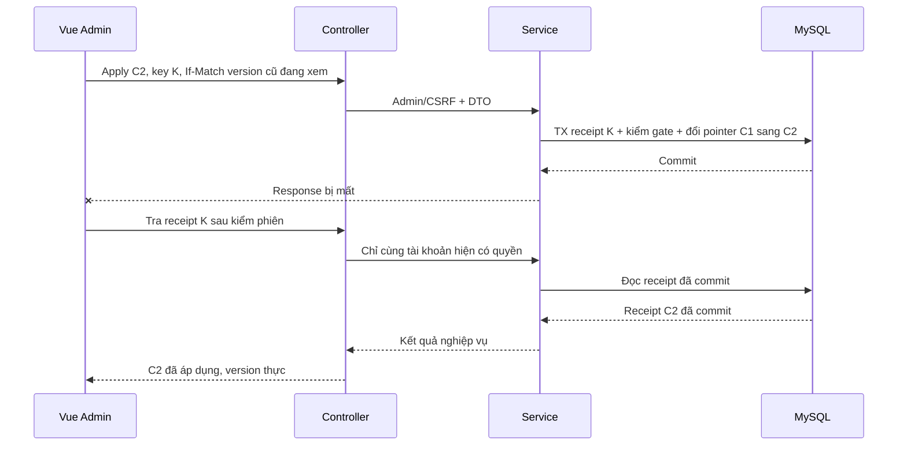

# Hợp đồng API và giao dịch

Nguồn mô tả URL, DTO, xác thực, version, command-window/receipt, trạng thái tác vụ và ranh giới giao dịch. Không thay endpoint hoặc nới điều kiện nghiệp vụ trong đợt biên tập.

## 1. Quy ước API

- Base path **/api/v1**; JSON UTF-8 cho dữ liệu, MP3/PNG đúng media type cho bytes. Không trả entity JPA, đường file hệ điều hành, stacktrace, password/token/key hoặc raw provider response.
- DTO dùng id/version/hash của đối tượng đã lưu; thời điểm do server ghi và trả dạng ISO-8601 UTC kèm serverNow/expiresAt khi cần. Client không tự đặt bắt đầu/kết thúc/lượt xem hoặc hạn phiên; hiển thị/thống kê ngày theo Asia/Saigon.
- Mỗi response có kết quả/trạng thái thực; lỗi có **code, message, fieldErrors nếu cần, retryable, correlationId**, không đưa thông tin nội bộ lên giao diện khách. correlationId không là mã phiên hoặc quyền.
- Header **If-Match** chứa version/ETag đối tượng đang chỉnh; thiếu điều kiện ở lệnh cần nó thì 400 PRECONDITION_REQUIRED, version cũ trả 412 VERSION_CONFLICT và giữ dữ liệu chưa lưu Q2. Không tự ghi đè bằng last-write-wins.
- Header **Idempotency-Key** là quy ước ứng dụng cho lệnh quan trọng; cùng actor/window/key/phạm vi/body/precondition dùng lại kết quả cũ trong window còn hạn, khác payload thì 409 KEY_REUSED. Window không còn/hết hạn không nhận key cũ như lệnh mới; LIFE-P02 đã duyệt 24 giờ từ cấp, login không gia hạn. Đây không phải giả định Gemini hỗ trợ exactly-once hoặc một tiêu chuẩn provider đã được kiểm chứng.
- Không đặt page size, dung lượng/độ dài bài/giây chờ/tải đồng thời tùy ý làm AC bắt buộc. Nếu cần phân trang kỹ thuật danh sách thì hoàn thiện DTO sau, không thêm bộ lọc hoặc chức năng export.
- HTTP GET không tạo phiên/ghi lượt/Áp dụng/gọi TTS. “Kiểm tra kết quả” chủ động là POST riêng; GET trạng thái không tự gửi lại yêu cầu ngoài.

Lựa chọn ETag/HTTP có cơ sở [RFC 9110](https://www.rfc-editor.org/rfc/rfc9110.html); cách đặt DTO/key/version là đề xuất của dự án, không tuyên bố framework tự thực hiện. Toàn bộ path/tên field dưới đây có thể điều chỉnh nhất quán khi duyệt hợp đồng, giữ mã API để truy vết.

## 2. Quyền truy cập và mốc thời gian

| Nhóm | Bằng chứng quyền / kiểm server | Không được làm |
| --- | --- | --- |
| Public | Trang bắt đầu/assets nhãn được phép, thông tin bootstrap cần thiết | Không tạo phiên vì mở QR; không đọc nháp/Admin/key/database. |
| Guest | sessionId + **X-Guest-Credential** riêng tab; server so hash ngẫu nhiên, trạng thái/hạn và ownership của opening/grant | Không tin ID/tên/cookie chung hoặc client isActive; không dùng cookie Admin thay quyền khách. |
| Admin | Cookie session Spring Security, một role Admin; CSRF cho lệnh ghi, cookie HTTPS/HttpOnly/SameSite theo cấu hình sẽ kiểm | Không JWT mặc định/đăng ký công khai; không dựa menu ẩn để phân quyền. |
| Worker/ops | Service nội bộ/đường CD-L01 đã chọn, không endpoint công khai nhận shell/backup/SQL | Không dùng URL ngrok để deploy hoặc frontend gọi Gemini trực tiếp. |

**Guest lifecycle:** xác thực credential trước; session còn hiệu lực nếu chưa ended và serverNow < expiresAt. GET trạng thái có thể trả ended/expired để điều hướng; điều đó không mở quyền nội dung mới. Hết hạn, tiếp tục A1 bằng Blob đã tải theo TECH-04, **không API cấp lại audio sau hạn**. Trả trạng thái đã kết thúc để giải quyết phản hồi bị mất không làm phiên còn hiệu lực.

**Admin Q3:** kiểm 30 phút từ lastInteractiveAt được ghi nhận khi còn hiệu lực; polling/status/CSRF/bootstrap/giữ tạm/audio tự phát không gia hạn. POST activity hoặc lệnh chủ động đủ quyền dùng timestamp server, không timestamp khách. Hết hạn 401 ADMIN_SESSION_EXPIRED, dừng preview/che nội dung; Q2 giữ công việc. Đăng nhập lại không tự gửi lại thao tác hoặc phát audio.

GET phục vụ xem chủ động và GET do tự tải có cùng URL nhưng không tự chứng minh hoạt động; UI gửi sự kiện Q3 được phép khi thực có thao tác xem/cuộn/chọn. Cách chống spam/batching chỉ là kỹ thuật, không dùng mất mạng để ghi bù/hồi sinh. [Spring Security CSRF](https://docs.spring.io/spring-security/reference/servlet/exploits/csrf.html).

## 3. Hợp đồng khách — phân biệt bắt đầu, khôi phục, chọn và nghe

**Triển khai hiện có:** K11 (mục 9.1), K01/K02 qua Controller → Service → Repository đã kiểm trong [64 test ngày 05/11](TDD.md#tdd-layers). Ngày 08/11 bổ sung phần kết thúc phiên K04, [88 test toàn bộ đạt](TDD.md#tdd-layers) với MySQL 8.4.13 tạm. K03/K05–K10 và thu hồi grant khi kết thúc đã có nguồn và kiểm chứng tại [mục 11.9](#guest-content-implementation); giới hạn frontend/vòng đời ghi riêng, không suy toàn T03 đã đạt.

| Mã | Method/path sau /api/v1 | Input/quyền | Kết quả / điều kiện |
| --- | --- | --- | --- |
| API-K01 | POST /guest/sessions | startTicket ký từ K11, displayName,initialLanguage; credential riêng tab; key=requestId đã ký | Kiểm signature/quyền/epoch/fingerprint. Có ledger trả cùng session/mốc gốc kể cả vé hết hạn; chưa ledger chỉ tạo vé còn 24 giờ. ID/key/fingerprint cùng TX và UK chống lặp, không gate/generation. |
| API-K02 | GET /guest/sessions/{sid} | Guest credential khớp sid | 200 effectiveState, mốc gốc/metadata cần UI; ended/expired không là lỗi mất phiên. Không thấy/không chứng minh quyền: không cho tra phiên theo tên hoặc lộ tên người khác. |
| API-K03 | POST /guest/sessions/{sid}/resume | Guest, documentNonce mới của document đã qua kiểm owner tab | Tiếp tục phiên hiện có, trả bản đồ/lựa chọn được phép và trạng thái, không tạo ID/lượt hoặc gia hạn. Reload trước hạn pause; nếu bài thay, tải cặp hiện hành và báo đầu bài. Sau hạn chỉ điều hướng P02, không trả grant audio mới. |
| API-K04 | POST /guest/sessions/{sid}/end | Guest + Idempotency-Key | Kết thúc còn hiệu lực: endedAt server, 200 ENDED; lần lặp của cùng kết thúc đã commit trả cùng kết quả. Nếu đã expired nhưng chưa ended, trả 409 SESSION_EXPIRED, không ghi endedAt muộn hoặc box “đã kết thúc” giả. |
| API-K05 | GET /guest/sessions/{sid}/map | Guest còn hiệu lực | Điểm hiển thị/vùng đang áp dụng đúng map space/version, không draft. Không tạo opening/lượt. |
| API-K06 | POST /guest/sessions/{sid}/openings | Guest còn hiệu lực; placeId, language, documentNonce, selectionSeq; key | Chủ động chọn điểm: tạo/chuyển opening hiện tại và trả snapshot văn bản/cặp/availability/contentGrantId khi có text. Chọn lại cùng điểm của cùng lần mở trả opening cũ, không cộng thêm; P06 do UI xử lý audio cục bộ. Chuyển B rồi quay A là opening mới. |
| API-K07 | PUT /guest/sessions/{sid}/openings/{oid}/language | Guest; language, documentNonce/selectionSeq, If-Match openingVersion; key | Giữ oid/phiên/điểm, lấy đúng tiếng và grant mới nếu có nội dung; không tự phát hoặc tạo lượt thứ hai. initialLanguage của phiên không bị sửa. Thiếu dịch trả availability/availableLanguages được phép, không auto fallback. |
| API-K08 | POST /guest/sessions/{sid}/openings/{oid}/view-ack | Guest còn hiệu lực; contentGrantId của văn bản thực đã hiển thị | 201 ghi PLACE_VIEW một lần cho opening đủ điều kiện; lặp trả cùng viewId/count. Lấy điểm/tên/tiếng/bản từ grant server, không từ snapshot client tùy gửi. Không ghi lượt chỉ vì nhận request chọn hoặc GET audio. |
| API-K09 | GET /guest/sessions/{sid}/content-grants/{gid}/audio | Guest còn hiệu lực; grant thuộc sid, có audio MP3 được phép | 200 toàn bộ MP3 đúng immutable file, Content-Type/length/checksum metadata; không nhận WAV/đường lưu do client chọn. Frontend tải đủ Blob rồi kiểm generation/quyền trước phát. Hết hạn từ chối, không “resume server” A1. |
| API-K10 | POST /guest/sessions/{sid}/openings/{oid}/leave | Guest còn hiệu lực; documentNonce/selectionSeq, oid hiện tại; key | Ghi việc quay lại bản đồ theo luồng đã có, kết thúc ngữ cảnh lần mở hiện tại; không ghi lượt hoặc phiên mới. Lần chủ động mở điểm sau là opening mới, kể cả cùng điểm. Request cũ không được xóa lựa chọn mới hơn. |

Chi tiết K04 đã triển khai ngày 08/11 nhận body rỗng và key UUID chuẩn chữ thường. Khóa bản ghi trước khi xét hạn và ghi endedAt, kiểm credential/epoch trước khi replay. Kết quả kết thúc được xác định theo phiên, key hợp lệ khác trên cùng phiên đã ended cũng trả mốc cũ với `replayed=true`. Cách này dùng ended_at hiện có, chưa thêm receipt riêng. Thu hồi grant/đóng opening đã bổ sung theo [mục 9.14](#api-guest-content-implementation-contract); dọn metadata/D08 vật lý còn mở.

### 3.1. DTO kết quả chọn/đổi tiếng, thiếu nội dung và tải audio

Một kết quả lựa chọn gồm openingId/openingVersion, placeId/tên/nhận biết bản, language, textRevisionId/text/contentHash nếu có, pairId/audioRevisionId/audioAvailability nếu có, contentGrantId, availableLanguages, expiresAt/serverNow. Không trả raw hồ sơ duyệt hoặc nội dung dự thảo cho khách.

- **Thiếu dịch:** trả 200 với trạng thái nội dung NOT_AVAILABLE và danh sách chỉ các ngôn ngữ có văn bản được phép; text/audio không giả. Nếu không có, về bản đồ. Đây là kết quả nghiệp vụ dự kiến, không nhất thiết lỗi HTTP.
- **Thiếu audio runtime của cặp đã áp dụng:** văn bản vẫn đọc, audioAvailability=NOT_READY; không thay bản cũ/sai tiếng. Audio endpoint 404/503 phù hợp căn cứ, UI D03/BS và retry từ đầu chỉ khi còn quyền.
- **Điểm không khả dụng ở lần chọn mới:** 404 PLACE_UNAVAILABLE/409 NOT_VISIBLE với thông báo chọn điểm khác, không tạo lượt/grant giả. Không cho client tự chọn cặp chưa áp dụng.
- **Đã cấp snapshot trước khi cặp thay/ẩn/xóa:** không đẩy cập nhật ép dừng phần đã tải. Grant chỉ dùng đúng file đã cấp tới hạn phiên, không tạo lại điểm/cặp; chọn mới/reload phải đối chiếu tình trạng hiện hành A07/P03.
- **Full MP3:** luồng fetch khách phải nhận đủ response 200; đề xuất từ chối Range ở endpoint này bằng 400 FULL_DOWNLOAD_REQUIRED, không nhầm 206/canplay/cache với đủ bài. Audio trong tab dùng Blob cho tua, không cần Range tới server sau hạn. Không thêm ngưỡng MB chưa chốt.
- Abort request không chứng minh server chưa xử lý; client dùng generation và nonce/sequence để loại phản hồi cũ. play() bị browser từ chối xử lý D03-BS, không báo đang phát giả.

### 3.2. Tab, thứ tự chọn và giao thức đếm lượt

documentNonce/selectionSeq **không phải credential**; server vẫn kiểm sid+credential. Resume chỉ gắn document đã qua cơ chế owner của TDD 9, không là “cướp phiên bằng ID”. Server ghi generation của document, chỉ chấp nhận lựa chọn mới hơn trong document đó; request cũ tới muộn trả STALE_SELECTION. Frontend cũng loại response cũ, một audio/tab; không tin việc abort đã hủy request phía server. Owner/Web Locks/duplicate/freeze vẫn cần kiểm trên thiết bị thật.

Để tuân D04/P06, opening hiện tại giữ place identity độc lập request key. Bấm lại cùng vùng không được client gắn key mới rồi làm tăng lượt. Đổi tiếng dùng API-K07, không gọi chọn vùng mới; reload dùng API-K03/GET hiện tại, không tạo opening mới hoặc ACK từ bản khôi phục.

**Quay lại bản đồ:** API-K10 chỉ dùng khi khách thực sự chọn hành động quay lại bản đồ trong nhánh nghiệp vụ đã có; kết thúc current opening nhưng giữ grant/ACK đang bay tối thiểu. Sau đó mở lại A là lần mở mới theo D04. Bản đồ vẫn nhìn thấy trên trang, kéo/phóng, chạm ngoài vùng hoặc mở/hủy box ứng viên **không** là leave, không reset opening/đếm lượt. API này là giao thức cho hành vi sẵn có, không thêm nút/luồng UI mới.

**ACK đề xuất:** server cấp grant gắn text snapshot đã được phép tại lúc trả; UI chỉ ACK **lần đầu văn bản của opening thực hiển thị**, giữ đúng key/grant của lần đó khi phản hồi chưa rõ. ACK không chờ audio. Nếu ban đầu thiếu text rồi khách đổi sang tiếng có text trong cùng opening, lần đầu text thành công có thể tính một lượt, đúng ngôn ngữ của lần đó; sau đã tính thì đổi tiếng không thêm.

ACK đang bay của lần chọn thật có thể đến sau lựa chọn tiếp theo: server đối chiếu grant đã cấp và UNIQUE của opening, không dùng tên hoặc “đang xem điểm nào” để đếm lặp. Đây là ghi nhận thao tác gốc, **không lượt do reload hoặc hàng chờ gửi bù offline**. Request/response cũ chưa từng được hiển thị không được frontend ACK. Khi session đã hết hạn, không nhận ACK mới; không backdate client clock. Mất ACK có thể chưa có lượt trong kho giữ lại; không tự tạo sự kiện để làm thống kê đẹp.

## 4. Hợp đồng Admin

### 4.1. Đăng nhập, hoạt động và kết quả thao tác

| Mã | Method/path sau /api/v1 | Quyền/input | Kết quả / ngoại lệ |
| --- | --- | --- | --- |
| API-A01 | GET /auth/csrf | Public/anonymous context theo Spring Security | Cấp thông tin CSRF cần đăng nhập/gọi lệnh, không tạo phiên khách, không gia hạn Q3. Không public token đăng nhập/secret. |
| API-A02 | POST /auth/login | Tài khoản/mật khẩu, CSRF; không log body | 200 Admin context/session cookie; sai thông tin 401 thông báo chung. Không tài khoản đăng ký mới. Cookie/session fixation/CSRF cụ thể kiểm theo BOM đã chọn. |
| API-A03 | GET /admin/session | Admin có session | Trạng thái/lastInteractiveAt/expiresAt cần UI, không gia hạn vì polling; hết hạn 401. |
| API-A04 | POST /admin/session/activity | Admin còn hiệu lực + CSRF; activityType thuộc Q3 | Timestamp server; nhập/vẽ/chọn/view-scroll/lưu/tạo-kiểm-thử lại/nghe thử theo Q3. Không dùng timer/background/audio tự phát hoặc client timestamp để hồi sinh. |
| API-A05 | POST /auth/logout | Admin + CSRF | 204 sau khi vô hiệu session. Client dọn đúng dữ liệu Q2 ở tab sau xác nhận. TTS đã nhận vẫn xử lý, không xóa nháp đã lưu. Không auto logout trước khi khách chọn bỏ công việc chưa lưu. |
| API-A06 | GET /admin/operations/{key} | Admin hiện đã xác thực, chỉ receipt của chính tài khoản | Trả kết quả commit/target ID của lệnh bị mất phản hồi; chưa thấy receipt không khẳng định chắc thất bại. Không trang lịch sử/xuất báo cáo mới. |

Login/logout cũng có phản hồi đang xử lý, không auto gửi lại sau mất mạng/xác thực. Cookie an ninh và credential guest tuyệt đối không lẫn vai trò. Lỗi API trả JSON 401/403, không HTML login page làm client hiểu nhầm dữ liệu hợp lệ.

### 4.2. Địa điểm và vùng

| Mã | Method/path sau /api/v1 | Input / precondition | Kết quả |
| --- | --- | --- | --- |
| API-A07 | GET /admin/places ; GET /admin/places/{pid} | Admin | Dữ liệu quản trị/điều kiện hiển thị/version; danh sách rỗng/lỗi riêng. Không tự đặt trần năm điểm. |
| API-A08 | POST /admin/places | Admin+CSRF+key; displayName Q1 | 201 id/version/hidden. Trùng tên chỉ warning kèm mã, không chặn/gộp/hậu tố. Không bắt vùng/bài khi lưu ẩn. |
| API-A09 | PATCH /admin/places/{pid} | Admin+CSRF+key+If-Match; tên | Cập nhật đúng version, giữ visible và vùng/cặp hiện hành. 412 giữ soạn Q2, tải đối chiếu trước ghi lại; không tự merge/ghi đè. |
| API-A10 | PUT /admin/places/{pid}/visibility | Admin+CSRF+key+If-Match; visible | Bật chỉ khi thông tin hợp lệ, vùng đã xem xét/áp dụng, ít nhất cặp vi được duyệt/áp dụng; trả missingConditions cụ thể. Ẩn chặn truy cập mới lần tải/chọn tiếp, không thu hồi Blob đang nghe. |
| API-A11 | DELETE /admin/places/{pid} | Admin+CSRF+key+If-Match; UI đã xác nhận đúng điểm | 200 placeDeleted=true/fileCleanupState=PENDING hoặc kết quả có căn cứ. Giữ session/views/history, không báo mọi file đã xóa. Retry key sau commit trả receipt, không xóa nhầm điểm mới trùng tên. |
| API-A12 | POST /admin/places/{pid}/region-revisions | Admin+CSRF+key+If-Match place; polygon,mapSpaceKey,geometryHash | Lưu hình kín hợp lệ đã xem trước; tạo revision riêng, không đổi active region. Hình dở chỉ Q2, không lưu thành bản hợp lệ. Không chốt ranh giới thật. |
| API-A13 | GET /admin/places/{pid}/region-revisions/{rid} | Admin; rid thuộc pid | Bản lưu/hash để xem trước/đối chiếu; chưa thêm editor công nghệ ngoài TECH-01. Xem trước tại client không bắt buộc một endpoint mới. |
| API-A14 | PUT /admin/places/{pid}/active-region | Admin+CSRF+key+If-Match place; savedRevisionId,previewedGeometryHash | Áp dụng đúng bản đã lưu/đã xem không đổi. Không âm thầm save hình đang sửa; lưu không đổi hình đã xem thì không bắt preview lại. Không tự bật visible/đẩy ngay vào tab khách. |

Đọc hash/nhập reference không thể chứng minh con người đã xem xét ranh giới hoặc được chủ đồ án duyệt. UI giữ bước xem trước/xem xét đã chốt; Service kiểm bản/hash/điều kiện, không tự thẩm định bản đồ ngoài hệ thống.

### 4.3. Văn bản, hồ sơ, TTS và áp dụng cặp

| Mã | Method/path sau /api/v1 | Input / quyền | Kết quả / điều kiện |
| --- | --- | --- | --- |
| API-A15 | GET /admin/places/{pid}/content/{lang} | Admin; lang vi/en/fr/ru | Slot/version, bản đang soạn đã lưu, cặp khách chỉ đọc, hồ sơ và job hiện có. Không tự tạo bản dịch hoặc thay text đang gõ. |
| API-A16 | POST /admin/places/{pid}/content/{lang}/text-revisions | Admin+CSRF+key+If-Match slot/place base; body,baseTextId | Lưu text revision và draft pointer, không đổi active pair hoặc tạo audio. Đã có job/audio trỏ T1 thì không sửa nội dung T1 tại chỗ; sinh T2. |
| API-A17 | PUT /admin/text-revisions/{tid}/review-reference | Admin+CSRF+key+If-Match; locator,limitations | Chỉ text đã lưu. Ghi ref đúng tid/hash, không tự lưu phần đang soạn; không bắt retype ngày/người duyệt từ hồ sơ hoặc auto duyệt/áp dụng. |
| API-A18 | POST /admin/text-revisions/{tid}/tts-jobs | Admin+CSRF+key; tid/hash | 202 job đã commit/accepted, snapshot đúng bản/ngôn ngữ/model/Charon. Một job đang tạo/unknown cho cùng text thì trả job cũ, không thêm provider request; không giữ TX chờ Gemini. |
| API-A19 | GET /admin/tts-jobs/{jid} | Admin | Trạng thái nội bộ/result/cause có căn cứ; polling không Q3 và không tự gọi tạo lại. Chưa rõ kết quả có outcomeUncertain riêng, không gán failed giả. |
| API-A20 | POST /admin/tts-jobs/{jid}/check | Admin+CSRF+key, thao tác chủ động | Kiểm yêu cầu cũ/provider nếu có cách truy hồi; không tạo TTS mới. Không có provider ID/khả năng tra thì vẫn UNKNOWN, không hứa reconcile được. |
| API-A21 | POST /admin/tts-jobs/{jid}/retry | Admin+CSRF+key; lỗi xác định, không job cũ đang chạy/unknown | Tạo attempt mới gắn đúng tid sau kiểm trạng thái; đã received vẫn xem job cũ. Không auto retry khi login/reload/429/timeout. |
| API-A22 | GET /admin/audio-revisions/{aid}/preview | Admin session hợp lệ | MP3 của đúng audio/text đã lưu, chưa duyệt vẫn được nghe trong Admin; nghe thử không phát cho khách. Hết session dừng preview/che UI, không ngoại lệ nghe tiếp khách. |
| API-A23 | PUT /admin/audio-revisions/{aid}/review-reference | Admin+CSRF+key+If-Match; locator,limitations | Audio đã tạo/sẵn sàng, ref riêng đúng aid/text/lang; không tự thẩm định/áp dụng hoặc coi kiểm codec là nghe duyệt. |
| API-A24 | PUT /admin/places/{pid}/content/{lang}/active-pair | Admin+CSRF+key+If-Match slot; textRevisionId,audioRevisionId,expected hashes | Chỉ cả cặp đủ D09/đúng bản/tiếng/file/hồ sơ, đổi pointer nhất quán. Lỗi giữ C1, chưa rõ tra receipt/current pair. Chỉ đổi A thì dùng T hiện tại+A mới duyệt, không bắt sửa T. Không tự bật hiện/chờ đủ 4 tiếng. |
| API-A25 | GET /admin/content-completeness | Admin | Ma trận địa điểm×4 tiếng: draft/ref/applied text/audio/pair thiếu gì. Không trộn có-file/tạo-xong với duyệt/áp dụng; không chức năng quản lý thêm ngôn ngữ. |

Text body ở đây là văn bản/DTO, không tự chọn rich HTML hoặc giới hạn ký tự/file bắt buộc mới. Kiểm tên đã chốt Q1 khác giới hạn bài TTS còn phải có căn cứ. Hồ sơ có thể chung mục cho text/audio nhưng record tham chiếu vẫn gắn đúng hai đối tượng; không server đọc hiểu tài liệu rồi kết luận đã được người dùng duyệt. Chỉ phê duyệt rõ theo D09 mới được Admin áp dụng.

### 4.4. Phiên khách, thống kê và một QR

| Mã | Method/path sau /api/v1 | Query/quyền | Kết quả / giới hạn |
| --- | --- | --- | --- |
| API-A26 | GET /admin/guest-sessions | Admin; fromDate,toDate,status,searchNameOrId đúng bộ lọc đã chốt | Danh sách chỉ đọc, default hôm nay Asia/Saigon. UI-A21 box chi tiết không thêm trang riêng, không sửa/gia hạn/kết thúc thay khách. |
| API-A27 | GET /admin/guest-sessions/{sid} | Admin | Tên/id/ngôn ngữ ban đầu/mốc/trạng thái + lượt đã tính (thời gian/nhận biết điểm/tiếng). Không còn dữ liệu trả 404 DATA_NOT_RETAINED, không bịa thời điểm đóng tab. |
| API-A28 | GET /admin/statistics | Admin; fromDate,toDate, default hôm nay | Hai tổng/hai nhóm: phiên theo ngày bắt đầu; lượt theo ngày/địa điểm snapshot/tiếng. Không thêm filter điểm/tiếng, biểu đồ/export/người duy nhất/lượt nghe/quét. |
| API-A29 | GET /admin/qr | Admin | URL chỉ đọc/trạng thái ready; một QR chung cho mọi điểm/tiếng, chưa URL thật thì unavailable. Không tự chọn domain/thư viện. |
| API-A30 | GET /admin/qr.png | Admin, URL thật đã được cấu hình/đối chiếu | PNG đúng QR chung. Chưa URL thật trả 409 QR_NOT_READY, không QR từ URL giả. Print dùng bố cục trình duyệt theo UI-05, không endpoint đếm in/quét; request tải/in không chứng minh đã lưu/in. |

Ngày đầu/cuối tính trọn ngày: chuyển khoảng local [Từ 00:00, ngày sau Đến 00:00) Asia/Saigon sang UTC để query, không kết thúc 23:59:59 làm rơi phần giây. from>to hoặc ngày sai trả 422 giữ bộ lọc. Về hôm nay do UI đặt lại hai ngày, danh sách giữ status/search. Query chỉ dùng dữ liệu còn giữ D08, kể cả nhận biết điểm đã xóa; grouping theo stable snapshot ID, không tên.

## 5. Thao tác lặp và mất phản hồi — không retry mù

| Tình huống | Thiết kế |
| --- | --- |
| Bắt đầu khách | Signed requestId/credential/epoch/issuedAt/expiresAt và fingerprint; lookup ledger trước phân nhánh expiry. UNIQUE + TX cho concurrent; expired có ledger trả gốc, expired không ledger không insert. Mất response giữ đúng vé/key/quyền, không tự tạo vé khác/session khác. |
| Đếm lượt | UK(session_id, opening_id) hoặc khóa tương quan tương đương ở PLACE_VIEW; ACK lặp/đổi tiếng/reload/audio không tạo view mới. Số đếm lấy DB, không cộng lạc quan vào client rồi coi đã ghi. |
| Admin lệnh DB | ADMIN_COMMAND_WINDOW + OPERATION_RECEIPT, UK(account,window,key), fingerprint method/resource/body/precondition. Xác thực/window còn hạn rồi receipt + thay đổi DB cùng TX; window cũ thiếu/hết hạn không thi hành lại. |
| Kiểm tra receipt | Chỉ Admin cùng tài khoản đã xác thực, kể cả sau login lại. Kiểm quyền **trước** replay; không cho người khác đọc receipt. Kết quả delete đã commit có thể replay dù target đã mất, không phụ thuộc tên trùng. |
| Thứ tự replay/precondition | Xác thực → window/account/epoch/hạn → receipt/fingerprint → replay kết quả commit nếu có → nếu lệnh mới kiểm If-Match/điều kiện. Không báo version conflict sai cho replay còn hợp lệ hoặc hứa receipt là trạng thái hiện tại mãi. |
| Lệnh đang chạy/chưa thấy | Chưa commit có thể chưa thấy receipt; không khẳng định thất bại. Retry cùng key dựa UK/TX đối chiếu, có thể trả OPERATION_IN_PROGRESS/cho kiểm lại; không key mới cho thao tác chưa rõ. |
| TTS | Receipt accepted trỏ jobId, không là audio đã tạo. Job request_key/khóa text ngăn bấm lặp; không suy receipt bảo đảm provider exactly-once. Retry provider chỉ chủ động sau lỗi xác định. |
| Lỗi HTTP/mất kết nối | 5xx/timeout của client không chứng minh rollback. Tra current state/receipt/job và replay đúng key nếu cần. Sau hết phiên Admin, login lại không auto replay; Q2 chỉ phục hồi soạn. |

Receipt chỉ là kỹ thuật giải quyết kết quả, không menu nhật ký mới; lưu hash payload thay nội dung/secret, chỉ thông tin tối thiểu không sao chép tên khách. [Vòng đời](operations-design.md#ops-lifecycle) cập nhật LIFE-P02/P03 đã duyệt và hướng LIFE-P01 đơn giản; vé ký 24 giờ LIFE-P01 đã duyệt, độc lập window Admin/8 giờ guest/30 ngày ledger. Không giữ metadata vô hạn hoặc coi thiết kế là test. Không áp log 7 ngày/D08 30 ngày máy móc cho mọi metadata. Lỗi validation/precondition đã rollback không là receipt thành công; client không tự lặp, khi chủ động thay payload/điều kiện dùng operation mới. Chỉ receipt commit mới là căn cứ không thi hành cùng lệnh lần hai.

## 6. Ranh giới giao dịch và xử lý đồng thời

Controller nhận DTO/quyền, Service quyết định/giữ TX, Repository thực hiện đọc/ghi/khóa. Không Controller gọi trực tiếp Repository để bypass luật. TX phải đi qua cơ chế Spring proxy tương ứng; tự gọi method trong cùng object không tự tạo giao dịch mới. Chưa viết code, không thay BOM đang chọn bằng version hiển thị trên trang docs. [Spring transactions](https://docs.spring.io/spring-framework/reference/data-access/transaction/declarative/annotations.html).

### 6.1. Danh sách giao dịch

| Mã | Bên trong TX ngắn | Ngoài TX / lỗi |
| --- | --- | --- |
| TX-K01 Bắt đầu | Xác minh signature/epoch/credential/key, đọc ledger và đối chiếu; có trả gốc, không có kiểm clock vé rồi insert session/key/fingerprint/timestamp-digest vé cùng TX | UNIQUE race: rollback TX lỗi rồi đọc/đối chiếu trong TX mới, không query trong TX đã hỏng. Không tự sinh key mới hoặc gia hạn mốc, không start/purge gate. |
| TX-K02 Chọn/đổi tiếng/quay bản đồ | Kiểm phiên/generation; đọc đúng điểm/vùng/cặp hiện hành trong snapshot; tạo/update hoặc kết thúc opening/grant + GUEST_REQUEST_RESULT đúng key/seq/fingerprint, không ghi view | Lấy bytes MP3 ngoài TX; clientrender/Blob ngoài DB. Chọn lại cùng point không opening mới. |
| TX-K03 ACK view | Kiểm credential/hạn, grant đã cấp/đúng opening, snapshot server; insert view một lần với live_place_id còn sống hoặc NULL nếu điểm đã xóa, giữ stable ID/name/lang; mark counted | Không giữ TX chờ audio hoặc client render. Đã có view thì trả gốc; không dựa cặp hiện hành A2 để viết lại view A1. |
| TX-K04 Kết thúc | Khóa/kiểm session; nếu active ghi endedAt một lần, vô hiệu grant chưa dùng thêm; anchor D08 đúng endedAt | Expired không ghi end muộn. Đã ended trả trạng thái cũ; tab khác ID không bị đụng. |
| TX-A01 Lưu/ẩn-hiện/vùng | Khóa PLACE/version; lưu revision/hash hoặc kiểm gate; đổi đúng pointer nếu Apply | Không save ngầm, không xem lại hình đã preview không đổi chỉ vì vừa lưu. |
| TX-A02 Áp dụng cặp | Khóa PLACE → SLOT/version; kiểm text/audio cùng slot/bản/tiếng/hồ sơ/file; tạo/reuse pair và đổi active pointer + receipt, ghi last-unapply của file cũ đúng lúc | Không gọi provider/đọc file dài trong TX; file existence-check cần có protocol tránh cleaner, không kiểm rồi nhả race. C1 giữ khi TX rollback, client mất response tra receipt. |
| TX-A03 Tạo job | Khóa text/slot; kiểm không active/unknown job; snapshot/create job + receipt accepted, commit | Worker gọi Gemini sau commit; không sự kiện RAM duy nhất rồi mất job khi restart. |
| TX-A04 Kết quả job | Theo job/target đã snapshot, kiểm target_valid/text/hash/tiếng, ghi AUDIO_REVISION + WAV/MP3 metadata đúng bản, phase success | Gọi provider/convert/check file ngoài TX; nếu target xóa thì bỏ liên kết/đưa orphan, không phục hồi PLACE. |
| TX-A05 Xóa điểm | Khóa PLACE và các aggregate theo thứ tự; bỏ pointers/phụ thuộc riêng, void liên kết TTS, giữ views/grants kỹ thuật cần phục vụ đã cấp, chuyển live refs/snapshots, metadata dọn file + receipt; DELETE place; commit toàn bộ hoặc rollback | Dọn file sau commit, không xóa hồ sơ tài liệu/dữ liệu dùng chung. Trả fileCleanupPending, không tuyên bố mọi file đã mất. |
| TX-D01 Xóa phiên đến hạn | Kiểm lại anchor+30 ngày, xử lý view/request-result/opening/grant và session/ledger đúng FK trong TX | Không tăng/khóa start_generation; request vé cũ sau purge đã hết 24 giờ nên không tạo lại. Không đổi D08 hoặc giữ tombstone ngoài hạn. |
| TX-F01 Dọn asset | Khóa/kiểm refs + job/read-claim + mốc đủ hạn, đánh dấu cleanup-claimed để ngăn ref mới | File delete bên ngoài TX, sau đó finalize deleted/retry trong TX mới. File đã absent được xác nhận là kết quả dọn, không giả lúc chưa kiểm. |
| TX-O01 Receipt | Khóa command window, kiểm account/expiry/epoch rồi receipt cùng TX lệnh DB; result chỉ committed sau commit | Dọn window/receipt không khi TX đang dùng; không bao trùm provider/file hoặc hồi sinh key sau dọn. |

### 6.2. Các cuộc đua bắt buộc xử lý

- **Hai Admin sửa:** If-Match/version cũ trả 412; Q2 giữ soạn và cho tải đối chiếu. Không âm thầm merge/publish hoặc biến conflict thành mất dữ liệu.
- **Apply với Delete/Hide:** khóa PLACE trước, đọc lại gate/target trong TX. Delete thắng thì Apply thất bại không tạo lại; Hide thắng không cho Apply tự bật hiện. Apply thành công rồi Hide thì cặp vẫn có nhưng truy cập mới chặn.
- **Hai tạo audio cùng text:** lock text trước kiểm active job, tạo tối đa một job đang tạo/unknown; không dựa kiểm ngoài TX rồi cùng gọi provider. T2/T3 là hai bản khác, không gắn audio nhầm dù hai job cùng tồn tại.
- **Worker với Delete:** worker không giữ job lock rồi đi lấy PLACE ngược chiều. Đọc snapshot để biết target, TX finalize lấy PLACE → SLOT/text → JOB → FILE theo thứ tự phù hợp; target đã mất thì nhánh orphan không cố khóa/insert PLACE. Không giữ DB lock suốt Gemini.
- **Cleaner với Apply/Download/Backup:** mọi bước có thể thêm/tháo ref phải nhìn cleanup state và claim cùng protocol. Khi cleaner đã claim, không nhận ref mới; khi đọc/copy đang giữ read-claim thì chưa xóa. File vừa tạo không được áp dụng trước hoàn tất/kiểm metadata.
- **Hai chọn liên tục:** docNonce+selectionSeq trong authenticated session tránh request cũ tới muộn làm server current selection sai; clientgeneration cũng kiểm khi response/Blob/play về. Không cộng lượt cho phản hồi chưa hiển thị.
- **ACK với cặp thay/xóa:** lấy snapshot được cấp, không đọc tên/cặp hiện hành để gộp lịch sử. ACK hợp lệ ghi một view của lần chọn gốc, live FK nullable theo kết quả xóa; không tạo quyền chọn điểm đã xóa.
- **End/Expiry với ACK/grant:** kiểm serverNow khi quyết định TX; nếu đã hết hạn không cấp thêm grant hoặc view mới. Khi cạnh tranh, thứ tự commit/kiểm dưới khóa là căn cứ; không dùng timestamp client để backdate.
- **Deadlock/timeout khóa:** rollback toàn TX. Có thể thử lại **phần DB thuần đã biết rollback** với cùng key theo chính sách kỹ thuật sẽ kiểm; không retry lời gọi TTS hoặc lệnh có kết quả commit chưa rõ. Không cam kết không bao giờ deadlock.

Thứ tự lock dự kiến: Admin window → PLACE → SLOT/TEXT → JOB → FILE; chọn/ACK khách SESSION → PLACE còn sống → OPENING/GRANT, không khóa opening rồi quay lấy PLACE. Download SESSION/GRANT → FILE, không lấy PLACE sau FILE. Xóa điểm không khóa/sửa session khách, giữ opening/grant snapshot; purge session không mở quyền/place lại. Cleaner kiểm OPS_GUARD trước FILE/claims. Khóa ngầm FK/deadlock vẫn cần kiểm thật và xử lý rollback, không hứa mô tả đã loại bỏ mọi deadlock.

Ưu tiên version lạc quan cho sửa form và khóa row ngắn cho chuyển pointer/gate/delete/job. Dùng locking read đúng transaction và index, không khóa mọi bảng suốt request. FK vẫn chặn thao tác xóa trực tiếp ở quan hệ cần bảo vệ; không ON DELETE CASCADE để né. [MySQL locking reads](https://dev.mysql.com/doc/refman/8.4/en/innodb-locking-reads.html). Thứ tự khóa cần giữ nhất quán với Repository và các ca kiểm MySQL; bằng chứng từng nhóm tại báo cáo kiểm thử, không suy toàn bộ race/deadlock đã được bao phủ.

### 6.3. Ví dụ áp dụng cặp bị mất response

Không thấy response không đổi C2 về C1, không gọi Apply key mới mù. Nếu login lại, chỉ khi Admin chủ động kiểm/tiếp tục mới gọi; Q2 không là hàng đợi tự phát lệnh.

## 7. Mô hình và vòng đời hiện hành — một vị trí chính

### 7.1. Mô hình dữ liệu

[Mô hình 0.3](data-model.md) là nguồn chính cho bảng/ERD/ràng buộc TDD hiện hành/API 0.4. Nó đã hợp nhất opening/grant/receipt của API 0.1, bỏ context/10 phút/start_generation, dùng vé ký 24 giờ/ledger session và giữ window/claim theo DATA-05/DATA-04. [Bản mô hình TDD 0.3](https://github.com/khaithanh2726-beep/AudioQR_Kinh-thanh-Hue/blob/601c09acd34e45d3d0b17bf2b7dbe94daf6bdae1/docs/99-luu-tru/data-model-history.md) chỉ là lịch sử; không tự ghép ERD TDD 0.2–0.4 với bảng bổ sung của API cũ.

Opening giữ đúng P06/đổi tiếng/reload và chủ động quay map; grant ghim đúng text/MP3/deadline; PLACE_VIEW không FK buộc giữ opening tới 30 ngày. Download sau hạn bị chặn, Blob đủ điều kiện là quyền nghe tiếp ở tab. Window Admin và expiry vé guest 24 giờ ngăn key cũ được nhận như lệnh mới sau khi dọn kết quả; GUEST_REQUEST_RESULT giữ tương quan request guest tạm tới end/expiry, không dùng receipt Admin cho guest.

### 7.2. Job/file và thao tác lặp

[Operations 1–2](operations-design.md#ops-lifecycle) mô tả tạo/giữ/vô hiệu/dọn, marker DISPATCHING trước provider, owner token/phase version, xử lý unknown/local retry/target xóa và phân biệt WAV hoàn chỉnh 24 giờ với workspace 1 giờ. LIFE-P01 vé ký 24 giờ đã duyệt DATA-05, LIFE-P02/P03 giữ nguyên; hết hạn vé không chặn lookup gốc có quyền hoặc đổi mốc session. Cookie Admin/Q3 và guest credential không bị thay bằng window/start ticket.

### 7.3. Backup/restore và CD

[Operations 3–5](operations-design.md#ops-backup) mô tả **BKP-P02 đã chọn**: stop phục vụ/dispatch/ghi/dọn có kiểm soát, giữ MySQL, dump/catalog/copy cùng checkpoint, không MySQL tạm mỗi lần backup. REC-P01 đã duyệt thu hồi quyền/window cũ khi restore thật; không backup/restart thường.

Khi app QUIESCING có thể trả 503 SERVICE_MAINTENANCE; khi app dừng có thể không truy cập được. P04/Q2 giữ lựa chọn/soạn, kiểm hiệu lực lúc mở lại; không gửi lặp hoặc reset 8 giờ/24 giờ/30 phút. Job đã nhận giữ, không provider retry/auto Apply. Chi tiết error/mode là kỹ thuật dự thảo, không thêm endpoint public vận hành.

CD-L01 vẫn Actions → Tailscale riêng → OpenSSH Windows → PowerShell → Docker Desktop; ngrok chỉ web. Chưa SSH/context/quyền/CD, V-CD01 phải kiểm trước triển khai đầy đủ.

## 8. Ma trận lỗi và phản hồi đúng nghiệp vụ

| HTTP / code đề xuất | Khi nào | UI/hành động được phép |
| --- | --- | --- |
| 400 MALFORMED_REQUEST / PRECONDITION_REQUIRED | Sai cấu trúc/thiếu điều kiện kỹ thuật | Giữ dữ liệu, chỉ rõ trường cần sửa/kiểm lại; không gửi lặp mù. |
| 401 GUEST_CREDENTIAL_INVALID / ADMIN_SESSION_EXPIRED | Thiếu/sai quyền hoặc Admin hết phiên | Không tiết lộ dữ liệu phiên khác; Admin che/dừng preview/Q2/login lại. Guest không khẳng định “hết hạn” khi chỉ không xác thực được phiên. |
| 403 FORBIDDEN / CSRF_INVALID | Có ngữ cảnh nhưng không đủ quyền/CSRF | Chặn thao tác, không “thành công”; không thử bỏ bảo mật để chạy. |
| 404 SESSION_NOT_FOUND / DATA_NOT_RETAINED / PLACE_UNAVAILABLE | Không còn dữ liệu được phép truy cập | Guest theo P02: “Không thể tiếp tục phiên trước. Vui lòng bắt đầu phiên mới” nếu không có căn cứ state; Admin box/detail phản hồi đúng không còn. |
| 409 SESSION_EXPIRED / SESSION_ENDED | Guest có chứng cứ phiên nhưng lệnh cần active | UI box đúng nhánh/mốc; văn bản đã tải đọc được, chỉ Blob đủ điều kiện được pause/resume, không tải mới. |
| 409 REQUIREMENTS_NOT_MET / WRONG_REVISION / TARGET_DELETED | Gate vùng/cặp/visibility thiếu hoặc sai bản | Liệt kê thiếu gì/đối tượng đã đổi; không Apply/Lưu ngầm hoặc phục hồi điểm. |
| 409 KEY_REUSED / OPERATION_IN_PROGRESS / OUTCOME_UNCERTAIN / STALE_SELECTION | Key khác body, đang xử lý, chưa rõ provider, request chọn cũ | Tra receipt/current state/job; không key mới/auto retry/đổi lựa chọn mới bằng response cũ. |
| 412 VERSION_CONFLICT | If-Match không còn đúng | Giữ soạn Q2, tải đối chiếu bản hiện hành; không ghi đè. |
| 422 VALIDATION_FAILED | Tên/tiếng/ngày/geometry sai theo quy tắc đã chốt | Giữ input/chỉ lỗi; không tự thêm giới hạn văn bản/file tùy ý. |
| 429 RATE_LIMITED / PROVIDER_QUOTA | Có căn cứ giới hạn dịch vụ/request | Báo đúng lý do có thể biết, cho kiểm/thử lại chủ động phù hợp; không tự bật billing/tạo key né quota hoặc nói chắc hết tiền. |
| 503 SERVICE_UNAVAILABLE / MEDIA_NOT_READY | Mạng/dịch vụ/file tạm không sẵn sàng | Giữ nội dung/lựa chọn/Q2, retry đúng quyền. Khách audio đã tải đủ có thể tiếp tục theo trạng thái phiên, không ép dừng vì một API lỗi. |
| 500 INTERNAL_ERROR / kết nối mất | Lỗi không dự kiến hoặc client chưa biết commit | Không nói chắc rollback; tra receipt/job/state. Không trả stacktrace/secret hoặc “đã xóa file” thiếu kiểm. |

Thông báo khách chuyển theo ngôn ngữ đã rà soát; câu vi P02/D04-BS là căn cứ nghĩa. Error code là cho client/kiểm tra, không phải dòng kỹ thuật phải hiện thường trực cho khách.

## 9. DTO hiện hành cho các luồng trọng yếu

**Quy ước:** bảng chỉ rõ trường gửi/nhận để triển khai DTO, chưa JSON schema/OpenAPI thực thi. Mã S1/O1/T2/A2/C2 trong ví dụ là nhãn giả định, API thật dùng UUID; hash/token chỉ là chỗ giữ minh họa, không key thật. Timestamp mẫu dùng UTC, giao diện đổi theo ngôn ngữ/múi giờ. Nullable được ghi rõ, server không tin field ngoài hợp đồng.

### 9.1. Start ticket và cửa sổ lệnh — không phải phiên/nghiệp vụ mới

| Mã / path sau /api/v1 | Request | Response / quy tắc |
| --- | --- | --- |
| **API-K11** POST /guest/start-ticket | Public; X-Guest-Credential riêng tab, body rỗng | 201 {startTicket,requestId,issuedAt,ticketExpiresAt,serviceEpoch,serverNow}; payload ký gắn credentialHash, ticketExpiresAt=issued+24 giờ. Không session row/thao tác/đồng hồ mới; không startGeneration/context. |
| **API-A31** POST /admin/command-windows | Admin còn hạn + CSRF, body rỗng | 201 windowId,serviceEpoch,issuedAt,expiresAt=issued+24 giờ theo LIFE-P02 đã duyệt. Cấp ở nền không tự Q3/login mới; login lại không gia hạn window cũ. |

K11/A31 phục vụ K01/A06, **không thêm FR/UC/màn hình**. K11 cấp vé ký 24 giờ theo DATA-05, không context/10 phút/generation; path context cũ chỉ lịch sử, không hợp đồng song song. Không JWT Admin. Client không gửi secret qua query/URL hoặc nhận lại credential trong response.

**Chi tiết triển khai K11:** chỉ nhận body rỗng; credential chuẩn 32 byte/Base64URL không padding và cấu hình khóa/epoch theo [operations](operations-design.md#ops-start-runtime). Không tạo session row. K11/K01/K02 trả `Cache-Control: no-store`; lỗi dữ liệu trả đủ code/message/fieldErrors/retryable/correlationId. Sai credential dùng 401 GUEST_CREDENTIAL_INVALID; sai định dạng/chữ ký vé 401 INVALID_START_TICKET; epoch khác 403 SERVICE_EPOCH_MISMATCH. Đây là mã hợp đồng cho client, không đưa chuỗi kỹ thuật thường trực lên màn hình khách.

### 9.2. Bắt đầu, đọc trạng thái, khôi phục — K01/K02/K03

| DTO | Trường bắt buộc / tùy chọn | Kiểm / kết quả |
| --- | --- | --- |
| StartRequest | startTicket,displayName,initialLanguage; Idempotency-Key=requestId đã ký; credential header | Raw control/newline từ chối trước normalize. Kiểm signature/epoch/quyền, ledger + fingerprint + ticket metadata; đã có trả gốc dù expiry vé, không có chỉ insert vé còn hạn. Không đổi key/body để tái dùng vé tạo nhiều phiên. |
| SessionResponse | sessionId, state ACTIVE/ENDED/EXPIRED, displayName, initialLanguage, currentLanguage, startedAt, expiresAt, endedAt nullable, serverNow, created, replayed | 201 tạo mới, 200 replay đã có. Không trả credential hash; currentLanguage có thể null sau end/expiry (form dùng memento hợp lệ trong tab); state expired không đổi mốc bắt đầu hoặc retention. Không dùng tên tìm lại phiên. |
| ResumeRequest | documentNonce mới, previousDocumentNonce nullable; header credential | Backend CAS nonce dưới khóa session sau kiểm credential; gửi lại cùng documentNonce không tăng generation hoặc tạo phiên/lượt. Client chỉ resume sau kiểm owner theo TDD 9; nonce không thay xác thực. |
| ResumeResponse | SessionResponse + documentNonce, selectionSeq, currentOpening nullable, content nullable, restoreReason | Trước hạn lấy bản hiện hành được phép để đối chiếu audioRevision/hash với memento **trong tab**; cùng bài mới đặt mốc rồi pause. Bài đổi hoặc mốc không dùng được về đầu/thông báo. Sau hạn content/grant mới null, chỉ trạng thái/P02. Không gửi/lưu lịch sử mốc nghe vào DB. |

**Ví dụ thành công:** Start “  An   Bình ”/vi → displayName="An Bình", sessionId=S1, startedAt=2026-11-03T02:00:00Z, expiresAt=2026-11-03T10:00:00Z, created=true. Reload S1 → created=false, cùng hai mốc, content.source=RESTORE, không tự phát/lượt mới.

**Lỗi:** 422 VALIDATION_FAILED, fieldErrors.displayName nêu tên không hợp lệ; chưa session row. Vé hết hạn và không ledger: 409 START_TICKET_EXPIRED, giữ tên/tiếng, không khẳng định sai phiên đã hết hạn hoặc request gốc chắc chưa commit. Nếu chưa gửi lần đầu, chuẩn bị vé mới nền; nếu pending chưa rõ thì không tự đổi key/gửi như phiên mới. Sai chữ ký/credential/epoch từ chối quyền, cùng key khác body 409 KEY_REUSED.

**Mất phản hồi:** giữ vé/requestId/credential. Đã có session thì kiểm signature/quyền/epoch/fingerprint/timestamp vé và trả S1/hạn gốc **kể cả vé đã quá 24 giờ**; không tự tạo S2 hoặc sửa tên/initialLanguage. Chưa ledger chỉ vé còn hạn được insert. Sau purge đúng D08, vé cũ đã quá 24 giờ → START_TICKET_EXPIRED, không S2. Khi không thể xác định/tiếp tục, thông báo phù hợp và khách chủ động xác nhận lần mới. Không expiry validator chặn mọi lookup trước khi đọc ledger.

### 9.3. Chọn điểm, đổi tiếng, quay bản đồ và ghi lượt — K06/K07/K08/K10

| DTO | Trường gửi / nhận | Ý nghĩa |
| --- | --- | --- |
| SelectionRequest K06 | placeId, language, documentNonce, selectionSeq; key | Không nhận pairId/audioId do khách tùy chọn. Server lấy cặp hiện hành đúng điểm/tiếng, key và freshness kiểm cùng session. |
| LanguageRequest K07 | language, documentNonce, selectionSeq; If-Match openingVersion; key | Chỉ opening hiện tại; giữ session/điểm, cập nhật currentLanguage, không sửa initialLanguage, không phát tự động. |
| ContentResponse | openingId, openingVersion, selectionKind NEW_OPENING/SAME_OPENING, place{id,name}, language, source SELECT/LANGUAGE/RESTORE, availability, availableLanguages | SAME_OPENING dùng P06 và audio cục bộ, không trở thành yêu cầu play-from-zero; bản đồ kéo/phóng/ngoài vùng không gửi K10. |
| ContentResponse.text | null hoặc {revisionId,hash,body} | Chỉ văn bản được phép; thiếu dịch trả null, availableLanguages chỉ tiếng có nội dung được phép. |
| ContentResponse.audio | null hoặc {revisionId,mp3FileId,checksum,byteSize,durationSeconds,availability READY/NOT_READY} | Không URL filesystem/WAV/provider key; trạng thái file runtime không đổi việc cặp đã được áp dụng. |
| ContentResponse.grant | null hoặc {id,expiresAt,viewEligible}; kèm serverNow | Deadline bằng hạn phiên; session+credential vẫn cần để tải. Không quyền audio sau expiry; full response MP3 rồi Blob trước phát. |
| ViewAckRequest | contentGrantId | UI chỉ ACK văn bản thực đã hiển thị lần đầu trong opening; backend kiểm grant/owner/phiên/viewEligible. Lấy snapshot server, không nhận viewedAt/name/lang do client đặt. |
| ViewAckResponse | viewId, created, viewedAt, language, openingId | 201 mới; 200 đã tính trả view gốc. UK(session,opening) là nguồn chống lặp, không counter client. |
| LeaveRequest K10 | documentNonce,selectionSeq; oid path; key | Chỉ quay về bản đồ theo nhánh đã có. Đóng current opening, không cộng lượt; không làm mất ACK gốc đang bay. |

**Ví dụ thành công:** chọn P1/vi → O1, T1/A1/C1/G1, NEW_OPENING; hiển thị text rồi ACK G1 → V1/created=true. Bấm P1 lại → SAME_OPENING, P06 giữ/tiếp tục/phát lại đúng trạng thái; đổi en → O1/G2/source=LANGUAGE, dừng audio cũ và pause đầu, ACK lại không tạo V2. Chọn P2 rồi P1 → O2/O3; mỗi lần text thành công có một lượt. Chủ động Quay bản đồ rồi mở P1 cũng là opening mới, không suy từ map vẫn nhìn thấy.

**Thiếu/lỗi:** thiếu fr → text=null, availability=TEXT_NOT_AVAILABLE, availableLanguages=["vi","en"] nếu đúng dữ liệu được phép; chưa lượt, không auto fallback. Audio runtime thiếu → text vẫn có, audio.availability=NOT_READY, nút phát khóa; tải lỗi có căn cứ trả 503 MEDIA_NOT_READY và retry từ đầu khi còn hạn. 409 STALE_SELECTION chỉ bỏ request cũ, không thay lựa chọn mới.

**Mất phản hồi:** GUEST_REQUEST_RESULT lưu key + documentNonce/seq/fingerprint và khóa kết quả opening/grant, không body text trùng; giống request trả kết quả cũ, không seq mới chỉ vì timeout. Replay không đổi current selection đã mới hơn. Nếu text gốc đã xóa thì báo không còn khả dụng, không tráo bản khác hoặc tạo lượt. Mất ACK response thì cùng grant trả V1/created=false. Reload RESTORE không tạo ACK mới; không hàng chờ gửi bù offline. ACK cũ hợp lệ tới sau delete dùng snapshot/null live FK, không hồi sinh điểm; sau session expiry từ chối ghi lượt mới.

### 9.4. Tạo, kiểm và thử lại TTS — A18–A21

| DTO | Trường | Điều kiện |
| --- | --- | --- |
| CreateTtsRequest | textRevisionId ở path, expectedTextHash; operation key/window | Server tự lấy body/tiếng của bản đã lưu, model/Charon đã chọn; không lấy phần chưa Lưu hoặc cho client chọn provider/model ngoài quyết định. |
| TtsJobResponse | jobId,textRevisionId,textHash,language,model,voice,state,phase,targetValid,outcomeUncertain,acceptedAt,updatedAt,phaseVersion,terminalAt,sourceWavFileId,failureCode,retryAction,result | state cho UI: PROCESSING/SUCCEEDED/FAILED/UNCERTAIN/DISCARDED. Các trường kết quả/lỗi có thể null theo phase; tiếp nhận không là tạo audio thành công. |
| TtsJobResponse.result | null hoặc {audioRevisionId,wavFileId,mp3FileId,checksum,durationSeconds} | Chỉ result đúng bản đã kiểm metadata; không hồ sơ “đã nghe duyệt” tự động. |
| TtsJobResponse.failureCode / retryAction | Hai trường trực tiếp, không có object failure hoặc failureStage | REPROCESS_LOCAL khi WAV hợp lệ và lỗi local; CREATE_PROVIDER_ATTEMPT khi lỗi provider xác định; INSPECT_ONLY khi chưa rõ. Không trả raw provider body/secret/prompt. |
| CheckRequest / RetryRequest | Path jobId; operation key/window; body rỗng hoặc expectedPhaseVersion khi Retry | Check không gọi tạo mới. Retry kiểm active/unknown/phase và target; accepted tiếp tục dù Admin hết phiên; không auto gửi khi login. |

**Ví dụ thành công:** A18(T2,H2) → 202 {jobId:J2,state:PROCESSING,phase:QUEUED,reused:false}. Poll A19 sau đó → SUCCEEDED/result=A2; chưa được duyệt/áp dụng. Hai request cùng text khi J2 active trả J2/reused=true, không hai lần provider.

**Lỗi:** text chưa lưu/đã xóa → 409 TARGET_DELETED hoặc WRONG_REVISION, không tự Lưu. Có response provider lỗi xác định → FAILED và mã phù hợp; convert lỗi sau WAV tốt cho retry local. DISPATCHING mất kết quả → UNCERTAIN, Check chỉ kiểm yêu cầu cũ, không gán lỗi để mở retry mù.

**Mất phản hồi:** tra receipt/job sau xác thực; có J2 thì tiếp tục xem. Chưa thấy receipt chưa chứng minh rollback. Worker crash sau DISPATCHING không tự gọi lại Gemini; target bị xóa trong lúc chạy thì kết quả muộn bị loại và file xử lý đúng lớp vòng đời.

### 9.5. Áp dụng cả cặp — A24/TX-A02

| DTO | Trường | Kiểm |
| --- | --- | --- |
| ApplyPairRequest | textRevisionId,audioRevisionId,expectedTextHash,expectedMp3Checksum,textReviewVersion,audioReviewVersion; If-Match slotVersion; operation key/window | Khóa PLACE→SLOT/TEXT→JOB/FILE theo protocol. Text/audio cùng slot/bản/tiếng, file READY, review references đúng bản/version; không ghi hồ sơ/lưu draft ngầm. |
| ApplyPairResponse | operationId,placeId,language,previousPairId nullable,appliedPair{id,textRevisionId,audioRevisionId},slotVersion,appliedAt,replayed | Một TX đổi cả cặp + receipt; không tự bật hiện hoặc chờ bốn tiếng. Response commit là sự kiện tại appliedAt, không chứng minh không có thay đổi khác sau đó. |
| Apply error | 412 VERSION_CONFLICT hoặc 409 REQUIREMENTS_NOT_MET với missingConditions | Giữ Q2 và cặp cũ khi thất bại xác định. T2+A1 không khớp, hồ sơ/file thiếu thì không áp dụng nửa cặp. |

**Ví dụ thành công:** C1=(T1,A1) → C2=(T2,A2); response appliedPair=C2, khách nhận ở lần tải/chọn tiếp. Chỉ đổi audio: T1+A3 hợp lệ, không bắt sửa/duyệt lại T1.

**Ví dụ lỗi:** 409 {code:"REQUIREMENTS_NOT_MET",missingConditions:["AUDIO_REVIEW_REFERENCE_MISSING"]}; không đổi pointer. Tham chiếu có đủ không chứng minh người dùng đã duyệt: **Admin phải đối chiếu hồ sơ bên ngoài D09 trước chủ động Apply**; server không tự thẩm định lịch sử/ngôn ngữ/audio hoặc coi locator là chữ ký duyệt.

**Mất phản hồi:** A06 cho biết key đã commit C2 lúc nào; gọi lại cùng key trong window trả cùng kết quả dù If-Match gốc đã cũ. Sau đó GET slot đối chiếu bản hiện hành (có thể đã là C3 do thao tác khác), không trình receipt C2 như lời khẳng định C2 vẫn đang phục vụ. Không tìm thấy/hết window thì không tự dùng key mới Apply lại.

### 9.6. Xóa địa điểm — A11/TX-A05

Request: pid path + If-Match placeVersion + operation key/window; UI đã xác nhận đúng tên/mã. Không cần nhét SQL/FK vào form hoặc gửi danh sách “xóa mọi file”.

**Thành công:** 200 {operationId:D1,placeId:P1,databaseState:"DELETED",fileCleanup:{state:"PENDING"},historyPreserved:true,replayed:false}. Cùng DB transaction xử lý riêng/dùng chung/target TTS/history; dọn bytes ngoài transaction sau đủ hạn. Kết quả này không báo mọi file đã xóa.

**Lỗi:** 412 place đã đổi, giữ danh sách/cho xem lại; lỗi xác định rollback DB giữ điểm/phụ thuộc. Nếu timeout/500 không biết commit thì chưa nói giữ/xóa thành công.

**Mất phản hồi:** tra receipt D1 theo account/window rồi reload danh sách; key cũ replay kết quả P1, không tra tên và không đụng P2 mới trùng tên. Receipt trỏ ID logical nên vẫn trả kết quả khi P1 không còn. Nếu chưa biết file cleanup thì giữ PENDING/RETRY đúng thực tế.

### 9.7. Kiểu lỗi thống nhất và kết quả chưa rõ

Ví dụ 412: {code:"VERSION_CONFLICT",message:"Dữ liệu đã thay đổi. Vui lòng đối chiếu trước khi lưu.",fieldErrors:{},retryable:false,correlationId:"MINH-HOA"}. Message là bản nháp câu chữ/được dịch trước dùng; code cho client, không đưa chi tiết kỹ thuật lên giao diện khách.

Không response ≠ một error DTO đã xác định: UI giữ pending ticket/key (khách) hoặc window/key (Admin) và phần soạn, hiển thị chưa xác định, kiểm A06/K02/job hoặc cùng key. Phân biệt kiểm kết quả với gửi lại tác động. Admin không auto làm lại sau login; guest lỗi audio retry từ đầu khác P03 khôi phục mốc.

Window hết hạn trả 409 COMMAND_WINDOW_EXPIRED; window không có/sai chủ trả 403 FORBIDDEN, sai epoch trả 403 SERVICE_EPOCH_MISMATCH theo phần triển khai đã kiểm. Không thi hành key cũ. Start ticket quá 24 giờ/ledger mất: 409 START_TICKET_EXPIRED, không insert; ledger còn và quyền hợp lệ thì trả kết quả gốc, không coi hết hạn vé là mất quyền tra. Sai signature/credential/epoch 401/403 phù hợp. Window 24 giờ/job metadata bảy ngày/vé 24 giờ là ba phạm vi riêng đã chốt. Window/vé đã có bằng chứng backend; job/worker và các phần UI/vận hành vẫn cần triển khai hoặc kiểm chứng.

### 9.8. Lưu, đọc và áp dụng vùng — A12–A14

Hợp đồng vùng theo UI-AP01/UI-AP02 và A02.4–A02.6. Backend và frontend xem trước đã có triển khai; hợp đồng không tự xác nhận ranh giới đã được duyệt. [Bàn giao](../01-tong-quan/handoff.md) ghi dữ liệu áp dụng thực.

| DTO / header | Nội dung và điều kiện |
| --- | --- |
| SaveRegionRequest A12 | `polygon`, `mapSpaceKey`, `geometryHash`; Admin + CSRF + Idempotency-Key + If-Match của Place. `polygon` là đối tượng GeoJSON có đúng `type: "Polygon"` và `coordinates`, một vòng kín ngoài gồm ít nhất ba đỉnh khác nhau và đỉnh đóng trùng đỉnh đầu |
| Không gian tọa độ | `mapSpaceKey = "WGS84_LON_LAT"`; mỗi điểm đúng hai số `[kinh độ, vĩ độ]`, đơn vị độ, trong [-180,180] và [-90,90]. Đây là lựa chọn biểu diễn theo [GeoJSON/RFC 7946](https://www.rfc-editor.org/rfc/rfc7946), không phải phê duyệt nền bản đồ hoặc giới hạn ranh giới di tích |
| Hình hợp lệ | Một đa giác đơn giản, diện tích khác không; không tự cắt/tự chạm, không đỉnh trùng hoặc cạnh quay ngược chồng nhau. Chưa nhận lỗ, MultiPolygon, Feature hoặc tọa độ độ cao. Không thêm ngưỡng diện tích tối thiểu, không tự khép hình/sửa đỉnh/đổi chiều vòng, không cấm các vùng của địa điểm khác chồng lấn |
| geometryHash | 64 ký tự hex chữ thường. Server tính lại SHA-256 từ UTF-8 của `mapSpaceKey + "\n" + canonicalPolygon`, so với mã Hash hình đã xem trước do client gửi. Sai hình hợp lệ nhưng khác mã Hash trả 409 GEOMETRY_HASH_MISMATCH, không lưu revision |
| Canonical polygon | JSON không khoảng trắng, khóa cố định `type` rồi `coordinates`; giữ nguyên thứ tự đỉnh, chuẩn hóa các số đã đọc bằng `BigDecimal.stripTrailingZeros().toPlainString()`, gồm -0 thành 0. Không tự xoay điểm đầu hoặc đảo chiều vòng để coi hình khác cách biểu diễn là cùng bản đã xem |
| Kết quả A12 | 201 AdminOperationResponse, result gồm placeId,regionRevisionId,version,geometryHash,mapSpaceKey,savedAt; ETag là version Place đang đối chiếu. Lưu revision riêng không đổi con trỏ vùng hiện hành, version/updatedAt hoặc visible của Place |
| AdminRegionRevisionResponse A13 | GET theo pid/rid trả revisionId,placeId,polygon,mapSpaceKey,geometryHash,savedAt, no-store. Chỉ lấy bản vùng thuộc đúng địa điểm; không tạo bản sửa, áp dụng hoặc gia hạn Q3 vì GET |
| ApplyRegionRequest A14 | `savedRevisionId`, `previewedGeometryHash`; Admin + CSRF + Idempotency-Key + If-Match của Place. Chỉ tham chiếu bản đã lưu của chính địa điểm và đúng không gian/mã Hash; không nhận hình đang sửa để âm thầm lưu |
| Kết quả A14 | 200 AdminOperationResponse, result gồm placeId,regionRevisionId,version,visible,geometryHash,updatedAt. Đổi con trỏ thì cập nhật mốc micro giây và flush @Version; áp dụng đúng vùng đang dùng là không đổi dữ liệu, vẫn có receipt cho key mới. Không tự bật hiện hoặc đẩy thay đổi vào tab khách |

Mã Hash không chứng minh con người đã xem xét hoặc duyệt ranh giới. UI còn phải thực hiện Vẽ/sửa → Xem trước → Lưu → Áp dụng đúng bản đã xem, bảo vệ Q2 và phân biệt bản sửa với vùng đang dùng. Lưu không đổi hình đã xem thì không bắt gọi GET/xem trước lại chỉ vì vừa lưu. Xác thực/CSRF và hoạt động SAVE theo Q3 áp dụng như API địa điểm; đọc không gia hạn, lệnh hợp lệ đã vào Controller vẫn ghi nhận SAVE kể cả dữ liệu cần sửa.

Thứ tự xử lý lệnh là WINDOW → receipt/fingerprint/replay → If-Match → khóa PLACE → kiểm hình/bản vùng → ghi dữ liệu và receipt cùng giao dịch. Fingerprint của yêu cầu vùng sắp khóa đối tượng JSON và chuẩn hóa số, giữ thứ tự mảng và nguyên giá trị chuỗi; đổi cách trình bày JSON không tạo lệnh mới. Replay trả kết quả/version gốc kể cả con trỏ đã đổi sau đó, không khẳng định bản gốc vẫn đang phục vụ. If-Match thiếu/sai/cũ giữ mã 400 PRECONDITION_REQUIRED / 400 VALIDATION_FAILED / 412 VERSION_CONFLICT như A09. Bản vùng không thuộc địa điểm hoặc không còn trả 404 REGION_REVISION_NOT_FOUND; bản lưu khác không gian trả 409 MAP_SPACE_MISMATCH.

**Vector mã Hash dùng cho test, không phải vùng di tích:** canonical polygon `{"type":"Polygon","coordinates":[[[0,0],[2,0],[2,2],[0,2],[0,0]]]}` với WGS84_LON_LAT có SHA-256 `6c56d973f986ec5a9721110a9eca5448a0e1787fc7f4dbccd7eda891d882a501`. Frontend cần kiểm cùng vector khi triển khai xem trước; không lấy fixture này làm dữ liệu khách.

### 9.9. Bản nháp văn bản và tham chiếu hồ sơ — A15–A17

Hồ sơ HTTP cho phần văn bản đã lưu theo UI mục 10.3–10.5. Văn bản thuần được giữ nguyên, không tự dịch, không có fallback tiếng Việt và không tự tạo audio/áp dụng. Giới hạn của bài TTS chưa được chọn nên không đặt thêm giới hạn ký tự tại đây.

| Thao tác | DTO và kết quả |
| --- | --- |
| GET `/api/v1/admin/places/{placeId}/content/{language}` | `language` đúng `vi/en/fr/ru`. Trả `placeId,language,slotId,version,etag,draftText`; ngăn chưa tồn tại trả ba trường slot/version/draft là null, không INSERT. `draftText` gồm `textRevisionId,body,contentHash,savedAt,reviewReference`. Đây là phần nháp của A15; dữ liệu cặp đang phục vụ và job sẽ được bổ sung cùng các module tương ứng |
| POST `.../content/{language}/text-revisions` | `{body,baseTextId}`; lần đầu base null, lần sau đúng Id nháp đã đọc. Admin+CSRF+Idempotency-Key+If-Match; trả 201 `TEXT_SAVED`, receipt với Id/slot/language/version/etag/mã Hash/mốc lưu. Mỗi lệnh mới thành công tạo revision mới, kể cả body giống bản cũ; replay cùng key không tạo thêm |
| GET `/api/v1/admin/text-revisions/{textId}/review-reference` | Phép đọc hỗ trợ A17, cho phép đối chiếu cả văn bản đã rời con trỏ nháp. Trả `textRevisionId,contentHash,etag,locator,limitations,recordedBy,recordedAt,version`; chưa ghi hồ sơ thì các trường hồ sơ/version null. Không tạo hồ sơ khi đọc |
| PUT cùng đường dẫn review-reference | `{locator,limitations}`; locator không được trống, limitations nullable. Admin+CSRF+key+If-Match; trả 200 `TEXT_REVIEW_REFERENCE_RECORDED`. Chỉ ghi tham chiếu đúng văn bản đã lưu, không lưu body đang gõ, không đọc tài liệu qua mạng và không kết luận đã duyệt |

`contentHash` là SHA-256 của đúng byte UTF-8 của body, 64 ký tự hex thường. Không trim, chuẩn hóa Unicode hoặc xuống dòng; từ chối chuỗi rỗng/toàn khoảng trắng và surrogate lẻ. Tham chiếu gắn với Id văn bản bất biến nên luôn đối chiếu đúng mã Hash của văn bản đó. `recordedBy/recordedAt` là tài khoản và thời điểm ghi tham chiếu, không thay cho người/ngày phê duyệt trong hồ sơ bên ngoài. Bản T2 không kế thừa hồ sơ T1.

**ETag mạnh có loại đối tượng.** Ngăn chưa tạo dùng `"place:<placeId>:<placeVersion>"`; ngăn đã có dùng `"slot:<slotId>:<slotVersion>"`. Tham chiếu chưa ghi dùng `"review:<textId>:none"`, sau ghi dùng `"review:<textId>:<reviewVersion>"`. Phân biệt absent với version 0 để lần ghi đầu không bị ghi đè. Header và `etag` trong DTO/receipt khớp nhau; client gửi nguyên ETag đã nhận. Không dùng ETag số của API đổi tên địa điểm cho các API này. Thiếu If-Match trả 400 `PRECONDITION_REQUIRED`, sai định dạng/weak/wildcard/danh sách trả 400 `VALIDATION_FAILED`, sai đối tượng hoặc version cũ trả 412 `VERSION_CONFLICT`. `baseTextId` hợp lệ nhưng khác nháp hiện tại trả 409 `BASE_TEXT_CONFLICT`; UUID/ngôn ngữ/dữ liệu sai trả 422 kèm fields. Đích không có trả 404 `LOCATION_NOT_FOUND` hoặc `TEXT_REVISION_NOT_FOUND`.

**Giao dịch.** Cửa sổ lệnh kiểm owner/epoch/hạn và replay trước điều kiện hiện tại. Khóa WINDOW → PLACE, sau đó đọc ngăn/hồ sơ trong READ_COMMITTED; khóa Place bảo vệ cả ngăn chưa tồn tại khi hai cửa sổ cùng lưu lần đầu. Body và base của DTO có thứ tự tuần tự hóa ổn định để tính fingerprint cùng method/resource/If-Match. Tạo revision, đổi draft pointer và receipt cùng giao dịch; lỗi ghi receipt hoàn tác cả ngăn/văn bản/con trỏ/hồ sơ. Lưu nháp không đổi version, vùng áp dụng hoặc visible của Place; ghi hồ sơ có version riêng và không đổi slot version. Receipt chỉ giữ kết quả tối thiểu, không sao chép body/locator/limitations. GET không gia hạn Q3; thao tác SAVE hợp lệ về HTTP/CSRF được tính tương tác kể cả bị từ chối nghiệp vụ, theo quy tắc Q3 hiện hành.

### 9.10. Tiếp nhận và đọc hàng đợi TTS — nền A18/A19

Hàng đợi bền vững tiếp nhận văn bản đã lưu; adapter, worker và xử lý MP3 đã triển khai. Tiếp nhận 202 chỉ xác nhận job đã commit. Model/giọng giữ TTS-01; kết quả phụ thuộc cấu hình/quota và trạng thái job.

| Thao tác | Hợp đồng của nền hiện tại |
| --- | --- |
| POST `/api/v1/admin/text-revisions/{textId}/tts-jobs` | Admin+CSRF+Idempotency-Key, body `{expectedTextHash}` đúng 64 hex thường. Server tra bản đã lưu/ngôn ngữ, cố định model/giọng; không nhận phần đang gõ hoặc tự lưu. Trả 202 receipt `TTS_JOB_ACCEPTED`, result gồm `jobId,textRevisionId,phase,reused,acceptedAt` |
| GET `/api/v1/admin/tts-jobs/{jobId}` | Admin, no-store, không gia hạn Q3; DTO đầy đủ ở mục 9.4. Không trả body/prompt/token worker. |
| GET nội dung A15 | `draftText.latestTtsJob` null hoặc cùng DTO trạng thái của job gần nhất của đúng bản nháp đã lưu. Chuyển sang T2 không đưa job T1 sang T2; cặp đang phục vụ được đọc riêng, không tự đổi theo job mới |

Không cần hồ sơ phê duyệt để yêu cầu tạo audio; tạo xong và nghe/duyệt/áp dụng tiếp tục là các bước riêng. Mã Hash khác trả 409 `WRONG_REVISION`; hash/UUID sai định dạng trả 422 kèm fieldErrors, không có văn bản/job trả 404 `TEXT_REVISION_NOT_FOUND`/`TTS_JOB_NOT_FOUND`. Không đặt thêm giới hạn bài TTS hoặc cho client đổi model/giọng.

**Chống lặp.** WINDOW → PLACE → TEXT → JOB trong READ_COMMITTED. Tra Id địa điểm bằng projection trước khóa, nạp Entity text sau khóa để không giữ con trỏ cũ trong persistence context. Job + hai con trỏ active/latest + receipt 202 cùng giao dịch; ghi receipt lỗi hoàn tác toàn bộ. Cùng key trả receipt cũ sau kiểm owner/epoch/hạn; receipt mô tả thời điểm tiếp nhận, GET phản ánh trạng thái mới nhất. Key mới khi text đang QUEUED/DISPATCHING/UNCERTAIN trả lại job cũ với reused=true, không đổi mốc tiếp nhận hoặc tạo thêm job. Reused không đồng nghĩa replay: lệnh key mới có receipt riêng. Không đổi nội dung/hash văn bản, slot/place version hoặc visible.

**Marker worker nội bộ.** `TtsDispatchService.claim` khóa PLACE → TEXT → JOB, chỉ giành QUEUED đang là active job của text còn hợp lệ. Ghi worker_instance/token, DISPATCHING và phase_version rồi commit trước khi trả lease chứa đúng văn bản đã lưu. Không giữ giao dịch cho lời gọi provider. Một worker khác không giành lại DISPATCHING; `markUncertain` chỉ nhận đúng token/version của marker, giữ active pointer và không mở lại QUEUED. Các hàm này được worker sử dụng nội bộ, không là endpoint công khai. Không dùng timeout/heartbeat riêng lẻ để tự kết luận tiến trình cũ đã dừng; tự phục hồi sau restart còn cần triển khai theo operations/REC.

Schema hiện hành mở rộng V6 bằng WAV, audio/cặp, lifecycle và kết quả local. Mục 9.11 mô tả provider/WAV; mục 11 mô tả hoàn tất MP3 và Retry local.

### 9.11. Worker WAV, kiểm tra và thử lại — A18–A21

Nền hàng đợi ở mục 9.10 đã được mở rộng bằng V7 và các Service dưới đây. Worker/scheduler chỉ được tạo khi `hueqr.tts.enabled=true`; mặc định tắt. Khi bật cần `HUEQR_TTS_API_KEY` và `HUEQR_AUDIO_ROOT` tuyệt đối được người vận hành cấp ngoài repo. Phần local MP3 còn cần cấu hình riêng theo mục 11. Nền test dùng provider giả lập/HTTP localhost, không bật gọi dịch vụ thật.

- Adapter REST unary gửi nguyên văn bản đã lưu qua `input[].content[].text`, model/Charon tách riêng trong cấu hình giọng; yêu cầu audio/wav. Không thêm style/prompt chưa duyệt hoặc tự chọn model khác. Đọc một audio block từ response hoàn tất; không thêm RIFF vào WAV đã có header. Căn cứ kiểm ngày 09/11/2026: [hướng dẫn Gemini TTS](https://ai.google.dev/gemini-api/docs/speech-generation), hiện chuyển đến AI Studio; mẫu REST dùng `/v1beta/interactions`. Adapter đã có bằng chứng gọi thật; quota tại thời điểm vận hành không được đảm bảo từ lần kiểm đó.
- Một lần gọi, không tự retry 429/timeout/5xx, không đi theo redirect mang khóa API. 400/404/422 được phân loại `PROVIDER_REQUEST_INVALID`, 401/403 `PROVIDER_AUTH_FAILED`, 429 `PROVIDER_QUOTA`; lỗi mạng/response chưa rõ/malformed/5xx giữ UNCERTAIN. Lỗi/receipt không chép provider body, transcript hoặc khóa API. Thời gian chờ HTTP là giới hạn chờ kỹ thuật, không chứng minh provider đã hủy hoặc không tính phí.
- WAV kiểm RIFF/container/chunk đầy đủ, PCM 16-bit mono 24 kHz, byte rate/block align, data không rỗng và frame đầy đủ. Tính checksum/số byte/thời lượng theo frame; không áp ngưỡng byte/thời lượng bài mới, không thay nghe trọn/phê duyệt nội dung. Bytes viết vào key UUID mới, force file rồi manifest kỹ thuật qua rename nguyên tử; manifest không có transcript/key. Lỗi không tự xóa file hoàn chỉnh hoặc đặt lại hạn vòng đời.
- Job giữ `source_wav_file_id` FK tới file READY, phase RESULT_STAGED và mốc đăng ký trong cùng TX PLACE → TEXT → JOB → FILE. Đây là PROCESSING, không phải SUCCEEDED/audio được phép nghe hoặc áp dụng. Target mất cho kết quả muộn DISCARDED, không tạo lại Place/Text. Đăng ký DB lỗi giữ manifest và UNCERTAIN, không gọi provider lại.
- `TtsJobResponse` thêm `terminalAt,sourceWavFileId,failureCode,retryAction`. FAILED/DISCARDED có terminalAt; UNCERTAIN không có terminal giả. Lỗi xác định trả CREATE_PROVIDER_ATTEMPT, unknown INSPECT_ONLY. File WAV là đầu vào local; chỉ sau hoàn tất MP3 mới có audio revision/result hợp lệ theo mục 11.

| Thao tác | Hợp đồng đã triển khai |
| --- | --- |
| POST `/api/v1/admin/tts-jobs/{jobId}/check` | Admin+CSRF+key; không gửi tạo TTS mới. Đọc/kiểm manifest cũ ngoài TX, đối chiếu job/token/textHash/storage key/checksum/size/duration. Nếu có bằng chứng đúng thì gắn WAV và receipt trong cùng TX. Trả 200 `TTS_JOB_CHECKED`, result gồm jobId/phase/phaseVersion/outcomeUncertain/inspection. `NO_LOCAL_EVIDENCE` hoặc `LOCAL_EVIDENCE_INVALID` không biến unknown thành failed. Chưa truy hồi provider theo ID |
| POST `.../{jobId}/retry` | Admin+CSRF+key, {expectedPhaseVersion}; kiểm version/target/latest/active job. CREATE_PROVIDER_ATTEMPT tạo job mới, REPROCESS_LOCAL dùng lại WAV và job cũ theo mục 11; unknown chỉ INSPECT_ONLY. Version thiếu 422/cũ 412, sai bản 409 WRONG_REVISION, không được retry 409 TTS_RETRY_NOT_ALLOWED. |

Tạo lại A18 khi đã có latest job terminal chỉ trả job đó, không ngầm gọi provider; Admin phải dùng A21. Check/Retry là tương tác Q3, polling vẫn không tính. Hai key Retry đồng thời chỉ một attempt mới; Check/recovery đồng thời chỉ một file metadata. Cùng key dùng receipt cũ sau kiểm window/epoch/owner. Thay payload/version cùng key trả KEY_REUSED.

**Giới hạn:** đối chiếu owner sau crash cần đủ bằng chứng tiến trình cũ đã dừng; không tự gửi lại provider từ timeout. MP3/preview/cặp và vòng đời đã có mã triển khai, phạm vi kiểm ở báo cáo tổng hợp; phục vụ V13 và staging V14 là hai môi trường riêng.

### 9.12. Đọc phiên, lượt đã tính và thống kê — A26–A28

Admin có session hợp lệ; các GET no-store và không gia hạn Q3. Không thêm quyền sửa/xóa/kết thúc/gia hạn thay khách. fromDate/toDate mặc định hôm nay Asia/Saigon, ngày ISO hợp lệ, khoảng trọn ngày `[đầu Từ, đầu ngày sau Đến)`. Không thêm giới hạn khoảng ngày. Sai ngày/thứ tự/status/UUID trả 422, không sửa dữ liệu.

- A26 trả `{fromDate,toDate,timezone,sessions}`. Mỗi hàng gồm sessionId/displayName/initialLanguage/startedAt/expiresAt/endedAt/state; views=null vì đây là hàng danh sách, chi tiết tải riêng. Bộ lọc status ALL/ACTIVE/ENDED/EXPIRED; tìm chuỗi tên hoặc mã phiên, tên trùng vẫn riêng. Ký tự `%`, `_`, `\` được tìm theo nghĩa đen, không biến thành wildcard của người nhập. Sắp ổn định startedAt rồi id. Không trả credential, mã Hash, vé hoặc fingerprint.
- A27 trả cùng thông tin phiên và `views[]` đã ghi: viewId/placeId/placeName/placeDeleted/language/viewedAt, thứ tự viewedAt/id. Id/tên địa điểm là snapshot tại lúc tính lượt; điểm xóa còn nhận biết được, không gộp với điểm mới trùng tên. Không còn dữ liệu trả 404 DATA_NOT_RETAINED, không bịa thời điểm đóng tab.
- A28 trả hai tổng `sessionTotal/viewTotal` và hai nhóm `sessionsByDay[]` (date/sessions), `viewsByPlaceLanguageDay[]` (date/placeId/placeName/placeDeleted/language/views), kèm khoảng ngày/múi giờ. Phiên lọc theo startedAt, lượt lọc theo viewedAt độc lập; nhóm lượt theo ngày/Id snapshot/tiếng, không theo tên. Khi tên snapshot khác nhau trong một nhóm, dùng tên của lượt mới nhất làm nhãn. Hai tổng và hai nhóm đọc trong cùng snapshot REPEATABLE_READ. Không thống kê quét/nghe/người duy nhất hoặc thêm filter điểm/tiếng/export.

Trước mọi kết quả đọc, bỏ phiên và lượt liên quan nếu `now >= (endedAt nếu có, ngược lại expiresAt) +30 ngày`, kể cả job dọn vật lý chưa chạy. Đây là chặn đọc dữ liệu quá hạn D08, chưa chứng minh tự xóa đã hoạt động. V8 chỉ thêm kho PLACE_VIEW, UNIQUE(session,openingKey), session FK RESTRICT và live_place FK SET NULL; không FK đến opening/grant/audio/text. **Chưa nối ACK/grant của khách để ghi lượt thật**, mọi lượt trong kiểm thử là fixture. Bảng trống ở môi trường mới được thống kê đúng là 0, không dùng để suy chưa từng có khách.

### 9.13. Hồ sơ audio, cặp áp dụng và bật hiện — A10/A15/A23–A25

Phần này cụ thể hóa hợp đồng ở 4.2/4.3/9.5 trên nền V9. Không thêm bước duyệt tự động, trạng thái phê duyệt từ locator hoặc API áp dụng riêng một nửa cặp. Admin phải đối chiếu đúng hồ sơ bên ngoài theo D09 trước thao tác Áp dụng; backend kiểm đối tượng, version và điều kiện có thể kiểm bằng phần mềm.

| API | Hợp đồng triển khai |
| --- | --- |
| GET /admin/audio-revisions/{aid}/review-reference | A23 đọc: audioRevisionId/textRevisionId/language/textHash/mp3Checksum, locator/limitations/recordedBy/recordedAt/version và etag. Chưa có ref trả trường tương ứng null, ETag `"audio-review:<aid>:none"`; đã có dùng version số, 0 khác none. Audio không tồn tại trả 404 AUDIO_REVISION_NOT_FOUND. Đọc không gia hạn Q3 |
| PUT /admin/audio-revisions/{aid}/review-reference | A23 ghi: `{locator,limitations}`, Admin/CSRF/Idempotency-Key và If-Match từ lần đọc đúng audio. Giữ nguyên Unicode; locator không rỗng, limitations có thể null. Kiểm file WAV/MP3 READY/còn tồn tại/đúng số byte. Chỉ ghi ref của audio, không sửa text/cặp/nháp hoặc tự duyệt/áp dụng; version cũ trả 412 |
| PUT /admin/places/{pid}/content/{lang}/active-pair | A24: `{textRevisionId,audioRevisionId,expectedTextHash,expectedMp3Checksum,textReviewVersion,audioReviewVersion}` và ETag slot. Hai version không âm; hashes SHA-256 hex chữ thường. Text phải thuộc slot pid/lang, audio thuộc đúng text; không bắt text là nháp mới nhất, nên chỉ đổi audio vẫn được dùng text đang áp dụng |
| PUT /admin/places/{pid}/visibility | A10: `{visible:true/false}`, If-Match mạnh dạng số của Place và operation key. Bật kiểm thông tin tên, vùng đang áp dụng còn hợp lệ, cặp vi đang áp dụng đủ hồ sơ/file. Không bắt đủ en/fr/ru. Ẩn không đòi các điều kiện bật, giữ vùng/cặp và mốc áp dụng file |
| GET /admin/places ; GET /admin/places/{pid} | A07 bổ sung canShow và missingConditions. Đây là kết quả kiểm tại lần đọc, không thay precondition/gate được kiểm lại trong lệnh bật hiện. Không tự thay visible khi chỉ đọc |
| GET /admin/places/{pid}/content/{lang} | A15 giữ draftText riêng, thêm appliedPair nullable: pairId/textRevisionId/body/textHash/audioRevisionId/mp3Checksum/pairCreatedAt/hai review refs/missingConditions. Nội dung đang dùng chỉ đọc, nháp mới không thay nó; pairCreatedAt là mốc tạo cặp, không suy thành lần áp dụng gần nhất |
| GET /admin/content-completeness | A25 trả mảng mỗi điểm × vi/en/fr/ru theo thứ tự cố định. Mỗi dòng `{placeId,displayName,language,content,draftAudios,draftMissingConditions}`; content theo A15. draftAudios chỉ là audio của đúng bản nháp đã lưu: audioRevisionId/textRevisionId/textHash/mp3Checksum/reviewReference/missingConditions. Audio của cặp cũ vẫn ở appliedPair. Không tự INSERT slot hoặc fallback vi; không tự đánh dấu approved vì có hồ sơ/file |

Lệnh A23 dùng activity SAVE, A24 dùng APPLY, A10 dùng VISIBILITY trong phiên còn hạn; đọc A07/A15/A23/A25 không gia hạn Q3. Mọi phản hồi no-store. Session/CSRF và window/account/epoch/hạn vẫn theo nền Admin. ETag sai/thiếu trả 400 hoặc 412 như hợp đồng trước; UUID/hash/version/payload sai trả 422. Error DTO bổ sung `missingConditions:[]`; trường hợp gate không đạt trả 409 REQUIREMENTS_NOT_MET với các mã cụ thể, giữ dữ liệu đã áp dụng.

Các điều kiện cặp: PAIR_REVISION_MISMATCH, TEXT_REVIEW_REFERENCE_MISSING, AUDIO_REVIEW_REFERENCE_MISSING, AUDIO_FILE_NOT_READY, TEXT_HASH_MISMATCH, MP3_CHECKSUM_MISMATCH. Có ref nhưng version đã đổi trả 412, không áp dụng hồ sơ vừa bị sửa bằng dữ liệu cũ trên form. Gate bật hiện có PLACE_INFORMATION_INVALID/REGION_NOT_APPLIED/REGION_INVALID/VI_PAIR_NOT_APPLIED và tiền tố VI_ cho điều kiện cặp vi. Mức đầy đủ nháp phân biệt DRAFT_TEXT_MISSING/TEXT_REVIEW_REFERENCE_MISSING/AUDIO_NOT_CREATED/NO_APPLICABLE_DRAFT_AUDIO với chi tiết của từng audio, không gộp thành đã duyệt.

#### Giao dịch, replay và vòng đời file

- A23 lấy projection Id chủ sở hữu rồi WINDOW→PLACE trước khi nạp audio/ref, khóa FILE theo Id tăng dần. A24 lấy WINDOW→PLACE→SLOT, đọc đúng text/audio/hồ sơ; khóa tập hợp file của cặp mới và cặp cũ theo cùng thứ tự. A10 khóa WINDOW→PLACE→SLOT vi→FILE khi bật. Các mutator hiện có của văn bản/hồ sơ/vùng cũng khóa PLACE nên version/ref không đổi giữa kiểm và commit trong protocol này.
- File phải có metadata READY, đúng WAV/MP3, số byte/thời lượng dương; `HUEQR_AUDIO_ROOT` tuyệt đối do người vận hành cấp, file một cấp dưới root, không symlink, còn tồn tại và đúng byte_size. Thiếu root/file hoặc stat lỗi → chưa sẵn sàng. Chỉ stat file dưới khóa FILE, không đọc/chuyển/stream bytes dài hoặc gọi provider trong giao dịch. Cleaner phải giữ cùng protocol FILE/state/claim khi thêm hoặc bỏ tham chiếu. Scheduler dọn đã được triển khai; phạm vi kiểm và điều kiện owner/claim còn mở được ghi tại báo cáo kiểm thử, không dùng câu trạng thái của chặng triển khai cũ làm kết luận hiện tại.
- Expected hashes được đối chiếu với metadata của bản text/file bất biến. Đây không phải hash lại toàn file trong mỗi lệnh hoặc kiểm codec/nghe duyệt MP3. Việc tạo/kiểm bytes trước đăng ký metadata thuộc T07; thay file thủ công ngoài protocol, đặc biệt đổi cùng số byte, chưa được bộ kiểm này chứng minh phát hiện.
- Tạo/reuse CONTENT_PAIR và đổi active_pair_id cùng receipt trong một TX READ_COMMITTED. Không đổi draft_text_id, không đổi visible hoặc vùng; lỗi ghi receipt hoàn tác pointer/cặp/mốc file. Cùng key/payload/If-Match gốc replay sự kiện đã commit dù ETag nay đã cũ. Cùng key đổi payload/tag trả KEY_REUSED. GET hiện hành vẫn cần đọc lại vì receipt không chứng minh cặp vẫn đang được dùng.
- Khi đổi sang cặp khác, đánh dấu cả WAV/MP3 mới ever_applied=true, bỏ orphan_eligible_since. File cũ chỉ ghi last_unapplied_at=serverNow UTC micro giây sau khi không còn bất kỳ active_pair nào tham chiếu, kể cả ở điểm khác. File giữ qua một nửa cặp mới không bị tính là ngừng áp dụng. Mốc cũ không được đặt lại khi còn dùng chung. Áp dụng lại đúng cặp đang dùng với key mới kiểm lại hồ sơ/file nhưng không tăng slot version hoặc đặt lại mốc; kết quả changed=false.
- A10 chỉ đổi visible/Place version/updatedAt khi giá trị thay đổi, đổi cặp không tự thay Place version. Ẩn không ghi last_unapplied_at vì cặp vẫn được áp dụng. Blob/quyền khách đã cấp không bị endpoint này chủ động thu hồi; luồng khách thực tế còn cần T03/T04.

Lệnh A24 trả envelope AdminOperationResponse theo nền chung, trong result có placeId/language/slotId/previousPairId nullable/appliedPair{id,textRevisionId,audioRevisionId}/slotVersion/etag/appliedAt/changed; operationId/committedAt/replayed ở envelope. Cấu trúc này không sao chép body văn bản/locator/file path vào receipt. A23 trả Id/hash/version/etag/mốc ghi tối thiểu; A10 trả Id/visible/version/changed/updatedAt. Bảng A25 dùng snapshot DB REPEATABLE_READ; kết quả stat file là quan sát tại thời điểm đọc, lệnh ghi luôn kiểm lại dưới khóa.

### 9.14. Chi tiết giao thức khách đã triển khai — K03/K05–K10

Giữ hợp đồng mục 9.2–9.3. Các DTO Java có tiền tố Guest để tách khỏi Admin, không đổi path hoặc vai trò. K06 trả 200 ContentResponse kèm ETag `"opening:<id>:<version>"`; K07 cần đúng ETag đó. Nonce là UUID, selectionSeq là số nguyên dương trong miền BIGINT, tăng trong document; không thay credential hoặc thứ tự server. K03 nhận previousDocumentNonce nullable, đổi nonce bằng CAS dưới khóa phiên và reset seq về 0; gửi lại cùng nonce không reset seq hoặc tạo opening/lượt.

- Mọi lệnh/đọc nội dung kiểm credential/epoch và phiên còn hạn trước replay. SESSION được khóa trước PLACE; request key và fingerprint cùng giao dịch với opening/grant/con trỏ. K06/K07/K10 cùng key khác action/body/tag trả KEY_REUSED; seq cũ, document sai hoặc opening không còn hiện tại trả STALE_SELECTION. Replay trả đúng opening version/grant gốc, không đưa con trỏ hiện tại trở lại lựa chọn cũ.
- Chỉ đọc active_pair của đúng slot/tiếng, khớp text/audio và có hồ sơ đúng bản; nháp không được phục vụ. Thiếu bản dịch trả TEXT_NOT_AVAILABLE, text/audio/grant null và chỉ các tiếng có văn bản được phép. Không tự dịch hoặc chuyển tiếng. File runtime thiếu vẫn trả văn bản của cặp có hồ sơ, audio NOT_READY; hồ sơ đủ không tự chứng minh nội dung đã được con người duyệt.
- Grant lưu khóa logical của text/pair/audio và snapshot điểm/tên/tiếng/mã Hash, không body trùng hoặc hồ sơ. File MP3 READY được pin bằng FK sau locking read FILE; đã cấp không tráo bản khi Admin áp dụng cặp khác/ẩn/xóa. Replay mất text gốc trả CONTENT_UNAVAILABLE. RESTORE lấy cặp hiện hành được phép, luôn viewEligible=false, không ACK/lượt mới.
- K08 chỉ nhận Id grant; kiểm owner/opening/quyền/expiry, lấy snapshot server và UNIQUE(session,opening). ACK cũ có thể đến sau đổi điểm/ẩn/xóa khi phiên còn hạn; khóa PLACE còn sống, live FK null khi đã xóa. 201 lượt đầu, 200 cùng viewId/ngôn ngữ/viewedAt gốc khi lặp. viewEligible của SELECT/LANGUAGE biểu thị nguồn chọn chủ động, không hứa opening chắc chưa được tính; UNIQUE mới quyết định lượt. RESTORE bị từ chối ACK. Client không có hàng chờ ACK gửi bù offline.
- K09 kiểm session/grant, khóa FILE và tạo READ claim rồi mở stream đúng storage key nội bộ. Commit trước truyền bytes, không giữ giao dịch suốt download; claim chỉ xóa khi stream thực đóng. 200 audio/mpeg, Content-Length, X-Audio-Checksum và no-store; Range bị 400 FULL_DOWNLOAD_REQUIRED, file mất/sai size/không READY là 503 MEDIA_NOT_READY. Không trả WAV/path. Kết thúc phiên thu hồi grant, đóng opening và xóa con trỏ trong cùng giao dịch, giữ PLACE_VIEW.
- Mã lỗi bổ sung: 403 GRANT_FORBIDDEN, 404 PLACE_UNAVAILABLE, 409 DOCUMENT_CONFLICT/STALE_SELECTION/SESSION_ENDED/CONTENT_UNAVAILABLE, 412 VERSION_CONFLICT, 422 VALIDATION_FAILED. MEDIA_NOT_READY có retryable=true; thử tải lại từ đầu chỉ khi phiên còn hiệu lực. Lỗi và thành công đều no-store.

Storage phải do backend quản lý, không sửa bytes ngoài protocol. Server kiểm READY/format/path không symlink/số byte trước mở, truyền checksum metadata; frontend kiểm toàn bytes trước phát. Chưa chứng minh codec, chống can thiệp thủ công cùng kích thước, cleaner thu hồi file/claim bị rò khi process chết hoặc toàn quyền browser sau expiry.

## 10. Truy vết, phần còn mở và cách đọc

| Nhóm hợp đồng/giao dịch | Nguồn | Phần còn cần hoàn thiện/kiểm |
| --- | --- | --- |
| API-K01–K04/K11, TX-K01/K04/TX-D01 | FR-K01/K02/K07/K09, UC-K01/K04/K05, AC-K01–K04/K15/K18–K20, D04/P02/P03/TECH-04 | Credential/owner-capability thật, mã hóa/hash, clock/expiry và idempotency test; không thêm unique person. |
| API-K05–K10, TX-K02/K03 | FR-K03–K06/K08/K10, UC-K02/K03, AC-K05–K14/K16/K18/K21/K22; P06–P08/D03/A07 | Opening/grant/ACK race, full Blob/tab nền/late fetch, không count reload/tiếng/audio. |
| API-A01–A06/A31 | FR-A01, UC-A01, AC-A01/A02/A13; Q2/Q3/UI-04 | Security/cookie/CSRF/activity và UX chưa lưu; không auto replay sau login. |
| API-A07–A14, TX-A01/A05 | FR-A02/A03/A08/A09, UC-A02/A06, AC-A03–A06/A16–A21; A02/Q1/UI-03 | FK/geometry space/version/delete-history/file claims. Không duyệt ranh giới. |
| API-A15–A25, TX-A02–A04 | FR-A04–A07/A12, UC-A03–A05, AC-A07–A15/A25/A26; D09/A04/UI-04 | DTO cụ thể/state/reconcile/claim, audio limits/quota thật, hồ sơ đủ từng bản. |
| API-A26–A30, TX-D01 | FR-A10/A11/FR-D01, UC-A07/A08/UC-D01, AC-A22–A24/AC-D01/D02; D08/UI-05 | Index/ngày/retention/URL-PNG-print thực. Không export/QR riêng/đếm quét. |
| Ops file/backup/CD | DATA-01–03/TECH-04/05, NFR-03/04/06 | Checkpoint DB-file, công cụ/quyền/window cleanup/receipt; backup/restore đã diễn tập riêng, SSH/Docker/CD trên máy đích chưa nghiệm thu. |

**Nguồn thiết kế và triển khai:** data-model giữ mô hình/ràng buộc, mục 9 giữ DTO và operations-design giữ vòng đời/state/backup. Mục 11 ghi riêng phần backend đã triển khai và kiểm chứng. Các API còn lại, frontend/owner/Blob, job/file/backup/restore và SSH/Docker/CD tiếp tục theo phụ thuộc; không dùng thiết kế thay kết quả hoặc yêu cầu chọn lại hành vi đã chốt.

**Chỉ cần quyết định người dùng nếu có căn cứ ảnh hưởng thật:** giới hạn bài/file/độ trễ/ngưỡng nghiệm thu mới, ngân sách/đổi dịch vụ, hoặc phương án backup cần chặn thao tác có ảnh hưởng vượt xử lý lỗi đang có. Chưa đặt các giá trị ấy làm bắt buộc trong API này.

Ví dụ dễ hiểu: “Lưu” gửi nội dung một lần với key; mất response thì tra kết quả của key đó. “Áp dụng” gửi cả T2/A2 cùng version đang xem; người khác đã sửa thì giữ bản soạn và báo đối chiếu. “Tạo audio” trả jobId trước, không đồng nghĩa nghe/duyệt/Áp dụng. Các bảng là bản thiết kế để người dùng/nhóm đọc, không kết quả phần mềm.

## 11. Xử lý WAV → MP3, Check và Retry

Phần T07 nối sau RESULT_STAGED theo state machine đã thiết kế, không đổi URL/đầu vào A18–A21 hoặc các trường TtsJobResponse cũ. `CONVERTING` ánh xạ PROCESSING; chỉ giao dịch đăng ký thành công mới chuyển `SUCCEEDED`, có terminalAt và `result={audioRevisionId,wavFileId,mp3FileId,checksum,durationSeconds}`. Kết quả thuộc đúng bản đã lưu, không chạy theo nháp mới, không tự tạo hồ sơ duyệt, áp dụng cặp hoặc bật hiện.

**Nhận và xử lý.** Khóa PLACE → TEXT → JOB trước khi nhận; kiểm target, active job, snapshot text/hash/ngôn ngữ và WAV READY. Marker conversion_instance/task/token/file tách khỏi marker provider. Runtime TTS scope giữ tới khi công việc và tiến trình con đã kết thúc; không dùng timeout/tuổi job để giành lại scope còn sống. CONVERTING chỉ được nhận lại khi task cũ đã đóng hoặc được thu hồi theo bằng chứng owner dừng. Khi owner bên ngoài node/root chưa đủ căn cứ, giữ nguyên.

FFmpeg/ffprobe chạy ngoài DB transaction, ProcessBuilder dùng danh sách đối số, không shell. FFmpeg trả bytes qua stdout; Java là phía ghi file CREATE_NEW do server cấp, không truyền tên đích có thể ghi đè cho tool. Kiểm WAV container/hash/size/duration, không symlink/path ngoài audio root. Encode MP3 mono 24 kHz, probe đúng codec/kênh/tần số/thời lượng dương rồi yêu cầu giải mã toàn file; timeout/exit code/lỗi I/O được trả bằng mã phân loại, không raw diagnostic/path. Timeout mặc định 300 giây là cấu hình kỹ thuật, không ngưỡng nghiệm thu hoặc hạn nội dung.

Đăng ký workspace trước ghi, force bytes trước READY. MP3 hoàn chỉnh được đăng ký metadata trước manifest; manifest kỹ thuật xuất hiện bằng rename nguyên tử. Finalize khóa các FILE theo cùng thứ tự UUID, kiểm lại token/task/đích và metadata, insert audio + SUCCEEDED + tháo active pointer trong một TX. WAV vẫn được giữ bởi quan hệ job/audio; không xóa con trỏ đang là thành phần FK V9. Nếu target bị xóa giữa lúc xử lý thì không tạo lại dữ liệu, giữ bytes hoàn chỉnh theo chính sách dọn. Lỗi finalize giữ CONVERTING/manifest để đối chiếu, không gọi provider lại.

**Check.** Với CONVERTING không còn task gốc, đọc/kiểm manifest và bytes ngoài TX dưới RECOVER scope. Chỉ gắn audio trong TX receipt sau khi kiểm account/window/key; lỗi receipt hoàn tác cả audio và SUCCEEDED. `LOCAL_MP3_VERIFIED` là bằng chứng file local, phase trong response mới phản ánh trạng thái DB. Không có manifest hoặc bằng chứng không hợp lệ không tự encode, thử provider, ghi FAILED hay kết luận rollback. Task đang chạy không bị Check giành quyền. Check WAV DISPATCHING/UNCERTAIN trước đây giữ hành vi.

**Retry.** Lỗi local giữ WAV có retryAction=REPROCESS_LOCAL. Retry chủ động kiểm expectedPhaseVersion/latest/active/target, giữ cùng job và snapshot/WAV, đưa về RESULT_STAGED với token/file mới ở lần nhận tiếp; không đổi marker provider, acceptedAt hay tạo chi phí provider mới. Job + pointer + receipt cùng TX; replay không queue thêm. Source thiếu/sai cho FAILED/LOCAL_SOURCE_INVALID/INSPECT_ONLY, không tự mở lại lời gọi provider. Lỗi provider xác định vẫn dùng CREATE_PROVIDER_ATTEMPT; unknown vẫn INSPECT_ONLY. DISCARDED không gợi ý Check/Retry dù còn giữ mã lỗi cũ để đối chiếu.

**Bật riêng, mặc định tắt.** `hueqr.tts.local.enabled=true` cần HUEQR_AUDIO_ROOT tuyệt đối; HUEQR_FFMPEG_PATH/HUEQR_FFPROBE_PATH mặc định tên executable trong PATH, có thể cấp đường dẫn ngoài repo. Không cần/bật provider key cho bước local. `hueqr.tts.local.process-timeout-seconds` mặc định 300, poll-delay-ms mặc định 1000; runner chỉ nhận RESULT_STAGED/CONVERTING, không tự retry FAILED hoặc provider unknown. Chỉ bật worker trên môi trường đã chuẩn bị theo hướng dẫn vận hành.

**Vòng đời và giới hạn.** Workspace nhận thêm MP3/SUCCEEDED. Sau đúng một giờ đủ điều kiện có thể bỏ registry/manifest; metadata/bytes hoàn chỉnh vẫn chịu các tham chiếu và hạn 24 giờ/8 giờ đã chốt. MP3 chưa có metadata/manifest xác minh được giữ để đối chiếu khi có tool, không suy là file dở rồi xóa một giờ. Không coi cleaner đã xử lý đầy đủ mọi đầu ra MP3 sau crash. Source/owner của hệ thống cũ không có căn cứ vẫn giữ như trước.

## 12. Trạng thái kiểm chứng

Các hợp đồng và mã lỗi trong tài liệu là căn cứ thực thi. Backend đầy đủ đã có lượt 530/530 ca đạt; pipeline thật đã tạo 14 audio mới vi/en/fr, còn ru vướng quota. Check/Retry không đồng nghĩa audio đã được duyệt hoặc áp dụng. Phạm vi triển khai và nghiệm thu được tổng hợp tại [hiện trạng bàn giao](../01-tong-quan/handoff.md); kết quả thực thi tại [báo cáo kiểm thử](../06-kiem-thu/README.md).

