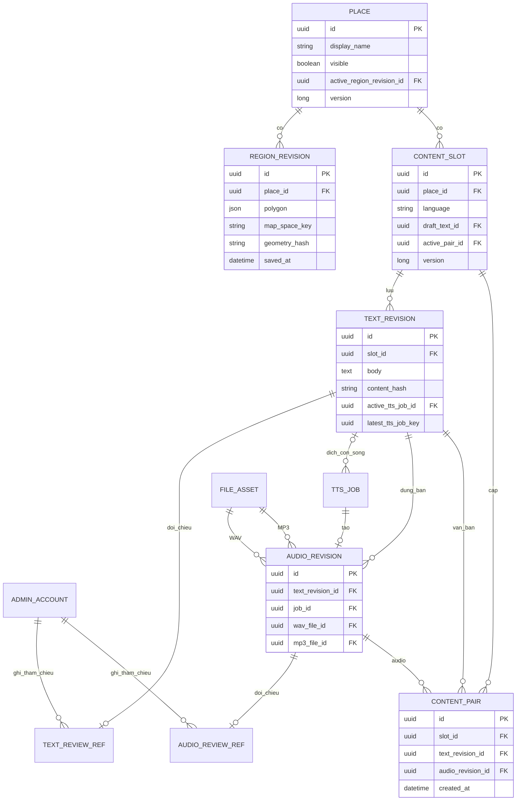
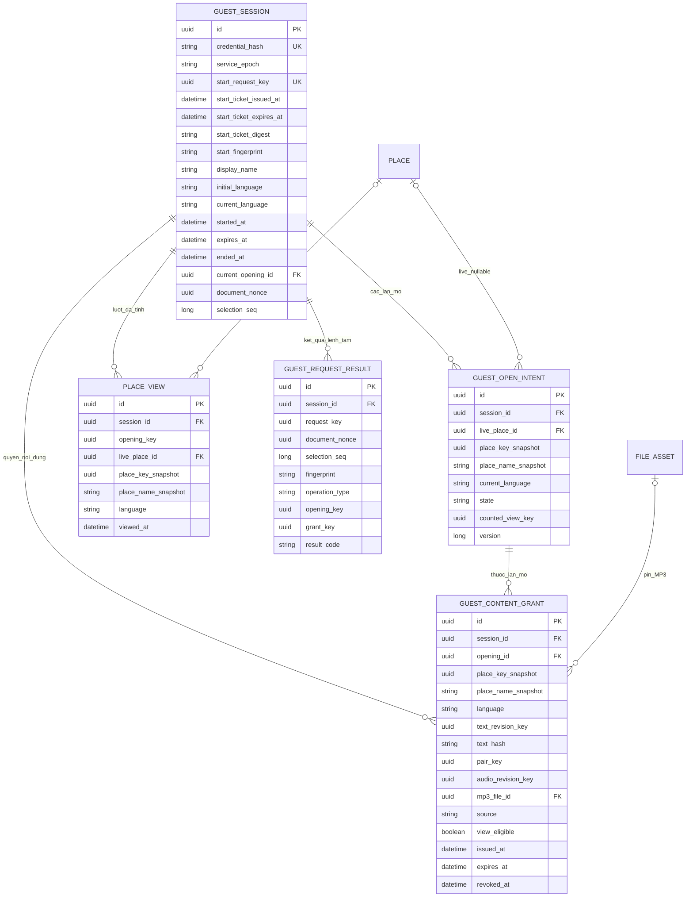
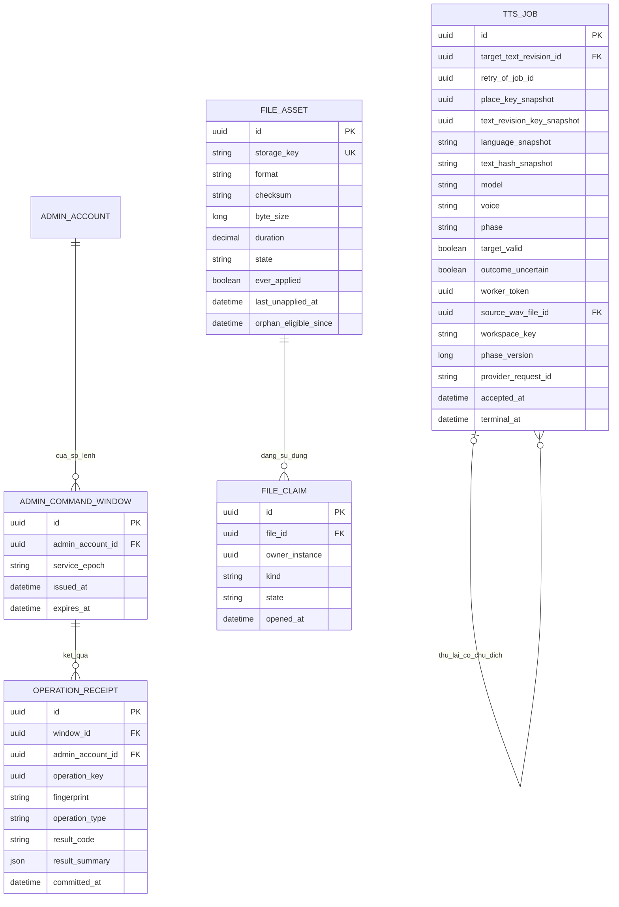

# TDD — Mô hình dữ liệu hiện hành

**Phiên bản nội dung:** 0.3, biên tập 08/11/2026. **Trạng thái:** ERD còn dự thảo. Đã có V1 guest_session, V2 địa điểm/vùng theo [phần nền địa điểm/vùng](#model-place-region-result), V3 tài khoản và V4 window/receipt theo [bằng chứng quản trị](api-transactions.md#admin-command-implementation). Chưa toàn schema/FK/seeds hoặc duyệt toàn mô hình.
**Mục đích:** vị trí chính duy nhất của mô hình nội dung, phiên/lượt, quyền tải, thao tác lặp, job và file. LIFE-P01 theo DATA-05: vé ký 24 giờ/ledger, không bảng start context hoặc start_generation.
**Đọc cùng:** [TDD](TDD.md), [API](api-transactions.md), [operations](operations-design.md), [PRD](../02-nghiep-vu/PRD.md), [decisions](../02-nghiep-vu/decisions.md). [Mô hình cũ](../99-luu-tru/data-model-history.md) chỉ để truy vết.

Mục lục: [1. Quy ước](#model-conventions) · [2. Nội dung](#model-content) · [3. Phiên/quyền](#model-guest) · [4. Thao tác/job/file](#model-operations) · [5. Ràng buộc/xóa](#model-constraints) · [6. Truy vết](#model-trace) · [7. Triển khai/kiểm chứng](#model-implementation).

## 1. Quy ước và phạm vi

- UUID do hệ thống cấp, không lấy tên làm khóa. Mapping BINARY(16)/Java UUID, thời gian UTC DATETIME(6), tên/ngôn ngữ Unicode, version tăng khi aggregate thay đổi. V1 cho guest_session và V2 cho place/region_revision đã có DDL và mapping JPA. Các bảng còn lại vẫn thiết kế. Bằng chứng phiên khách tại [thực hành](practice-01-start-session.md#practice-jpa-mapping), địa điểm/vùng tại mục 2.1.
- PK: khóa chính; FK: tham chiếu được database kiểm; UK: tổ hợp không trùng. FK quan hệ cần chặn dùng RESTRICT/NO ACTION, không CASCADE/JPA xóa ngầm. Pointer nullable để tạo và tháo theo thứ tự trong giao dịch.
- Ngôn ngữ chỉ vi/en/fr/ru. Năm điểm là bộ chuẩn 20 văn bản + 20 audio, không trần số điểm. Tên Q1/D02-BS kiểm grapheme/chuẩn hóa tại Service; độ dài cột/byte không tự thay giới hạn ký tự hiển thị hoặc thêm giới hạn bài mới.
- Bản văn/audio/vùng đã lưu dùng định danh bất biến; sửa sinh revision thay thế. Con trỏ nháp khác con trỏ áp dụng. Không cần UI lịch sử phiên bản phức tạp.
- Dữ liệu Q2 chưa lưu/mốc nghe khách/Blob/owner lock nằm ở tab theo phạm vi đã chốt; không tạo bảng lịch sử audio hoặc đồng bộ thiết bị.

## 2. Địa điểm, vùng, văn bản/audio và cặp

| Bảng | Trường và khóa chính ngoài ERD | Ý nghĩa / kiểm Service |
| --- | --- | --- |
| PLACE | display_name theo Q1; visible mặc định false; created_at/updated_at | Lưu ẩn dù chưa có vùng/nội dung. Bật hiện chỉ thông tin hợp lệ + vùng đã xem xét/áp dụng + ít nhất cặp vi đã duyệt/áp dụng. Không tự bật khi Apply. |
| REGION_REVISION | geometry_hash do server tính lại; saved_at; UK(id,place_id) | Một đa giác kín đơn giản, cùng không gian nền; hình dở chỉ Q2. Bản đã xem không đổi sau Lưu thì không bắt xem lại. Ranh giới thật vẫn chờ xem xét, hash không chứng minh duyệt. |
| CONTENT_SLOT | UK(place_id,language), UK(id,place_id,language) | Một ngăn như Ngọ Môn/vi; một active_pair, không chờ đủ bốn tiếng mới áp dụng. |
| TEXT_REVISION | UK(id,slot_id), saved_at | Mỗi Lưu rõ ràng tạo bản bất biến mới và đổi draft pointer, không sửa bản đang dùng hoặc tự tạo TTS. Hash không thay id. |
| TEXT_REVIEW_REF | text_revision_id PK/FK, locator, limitations nullable, recorded_by FK, recorded_at, version | Gắn đúng bản đã lưu/hash. Không nhập lại ngày/người duyệt nếu đã có trong tài liệu; không tự thẩm định hoặc áp dụng. |
| AUDIO_REVISION | job_id UK; UK(id,text_revision_id); created_at | WAV/MP3 hoàn chỉnh đúng text/ngôn ngữ. Một kết quả chưa nghe/duyệt vẫn chỉ được nghe thử trong Admin. |
| AUDIO_REVIEW_REF | audio_revision_id PK/FK; các trường như text reference | Có thể cùng locator nếu hồ sơ chỉ rõ cả hai đối tượng; vẫn hai liên kết riêng. |
| CONTENT_PAIR | UK(slot_id,text_revision_id,audio_revision_id), UK(id,slot_id) | C2=(T2,A2) khớp cùng ngăn. Chỉ đổi audio thì dùng T hiện hành cùng A mới được duyệt; không bắt duyệt lại T không đổi. |

Phiên bản nội dung bất biến không làm hồ sơ bất biến: sửa tham chiếu có review_version/ETag riêng; Apply kiểm lại đúng hồ sơ hiện có trong TX, không tin snapshot ngoài TX. Phần mềm chỉ kiểm điều kiện/đối tượng và thông tin Admin đối chiếu, không tự đọc tài liệu rồi quyết định đã duyệt.

## 3. Phiên theo tab, lần mở, quyền tải và lượt xem

| Bảng / con trỏ | Ràng buộc hiện hành đề xuất | Vòng đời và giới hạn |
| --- | --- | --- |
| Vé Bắt đầu (không bảng riêng) | Payload ký: requestId/credentialHash/serviceEpoch/issuedAt/ticketExpiresAt=issued+24 giờ/version; không dữ liệu tên/ngôn ngữ trong vé | Cấp nền; chỉ tạo lần đầu bằng vé còn hạn. Có ledger thì kiểm signature/quyền/epoch/fingerprint và trả gốc dù expiry vé đã qua; không JWT Admin hoặc đồng hồ khách |
| GUEST_SESSION | UK(start_request_key), credential_hash UK; start_fingerprint + start_ticket_issued_at/expires_at/digest để đối chiếu; service_epoch; current language/nonce/seq dọn theo end/expiry; current_opening FK tổ hợp | Lưu ID/key/quyền/fingerprint cùng TX. Session 8 giờ/ledger anchor+30 ngày giữ nguyên; purge không phối hợp thế hệ. Vé hết hạn mà ledger còn chỉ tra gốc, không tạo/gia hạn/đổi thông tin |
| GUEST_OPEN_INTENT | Giữ tên bảng 0.2 để truy vết, nghĩa hiện hành là **opening**; UK(id,session_id); created_at/closed_at; counted_view_key logical, không FK ngược tới view | Sau ACK vẫn giữ current opening để P06/đổi tiếng/reload không thêm lượt. Chọn điểm khác hoặc chủ động quay bản đồ đóng opening; opening/grant kỹ thuật giữ tối đa tới kết thúc/hết hạn rồi dọn an toàn, không lịch sử thất bại 30 ngày. |
| GUEST_CONTENT_GRANT | FK tổ hợp (opening_id,session_id); file FK RESTRICT nullable; text/pair/audio/điểm cũ là id snapshot logical, không FK cản xóa nội dung | Một grant gắn đúng text/tiếng/MP3 của một response; server kiểm session+credential+grant owner. expiresAt không vượt hạn phiên, revoked khi kết thúc. Không phải URL public/token độc lập, không cấp lại audio sau hạn. |
| GUEST_REQUEST_RESULT | UK(session_id,request_key), UK(session_id,document_nonce,selection_seq); fingerprint/action + opening/grant key logical + kết quả tối thiểu, không body text | Giữ kết quả K06/K07/K10 tới end/expiry để replay không đổi current selection hoặc tạo grant/lượt mới. Bản gốc mất thì báo không còn khả dụng, không thay bản khác âm thầm; không lịch sử nghe 30 ngày. |
| PLACE_VIEW | UK(session_id,opening_key); session FK, live_place nullable FK; **không FK tới opening/grant/text/audio** | ACK theo grant server và UNIQUE mới tạo một lượt; viewedAt server. Opening/grant được dọn sau hạn, view giữ D08. Không dùng tên gộp điểm/người. |
| document_nonce/selection_seq | Nonce document mới khi resume thành công; seq tăng trong document, kiểm dưới khóa session; không là bằng chứng quyền | Cùng credential mà sai document/seq cũ không đổi lựa chọn mới. Web Locks/owner bên tab vẫn phải kiểm, không dùng cookie chung thay credential. |

**LIFE-P01 đã duyệt tại DATA-05:** không start_generation, context hoặc gate giữa start và purge. [Protocol chính](operations-design.md#ops-start-simple): xác minh signature/quyền/epoch → tra ledger/đối chiếu → ledger có trả gốc kể cả vé hết hạn; ledger không có chỉ insert vé còn hạn 24 giờ. UNIQUE bảo vệ insert lặp, xung đột rollback TX rồi đọc lại đối chiếu.

Ticket issuedAt ≤ startedAt; thời điểm xóa ledger D08 sớm nhất là endedAt+30 ngày (endedAt ≥ startedAt), hoặc startedAt+8 giờ+30 ngày. Vì thế khi ledger bị purge đúng D08, vé đã hết 24 giờ và không thể tạo lại. Không lưu key/PII thêm sau purge; restore thật thu hồi epoch cũ trước public. Timestamp vé khác expires_at của phiên.

**Lượt đầu và reload:** SELECT/LANGUAGE grant có thể viewEligible=true khi opening chưa tính; RESTORE luôn false. ACK đầu đúng văn bản đã hiển thị lấy điểm/tên/tiếng/hash từ grant, không client tự khai. Nếu thiếu dịch lúc đầu rồi chủ động chọn tiếng có bài, lần đầu văn bản thành công tính đúng một lượt; các lần đổi sau không cộng. ACK đang bay của lựa chọn thật có thể ghi snapshot sau điểm bị xóa khi phiên còn hạn; không phải gửi bù offline. Server không thể chứng minh con người thực sự đọc: ACK là hợp đồng giữa client đã kiểm và server, cần thử race/hiển thị thực.

**Giữ lịch sử khi xóa:** giữ snapshot id/tên của lượt đã tính, đặt live_place_id NULL. Một điểm mới cùng tên có UUID khác; nhóm theo snapshot id/ngày/tiếng. Nhãn thống kê đề xuất dùng snapshot mới nhất trong nhóm nếu tên từng đổi, không gộp theo tên hoặc thêm lịch sử đổi tên mới.

## 4. Chống thao tác lặp, job và tài nguyên file

| Bảng | Khóa/trường bổ sung | Điều kiện dùng / không được suy ra |
| --- | --- | --- |
| ADMIN_ACCOUNT | V3 đã có id BINARY(16), login_name UK phân biệt hoa thường/dấu, password_hash kèm tiền tố thuật toán, enabled | Một role cấp trước, bảng khởi tạo rỗng. Entity/Repository và xác thực/Q3 xem bằng chứng Admin, HttpSession tách guest |
| ADMIN_COMMAND_WINDOW | V4 đã có account FK; issued/expires do server, service_epoch thuộc môi trường; mỗi lệnh dùng key=(windowId,randomId) | LIFE-P02 đã duyệt: 24 giờ từ cấp, không gia hạn qua login. Đăng nhập lại cùng tài khoản vẫn tra window cũ còn hạn; window thiếu/hết hạn không được nhận key cũ như lệnh mới. Không là phiên Admin mới, không gia hạn 30 phút. |
| OPERATION_RECEIPT | V4 đã có UK(admin_account_id,window_id,operation_key); FK tổ hợp (window_id,admin_account_id) tới UK(id,admin_account_id) của window; fingerprint BINARY(32), http_status/result_code/operation_type, result_summary JSON tối thiểu, committed_at DATETIME(6) | Receipt và lệnh DB cùng TX, mã Hash gồm method/resource/canonical body/If-Match. Không lưu secret/text/tên khách hoặc payload đầy đủ, không FK target PLACE/TEXT đã xóa. Receipt accepted TTS theo thiết kế chỉ trỏ job key, không audio success; TTS chưa được nối. |
| TTS_JOB | UK(admin_account_key,request_window_key,request_operation_key) là snapshot logical không FK bắt giữ window; target FK nullable + snapshot; worker_instance/token/phase_version; dispatched_at/result_staged_at/updated_at; retry_of logical nếu cần dọn job cũ | TEXT.active_tts_job_id cùng text ngăn hai job active/unknown; latest_tts_job_key logical giữ nhận biết kết quả mới nhất khi text còn sống. LIFE-P03 đã duyệt: job cũ terminal rõ chỉ dọn sau bảy ngày nếu không còn ref/use/current; audio/nháp còn liên kết và active/unknown giữ. Không tự biến TTL thành lỗi/provider retry. |
| FILE_ASSET | key chỉ server tạo, checksum/size/duration/ready_at; cleanup_status/retry/cause | File bất biến, không ghi đè cùng key; không publish pointer trước bytes hoàn tất và kiểm. Metadata phải còn để báo dọn chờ/lỗi; trỏ WAV và MP3 riêng. |
| FILE_CLAIM | FK file, owner_instance/task/download key, kind READ/WORKER; ACTIVE→RELEASED→xóa | Bảo vệ đọc/copy/worker đang thực dùng; không là tham chiếu nội dung giữ mãi. Không dọn chỉ vì thiếu heartbeat khi tiến trình còn sống/chưa rõ. |
| OPS_GUARD | Hàng bền cho maintenance_mode OPEN/QUIESCING/FROZEN, owner/checkpoint/version | Chỉ điều phối backup/dispatch/cleaner như BKP-P02; **không start_generation hoặc khóa start/purge**. service_epoch vẫn quản lý riêng theo REC-P01, backup/restart thường không thu hồi quyền |
| BACKUP_RUN (metadata vận hành cục bộ riêng kho phục vụ) | backupId,state,createdAt,expiresAt=created+7 ngày,owner/checkpoint,dump/catalog/file hashes,error | BKP-P02 stop app/worker/cleaner, MySQL còn hoạt động và không writer/DDL; dump/catalog/copy khớp. Không MySQL tạm mỗi lần backup; restore thử vẫn riêng |

V3 chỉ tạo bảng tài khoản quản trị, không sinh tài khoản hoặc secret. [AdminAccount](../../backend/src/main/java/vn/hueqr/backend/entity/AdminAccount.java), [Repository](../../backend/src/main/java/vn/hueqr/backend/repository/AdminAccountRepository.java) và [hợp đồng/bằng chứng xác thực](api-transactions.md#admin-auth-implementation) là nguồn triển khai. V4 bổ sung window/receipt cùng Entity/Repository, giữ khóa tài khoản dạng UUID trong Java và FK trong database. [Hợp đồng, giao dịch và kiểm chứng](api-transactions.md#admin-command-implementation) là nguồn chính. Worker dọn metadata, job/file và các bảng vận hành khác vẫn chờ triển khai/kiểm chứng.

retry_of_job_id trong hình là **liên kết logic**, không FK bắt giữ chuỗi job vô hạn; id cũ dùng đối chiếu nếu còn dữ liệu. Trường target_text FK và audio→job FK tổ hợp vẫn phải kiểm thật. Receipt/window chỉ dành Admin; guest dùng vé ký 24 giờ/ledger session, không sao chép dữ liệu khách vào receipt Admin hoặc thêm bảng context.

## 5. Ràng buộc, giao dịch và thứ tự xóa hiện hành

1. SLOT UK(place,language); TEXT UK(id,slot); AUDIO UK(id,text); PAIR FK tổ hợp trỏ đúng text của slot và audio của text; SLOT(active_pair,id) trỏ đúng pair cùng slot. REGION UK(id,place), PLACE(active_region,id) trỏ vùng của mình; draft_text cũng đúng slot.
2. TTS_JOB UK(id,target_text); AUDIO(job,text) trỏ job của đúng text. TEXT.active_tts_job_id FK tổ hợp trỏ job đúng text; chỉ tháo target sau bỏ pointer và xử lý AUDIO/PAIR. Target_invalid không xóa nhầm text khi job đã gửi.
3. SESSION.current_opening dùng FK tổ hợp; GRANT(opening,session) đúng chủ; VIEW chỉ UK tương quan để dọn grant/opening mà vẫn giữ lượt. Start ticket không FK/bảng riêng; request key UK và thông tin đối chiếu lưu trong session cùng TX. Purge theo D08 chỉ xóa con/session; vé cũ chắc đã hết hạn, không gate/generation/tombstone.
4. Lệnh Admin khóa window/kiểm account + expiry, receipt cùng TX; serialize key trước mutate, rồi PLACE→SLOT/TEXT→JOB→FILE theo một thứ tự đã thống nhất. Receipt replay có quyền vẫn trả kết quả dù target đã xóa; không replay khi service epoch đã đổi sau restore theo REC-P01 đã duyệt. Window 24 giờ vẫn kiểm trước replay, login không gia hạn.
5. Xóa điểm: khóa PLACE/version → vô hiệu target job, tháo TEXT.active_job → bỏ active/draft pointers → giữ VIEW và opening/grant snapshot, đặt live refs NULL → xóa PAIR/review refs DB/AUDIO rồi tháo FK job target → xóa TEXT/SLOT/REGION/PLACE. Giữ FILE_ASSET/claim/job tối thiểu và receipt. Các thay đổi DB một TX; hồ sơ tài liệu bên ngoài không xóa.
6. Điểm bị xóa không nhận chọn/grant mới. Grant đã cấp pin file đúng bản cho ACK/tải trong hạn theo API; nó không khôi phục PLACE/TEXT. Xóa asset chỉ sau DB commit + không tham chiếu VÀ không dùng chung/không tác vụ đang sử dụng + đủ hạn nguồn.
7. File refs là AUDIO_REVISION WAV/MP3, TTS_JOB.source_wav_file_id đang giữ để convert/retry và GRANT còn cần; active claims chặn thao tác dọn trong lúc đọc. Counter nếu có chỉ hỗ trợ, không thay kiểm mọi refs. ever_applied áp cho cả WAV/MP3; last_unapplied_at cập nhật khi bỏ **tham chiếu áp dụng cuối cùng**, không khi file vừa được tạo hoặc restore.
8. Metadata có FK/retry chưa khép thì chưa dọn. Lịch xóa không reset mốc gốc; backup/restore không tự tạo session/view hoặc gửi lại TTS. Backup thường giữ epoch/hạn; restore thật REC-P01 thu hồi quyền cũ trước public, không endedAt giả.

**Ví dụ dễ hiểu:** khách chọn C1=(T1,A1) nhận opening O1 và grant G1 ghim A1. Admin áp dụng C2, lần chọn mới nhận C2; G1 không tự đổi sang A2. Sau hết hạn O1/G1 được vô hiệu/dọn, V1 vẫn còn tới D08. Admin xóa điểm, V1 vẫn nhận biết id cũ; key xóa cũ trả receipt, không xóa điểm mới trùng tên.

### 5.1. Chỉ mục và lock cần mapping khi triển khai

Ngoài PK/UK/FK đã nêu, đề xuất index theo truy vấn: session(started_at,id), session(expires_at), session(ended_at); view(viewed_at,place_key_snapshot,language), view(session_id,viewed_at); opening(session_id,state); grant(session_id,expires_at), grant(mp3_file_id); receipt(window_id,operation_key); guest_request_result(session_id,request_key); job(phase,updated_at), job(target_text_revision_id); file(state,last_unapplied_at), claim(file_id,state). Có thể dùng purge_due_at tính từ anchor để index dọn; không đổi timestamp gốc hoặc tin field client.

Độ chọn lọc/index thực phải đo trên MySQL và truy vấn JPA; không coi danh sách này là migration đã có. Không dùng partial index không được MySQL hỗ trợ để giả bảo đảm một active job; dùng pointer TEXT.active_tts_job_id dưới khóa. Lỗi lock/deadlock rollback DB thuần mới cân nhắc retry kỹ thuật, không provider retry.

## 6. Truy vết và phần chưa kiểm

| Nhóm | Nguồn / API | Cần kiểm thực |
| --- | --- | --- |
| PLACE/REGION/SLOT/PAIR/hồ sơ | Q1/D09/A02.4–A02.6/UI-03/UI-04, FR-A02–A09/A12, UC-A02–A06, AC-A03–A21/A25/A26 | FK tổ hợp/pointer vòng, Apply/delete/worker cùng lúc, gate cặp vi và Q2 khi 412. |
| SESSION/OPENING/GRANT/VIEW/start ticket | D04/P01–P08/TECH-04, FR-K01–K10, UC-K01–K05; API-K01–K11 | Hai tab/reload/duplicate, UNIQUE ACK/late response, MP3/expiry, start key sau dọn không tạo phiên lần hai. |
| WINDOW/RECEIPT/JOB/FILE | A04/A07/UI-04/TECH-05/DATA-01–03; API-A01–A31/TX-* | Replay/unknown/khóa/worker restart; dọn file không race với đọc/backup. |
| Backup metadata | DATA-02–04; operations-design BKP-P02/REC-P01 | Snapshot DB–file/restore/lọc mốc gốc, quyền/chỗ trống/thời gian thực. |

LIFE-P02/P03/REC-P01 và hướng BKP-P02 **đã được duyệt đúng phạm vi ngày 04/11**. DATA-05 chốt LIFE-P01 vé ký 24 giờ, bỏ generation/context/10 phút. V1/phiên khách và V2/địa điểm-vùng có bằng chứng kiểm thử riêng. Các phần mô hình/API còn lại tiếp tục cần triển khai và kiểm chứng, TECH-05/DATA-03 giữ phạm vi đã chốt.

## 7. Sản phẩm dữ liệu và bằng chứng kiểm chứng

Bằng chứng theo từng mốc được đặt sau mô hình, ràng buộc và truy vết. V3/V4 được dẫn tới nguồn kiểm chứng quản trị; không coi các bảng chưa triển khai đã tồn tại.

### 7.1. Nền dữ liệu địa điểm và vùng — T02

Hòa phụ trách cấu trúc/mapping theo G02. Phần này bổ sung nền dữ liệu cho T05, API và các quy tắc nghiệp vụ quản trị được triển khai tiếp theo phụ thuộc.

| Sản phẩm | Phạm vi đã triển khai |
| --- | --- |
| [V2__create_place_and_region_revision.sql](../../backend/src/main/resources/db/migration/V2__create_place_and_region_revision.sql) | Tạo place, region_revision, khóa ngoại RESTRICT và khóa tổ hợp bảo đảm active_region_revision_id thuộc chính địa điểm. V1 được giữ nguyên |
| [Place](../../backend/src/main/java/vn/hueqr/backend/entity/Place.java) và [PlaceRepository](../../backend/src/main/java/vn/hueqr/backend/repository/PlaceRepository.java) | UUID độc lập tên, mặc định ẩn và chưa có vùng áp dụng, tên trùng được lưu riêng. @Version phát hiện cập nhật từ phiên bản cũ |
| [RegionRevision](../../backend/src/main/java/vn/hueqr/backend/entity/RegionRevision.java) và [RegionRevisionRepository](../../backend/src/main/java/vn/hueqr/backend/repository/RegionRevisionRepository.java) | JSON hình vùng, mã không gian nền, mã Hash 32 byte và mốc lưu UTC. Các trường của bản đã lưu không có setter và dùng updatable=false trong JPA |
| [PlaceRegionSchemaTests](../../backend/src/test/java/vn/hueqr/backend/schema/PlaceRegionSchemaTests.java) và [PlaceRegionRepositoryTests](../../backend/src/test/java/vn/hueqr/backend/repository/PlaceRegionRepositoryTests.java) | Ràng buộc MySQL, mapping, con trỏ, phiên bản và bảo toàn dữ liệu cũ khi nâng migration |

Lựa chọn mapping giữ con trỏ bản vùng trong Place dưới dạng UUID, database kiểm quan hệ bằng khóa ngoại tổ hợp. RegionRevision giữ Entity Place bằng ManyToOne lazy, database lưu place_id. Không cấu hình cascade xóa, việc tháo con trỏ và xóa từng đối tượng thuộc giao dịch nghiệp vụ T05. Lưu bản vùng không tự áp dụng hoặc bật hiện địa điểm.

Cột JSON mới kiểm cú pháp JSON tại database. Kiểm đa giác kín đơn giản, cùng không gian nền, tính lại mã Hash, xem xét và áp dụng vùng còn thuộc bước Service/API. Tên theo Q1, gate cặp vi khi bật hiện, nội dung/cặp/hồ sơ, seeds năm điểm/bốn ngôn ngữ và xóa phối hợp toàn schema chưa hoàn tất. Các fixture chỉ dùng tên/vùng thử trong database tạm, không cung cấp vùng hay nội dung chưa duyệt cho khách.

Khóa tham chiếu tổ hợp dùng UNIQUE(id, place_id) của region_revision. JSON được ánh xạ bằng JdbcTypeCode JSON. Đây là lựa chọn kỹ thuật cho mapping đã kiểm, giữ nghiệp vụ PRD. [MySQL 8.4 về khóa ngoại](https://dev.mysql.com/doc/refman/8.4/en/create-table-foreign-keys.html), [Hibernate về JSON](https://docs.hibernate.org/stable/orm/userguide/html_single/#basic-mapping-json)

#### Bằng chứng kiểm thử ngày 08/11/2026

Chạy trên bản sao backend tại `C:\Users\khait\AppData\Local\Temp\hueqr-place-region-cd1e1cbd21b04ecf89bc1198d734d31f\backend`, Java 21.0.12.1, Maven Wrapper 3.9.12, Spring Boot 4.1.2, Docker Linux Engine 29.8.1 và MySQL 8.4.13 Testcontainers. Database và fixture được tạo tạm, tách môi trường phục vụ. Lệnh hồi quy trên bản sao là `mvnw.cmd -o test`.

Lần cuối kết thúc 17:02:17 +07, đạt **104 test**, 0 failures/errors/skipped, **BUILD SUCCESS, exit 0**. Đã đối chiếu đủ 13 báo cáo XML Surefire, gồm 88 ca hồi quy trước và 16 ca mới trong PlaceRegionSchemaTests/PlaceRegionRepositoryTests. Ca nâng V1 có dữ liệu lên V2 giữ phiên khách, mốc bắt đầu và checksum V1, tạo hai bảng mới rỗng. Log bộ cuối ở `..\full-tests.log`, báo cáo XML/TXT tại `target/surefire-reports` của bản sao. Lần đầu 103 test đạt lúc 16:59:32 +07 được giữ ở `..\full-tests-103.log`. Tệp sinh và thư mục tạm không thuộc nhóm commit.

Kiểm tra ở tầng dữ liệu và JPA. API/UI quản trị, xác thực Admin, kiểm hình học/ranh giới thật, triển khai trên database phục vụ và toàn T02 còn cần kiểm chứng. Checklist giữ nguyên 89 ô/18 dấu tích.

### Nhật ký biên tập

Nhật ký theo thời điểm được giữ nguyên trong [hồ sơ biên tập](../99-luu-tru/document-history.md#official-20261107-03-ky-thuat-data-model-journal). Phần hiện hành không thay thế kết quả hoặc căn cứ lịch sử.
