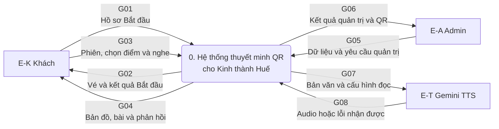
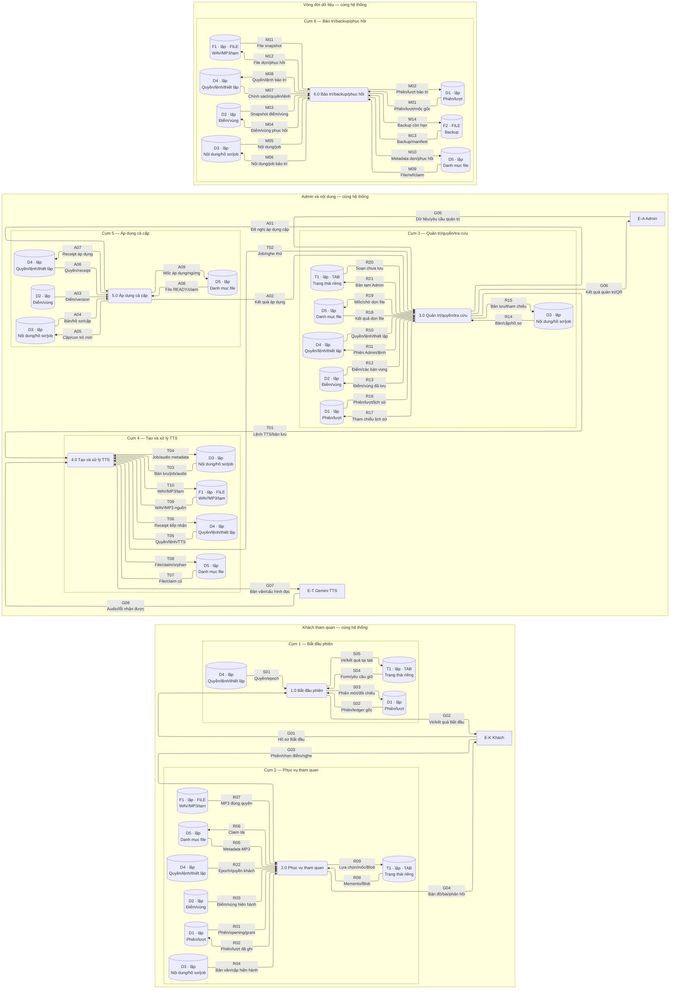
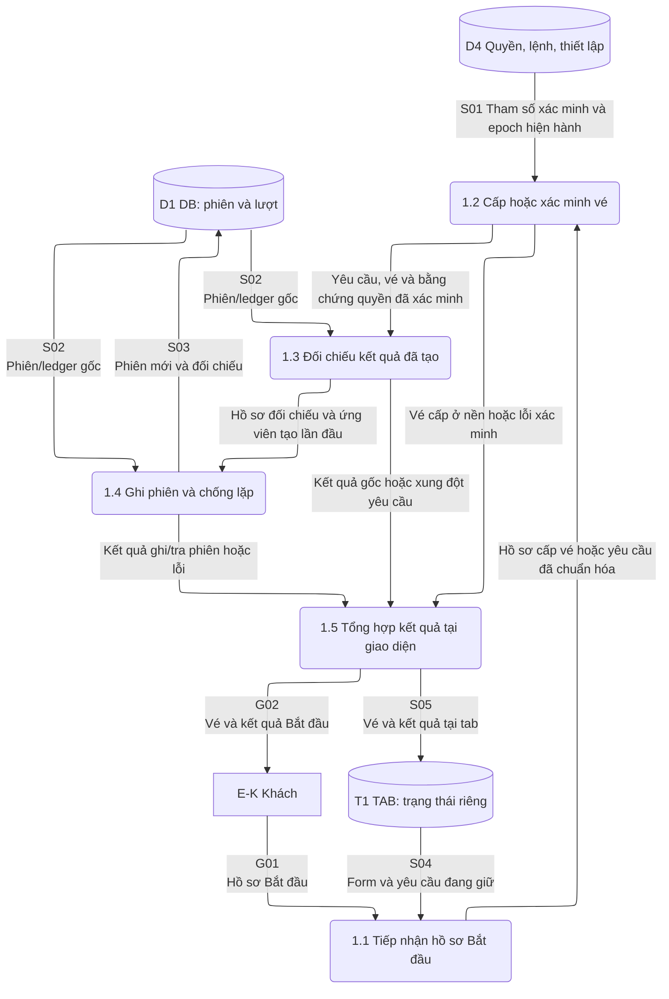
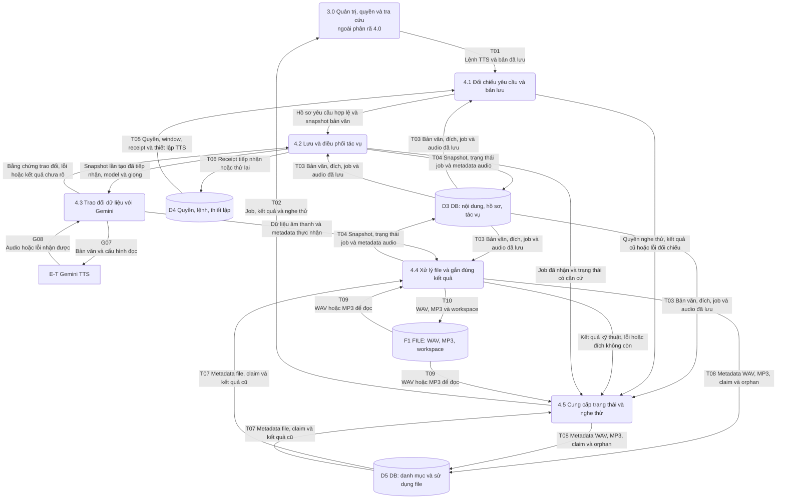
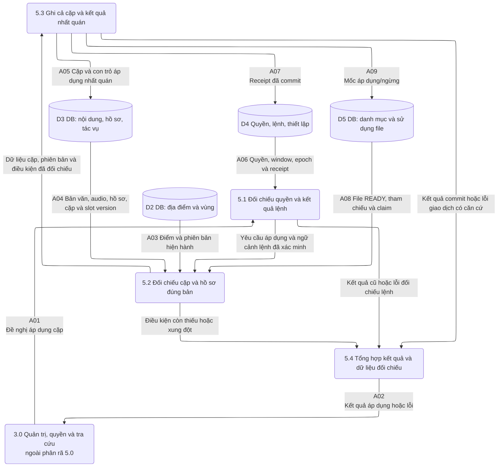

# Sơ đồ luồng dữ liệu (DFD)

Các mức DFD và bảng cân bằng dùng cùng phạm vi nghiệp vụ của PRD/Business Flow; ký hiệu kho lặp chỉ phục vụ bố cục, không tạo kho dữ liệu mới.

## 1. Quy ước, ranh giới và cách đọc

| Ký hiệu / mã | Ý nghĩa |
| --- | --- |
| Hình chữ nhật E-K, E-A, E-T | Tác nhân ngoài: Khách, Admin, Gemini TTS. Khách/Admin là người sử dụng qua giao diện; Gemini là dịch vụ ngoài. |
| Hình bo tròn có mã tiến trình | Xử lý biến đổi dữ liệu; tên mô tả trách nhiệm, không phải một màn hình, lớp Java, container hoặc microservice. |
| Hình trụ D1–D5, F1–F2, T1 | Kho dữ liệu logic. Nhãn DB/FILE/TAB và bảng mục 3 phân biệt nơi lưu; không suy mọi hình trụ thành bảng MySQL. |
| Mũi tên một chiều có tên | Một tập dữ liệu đi từ nguồn tới nơi nhận. Không phải thứ tự bước, điều kiện rẽ nhánh, chuyển màn hình hoặc chỉ dẫn gọi hàm. |
| G01–G08 | Gói dữ liệu qua biên toàn hệ thống, giữ ở mức 0 và mức 1. Một gói có thể gồm nhiều loại request/response được liệt kê dưới sơ đồ. |
| S-*, T-*, A-* | Mã luồng cụ thể của Bắt đầu/TTS/Áp dụng ở mức 1 và phân rã mức 2. [Từ điển 4.2](#dfd-packages) nêu đúng nguồn, đích và dữ liệu; bảng cân bằng đối chiếu trực tiếp. Không thay mã FR/UC/AC/API. |
| R-*, M-* | Luồng còn lại ở mức 1: phục vụ khách, quản trị và bảo trì. Không là chức năng mới hoặc mã quyết định. |
| D1 · lặp, D2 · lặp… | Các lần xuất hiện của cùng ID là cùng kho logic; ghi lặp để đặt gần tiến trình sử dụng. Hậu tố trong nguồn Mermaid chỉ bố trí, không sinh kho hoặc đồng bộ dữ liệu mới. |

**Đánh số mức:** mức 0 là ngữ cảnh với đúng một tiến trình 0; mức 1 gồm 1.0–6.0; mức 2 chỉ phân rã 1.0 thành 1.1–1.5, 4.0 thành 4.1–4.5 và 5.0 thành 5.1–5.4. Quy ước này được dùng xuyên tài liệu, không dùng cách gọi “ngữ cảnh ngoài mức 0”.

Mermaid flowchart được dùng để biểu diễn gần ký pháp DFD vì tài liệu Markdown chưa có bộ ký hiệu DFD chuyên biệt. Không dùng hình thoi, START/END hoặc cạnh không tên. Hai mũi tên ngược chiều là hai luồng dữ liệu riêng. Đọc sơ đồ cùng danh mục kho và bảng cân bằng, không suy trật tự trái/phải thành thuật toán.

**Biên hệ thống** bao gồm Vue trong trình duyệt, Backend/worker, metadata trong MySQL, tài nguyên file và quy trình bảo trì đã thiết kế. Ngrok/HTTPS/Docker/Controller–Service–Repository là đường vận chuyển/cấu trúc triển khai, không thêm tác nhân nghiệp vụ hoặc kho mới trong DFD. Kho T1 thuộc ứng dụng trong tab, ở phía frontend; hình vẽ không có nghĩa Backend đọc trực tiếp bộ nhớ trình duyệt.

Không có giá trị secret, vé thật, credential thật, thông tin tài khoản hoặc dữ liệu khách thật trong sơ đồ. “Quyền”, “bằng chứng quyền” và “tham số xác minh” chỉ mô tả loại dữ liệu; không cho phép log/chia sẻ các giá trị thật.

## 2. DFD mức 0 — Ngữ cảnh

| Gói | Dữ liệu cụ thể qua giao diện / kết nối |
| --- | --- |
| G01 | Đề nghị chuẩn bị vé gắn quyền tab; tên đã nhập, ngôn ngữ ban đầu; vé/requestId và bằng chứng quyền của yêu cầu Bắt đầu/tra lại. Không tạo phiên chỉ vì mở URL hoặc cấp vé. |
| G02 | Vé ký, requestId, issuedAt/ticketExpiresAt; kết quả cùng sessionId/startedAt/expiresAt/state hoặc lỗi/thông báo phù hợp. API không trả lại credential thô. |
| G03 | Phiên cần kiểm/khôi phục/kết thúc; địa điểm, ngôn ngữ, dữ liệu tương quan lựa chọn và xác nhận văn bản thực đã hiển thị; ý định Phát/Tạm dừng/tua/Nghe lại tại tab. Ý định nghe không mặc định là request Backend. |
| G04 | Vùng đang áp dụng/điểm được phép; đúng văn bản/tiếng/cặp, MP3 được cấp quyền; trạng thái phiên, thiếu nội dung, lỗi và cảnh báo. Âm thanh nghe từ Blob có thể hoàn toàn ở tab. |
| G05 | Đăng nhập/đăng xuất/hoạt động Q3; tên điểm, hình vùng, bản văn và tham chiếu hồ sơ; yêu cầu tạo/kiểm/thử lại TTS, áp dụng cặp, ẩn-hiện/xóa; bộ lọc phiên/ngày thống kê và yêu cầu xem/tải/in QR. |
| G06 | Kết quả quyền/lệnh, dữ liệu đang soạn và đang dùng, trạng thái job, audio nghe thử; phần còn thiếu/đối chiếu/xung đột; phiên/lượt còn giữ, hai bảng/tổng; một QR/URL/PNG hoặc chưa sẵn sàng. Không báo in/lưu file thành công chỉ vì có request. |
| G07 | Body từ đúng bản văn đã lưu, ngôn ngữ, model gemini-3.8-flash-tts và giọng Charon theo lựa chọn hiện hành; không tên khách, hồ sơ duyệt hoặc bí mật tài khoản. |
| G08 | Bytes âm thanh/metadata thực sự nhận được hoặc phản hồi lỗi/quota có căn cứ. Mất phản hồi không phải thông điệp “đã thất bại” từ Gemini; trạng thái chưa rõ do hệ thống xác định từ bằng chứng kết nối/tác vụ. |

QR in trên giấy dẫn vào URL trang bắt đầu; DFD không sinh một sự kiện “lượt quét”. Không có mũi tên Khách–Gemini hoặc Admin–Gemini trực tiếp. Dữ liệu hồ sơ duyệt bên ngoài do Admin đối chiếu và ghi tham chiếu qua G05; chưa thêm dịch vụ duyệt hoặc phần mềm tự đọc/thẩm định hồ sơ.

## 3. Kho dữ liệu theo nghiệp vụ

| Kho | Nội dung logic / nơi lưu | Giới hạn |
| --- | --- | --- |
| D1 — Phiên và lượt khách | **DB**: phiên, ledger Bắt đầu đi cùng phiên; ngữ cảnh lần mở/quyền tải/kết quả lựa chọn; lượt xem và snapshot nhận biết điểm cũ | Không lịch sử từng thao tác audio. D08 dọn phiên/lượt sau 30 ngày từ kết thúc/hết hạn gốc; metadata mở/quyền tải có vòng đời riêng theo model/operations. |
| D2 — Địa điểm và vùng | **DB**: mã/tên/ẩn-hiện, vùng đã lưu và con trỏ vùng đang áp dụng | Lưu bản sửa khác Áp dụng; không ranh giới đã được duyệt sẵn hoặc tọa độ thực của khách. |
| D3 — Nội dung, hồ sơ và tác vụ | **DB**: bản văn/bản dịch đã lưu, metadata audio, tham chiếu duyệt riêng; cặp/con trỏ đang áp dụng; snapshot/trạng thái/kết quả TTS | Gộp theo vòng đời nội dung để tránh vẽ mọi bảng ERD. D3 không chứa bytes WAV/MP3 hoặc bản Q2 chưa lưu. Tạo xong không tự duyệt/áp dụng. |
| D4 — Quyền, lệnh và thiết lập | **DB và ngữ cảnh vận hành được bảo vệ**: tài khoản Admin, trạng thái xác thực; cửa sổ/receipt lệnh; service_epoch và thiết lập ký vé, model/giọng, URL, chính sách nguồn | Không đồng nhất toàn kho với một bảng. Khóa ký/config runtime được bảo vệ ngoài repo; không vẽ giá trị. Admin session/cookie 30 phút; window 24 giờ riêng. Backup chỉ lấy phần DB/phần kê cần thiết theo phạm vi đã chốt, không tự mở rộng thành sao chép secret/runtime. |
| D5 — Danh mục và sử dụng file | **DB**: storage key/checksum/định dạng/thời lượng/trạng thái WAV–MP3, tham chiếu/claim, mốc bảo vệ và kết quả dọn | Không chứa audio bytes. Metadata READY không thay nghe duyệt; xóa record không chứng minh bytes đã xóa. |
| F1 — File audio và workspace | **FILE**: WAV nguồn, MP3 phục vụ/nghe thử, đầu ra xử lý tạm | Tách DB; Backend kiểm quyền trước đọc, không URL thư mục public. File hoàn chỉnh khác workspace dở. Không dùng kho này như kho offline của khách. |
| F2 — Backup cục bộ | **FILE**: dump DB, WAV/MP3 còn tham chiếu, manifest/thông tin phục hồi trong bản backup | Tách dữ liệu đang phục vụ, mỗi bản bảy ngày. Phục hồi riêng/lọc mốc gốc/REC-P01; không thêm yêu cầu ổ ngoài hoặc cứu mất toàn laptop. |
| T1 — Trạng thái riêng trong tab | **TAB**: form, vé/requestId/quyền và payload đang chờ; memento bài/ngôn ngữ/mốc nghe; Blob/object URL; phần Admin chưa lưu đúng Q2/UI-AP05 | Không là bảng DB, kho phục hồi dài hạn hoặc đồng bộ tab/thiết bị. Khi cần request, chỉ DTO được phép được gửi. Q2 không tự Lưu/Áp dụng/gửi TTS; Blob không phải nội dung có thể phục hồi sau hết hạn/reload. |

Lưu/khôi phục T1 do phần frontend của tiến trình tương ứng thực hiện. Các đoạn T1 của khách và Admin được tách quyền/công việc; tài khoản Admin khác không được thấy bản tạm cũ. Dữ liệu đã Lưu mới thành bản ở D2/D3; việc ghi T1 không được đổi active pointer.

### 3.1. Ánh xạ kho logic sang bảng vật lý

Một kho DFD có thể chứa nhiều bảng; F1/F2 là file và T1 là trạng thái tab. Không thêm bảng giả để số ký hiệu DFD bằng số bảng ERD. Tổng phần SQL là 24 bảng ứng dụng; flyway_schema_history là bảng hạ tầng migration riêng. Danh mục và FK chuẩn tại [ERD vật lý đầy đủ](erd-vat-ly.md).

| Kho | Bảng hiện hành | Số bảng |
|---|---|---:|
| D1 | `guest_session`, `guest_open_intent`, `guest_content_grant`, `guest_request_result`, `place_view` | 5 |
| D2 | `place`, `region_revision` | 2 |
| D3 | `content_slot`, `text_revision`, `text_review_ref`, `audio_revision`, `audio_review_ref`, `content_pair`, `tts_job` | 7 |
| D4 | `admin_account`, `admin_command_window`, `operation_receipt`, `ops_guard`, `ops_activity` | 5 |
| D5 | `file_asset`, `file_claim`, `runtime_instance`, `runtime_task`, `workspace_file` | 5 |

Các ký hiệu D1_1/D1_2… trên hình mức 1 là cách lặp một kho để bố trí, không tạo bản sao hoặc bảng mới. D4 có metadata gate/lease phục vụ bảo trì ngoài phần quyền/lệnh; D5 có owner/task/workspace ngoài file/claim. Hình SVG và Mermaid tiếp tục dùng cùng D1–D5 nên không cần thêm đầu mút dữ liệu cho từng bảng.

## 4. DFD mức 1 — Các xử lý chính

Sơ đồ giữ G01–G08 và sáu tiến trình chính. **Mọi cạnh nối trực tiếp tới tác nhân, tiến trình hoặc đúng kho có ID**, không tới DBS hay khung bố trí. Các kho dùng ở nhiều cụm được lặp ký hiệu, cùng ID và dấu “lặp”; đọc [từ điển 4.2](#dfd-packages) theo ID logic. Giữ phân biệt DB, file audio, backup và TAB; không frontend vượt API để đọc DB/file.

Bản SVG ở trên được xuất từ đúng nguồn Mermaid trong khối mở rộng dưới đây để xem/phóng to và dùng trong báo cáo. **Nguồn hiện hành vẫn là phần Mermaid trong file này**; không sửa SVG độc lập, khi đổi nguồn phải xuất lại. Các khung chỉ bố trí, không nhận/phát luồng dữ liệu; tất cả mũi tên phải chạm đúng ký hiệu kho hoặc tiến trình.

Nguồn Mermaid mức 1 — cùng hình SVG, không một phương án song song

### 4.1. Ranh giới các nhóm

| Tiến trình | Trách nhiệm và ranh giới quan trọng |
| --- | --- |
| 1.0 | API-K11/K01, chuẩn bị/kiểm vé và chống tạo phiên lặp; không map/audio/lượt hoặc bảng start context. |
| 2.0 | API-K02–K10 và UI khách: kiểm quyền/epoch/hạn phía Backend, khôi phục/kết thúc, map/chọn/đổi tiếng, text/grant/ACK/MP3; xử lý nghe và cảnh báo ở tab. R02 chỉ chứa lượt đủ điều kiện, không mọi lần nhấn nút. |
| 3.0 | Đăng nhập/đăng xuất/Q3; CRUD/ẩn-hiện/xóa điểm, lưu/xem trước/áp dụng vùng; lưu văn bản/hồ sơ; mức đầy đủ, phiên/thống kê chỉ đọc và một QR. Chuyển lệnh TTS/cặp sang 4.0/5.0; vẫn kiểm quyền tại Service, không tin menu hoặc dữ liệu “đã kiểm” của frontend. |
| 4.0 | Nhận tác vụ từ bản lưu, dispatch/nhận kết quả, WAV/MP3 và nghe thử. Ghi audio/job; không ghi hồ sơ “đã duyệt” hoặc active pair. |
| 5.0 | Kiểm đúng cặp đủ điều kiện và chuyển active pointer + receipt cùng giao dịch; không tự Lưu, tạo TTS, bật hiện hoặc đổi vùng. |
| 6.0 | Dọn từng lớp dữ liệu/file đúng hạn; backup tạm ngừng phục vụ và restore có lọc/thu hồi quyền. Là chức năng vận hành nội bộ đã thiết kế, không thêm màn hình/chức năng backup cho Admin website. Không cần mũi tên “đến giờ” vì đó là điều phối, không dữ liệu. |

Các kho D1–D5 là góc nhìn logic, không tách database vật lý. Các ghi nhận thuộc một giao dịch có thể cùng đi tới nhiều kho logic trong một MySQL transaction; DFD không chứng minh tính nguyên tử.

M07/M08 không biến restart/backup thường thành restore: chỉ phục hồi backup thật mới thay service_epoch/thu hồi quyền cũ theo REC-P01; không endedAt giả hoặc gia hạn phiên. Trong BKP-P02, dừng ứng dụng/worker/cleaner có kiểm soát, giữ MySQL chạy, lấy snapshot DB và file khớp; không backup khi còn writer chưa kiểm soát. QUEUED đã nhận vẫn giữ, kết quả TTS chưa rõ không tự gửi lại. Chi tiết ở [operations 3–4](operations-design.md#ops-backup).

P3 xóa địa điểm ghi R15/R17/R19 cùng các thay đổi DB có kiểm soát; không xóa ngay bytes F1 hoặc hồ sơ duyệt trong tài liệu. P6 chỉ dọn file không còn tham chiếu **và** không dùng chung/không tác vụ sử dụng, đủ mốc nguồn. Dữ liệu bảo trì gồm mốc D08, file từng áp dụng tám giờ, file hoàn chỉnh chưa áp dụng 24 giờ, workspace một giờ, metadata TTS LIFE-P03; không một TTL chung. Log kỹ thuật bảy ngày và quyền xem/bảo vệ giữ theo chính sách nguồn; sơ đồ lược chi tiết ghi log kỹ thuật, không thêm kho lịch sử audio hay PII để phục vụ log.

**Cân bằng mức 0 → mức 1:** G01/G02 chỉ vào/ra 1.0; G03/G04 chỉ vào/ra 2.0; G05/G06 chỉ vào/ra 3.0; G07/G08 chỉ vào/ra 4.0. Không có tác nhân ngoài hoặc luồng ngoài mới ở mức 1. Những luồng S/T/A/R/M còn lại nằm bên trong biên hệ thống.

### 4.2. Từ điển luồng — đúng nguồn, đích và chiều

Mỗi dòng tương ứng một luồng trực tiếp trên hình mức 1. Nhãn trên hình được rút gọn; cột dữ liệu giữ ý nghĩa đầy đủ đã có ở 0.2. Chỉ được gom thêm thành phần khi cùng kho/tiến trình nguồn, cùng đích và cùng chiều; không dùng khung để thay một đầu mút. Với bộ luồng hiện có, việc mở các gói 0.2 trả lại 68 quan hệ nguồn–đích; không ép giảm số đó.

| Mã | Nguồn → đích logic | Nhãn ngắn trên hình | Dữ liệu đầy đủ / nơi giữ chi tiết |
| --- | --- | --- | --- |
| G01 | K → P1 | Hồ sơ Bắt đầu | Hồ sơ Bắt đầu |
| G02 | P1 → K | Vé/kết quả Bắt đầu | Vé và kết quả Bắt đầu |
| S01 | D4 → P1 | Quyền/epoch | Tham số xác minh và epoch hiện hành |
| S02 | D1 → P1 | Phiên/ledger gốc | Phiên và ledger theo requestId |
| S03 | P1 → D1 | Phiên mới/đối chiếu | Phiên mới cùng dữ liệu đối chiếu |
| S04 | T1 → P1 | Form/yêu cầu giữ | Form và yêu cầu đang giữ |
| S05 | P1 → T1 | Vé/kết quả tại tab | Vé và kết quả tại tab |
| G03 | K → P2 | Phiên/chọn điểm/nghe | Phiên, chọn điểm và nghe |
| G04 | P2 → K | Bản đồ/bài/phản hồi | Bản đồ, bài và phản hồi |
| R01 | D1 → P2 | Phiên/opening/grant | Phiên, opening, grant và kết quả cũ |
| R02 | P2 → D1 | Phiên/lượt đã ghi | Opening, grant, lượt đã tính và kết thúc |
| R03 | D2 → P2 | Điểm/vùng hiện hành | Điểm hiện và vùng đang áp dụng |
| R04 | D3 → P2 | Bản văn/cặp hiện hành | Văn bản và cặp đang được phục vụ |
| R05 | D5 → P2 | Metadata MP3 | Metadata MP3 và tình trạng sử dụng |
| R06 | P2 → D5 | Claim tải | Claim tải và kết quả sử dụng file |
| R07 | F1 → P2 | MP3 đúng quyền | MP3 đúng quyền |
| R08 | T1 → P2 | Memento/Blob | Memento và Blob đang giữ |
| R09 | P2 → T1 | Lựa chọn/mốc/Blob | Lựa chọn, mốc nghe, Blob |
| R22 | D4 → P2 | Epoch/quyền khách | Epoch hiện hành và chính sách quyền khách |
| G05 | A → P3 | Dữ liệu/yêu cầu quản trị | Dữ liệu và yêu cầu quản trị |
| G06 | P3 → A | Kết quả quản trị/QR | Kết quả quản trị và QR |
| R10 | D4 → P3 | Quyền/lệnh/thiết lập | Quyền, receipt, thiết lập QR và chính sách |
| R11 | P3 → D4 | Phiên Admin/lệnh | Phiên Admin, hoạt động, window và receipt |
| R12 | D2 → P3 | Điểm/các bản vùng | Thông tin điểm và các bản vùng |
| R13 | P3 → D2 | Điểm/vùng đã lưu | Điểm, vùng nháp hoặc vùng áp dụng |
| R14 | D3 → P3 | Bản/cặp/hồ sơ | Bản lưu, cặp, hồ sơ và mức đầy đủ |
| R15 | P3 → D3 | Bản lưu/tham chiếu | Bản văn, tham chiếu và dữ liệu xóa có kiểm soát |
| R16 | D1 → P3 | Phiên/lượt/lịch sử | Phiên, lượt và nhận biết lịch sử còn giữ |
| R17 | P3 → D1 | Tham chiếu lịch sử | Live reference đã tháo, lịch sử được giữ |
| R18 | D5 → P3 | Kết quả dọn file | Trạng thái dọn file |
| R19 | P3 → D5 | Mốc/chờ dọn file | Metadata ngừng áp dụng và file chờ dọn |
| R20 | T1 → P3 | Soạn chưa lưu | Phần Admin chưa lưu |
| R21 | P3 → T1 | Bản tạm Admin | Bản tạm tại tab |
| G07 | P4 → T | Bản văn/cấu hình đọc | Bản văn và cấu hình đọc |
| G08 | T → P4 | Audio/lỗi nhận được | Audio hoặc lỗi nhận được |
| T01 | P3 → P4 | Lệnh TTS/bản lưu | Lệnh TTS và bản đã lưu |
| T02 | P4 → P3 | Job/nghe thử | Job, kết quả và nghe thử |
| T03 | D3 → P4 | Bản lưu/job/audio | Bản văn, đích, job và audio đã lưu |
| T04 | P4 → D3 | Job/audio metadata | Snapshot, trạng thái job và metadata audio |
| T05 | D4 → P4 | Quyền/lệnh/TTS | Quyền, window, receipt và thiết lập TTS |
| T06 | P4 → D4 | Receipt tiếp nhận | Receipt tiếp nhận hoặc thử lại |
| T07 | D5 → P4 | File/claim cũ | Metadata file, claim và kết quả cũ |
| T08 | P4 → D5 | File/claim/orphan | Metadata WAV, MP3, claim và orphan |
| T09 | F1 → P4 | WAV/MP3 nguồn | WAV hoặc MP3 để đọc |
| T10 | P4 → F1 | WAV/MP3/tạm | WAV, MP3 và workspace |
| A01 | P3 → P5 | Đề nghị áp dụng cặp | Đề nghị áp dụng cặp |
| A02 | P5 → P3 | Kết quả áp dụng | Kết quả áp dụng hoặc lỗi |
| A03 | D2 → P5 | Điểm/version | Điểm và phiên bản hiện hành |
| A04 | D3 → P5 | Bản/hồ sơ/cặp | Bản văn, audio, hồ sơ, cặp và slot version |
| A05 | P5 → D3 | Cặp/con trỏ mới | Cặp và con trỏ áp dụng nhất quán |
| A06 | D4 → P5 | Quyền/receipt | Quyền, window, epoch và receipt |
| A07 | P5 → D4 | Receipt áp dụng | Receipt áp dụng đã commit |
| A08 | D5 → P5 | File READY/claim | File READY, tham chiếu và claim |
| A09 | P5 → D5 | Mốc áp dụng/ngừng | Mốc áp dụng và ngừng áp dụng cuối |
| M01 | D1 → P6 | Phiên/lượt/mốc gốc | Phiên, lượt và mốc gốc |
| M02 | P6 → D1 | Phiên/lượt bảo trì | Dữ liệu còn hạn sau dọn hoặc phục hồi |
| M03 | D2 → P6 | Snapshot điểm/vùng | Snapshot điểm và vùng |
| M04 | P6 → D2 | Điểm/vùng phục hồi | Điểm và vùng phục hồi |
| M05 | D3 → P6 | Nội dung/job | Nội dung, tham chiếu và trạng thái tác vụ |
| M06 | P6 → D3 | Nội dung/job bảo trì | Metadata sau dọn hoặc phục hồi |
| M07 | D4 → P6 | Chính sách/quyền/lệnh | Chính sách và phần quyền, lệnh cần sao lưu |
| M08 | P6 → D4 | Quyền/lệnh bảo trì | Quyền sau restore và lệnh sau dọn |
| M09 | D5 → P6 | File/ref/claim | Danh mục, tham chiếu và file đang sử dụng |
| M10 | P6 → D5 | Metadata dọn/phục hồi | Danh mục và kết quả dọn, phục hồi |
| M11 | F1 → P6 | File snapshot | File snapshot và đối chiếu |
| M12 | P6 → F1 | File dọn/phục hồi | File sau dọn và phục hồi |
| M13 | F2 → P6 | Backup/manifest | Backup, manifest còn hạn |
| M14 | P6 → F2 | Backup còn hạn | Backup và tập bản còn hạn |

Các dòng G01–G08 mở rộng tại mục 2; S01–S05 tại mục 5; T01–T10 tại mục 6; A01–A09 tại mục 7. Dữ liệu R*/M* tiếp tục đối chiếu [API](api-transactions.md), [mô hình](data-model.md) và [vòng đời/backup/restore](operations-design.md). Từ điển này không thêm DTO, request, bảng hoặc thời hạn mới.

### 4.3. Cân bằng và ký hiệu lặp

- Bỏ cách nối mũi tên vào DBS của 0.2; các mã gói S06/R23–R26/T11–T12/A10–A11/M15–M16 không còn là luồng hiện hành. S03 giữ mã, sửa đích hiển thị từ khung về đúng D1.
- Cạnh nối tới D1_1, D1_2… trong nguồn Mermaid đều có nhãn nhìn thấy **D1 · lặp** và cùng ánh xạ kho logic D1. Tương tự D2–D5/F1/T1. Hậu tố chỉ định vị ký hiệu trên hình, không mã nghiệp vụ hoặc bản sao dữ liệu mới.
- T1 là loại kho trạng thái theo đúng tab/tài khoản đã mô tả ở mục 3; ký hiệu lặp không biến thành bộ nhớ chia sẻ giữa khách/Admin, các tab hoặc thiết bị.
- Có đúng một tiến trình 1.0–6.0 cho mỗi nhóm. Các khung C1–C6 và khung Khách/Admin/Vòng đời chỉ bố trí cùng một DFD, không đầu mút, tiến trình, kho mới hoặc các hệ thống triển khai riêng. Chúng không biểu diễn thứ tự thao tác.
- Sau khi chuẩn hóa hậu tố ký hiệu kho, mức 1 có đúng các quan hệ nguồn–đích–chiều của 68 thành phần trước đây. Các bảng 5.2/6.2/7.2 đối chiếu trực tiếp luồng S/T/A, không cần “mở gói DBS”. Mức 0 vẫn đúng G01–G08.
- Toàn hình dùng SVG phóng to để học theo từng cụm. Không suy từ số cạnh hoặc kích thước cửa sổ xem ra khả năng đọc trên giấy; giới hạn kiểm hình/khổ giấy ghi tại 8.3.

## 5. DFD mức 2 — Phân rã 1.0 Bắt đầu phiên

### 5.1. Ý nghĩa dữ liệu và điều kiện đã có

- S01 đọc trực tiếp D4; S02 đọc trực tiếp D1 ở mức 1 và mức 2. S01 gồm epoch hiện hành và khả năng xác minh chữ ký theo runtime được bảo vệ; không đưa khóa ký xuống tab. Vé chứa requestId ngẫu nhiên, ràng buộc quyền tab, issuedAt/ticketExpiresAt cách nhau 24 giờ. Không bảng start context/10 phút/start_generation.
- S02/S03 gồm requestId duy nhất, fingerprint tên đã chuẩn hóa/ngôn ngữ ban đầu, thông tin đối chiếu vé/quyền, sessionId và các mốc gốc. Phiên + dữ liệu chống lặp được ghi cùng TX-K01, UNIQUE xử lý concurrent; xung đột insert phải rollback rồi đọc đối chiếu bằng giao dịch phù hợp.
- 1.3 tra ledger sau kiểm chữ ký/quyền/epoch, **trước khi dùng hạn vé để quyết định tạo lần đầu**. Có kết quả đúng yêu cầu thì trả gốc kể cả vé đã hết hạn; cùng mã khác nội dung không sửa phiên. Chưa có ledger chỉ tạo bằng vé còn hạn; tại đúng deadline đã hết hạn.
- S05 chỉ giữ dữ liệu cần cho tab: vé và requestId được cấp, pending payload, kết quả; credential do tab giữ nguyên, không là trường được API trả lại. Vé hết trước lần gửi đầu thì chuẩn bị vé mới nền/giữ form. Pending chưa rõ thì giữ nguyên vé/key/quyền, không tự tạo lần khác.
- Không response không chứng minh thất bại: frontend trong 1.5 giữ pending và thông báo phù hợp; nếu không thể tiếp tục thì khách chủ động xác nhận Bắt đầu mới. Không suy ra phiên đã hết hạn khi không có căn cứ.
- Vé 24 giờ không thay phiên tám giờ. Ledger đi cùng hạn lưu phiên D08; lúc dọn sau 30 ngày, vé cũ đã hết hạn nên không tạo lại từ request cũ. service_epoch/REC-P01 giữ riêng.

Mũi tên “ứng viên tạo lần đầu” là dữ liệu để 1.4 kiểm điều kiện; không hình vẽ nhánh “có/không”. Thứ tự xác minh/lookup/expiry, giao dịch và mã lỗi đọc tại [protocol LIFE-P01](operations-design.md#ops-start-simple), [API-K11/K01](api-transactions.md#api-dto) và [mô hình phiên](data-model.md#model-guest).

### 5.2. Cân bằng biên 1.0

| Luồng mức 1 | Điểm nối mức 2 | Dữ liệu giữ nguyên |
| --- | --- | --- |
| G01 → 1.0 | Khách → 1.1 | Hồ sơ cấp vé/Bắt đầu, không thêm thao tác |
| 1.0 → G02 | 1.5 → Khách | Vé, kết quả gốc/tạo mới hoặc lỗi/thông báo |
| S01: D4 → 1.0 | D4 → 1.2 | Tham số xác minh/epoch |
| S02: D1 → 1.0 | D1 → 1.3 và 1.4 | Cùng dữ liệu phiên/ledger chia cho đối chiếu và concurrent, không một phiên mới |
| 1.0 → S03 | 1.4 → D1 | Session + thông tin chống lặp cùng giao dịch |
| S04 → 1.0 | T1 → 1.1 | Form/pending tại tab |
| 1.0 → S05 | 1.5 → T1 | Vé/pending/kết quả giữ đúng tab |

Chuẩn hóa ký hiệu kho lặp về ID D4/D1 rồi so trực tiếp với mức 2; phân rã không thêm kho hoặc dữ liệu ngoài biên cha. Các ca V-START01.01–10 và trạng thái từng phần giữ tại [operations 5.1](operations-design.md#ops-start-checks); đã có bằng chứng backend, chưa toàn browser/runtime/restore.

## 6. DFD mức 2 — Phân rã 4.0 Tạo và xử lý TTS

### 6.1. Ý nghĩa và giới hạn

T01 gồm id/hash bản văn đã lưu, loại yêu cầu tạo/kiểm/thử lại/nghe thử, quyền Admin hiện tại, window/key/precondition cần thiết. Body gửi Gemini lấy từ D3, **không lấy phần đang gõ ở T1**. T05 gồm model/Charon đã chọn; không bí mật nào được trả xuống frontend.

4.2 ghi job/snapshot/receipt accepted bền vững theo TX-A03; worker lấy job đã nhận và ghi marker DISPATCHING theo [operations 2](operations-design.md#ops-jobs). DFD không biến mũi tên thành thứ tự commit: gọi provider ở ngoài giao dịch dài, không chỉ phát sự kiện RAM. Yêu cầu lặp/active/unknown đối chiếu job cũ; kiểm trạng thái không tự gửi tạo mới. Retry provider chỉ chủ động sau lỗi xác định; WAV tốt nhưng convert lỗi có nhánh xử lý lại local.

G08 là audio/phản hồi thực nhận, không là cam kết WAV/MP3 đã sẵn sàng hoặc provider có API tra lại. Thiếu phản hồi được 4.3/4.2 ghi nhận thành chưa rõ từ bằng chứng tác vụ; không giả “Gemini báo thất bại”. Kết quả chưa đủ đối chiếu không được gắn nhầm vào bản văn khác.

4.4 giữ WAV đầy đủ, kiểm định dạng/thời lượng, tạo MP3 bằng FFmpeg/ffprobe theo hướng đã chọn; đăng ký nguồn WAV và file metadata bền trước chặng cần phục hồi/local retry. Kiểm lại owner/target/text/hash/ngôn ngữ trước ghi AUDIO_REVISION/TX-A04. Sửa văn bản tạo bản khác, không chuyển audio cũ; điểm đã xóa thì bỏ liên kết kết quả muộn, không phục hồi điểm. File không dùng được xử lý theo lớp dọn đã chốt, không đồng nhất WAV hoàn chỉnh với chunk tạm một giờ.

T04/T08 chỉ nói **kết quả kỹ thuật và metadata**. Không ghi tham chiếu duyệt, active pair hoặc tự bật hiện. Nghe thử MP3 qua T02/G06 cần quyền Admin; hết phiên dừng nghe thử, Q2 giữ phần soạn. Job đã tiếp nhận tiếp tục độc lập, đăng nhập lại không tự phát/gửi lại/áp dụng. Khi nghe thử, 4.5 đối chiếu file/claim qua T07/T08 và giải phóng claim phù hợp; không giữ giao dịch DB trong suốt thời gian nghe.

### 6.2. Cân bằng biên 4.0

| Luồng mức 1 | Điểm nối mức 2 | Dữ liệu giữ nguyên |
| --- | --- | --- |
| T01 → 4.0; 4.0 → T02 | 3.0 → 4.1; 4.5 → 3.0 | Lệnh bản lưu/quyền/key; job/trạng thái/lỗi/MP3 nghe thử |
| T03: D3 → 4.0 | D3 → 4.1/4.2/4.4/4.5 | Bản lưu/target/job/audio; không phần chưa lưu |
| T04: 4.0 → D3 | 4.2/4.4 → D3 | Snapshot/trạng thái và metadata audio đúng bản |
| T05: D4 → 4.0 | D4 → 4.1 | Quyền/window/receipt/model-giọng |
| T06: 4.0 → D4 | 4.2 → D4 | Receipt tiếp nhận hoặc thử lại |
| T07: D5 → 4.0 | D5 → 4.4/4.5 | Catalog/claim/kết quả cũ |
| T08: 4.0 → D5 | 4.4/4.5 → D5 | Metadata file/claim/orphan, không active pair hoặc tự duyệt |
| T09 → 4.0; 4.0 → T10 | F1 → 4.4/4.5; 4.4 → F1 | WAV/MP3 đọc và bytes đầu ra/workspace |
| 4.0 → G07; G08 → 4.0 | 4.3 → Gemini; Gemini → 4.3 | Đúng bản văn/tiếng/model/giọng; audio hoặc phản hồi lỗi thực nhận |

3.0 là tiến trình khác của hệ thống, không tác nhân ngoài mới. Phân rã không thêm provider, chức năng dịch, kho file hoặc luồng tự áp dụng.

## 7. DFD mức 2 — Phân rã 5.0 Áp dụng cả cặp văn bản/audio

### 7.1. Đơn vị áp dụng và kết quả

A01 gồm địa điểm/ngôn ngữ, textRevisionId/audioRevisionId, hash/checksum, phiên bản hồ sơ và slot, window/key/quyền theo [ApplyPairRequest](api-transactions.md#api-dto). Một cặp thuộc đúng một điểm/một ngôn ngữ; không chờ đủ bốn ngôn ngữ.

A04 phải chỉ đúng văn bản đã lưu/được người dùng duyệt và audio khớp bản/ngôn ngữ, đã nghe trọn/duyệt theo hồ sơ D09/UI-04. Tham chiếu văn bản/audio riêng có thể cùng mục tài liệu nếu mục đó xác định rõ cả hai. Admin đối chiếu hồ sơ trước thao tác; phần mềm kiểm liên kết/phiên bản/điều kiện, **không tự thẩm định tài liệu hoặc coi locator là chứng nhận duyệt**.

5.2–5.3 thuộc TX-A02 với kiểm lại dữ liệu/khóa theo API và model; hình DFD không cho phép kiểm ngoài giao dịch rồi ghi trên snapshot cũ. A05/A07/A09 phải nhất quán trong cùng giao dịch DB: chuyển cả cặp và receipt, cập nhật mốc file bị ngừng áp dụng cuối. Không có ghi nửa cặp hoặc đọc bytes/gọi Gemini kéo dài TX. D5/claim/khóa ngăn cleaner tranh chấp theo protocol, không chỉ tin một kiểm tra tồn tại file từ trước.

Thất bại xác định giữ cặp cũ; không response thì UI ở 3.0 giữ key/window và đối chiếu receipt/trạng thái thực trước thử lại, không đoán commit. Receipt phản ánh kết quả tại thời điểm commit, không chứng minh cặp ấy vẫn đang dùng nếu sau đó có lệnh khác.

Chỉ thay audio dùng văn bản hiện tại không đổi cùng audio mới đã duyệt, không bắt sửa/duyệt lại văn bản đó. Áp dụng không tự bật hiện; 3.0 chỉ bật khi D2 hợp lệ/vùng xem xét-applied và ít nhất cặp vi được duyệt/áp dụng. Khách nhận cặp mới ở lần tải/chọn tiếp theo, không có luồng push từ 5.0 tới tab đang nghe. Cặp đã áp dụng nhưng audio runtime thiếu/lỗi vẫn giữ nhánh D03/D03-BS; DFD không xóa nhánh đọc văn bản.

### 7.2. Cân bằng biên 5.0

| Luồng mức 1 | Điểm nối mức 2 | Dữ liệu giữ nguyên |
| --- | --- | --- |
| A01 → 5.0; 5.0 → A02 | 3.0 → 5.1; 5.4 → 3.0 | Đúng cặp/version/quyền/key; kết quả cũ/mới/lỗi/đối chiếu |
| A03: D2 → 5.0 | D2 → 5.2 | Điểm/version |
| A04: D3 → 5.0 | D3 → 5.2 | Bản/hồ sơ/cặp/slot |
| A05: 5.0 → D3 | 5.3 → D3 | Cả cặp và con trỏ áp dụng |
| A06: D4 → 5.0 | D4 → 5.1 | Quyền/window/epoch/receipt |
| A07: 5.0 → D4 | 5.3 → D4 | Receipt đã commit |
| A08: D5 → 5.0 | D5 → 5.2 | File READY/ref/claim |
| A09: 5.0 → D5 | 5.3 → D5 | Mốc áp dụng/ngừng áp dụng cuối |

Không có F1 hoặc Gemini trong phân rã này: nó sử dụng metadata/claim đã được quản lý an toàn, không tạo/chuyển đổi lại audio. Không có luồng áp dụng riêng văn bản hoặc audio.

## 8. Cách sử dụng sơ đồ

DFD mô tả luồng dữ liệu nghiệp vụ và quan hệ giữa các tiến trình/kho. Sơ đồ không thay ERD, hợp đồng API hoặc bằng chứng chương trình chạy. Khi trình bày hình mức 1 dài, dùng hình tổng cùng phần phóng to theo cụm; không lược cạnh làm thay đổi mô hình. Các sơ đồ giữ nguyên nội dung trong đợt biên tập.
