# ERD vật lý đầy đủ V1–V14

Đối chiếu ngày 15/11/2026 với migrations trong repository và metadata information_schema của bản phục vụ V14; chỉ đọc schema, không sửa database. Đây là sơ đồ đầy đủ **25 bảng: 24 bảng ứng dụng + flyway_schema_history**. Bảng Flyway phục vụ công cụ migration, không phải bảng nghiệp vụ mới.

[Hình SVG phóng to](erd-vat-ly.svg) dùng cùng nguồn Mermaid bên dưới. Các ERD trong [mô hình dữ liệu](data-model.md) là phần trích theo nhóm, không phải các mô hình database cạnh tranh. [DFD](dfd.md) gộp bảng thành kho logic; Use Case và sơ đồ kiến trúc không dùng số hình làm số bảng.

Hình đầy đủ dùng để tra quan hệ khi phóng to; không tuyên bố đọc được toàn bộ chữ trên một trang A4. Khi trình bày, dùng các phần trích nghiệp vụ ở mô hình dữ liệu rồi quay lại danh mục này để chứng minh phạm vi.

## Quy ước

- Tên node là tên bảng SQL viết hoa; hiển thị một tập cột để hình đọc được, không phải toàn bộ cột DDL. PK/FK lấy đúng metadata hiện hành; binary16/binary32 biểu diễn BINARY(16)/BINARY(32), không tự đổi loại trường chỉ vì cùng mang UUID.
- Mỗi cạnh là một FK vật lý; FK tổ hợp vẫn là một cạnh theo tên constraint. Đầu bắt buộc/tùy chọn xét nullable của FK; số con xét các khóa duy nhất. Các pointer ngược tạo chu trình là ràng buộc hiện có, không phải bảng trùng.
- ID snapshot/key logic không vẽ thành FK: retry_of_job_id, worker_instance, conversion_task, conversion_file_id, workspace_file.job_key/file_key/cleanup_task và các grant/request snapshot. ops_activity.instance_id là CHAR(36), không FK tới runtime_instance BINARY(16); ops_guard là một hàng gate, không có FK ép nối với activity.
- HttpSession Admin, vé Bắt đầu, sessionStorage/Blob, file WAV/MP3 và manifest backup không có bảng riêng ngoài danh mục dưới. Migrations là nguồn chuẩn cho cột, CHECK, index và thứ tự tháo pointer.

## ERD đầy đủ

```mermaid
erDiagram
    ADMIN_ACCOUNT ||--o{ ADMIN_COMMAND_WINDOW : fk_admin_window_account
    ADMIN_ACCOUNT ||--o{ AUDIO_REVIEW_REF : fk_audio_review_ref_account
    AUDIO_REVISION ||--o| AUDIO_REVIEW_REF : fk_audio_review_ref_revision
    TTS_JOB ||--o| AUDIO_REVISION : fk_audio_revision_job_text_wav
    FILE_ASSET ||--o{ AUDIO_REVISION : fk_audio_revision_mp3
    TEXT_REVISION ||--o{ AUDIO_REVISION : fk_audio_revision_text
    FILE_ASSET ||--o{ AUDIO_REVISION : fk_audio_revision_wav
    AUDIO_REVISION ||--o{ CONTENT_PAIR : fk_content_pair_audio_text
    CONTENT_SLOT ||--o{ CONTENT_PAIR : fk_content_pair_slot
    TEXT_REVISION ||--o{ CONTENT_PAIR : fk_content_pair_text_slot
    CONTENT_PAIR o|--o| CONTENT_SLOT : fk_content_slot_active_pair
    TEXT_REVISION o|--o| CONTENT_SLOT : fk_content_slot_draft_text
    PLACE ||--o{ CONTENT_SLOT : fk_content_slot_place
    FILE_ASSET ||--o{ FILE_CLAIM : fk_file_claim_file
    RUNTIME_INSTANCE o|--o{ FILE_CLAIM : fk_file_claim_instance
    FILE_ASSET o|--o{ GUEST_CONTENT_GRANT : fk_guest_grant_mp3
    GUEST_OPEN_INTENT ||--o{ GUEST_CONTENT_GRANT : fk_guest_grant_opening
    GUEST_SESSION ||--o{ GUEST_CONTENT_GRANT : fk_guest_grant_session
    PLACE o|--o{ GUEST_OPEN_INTENT : fk_guest_opening_place
    GUEST_SESSION ||--o{ GUEST_OPEN_INTENT : fk_guest_opening_session
    GUEST_SESSION ||--o{ GUEST_REQUEST_RESULT : fk_guest_request_session
    GUEST_OPEN_INTENT o|--o| GUEST_SESSION : fk_guest_current_opening
    ADMIN_COMMAND_WINDOW ||--o{ OPERATION_RECEIPT : fk_receipt_window_account
    REGION_REVISION o|--o| PLACE : fk_place_active_region
    PLACE o|--o{ PLACE_VIEW : fk_place_view_live_place
    GUEST_SESSION ||--o{ PLACE_VIEW : fk_place_view_session
    PLACE ||--o{ REGION_REVISION : fk_region_revision_place
    RUNTIME_INSTANCE ||--o{ RUNTIME_TASK : fk_runtime_task_instance
    ADMIN_ACCOUNT ||--o{ TEXT_REVIEW_REF : fk_text_review_ref_account
    TEXT_REVISION ||--o| TEXT_REVIEW_REF : fk_text_review_ref_revision
    TTS_JOB o|--o| TEXT_REVISION : fk_text_active_tts_job
    CONTENT_SLOT ||--o{ TEXT_REVISION : fk_text_revision_slot
    RUNTIME_INSTANCE o|--o{ TTS_JOB : fk_tts_conversion_instance
    FILE_ASSET o|--o{ TTS_JOB : fk_tts_job_source_wav_format
    TEXT_REVISION o|--o{ TTS_JOB : fk_tts_job_text
    RUNTIME_INSTANCE ||--o{ WORKSPACE_FILE : fk_workspace_file_instance
    ADMIN_ACCOUNT {
        binary16 id PK
    }
    ADMIN_COMMAND_WINDOW {
        binary16 id PK
        binary16 admin_account_id FK
        char service_epoch
        datetime expires_at
    }
    AUDIO_REVIEW_REF {
        binary16 audio_revision_id PK,FK
        binary16 recorded_by FK
        bigint version
    }
    AUDIO_REVISION {
        binary16 id PK
        binary16 text_revision_id FK
        binary16 job_id FK
        binary16 wav_file_id FK
        binary16 mp3_file_id FK
        varchar wav_format FK
        varchar mp3_format FK
    }
    CONTENT_PAIR {
        binary16 id PK
        binary16 slot_id FK
        binary16 text_revision_id FK
        binary16 audio_revision_id FK
    }
    CONTENT_SLOT {
        binary16 id PK,FK
        binary16 place_id FK
        varchar language
        binary16 draft_text_id FK
        bigint version
        binary16 active_pair_id FK
    }
    FILE_ASSET {
        binary16 id PK
        varchar storage_key
        varchar format
        binary32 checksum
        varchar state
    }
    FILE_CLAIM {
        binary16 id PK
        binary16 file_id FK
        binary16 owner_key
        varchar kind
        binary16 owner_instance FK
    }
    FLYWAY_SCHEMA_HISTORY {
        int installed_rank PK
        varchar version
        int checksum
    }
    GUEST_CONTENT_GRANT {
        binary16 id PK
        binary16 session_id FK
        binary16 opening_id FK
        char language
        binary16 mp3_file_id FK
        datetime expires_at
    }
    GUEST_OPEN_INTENT {
        binary16 id PK
        binary16 session_id FK
        binary16 live_place_id FK
        varchar state
        bigint version
    }
    GUEST_REQUEST_RESULT {
        binary16 session_id PK,FK
        binary16 request_key PK
        varchar action
        varchar selection_kind
        char language
    }
    GUEST_SESSION {
        binary16 id PK,FK
        char service_epoch
        datetime started_at
        datetime expires_at
        datetime ended_at
        binary16 current_opening_id FK
    }
    OPERATION_RECEIPT {
        binary16 id PK
        binary16 window_id FK
        binary16 admin_account_id FK
        varchar operation_type
    }
    OPS_ACTIVITY {
        char id PK
        varchar kind
        datetime started_at
    }
    OPS_GUARD {
        tinyint id PK
        varchar mode
    }
    PLACE {
        binary16 id PK,FK
        tinyint visible
        binary16 active_region_revision_id FK
        bigint version
    }
    PLACE_VIEW {
        binary16 id PK
        binary16 session_id FK
        binary16 live_place_id FK
        varchar language
    }
    REGION_REVISION {
        binary16 id PK
        binary16 place_id FK
    }
    RUNTIME_INSTANCE {
        binary16 id PK
        varchar state
    }
    RUNTIME_TASK {
        binary16 id PK
        binary16 instance_id FK
        varchar kind
        binary16 owner_key
    }
    TEXT_REVIEW_REF {
        binary16 text_revision_id PK,FK
        binary16 recorded_by FK
        bigint version
    }
    TEXT_REVISION {
        binary16 id PK,FK
        binary16 slot_id FK
        longtext body
        binary32 content_hash
        binary16 active_tts_job_id FK
    }
    TTS_JOB {
        binary16 id PK
        binary16 target_text_revision_id FK
        varchar phase
        binary16 source_wav_file_id FK
        varchar source_wav_format FK
        binary16 conversion_instance FK
    }
    WORKSPACE_FILE {
        varchar storage_key PK
        binary16 owner_instance FK
        varchar kind
    }
```

## Danh mục và ánh xạ DFD

| Kho DFD | Bảng SQL vật lý | Số bảng |
|---|---|---:|
| D1 | `guest_session`, `guest_open_intent`, `guest_content_grant`, `guest_request_result`, `place_view` | 5 |
| D2 | `place`, `region_revision` | 2 |
| D3 | `content_slot`, `text_revision`, `text_review_ref`, `audio_revision`, `audio_review_ref`, `content_pair`, `tts_job` | 7 |
| D4 | `admin_account`, `admin_command_window`, `operation_receipt`, `ops_guard`, `ops_activity` | 5 |
| D5 | `file_asset`, `file_claim`, `runtime_instance`, `runtime_task`, `workspace_file` | 5 |
| Hạ tầng migration | `flyway_schema_history` | 1 |
| Tổng | 24 ứng dụng + 1 hạ tầng | 25 |

D4 còn chứa ngữ cảnh/cấu hình được bảo vệ ngoài DB như session/epoch/khóa; bảng trên chỉ liệt kê phần vật lý. D5 quản lý metadata ownership/workspace, F1 chứa bytes tương ứng. T1 là trạng thái tab và F2 là bộ backup, không cộng thành bảng SQL.

## Danh mục FK tổ hợp và đơn

| Constraint | Bảng con / cột | Bảng cha / cột |
|---|---|---|
| `fk_admin_window_account` | `admin_command_window(admin_account_id)` | `admin_account(id)` |
| `fk_audio_review_ref_account` | `audio_review_ref(recorded_by)` | `admin_account(id)` |
| `fk_audio_review_ref_revision` | `audio_review_ref(audio_revision_id)` | `audio_revision(id)` |
| `fk_audio_revision_job_text_wav` | `audio_revision(job_id, text_revision_id, wav_file_id)` | `tts_job(id, target_text_revision_id, source_wav_file_id)` |
| `fk_audio_revision_mp3` | `audio_revision(mp3_file_id, mp3_format)` | `file_asset(id, format)` |
| `fk_audio_revision_text` | `audio_revision(text_revision_id)` | `text_revision(id)` |
| `fk_audio_revision_wav` | `audio_revision(wav_file_id, wav_format)` | `file_asset(id, format)` |
| `fk_content_pair_audio_text` | `content_pair(audio_revision_id, text_revision_id)` | `audio_revision(id, text_revision_id)` |
| `fk_content_pair_slot` | `content_pair(slot_id)` | `content_slot(id)` |
| `fk_content_pair_text_slot` | `content_pair(text_revision_id, slot_id)` | `text_revision(id, slot_id)` |
| `fk_content_slot_active_pair` | `content_slot(active_pair_id, id)` | `content_pair(id, slot_id)` |
| `fk_content_slot_draft_text` | `content_slot(draft_text_id, id)` | `text_revision(id, slot_id)` |
| `fk_content_slot_place` | `content_slot(place_id)` | `place(id)` |
| `fk_file_claim_file` | `file_claim(file_id)` | `file_asset(id)` |
| `fk_file_claim_instance` | `file_claim(owner_instance)` | `runtime_instance(id)` |
| `fk_guest_grant_mp3` | `guest_content_grant(mp3_file_id)` | `file_asset(id)` |
| `fk_guest_grant_opening` | `guest_content_grant(opening_id, session_id)` | `guest_open_intent(id, session_id)` |
| `fk_guest_grant_session` | `guest_content_grant(session_id)` | `guest_session(id)` |
| `fk_guest_opening_place` | `guest_open_intent(live_place_id)` | `place(id)` |
| `fk_guest_opening_session` | `guest_open_intent(session_id)` | `guest_session(id)` |
| `fk_guest_request_session` | `guest_request_result(session_id)` | `guest_session(id)` |
| `fk_guest_current_opening` | `guest_session(current_opening_id, id)` | `guest_open_intent(id, session_id)` |
| `fk_receipt_window_account` | `operation_receipt(window_id, admin_account_id)` | `admin_command_window(id, admin_account_id)` |
| `fk_place_active_region` | `place(active_region_revision_id, id)` | `region_revision(id, place_id)` |
| `fk_place_view_live_place` | `place_view(live_place_id)` | `place(id)` |
| `fk_place_view_session` | `place_view(session_id)` | `guest_session(id)` |
| `fk_region_revision_place` | `region_revision(place_id)` | `place(id)` |
| `fk_runtime_task_instance` | `runtime_task(instance_id)` | `runtime_instance(id)` |
| `fk_text_review_ref_account` | `text_review_ref(recorded_by)` | `admin_account(id)` |
| `fk_text_review_ref_revision` | `text_review_ref(text_revision_id)` | `text_revision(id)` |
| `fk_text_active_tts_job` | `text_revision(active_tts_job_id, id)` | `tts_job(id, target_text_revision_id)` |
| `fk_text_revision_slot` | `text_revision(slot_id)` | `content_slot(id)` |
| `fk_tts_conversion_instance` | `tts_job(conversion_instance)` | `runtime_instance(id)` |
| `fk_tts_job_source_wav_format` | `tts_job(source_wav_file_id, source_wav_format)` | `file_asset(id, format)` |
| `fk_tts_job_text` | `tts_job(target_text_revision_id)` | `text_revision(id)` |
| `fk_workspace_file_instance` | `workspace_file(owner_instance)` | `runtime_instance(id)` |

Có 36 FK vật lý. Không tính từng cột trong một FK tổ hợp thành nhiều quan hệ. Biên tập này chỉ đồng bộ tài liệu/sơ đồ, không thay hợp đồng API, migration hoặc cấu hình phục vụ.
