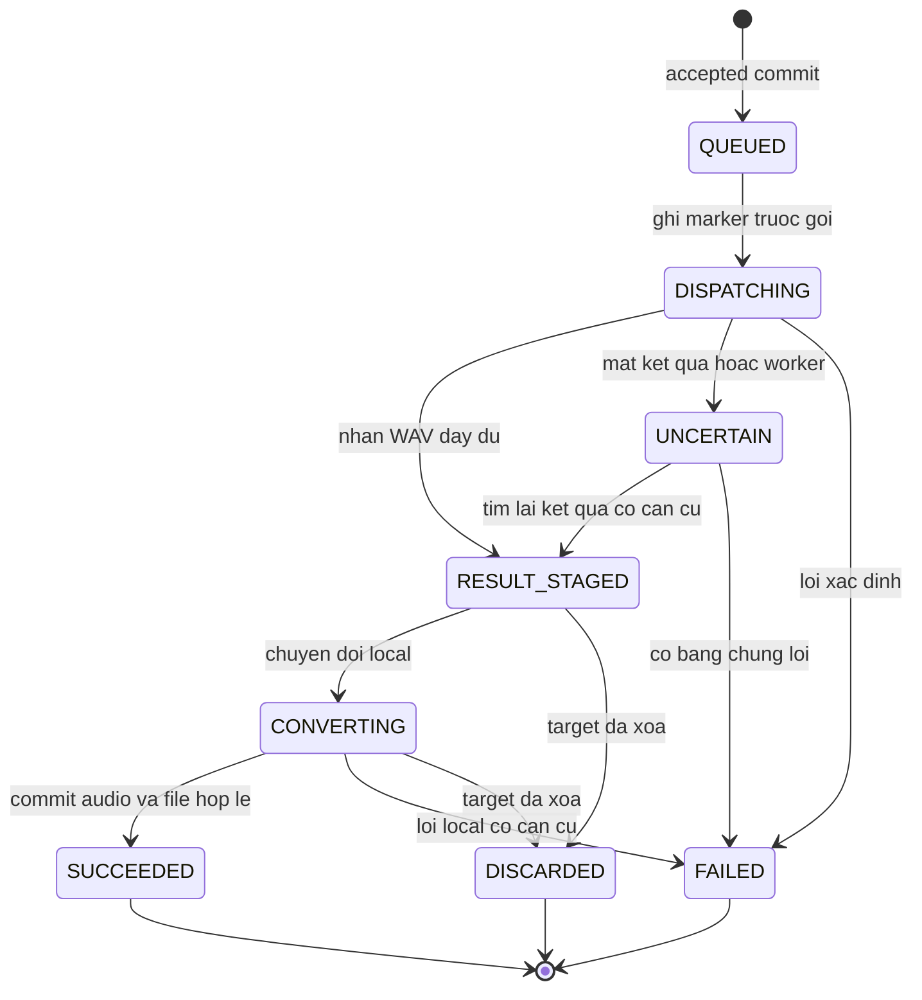

# TDD — Vòng đời dữ liệu, backup và kế hoạch kiểm chứng

**Phiên bản nội dung:** 0.3; biên tập 08/11/2026. **Trạng thái:** dự thảo cơ chế và cách kiểm; phần backend Bắt đầu có bằng chứng riêng, chưa kiểm toàn bộ vòng đời/vận hành.
**Mục đích:** giải thích tạo/giữ/vô hiệu/dọn quyền và metadata, tác vụ TTS/file, backup tạm ngừng phục vụ, restore và ma trận kiểm. LIFE-P01 vé ký 24 giờ, LIFE-P02/P03/REC/BKP-P02 đã chốt đúng phần.
**Nguồn:** [decisions](../02-nghiep-vu/decisions.md), [model](data-model.md), [API](api-transactions.md), [TDD](TDD.md). Hướng đã chọn khác với cơ chế đã kiểm chứng; [điểm dừng thực tế](practice-01-start-session.md#practice-stop) được ghi riêng.

Mục lục: [1. Vòng đời](#ops-lifecycle) · [2. Job/file](#ops-jobs) · [3. Backup](#ops-backup) · [4. Restore](#ops-restore) · [5. Kiểm chứng](#ops-verification) · [6. Điểm cần quyết định](#ops-open).

## 1. Tạo, giữ, vô hiệu và dọn — phân biệt hạn quyền với thời điểm dọn

| Đối tượng | Tạo / giữ | Vô hiệu / dọn | Căn cứ hoặc đề xuất |
| --- | --- | --- | --- |
| Bắt đầu khách — vé ký 24 giờ | Cấp nền, requestId ngẫu nhiên/credentialHash/epoch/issuedAt/ticketExpiresAt có chữ ký; không bảng riêng | Chưa có session chỉ tạo khi vé còn hạn; có session thì kiểm đầy đủ rồi trả gốc kể cả vé hết hạn. Không cấp vé mới/tạo khác khi pending chưa rõ | **LIFE-P01 đã duyệt/DATA-05**; 24 giờ không thay guest 8 giờ/ledger30 ngày/window Admin |
| GUEST_SESSION/start ledger | UK start_request_key, credentialHash/fingerprint và timestamp/digest vé, lưu cùng session trong một TX | Session ended/expiry theo nguồn; ledger và lượt dọn D08, khi ấy vé đã quá 24 giờ nên không tạo lại từ request cũ. Không start gate/generation/purge hook hoặc tombstone PII | D04/D08 giữ nguyên; lưu metadata đối chiếu không tạo hạn lưu mới |
| Current opening | Chọn thật tạo, cùng điểm P06 giữ opening; đổi tiếng/reload không tạo lượt | Chọn điểm khác/Quay bản đồ đóng current. Đóng không xóa ngay ACK/grant đang bay. Giữ phần kỹ thuật tối thiểu tới end/expiry rồi vô hiệu/dọn khi không còn đọc đang xử lý | D04/P06/TECH-04. Không lịch sử mở thất bại 30 ngày |
| GUEST_REQUEST_RESULT | Cùng TX K06/K07/K10; UK key/nonce-seq + fingerprint, result ids/state tối thiểu | Giữ tới end/expiry; replay không đổi current selection mới hơn, dọn cùng ngữ cảnh kỹ thuật, không TTL mới | Không receipt Admin/lịch sử audio; bản gốc mất thì báo unavailable, không tự ghép bản khác |
| Grant | Cấp snapshot text/MP3 đúng bản khi còn hạn; RESTORE không viewEligible. File pin chỉ metadata tối thiểu, không body text trùng | Quyền tối đa tới expiresAt phiên, end thu hồi ngay. Sau deadline không GET audio/ACK mới. Đợi request đọc đã nhận kết thúc rồi tháo file FK/xóa grant; sau đó mới opening, không chạm PLACE_VIEW | Không TTL mới; không dùng việc bytes còn trên server để cho tải sau hạn. Blob đủ điều kiện nghe tiếp ở tab độc lập grant |
| Document nonce/sequence | Resume đúng owner đổi nonce, session lưu seq mới; client cũng dùng generation | Nonce cũ không đổi lựa chọn; end/expiry không nhận mutate. Dọn cùng ngữ cảnh kỹ thuật, không lưu hoạt động audio | Cơ chế đề xuất, cần kiểm thật hai tab |
| Admin command window + receipt | Window từ tài khoản đã xác thực; key=(windowId,randomId), receipt + lệnh DB cùng TX | **24 giờ từ cấp**, không gia hạn khi login/hoạt động. Hết hạn/mất window không nhận key cũ như lệnh mới; đối chiếu trạng thái thực. Dọn sau không còn TX dùng, job độc lập | **LIFE-P02 ĐÃ DUYỆT 04/11**, không đổi login Admin 30 phút hoặc tự thi hành lại |
| TTS job | A18 accepted tạo job/snapshot, active/current/audio/refs cần dùng giữ | Job cũ chỉ dọn sau **bảy ngày từ terminalAt rõ ràng** khi không còn tham chiếu, sử dụng hoặc là kết quả hiện tại cần giữ. Active/unknown/liên kết cần thiết không áp hạn này | **LIFE-P03 ĐÃ DUYỆT 04/11**; không hạn xóa văn bản/audio, file giữ DATA-01/A02.3 riêng |
| File đọc/worker claim | Trước đọc/finalize, xác nhận READY và owner/task; cleaner kiểm cùng protocol | Release khi stream/task thực kết thúc. Worker chết phải có chứng cứ owner instance đã dừng; thiếu heartbeat một mình chưa là bằng chứng. Không tự xóa file hoặc gọi lại provider vì lease hết | Không thêm TTL đã chốt; heartbeat/timeout kỹ thuật sẽ đo, fail-closed khi chưa rõ |
| Blob/memento/Q2 | Giữ trong đúng tab/đúng tài khoản và công việc | Theo TDD 9–10/Q2. Không đưa Blob vào backup, receipt hoặc lịch sử nghe. Admin hết phiên dừng preview; guest chỉ đúng bài đang phát được nghe tiếp | Quy tắc đã chốt, không giữ dài hạn mới |

LIFE-P02 là cửa sổ tra/replay 24 giờ đã duyệt, không lời hứa dọn vật lý đúng mili giây; API chặn theo clock dù worker chưa chạy. LIFE-P01 dùng vé 24 giờ theo DATA-05, không context/10 phút. Mốc 8 giờ/30 ngày/7 ngày nguồn vẫn giữ; lịch dọn/độ trễ phải kiểm thực.

Receipt đã dọn không biến key cũ thành lệnh mới: window cũ hết hạn/mất phải từ chối thực hiện. Guest dùng vé ký 24 giờ/ledger ở dưới, không giữ mã hoặc dữ liệu khách vô hạn.

### 1.1. LIFE-P01 — Vé Bắt đầu ký, 24 giờ từ cấp — ĐÃ DUYỆT

**Xác nhận 04/11/2026 tại [DATA-05](../02-nghiep-vu/decisions.md#data-05).** Bỏ bảng start context/hạn 10 phút và start_generation phối hợp purge. Service epoch cho REC-P01 vẫn giữ; xác thực Admin vẫn session/cookie. Những chi tiết ký/DTO/transaction dưới đây là thiết kế hiện hành **dự thảo, chưa duyệt toàn TDD**. K11/K01/K02 và các nhánh Service/TX/API đã có [64 test hồi quy đạt](practice-01-start-session.md#practice-start-api-result) trên database tạm; chưa toàn V-START01, browser hoặc vận hành thật.

**Vé:** API-K11 cấp ở nền một chuỗi có chữ ký, chứa requestId ngẫu nhiên, credentialHash ràng buộc quyền tab, serviceEpoch, issuedAt, ticketExpiresAt=issuedAt+24 giờ, version nhận dạng định dạng. Không lưu vé vào bảng riêng; không tên/IP/ngôn ngữ trong vé. Client giữ nguyên chuỗi vé và credential trong cùng tab, không sửa payload, không đưa vào URL/log/ảnh báo cáo. Không thêm bước/màn hình/đồng hồ cho khách.

**Đề xuất kỹ thuật ký:** HmacSHA256 với khóa runtime được bảo vệ, payload/encoding do server định nghĩa; không đọc thuật toán từ dữ liệu client để tự đổi cơ chế. Chữ ký kiểm tính toàn vẹn; không mã hóa dữ liệu và không tự chứng minh có người duy nhất. Dùng credential bí mật của tab để đối chiếu hash và nonce; chỉ có ID/tên/vé sao chép mà thiếu credential đúng không có quyền. Web Locks/owner/duplicate vẫn phải kiểm theo TDD 9. Không thêm thư viện JWT hoặc thay đăng nhập Admin.

#### Định dạng vé v1 — lựa chọn triển khai, 14 unit test codec đã đạt

Ngày 05/11/2026, triển khai StartTicketCodec theo phần payload/encoding do server định nghĩa ở trên; không thay LIFE-P01 hoặc hợp đồng API. Bộ ký HMAC riêng có 9 unit test đạt; **14 ca codec đạt BUILD SUCCESS lúc 14:32:52+07:00**, [bằng chứng thực hành A.13](practice-01-start-session.md#practice-ticket-codec-result). Sau branch thành công, lớp xác minh kết hợp và K11/K01/K02 đã kiểm trong [64 test lúc 16:15:34+07:00](practice-01-start-session.md#practice-start-api-result); không dùng các test này để kết luận cấu hình môi trường thật/restart/restore đã đạt. Điểm dừng tại [handoff](../01-tong-quan/handoff.md#next-step).

- Chuỗi vé gồm **hai phần** `base64url(payloadBytes).base64url(hmacBytes)`, dùng bảng chữ URL-safe, không padding `=`, không khoảng trắng/newline trong chuỗi vé. HMAC-SHA256 ký đúng payloadBytes UTF-8, tag đủ 32 byte; không chọn thuật toán theo field client.
- Payload UTF-8 có đúng **6 dòng**, phân cách bằng LF (`\n`), không LF cuối: `hueqr-start-v1`, requestId UUID chuẩn chữ thường, credentialHash hex chữ thường 64 ký tự, serviceEpoch UUID chuẩn chữ thường, issuedAt và ticketExpiresAt theo Instant.toString() UTC. Hai mốc chính xác tới tối đa microsecond để khớp DATETIME(6). Nhãn đầu vừa nhận dạng mục đích Bắt đầu vừa chứa version, được ký cùng các trường.
- Không thêm tên/IP/ngôn ngữ, credential thô hoặc khóa ký. RequestId ngẫu nhiên/hash credential/epoch hiện hành và mốc 24 giờ phải do lớp cấp vé chuẩn bị ở bước sau; codec chỉ nhận các giá trị đã chuẩn bị, không endpoint ký payload tùy ý của client.
- Bộ đọc giới hạn chuỗi đầu vào **512 ký tự**, yêu cầu hai phần không rỗng, giải mã rồi mã hóa lại từng phần phải khớp nguyên văn (chặn padding/bit dư tạo chuỗi khác cho cùng bytes). Sau kiểm HMAC mới đọc field/version, kiểm loại/độ dài/precision và serialize lại phải khớp đúng payload gốc. Không chấp nhận version lạ, UUID/hex/timestamp có cách viết khác, field thiếu/thừa hoặc lỗi encoding. Thông báo lỗi chung không chép vé/field vào lỗi. Quy tắc biểu diễn này phục vụ định danh/digest vé nhất quán khi triển khai ledger, chưa tính/lưu digest ở codec.
- Kết quả decode chỉ chứng minh toàn vẹn/định dạng. **Chưa** đối chiếu requestId/header key, credential thật, epoch hiện hành hoặc clock; kiểm đủ khoảng 24 giờ/issuedAt không tương lai dùng TimePolicy ở lớp điều phối sau. Codec không kiểm expiry, không tra ledger hoặc ghi phiên. Khóa/epoch runtime bền vững, restart/restore và K11/K01 chưa được chứng minh từ các unit test này.

Căn cứ encoding đối chiếu 05/11/2026: [Java 21 Base64](https://docs.oracle.com/en/java/javase/21/docs/api/java.base/java/util/Base64.html), [Encoder.withoutPadding](https://docs.oracle.com/en/java/javase/21/docs/api/java.base/java/util/Base64.Encoder.html#withoutPadding()). Dùng Base64URL là mã hóa biểu diễn bytes, không mã hóa bảo mật; vé vẫn là chuỗi opaque với client và không đưa vào URL/log.

#### Credential, fingerprint và cấu hình runtime — phần triển khai K11/K01/K02

- Credential do client đúng tab tạo bằng nguồn ngẫu nhiên an toàn: **32 byte**, truyền `X-Guest-Credential` dạng Base64URL chuẩn không padding (43 ký tự), không URL/query/cookie dùng chung. Backend kiểm biểu diễn chuẩn, hash SHA-256 của bytes và lưu hash; không lưu/trả credential thô. Chọn encoding là chi tiết kỹ thuật, không thay cơ chế xác thực đã chốt. Frontend/nguồn sinh/owner tab chưa triển khai hoặc kiểm bằng kết quả API.
- Digest vé là SHA-256 của chuỗi vé chuẩn UTF-8. Fingerprint là SHA-256 của tên đã chuẩn hóa và initialLanguage ghép theo độ dài byte, kèm digest vé; đối chiếu riêng credentialHash/epoch/timestamp đã lưu. Không nhập nhằng do ghép chuỗi thiếu ranh giới hoặc đổi payload cùng key.
- `GuestRuntimeConfiguration` đọc `hueqr.guest.signing-key-base64` và `hueqr.guest.service-epoch`; application.properties ánh xạ tới `HUEQR_GUEST_SIGNING_KEY_BASE64` và `HUEQR_SERVICE_EPOCH`. Khóa là Base64 chuẩn có padding của tối thiểu 32 byte bí mật; epoch là UUID chuẩn chữ thường. Không default/khóa mẫu trong main, không sinh key/epoch mới mỗi boot; thiếu/sai cấu hình thì khởi động thất bại.
- Người dùng cung cấp/lưu cấu hình môi trường thật tại nơi bảo vệ ngoài repo, artifact và gói backup. Restart/cập nhật thường dùng lại khóa/epoch; restore thật luân chuyển epoch theo REC-P01. Không đặt lại key/epoch chỉ để chạy qua lỗi. Chưa có bằng chứng cấp secret hoặc áp dụng cấu hình thật; hướng dẫn thao tác môi trường được giao riêng khi tới chặng đó.
- Test import `support/TestcontainersConfiguration` được cấp fixture key/epoch công khai qua DynamicPropertyRegistrar, MySQL tạm qua ServiceConnection; không đọc/ghi database đang dùng. Test dựng lại Spring context với cùng cấu hình chứng minh không tự đổi key/epoch ở lớp cấu hình, **chưa** chứng minh restart quy trình app/volume/ledger hoặc restore thật.

#### Kiểm signature và quyền trước, phân nhánh expiry sau tra ledger

1. Kiểm format/version/chữ ký, epoch hiện hành và credential binding; requestId/header key phải trùng nonce đã ký, clock do server. Từ chối raw newline/control trước normalize tên, kiểm 1–50 ký tự/tiếng theo nguồn. Chưa ghi phiên vì cấp vé hoặc mở trang.
2. Tra ledger GUEST_SESSION theo UK(start_request_key). Nếu có: kiểm credential/quyền, fingerprint tên đã chuẩn hóa + initialLanguage + định danh vé, timestamp/digest vé đã lưu; khác thông tin trả KEY_REUSED, không sửa session. **Dù vé đã hết hạn**, đúng yêu cầu vẫn trả cùng sessionId/startedAt/expiresAt/state hiện tại; không gia hạn, tạo mới hoặc biến EXPIRED/ENDED thành ACTIVE.
3. Nếu không có ledger: chỉ cho tạo lần đầu khi serverNow < ticketExpiresAt, issuedAt không ở tương lai và khoảng 24 giờ hợp lệ đã ký. Tại đúng ticketExpiresAt đã hết hạn; từ chối START_TICKET_EXPIRED. Không có ledger không tự là bằng chứng phiên trước đã hết hạn hoặc request khác đang bay chưa commit.
4. Lưu session, requestId UNIQUE, credentialHash, fingerprint và thông tin đối chiếu vé **cùng một giao dịch**. startedAt lấy thời gian xử lý hợp lệ của lần Bắt đầu thành công, session expiresAt=startedAt+8 giờ; không lấy ticketExpiresAt làm hạn phiên.
5. Hai request concurrent cùng requestId: UNIQUE và TX bảo đảm một insert. Request thua tranh chấp unique phải rollback TX đó rồi đọc/đối chiếu trong TX mới; không query tiếp trong transaction đã lỗi hoặc gọi tạo lại với key khác. Cùng key khác nội dung trả 409 KEY_REUSED; trùng tên khác vé/credential ở hai tab tạo hai phiên độc lập.
6. Hết hạn vé **không** tự dọn ledger. Ledger/hash/fingerprint/timestamp vé sống cùng session tới mốc D08: (endedAt hợp lệ hoặc expiresAt gốc) +30 ngày; purge xử lý con/session như cũ. Không tăng generation, không khóa start gate, không kho tombstone hoặc TTL riêng cho vé đã dùng.
7. Backup/restart thường giữ khóa ký cần xác minh vé, epoch và dữ liệu ledger. Không sinh khóa ngẫu nhiên mới mỗi lần boot khiến vé/lookup cũ tự mất hiệu lực. Nếu sau này luân chuyển khóa, phải còn xác minh vé gắn ledger đang giữ; chưa chọn kỳ xoay khóa hoặc coi vòng đời khóa chỉ dài 24 giờ. Restore thật đổi epoch theo REC-P01, nên vé/quyền cũ bị chặn dù signature hợp lệ.

**Tránh lỗi cài đặt phổ biến:** không dùng bộ kiểm mặc định tự từ chối expiry trước khi tra ledger; phải kiểm chữ ký/quyền rồi phân nhánh “đã tạo”/“chưa tạo”. Không coi expiry vé là quyền hồi sinh phiên. Cùng credential nhưng key/vé mới xung đột UK credential thì đối chiếu/chặn an toàn, không insert phiên thứ hai; lần Bắt đầu mới được khách xác nhận có requestId và credential mới.

#### Vì sao không cần phối hợp start_generation với purge

Gọi I là issuedAt, T là startedAt, E là kết thúc chủ động hợp lệ (nếu có). Vé chỉ tạo khi I ≤ T < I+24 giờ. Nếu kết thúc chủ động thì E ≥ T, thời điểm dọn sớm nhất E+30 ngày ≥ I+30 ngày; nếu tự hết hạn thì dọn T+8 giờ+30 ngày. Cả hai đều **muộn hơn I+24 giờ**. Vì vậy sau purge D08, request cùng vé không còn ledger nhưng vé đã hết hạn: nhánh tạo lần đầu bị chặn. Không phải giữ request key/PII ngoài hạn đã chốt.

Lập luận chỉ áp dụng khi đúng D08 và clock đáng tin cậy; thao tác DB ngoài quy trình xóa session sớm không nằm trong bảo đảm. Restore thật dùng epoch chống quay lại trạng thái cũ. Nếu phát hiện clock/khóa/retention thực tế làm sai các giả định, ghi bằng chứng và xử lý; không âm thầm trả lại start_generation.

**Ví dụ tách hai đồng hồ:** vé cấp 08:00 ngày 04/11, hết 08:00 ngày 05/11; khách bắt đầu 07:50 ngày 05/11, phiên hạn 15:50 ngày 05/11. Tra lại lúc 08:10 ngày 05/11: vé hết hạn nhưng session đã tạo còn hạn; đúng quyền/yêu cầu trả cùng ID/hạn 15:50. Không cho dùng vé đó tạo phiên khác. Đây là dữ liệu minh họa, không kết quả test.

#### UI và tình huống chưa rõ kết quả

| Tình huống | Hành vi đã chốt / triển khai cần giữ |
| --- | --- |
| Chưa từng gửi Bắt đầu, vé đã hết hạn | Chuẩn bị vé mới ở nền, giữ tên/ngôn ngữ và hành động Bắt đầu hợp lệ; không đồng hồ/nút mới. Server vẫn kiểm clock trước insert |
| Đã gửi, response mất hoặc chưa rõ | Giữ nguyên vé/requestId/credential để tra lại bằng đúng yêu cầu; không tự cấp vé khác rồi tạo phiên thứ hai |
| Vé hết hạn, session tương ứng còn | Kiểm signature/quyền/epoch/fingerprint, trả kết quả gốc/state thật; không tự phát audio/tạo lượt hoặc gia hạn |
| Vé hết hạn, ledger không còn/chưa thấy | Từ chối tạo, thông báo phù hợp; nếu request gốc đang bay chưa rõ vẫn không nói chắc thất bại. Để khách chủ động xác nhận lần Bắt đầu mới khi không xác định/tiếp tục được; không khẳng định sai “phiên đã hết hạn” |
| Cùng mã nhưng tên/initialLanguage khác | 409 KEY_REUSED, giữ input để đối chiếu; không sửa session đã tạo. Khoảng trắng chuẩn hóa tương đương không là đổi tên; đổi ngôn ngữ trong phiên dùng luồng riêng |
| Session đã kết thúc/hết hạn | Trả đúng trạng thái gốc cho việc tra có quyền, không mở quyền nội dung mới. Tạo phiên khác chỉ sau khách xác nhận thông tin và Bắt đầu mới thành công |
| Restore thật | Thu hồi quyền/vé/window cũ trước public theo REC-P01; giữ lịch sử/mốc gốc, không endedAt giả. Không nhầm với restart thường |

**Kiểm tính nhất quán:** chưa phát hiện thay đổi hành vi ngoài xác nhận LIFE-P01; TTL 24 giờ kỹ thuật tách 8 giờ guest/30 ngày ledger/24 giờ window Admin/30 phút login. Điều kiện và ma trận kiểm ở 5.1, **chưa có tình huống nào được chạy/đánh đạt**.

Nguồn kỹ thuật kiểm **04/11/2026**: [Java 21 Mac](https://docs.oracle.com/en/java/javase/21/docs/api/java.base/javax/crypto/Mac.html) mô tả HMAC và HmacSHA256; [MySQL InnoDB locks](https://dev.mysql.com/doc/refman/8.4/en/innodb-locks-set.html) mô tả tranh chấp unique/lock. Thứ tự tra ledger/phân nhánh expiry, fingerprint và quy trình rollback là thiết kế của dự án, không tuyên bố API mặc nhiên bảo đảm nghiệp vụ.

## 2. State machine tác vụ và phối hợp file

**Chưa tạo** là không có job phù hợp; QUEUED/DISPATCHING/RESULT_STAGED/CONVERTING hiển thị đang tạo. UNCERTAIN hiển thị chưa xác định kết quả và hướng kiểm tra, không gán thành lỗi xác định để mở nút gửi lại. Một lần Retry tạo job/attempt mới, không reset job cũ hoặc tráo text T1 thành T2.

1. **Accept:** Service khóa text/active job và operation window; persist snapshot + job + receipt 202. Marker chưa commit không được dispatch.
2. **Dispatch:** worker giành owner_token/phase_version, ghi DISPATCHING trước gọi. Crash sau marker nhưng không rõ đã gửi hay chưa → UNCERTAIN, không tự gửi Gemini lần hai. QUEUED chắc chưa dispatch có thể xử lý lần đầu theo tác vụ đã tiếp nhận, không phải retry provider.
3. **Stage:** WAV hoàn chỉnh có manifest kỹ thuật jobId/hash/checksum; không prompt/key. Khi WAV đã kiểm đủ, đăng ký FILE_ASSET READY và TTS_JOB.source_wav_file_id trong TX trước convert; FK này giữ WAV cho local retry/backup, không để chỉ một path trong RAM. Có bằng chứng kết quả gốc thì tiếp tục convert local, không gọi TTS lại. Nếu chỉ còn bytes không đủ đối chiếu thì cách ly/kiểm, không tự gắn audio.
4. **Convert/finalize:** FFmpeg/ffprobe ngoài TX; tạo file key mới bất biến, hoàn tất bytes trước metadata READY/AUDIO_REVISION. Khi AUDIO_REVISION đã giữ WAV/MP3 thì tháo source_wav_file_id của job nếu không còn cần; lỗi local giữ đúng WAV để retry, target xóa tháo khi worker thật đã dừng. Trong TX kiểm lại owner token, target_valid/text/hash/ngôn ngữ; target đã xóa không insert PLACE/TEXT lại.
5. **Lỗi local sau WAV thành công:** job nêu failureStage và retryAction=REPROCESS_LOCAL nếu WAV còn hợp lệ; Retry chủ động có thể xử lý lại local, không tạo chi phí provider mới. Lỗi xác định trước kết quả có retryAction=CREATE_PROVIDER_ATTEMPT. Chưa rõ chỉ INSPECT_ONLY; thiếu căn cứ provider không hứa tra lại được.
6. **Xóa điểm/đóng trang/hết phiên:** job đã nhận không phụ thuộc HttpSession. Xóa làm target_invalid và kết quả muộn DISCARDED; nếu còn cuộc gọi/worker chưa rõ thì vẫn giữ cờ uncertain/claim, không dọn chỉ vì target mất.
7. **Dọn:** bản đầy đủ WAV/MP3 đã kiểm nhưng không dùng thuộc file hoàn chỉnh chưa áp dụng, áp DATA-01 24 giờ đủ điều kiện. Chunk/đầu ra dở trong workspace mới theo 1 giờ khi terminal/không worker/an toàn. Không đổi tên một WAV hoàn chỉnh thành “file tạm” để xóa sau 1 giờ. Bản nháp còn tham chiếu giữ.

Server không tự thẩm định hồ sơ D09: success → nghe thử/nghe trọn → người dùng duyệt đúng bản/hồ sơ → Admin áp dụng cả cặp là các việc khác nhau.

**File và race:** mọi download tạo claim trước stream; cleaner đánh dấu DELETING dưới khóa và chỉ khi không refs/claim + đủ hạn. Bên thêm ref/download không nhận asset DELETING. File delete ngoài TX, finalize kết quả thật hoặc retry. Kết quả unlink chưa rõ giữ DELETING, không READY cho tải/ref mới tới khi kiểm tồn tại/checksum; file thật đã absent mới finalize DELETED. FILE_ASSET.ever_applied/last_unapplied_at giữ đúng mốc tham chiếu áp dụng cuối của cả WAV/MP3. Service xóa điểm chỉ tháo refs, không unlink file trong TX.

## 3. BKP-P02 — Backup lúc tạm ngừng phục vụ — HƯỚNG ĐÃ CHỌN

**Đã được người dùng chọn ngày 04/11/2026**, thay BKP-P01 online làm mặc định. Giữ DATA-03: cuối ngày có thay đổi, trước deploy/thay cấu trúc DB, DB + WAV/MP3 đang tham chiếu + manifest, cục bộ tách live, mỗi bản bảy ngày. Không thêm MySQL tạm mỗi lần backup chỉ để dựng catalog; restore thử vẫn ở môi trường riêng. Thời gian gián đoạn **chưa đo/chưa cam kết**.

### 3.1. Điểm dừng nhất quán và trình tự

1. **Chuẩn bị ngoài buổi trình diễn:** kiểm vị trí/quyền/dung lượng, backupId/createdAt/expiresAt=created+7 ngày, khóa vận hành để không backup/deploy/DDL khác cùng lúc. Chốt đang lưu gì/chưa lưu Q2; không tự lưu/Áp dụng phần Admin đang gõ. Không thu hồi quyền khách vì bảo trì thường.
2. **Đóng nhận việc mới:** ghi mode QUIESCING bền trong OPS_GUARD, chặn request mới và không dispatch TTS/job/cleaner mới. Trong lúc app còn chạy có thể trả lỗi tạm ngừng phù hợp; khi app đã dừng, website/API có thể không truy cập được, **không hứa có trang bảo trì chạy riêng**. UI đã tải giữ nội dung/soạn theo P04/Q2, không báo kết thúc/expiry giả.
3. **Drain có kiểm soát:** chờ request/TX đang làm, stream/file write/convert/unlink thực kết thúc; những công việc đã nhận được ghi trạng thái bền. Cleaner không bắt thêm file; phần đang unlink phải hoàn tất/được kiểm thật. Chi tiết TTS ở 3.2. Không dựa riêng timeout graceful-shutdown hoặc heartbeat để khẳng định mọi worker đã dừng.
4. **Dừng ứng dụng và mọi tiến trình ghi/dọn:** sau khi drain được xác nhận, dừng Spring Boot (kèm Vue build) và worker liên quan; giữ container MySQL hoạt động. OPS_GUARD chuyển FROZEN bởi quy trình vận hành có kiểm soát; xác minh không app/worker/scheduler/manual migration khác còn ghi DB hoặc file, không đường unlink chưa rõ. Nếu chưa chứng minh trạng thái đứng yên thì **không chụp/không COMPLETE**, báo nguyên nhân, hoãn hoặc hủy lần backup thay vì tuyên bố bảo vệ dữ liệu.
5. **Database và catalog đứng yên:** khi không có writer/DDL/cleanup, dùng mysqldump snapshot InnoDB cho database ứng dụng; từ **chính database MySQL đang đứng yên này** đọc catalog AUDIO_REVISION.wav/mp3, TTS_JOB.source_wav_file_id còn dùng và GRANT file còn tham chiếu, hợp nhất theo storage_key. Cả dump và catalog cùng trạng thái checkpoint do không có thay đổi giữa chúng; không phải trộn query live đang thay đổi với dump cũ.
6. **Copy và đối chiếu:** copy đúng file hoàn chỉnh được tham chiếu vào staging tách live; giữ key/hash/size/định dạng và manifest gồm snapshot/schema/app version/checkpoint/mốc gốc, catalog, trạng thái job còn cần đối chiếu. Không đưa secret vào gói bàn giao; khóa runtime cần thiết quản lý riêng được bảo vệ, không trong Git/log. File thiếu/hash sai → backup FAILED, không bỏ qua để có bản “đủ”.
7. **Kết thúc bản sao:** chỉ COMPLETE sau dump/catalog/files/manifest đủ và kiểm; tạo xong không đặt lại createdAt để kéo thêm bảy ngày. Bản dở không dùng restore; không kéo hạn bản trước chỉ vì bản mới lỗi. Không unlink/xóa volume live hoặc reseed.
8. **Mở lại có kiểm soát:** trước public, kiểm không còn tác vụ backup đang copy; giữ nguyên serviceEpoch/khóa ký và các mốc vé/phiên. Xử lý D08 đã đến hạn trong lúc dừng trước trả danh sách/thống kê/phục vụ, giữ timestamp gốc; reconcile claims/job (3.2), mở app/worker/cleaner, bỏ mode bảo trì sau kiểm. Không restore B chỉ vì backup thành công; backup thường không làm mất thay đổi hay thu hồi phiên.
9. **Backup lỗi/không dừng sạch:** giữ lỗi/marker bền, xác minh writer/copy thực đã dừng trước mở; không mở app trong lúc operator vẫn lấy snapshot. Có thể mở lại hệ hiện tại sau kiểm an toàn và hoãn backup, không tự deploy/schema khi thiếu bản backup bắt buộc đã kiểm. Sự cố không là quyền xóa job/volume/các bản còn hạn.

Cách này đơn giản hóa việc chứng minh DB–audio khớp: không có writer giữa dump/catalog/copy. Dừng app phải bao gồm worker/công cụ dọn riêng nếu sau này tách tiến trình; ngrok không tự tạo checkpoint. Cần đo thời gian drain + dump + copy + kiểm, không lấy riêng thời gian dump làm downtime toàn bộ.

### 3.2. TTS đã nhận, đang chạy và chưa rõ kết quả

| Trạng thái lúc chuẩn bị | Cách xử lý | Sau mở lại bình thường |
| --- | --- | --- |
| QUEUED đã commit, chưa dispatch | Khóa nhận/dispatch mới; giữ job, snapshot/active pointer và receipt. Không chuyển FAILED chỉ để dừng app | Tiếp tục **lần xử lý đầu** của việc đã tiếp nhận sau bỏ gate; không cần Admin bấm tạo lại, không coi là retry provider |
| DISPATCHING còn worker/HTTP thật đang chạy | Khuyến nghị chờ cuộc gọi hoàn tất và persist kết quả/marker trước dừng. Không dùng stop container để hứa provider bị hủy; nếu không thể dừng sạch có chứng cứ thì hoãn/hủy backup, báo trạng thái | Không gửi lại Gemini chỉ vì restart; kết quả đã lưu kiểm đúng bản/hash rồi tiếp tục |
| RESULT_STAGED/CONVERTING hoặc local file write | Drain tới checkpoint: WAV hoàn chỉnh đã đăng ký source_wav_file_id/manifest; hoàn tất hoặc dừng local task có kiểm soát, xác nhận không writer. Giữ workspace bền qua stop thường, không coi stop là điều kiện dọn rác | Tiếp tục local từ WAV đúng job/hash khi có căn cứ; không gọi provider lại. Kết quả muộn/target xóa vẫn xử lý A04 |
| UNCERTAIN nhưng đã xác nhận không còn worker/file writer cục bộ | Giữ job/outcome_uncertain/target snapshot và file/claim cần thiết, chụp metadata đúng trạng thái; không chờ provider vô hạn mới backup nếu cục bộ thật đã đứng yên | Kiểm yêu cầu cũ, không tự đổi sang FAILED/SUCCEEDED hoặc phát provider mới. Nếu không có cách truy hồi thì tiếp tục hiển thị chưa rõ, không hứa lấy lại được audio |
| Trạng thái chưa rõ **và chưa chứng minh writer đã dừng** | Chưa đủ checkpoint; không hoàn tất backup. Xác minh owner/process hoặc hoãn, không giải phóng claim chỉ vì quá một khoảng chờ tùy ý | Chưa tự chạy cleaner/worker tranh chấp; không lấy snapshot thiếu file rồi tuyên bố đầy đủ |
| SUCCEEDED / FAILED / DISCARDED rõ | Kết quả/refs đã commit và bytes hoàn tất, không active worker thì chụp đúng bộ còn được tham chiếu | LIFE-P03 chỉ dọn job cũ đủ bảy ngày và không còn dùng/liên kết/current result; file theo DATA-01/A02.3 riêng |

Tạm dừng vì backup không tự ghi terminalAt mới hoặc đổi QUEUED/UNCERTAIN thành FAILED để bắt đầu đồng hồ LIFE-P03. Backup giữ việc đã nhận, không đồng nghĩa lưu được response ở dịch vụ ngoài chưa nhận về hoặc hứa hủy provider. Workspace dở không tự thuộc gói WAV/MP3 hoàn chỉnh; normal stop không xóa workspace/metadata hoặc làm tác vụ nhận rồi biến mất. Nếu crash ngoài quy trình, trước chạy lại phải kiểm manifest/owner và đánh dấu UNCERTAIN đúng căn cứ.

### 3.3. Phiên khách/Admin và thao tác trong thời gian dừng

- Phiên khách còn hạn giữ ID/credential và mốc bắt đầu + đúng 8 tiếng; downtime không gia hạn, không endedAt giả, không tự tạo phiên khi mở lại/reload. Sau mở lại kiểm hiệu lực rồi tiếp tục P03/P04 nếu còn quyền.
- Tab đã có văn bản/Blob vẫn theo quyền hiện hành; backup không đẩy xóa tức thì nội dung hoặc tạo ngoại lệ mới. Nếu đủ 8 tiếng trong lúc dừng, map/tiếng khóa, chỉ bài đang phát đúng mốc được P01 pause/resume; tải dở/response muộn/pause trước hạn không được nghe tiếp. Chưa hứa browser giữ tab hoặc network phát được.
- Request đã commit trước dừng nhưng mất response dùng key/receipt/session để đối chiếu, không gửi lại như lệnh mới. Mốc 24 giờ của window vẫn trôi qua; quá cửa sổ phải kiểm trạng thái thực, không tự gia hạn.
- Q2 bảo vệ phần chưa lưu đúng tab/tài khoản. Admin có thể phải login lại do HttpSession không lưu qua stop; không tự Lưu/Apply/TTS/preview sau login, thời hạn 30 phút vẫn độc lập. Không cam kết snapshot phần chưa lưu của trình duyệt.
- D08/cleanup/backup retention không đặt lại khi mở. Lịch/độ trễ dọn thực trong thời gian hệ thống dừng cần ghi nhận/đo, không tự coi chấp nhận downtime là duyệt tăng hạn giữ. Lượt kiểm sau phải quan sát việc lọc trước mở và dọn lại đúng lớp.

Nguồn kiểm ngày **04/11/2026**: [MySQL mysqldump](https://dev.mysql.com/doc/refman/8.4/en/mysqldump.html) cung cấp snapshot InnoDB và giới hạn DDL; không tự backup file audio. [Spring Boot graceful shutdown](https://docs.spring.io/spring-boot/reference/web/graceful-shutdown.html) mô tả việc chờ request khi dừng; không chứng minh tác vụ provider/file tùy biến đã drain. Trang có thể hiển thị bản Boot khác mốc đã chọn; không đổi bộ phiên bản qua việc đọc nguồn. Tính đứng yên của app/job/file và thời lượng phải kiểm thật.

## 4. Phục hồi — lọc trước mở phục vụ

**DATA-01–04/REC-P01 đã chốt:** chỉ B còn hạn, restore riêng, lọc phiên/lượt quá hạn theo timestamp gốc trước phục vụ, bảo vệ/dọn bản sao bảy ngày; không cứu mất toàn laptop.

1. Chọn B còn trong hạn, kiểm manifest/checksum/schema/app version và đủ WAV/MP3 được tham chiếu. Gói thiếu/dở/hết hạn không dùng như backup hợp lệ.
2. Restore DB/audio vào container/volume/path riêng; không provider, app public, worker, cleaner hoặc migration tự động chạy. Giữ live tách biệt trong lúc chuẩn bị.
3. Tính current time thật và anchor gốc: endedAt hợp lệ, ngược lại startedAt+8 giờ. Xóa phiên có anchor+30 ngày đã đến hạn và toàn bộ lượt/metadata phụ thuộc; không đổi started/ended/expires/last-unapply/createdAt backup về hôm nay. Lặp bước lọc ở ngay trước switch nếu chuẩn bị kéo dài.
4. Opening/grant đã hết hạn hoặc end thì vô hiệu/tháo refs; không phục hồi Blob/quyền nghe tiếp. Loại read/worker claim cũ sau xác nhận instance cũ không còn chạy, không tiếp quản lease trong dump như đang thực.
5. Job QUEUED/processing/unknown trong snapshot phải **reconcile**, không tự gửi provider. Công việc có thể đã thực hiện sau B mà B không biết; không phát sinh chi phí hoặc gắn kết quả mù. Audio success có file/hash khớp mới dùng, vẫn cần hồ sơ theo D09.
6. Kiểm ràng buộc/cặp/gate/file/name lịch sử và kết quả lọc bằng truy vấn/đường Admin phù hợp; lập báo cáo restore với B, thời điểm gốc, số lượng loại bỏ, lỗi. Dữ liệu kiểm không cần đưa tên khách vào báo cáo chia sẻ.
7. Trước switch phải dừng/fence app và worker cũ để không cùng ghi hai kho; checkpoint mới, đổi runtime sang kho đã kiểm, kiểm lại không quá hạn rồi mới mở. Đây là giai đoạn có thể gián đoạn; thời gian thực chưa đo/không hứa RTO. Không tự xóa kho cũ/backup còn hạn hoặc coi chạy image cũ là rollback schema.
8. Sau switch theo dõi lỗi/cleanup/worker, dọn B và bản tạm đúng hạn/quyền. Chỉ ghi đã phục hồi khi có bằng chứng, không chỉ import SQL thành công.

### 4.1. REC-P01 — ĐÃ DUYỆT: thu hồi quyền cũ sau phục hồi thật

Snapshot B có thể được tạo **trước** một thao tác kết thúc phiên/xóa/áp dụng/TTS ngoài hệ thống. Restore chỉ biết trạng thái ở B; không hứa giữ mọi thao tác sau B nếu không có journal bổ sung. Quy tắc “TTS muộn không phục hồi điểm đã xóa” vẫn áp dụng job, không phải phép khôi phục lịch sử toàn DB được chủ động chọn.

**Đã duyệt 04/11/2026:** mỗi lần restore thật đổi service_epoch, thu hồi quyền khách/Admin và command windows cũ trước mở phục vụ; vẫn giữ session/view hợp lệ cho thống kê theo mốc gốc. Khách cũ nhận nhánh không thể tiếp tục và phải xác nhận Bắt đầu phiên mới; không gán endedAt giả hoặc tạo phiên tự động. Admin đăng nhập lại, Q2 chỉ phục hồi phần soạn nếu target/version còn hợp lệ; kiểm trạng thái thực trước thao tác, không replay receipt từ epoch cũ. service_epoch được giữ trong metadata vận hành cục bộ tách gói restore và so với session/start ticket/window; không lấy epoch cũ từ B làm epoch hiện hành. Triển khai/restart app thông thường **không** đổi epoch hoặc tự thu hồi phiên khách theo phương án này; Admin vẫn có thể cần login lại nếu HttpSession không lưu qua restart.

**Ảnh hưởng đã được người dùng chấp nhận:** phiên khách còn hạn trong B cũng không tiếp tục qua lần kiểm quyền sau restore; thống kê không bị sửa cho khớp quyền mới. Đổi epoch chặn quyền request phía server, không tuyên bố xóa Blob/văn bản hoặc đẩy ngắt tức thì vào mọi tab đã tải; client vẫn giữ giới hạn 8 giờ/P01. Trạng thái/mốc phiên gốc không bị gán kết thúc giả chỉ vì credential bị thu hồi. Người dùng/nhóm phải biết thay đổi sau snapshot có thể mất; không tự hứa đồng bộ không mất dữ liệu. Người dùng hiểu thay đổi sau thời điểm backup có thể mất; xác nhận chỉ áp dụng restore thật. BKP-P02 cho phép downtime lúc backup theo phạm vi đã nêu, thời lượng backup/restore vẫn phải đo, chưa RPO/RTO đạt.

## 5. Kế hoạch kiểm chứng và trạng thái bằng chứng

Ma trận dưới đây là kế hoạch kiểm. Các ca backend đã thực hiện ghi tại [thực hành A.14](practice-01-start-session.md#practice-start-api-result) và [A.15 K04](practice-01-start-session.md#practice-end-session-result), các phần chưa chạy giữ giới hạn riêng. Window/receipt, xác thực và phần tạo/đọc/sửa tên địa điểm có [bằng chứng backend riêng](api-transactions.md#admin-place-test-result), chưa thay kiểm UI/vòng đời/restore. Quyền test/database tạm theo [handoff mục 7](../01-tong-quan/handoff.md#guidance-protocol), không áp dụng lên database đang dùng. Mỗi phép kiểm cần dữ liệu tách biệt, ghi app/schema/thiết bị/browser/timezone/network/thời gian và kết quả thực phù hợp. Dùng clock fixture, không endpoint đổi giờ public hoặc giảm 8 giờ production. Screenshot giao diện không thay truy vấn DB/network/âm thanh cần quan sát.

| Mã / nguồn | Chuẩn bị và thao tác sau này | Kết quả cần thấy / bằng chứng |
| --- | --- | --- |
| V-TAB01 — D04/TECH-04; AC-K04/K15 | Android/Chrome và iPhone/Safari thật; A/B bắt đầu cùng tên, đổi tiếng và kết thúc A; reload B | Hai id/hash credential riêng, DB hai session; B không đổi tiếng/kết thúc. Reload B giữ cùng session, không mới view hoặc tự phát. Che token trong ảnh/log |
| V-TAB02 — P03; TDD 9 | Kiểm reload, Duplicate, mở từ opener, BFCache/back, tab nền/restore; ghi Web Locks capability | Không dùng sessionStorage copy để chia sẻ phiên; document cũ không cướp lựa chọn mới. Chưa phân biệt được owner phải báo chưa đạt/chưa kết luận, không fallback cookie hoặc tự cấp phiên |
| V-START01 — API-K01/K11, LIFE-P01/DATA-05 | Theo ma trận 5.1: concurrent/replay/mất response/key khác body/hai tab/expiry/restart/restore/purge | Cùng ID/mốc gốc cho yêu cầu đã tạo, vé hết hạn không tạo lần đầu; không start_generation/context/purge gate. Có ca backend đã chạy; trạng thái và phần còn thiếu theo ma trận 5.1 |
| V-VIEW01 — P06–P08/D04 | A vi→en/reload/bấm lại; A→B→A; chủ động quay map→mở A; overlap Hủy/ngoài vùng; đảo thứ tự response/ACK | Đếm theo opening/văn bản thật, không audio/request; snapshot tiếng đầu thành công; late ACK sau xóa giữ lịch sử riêng, không phục hồi điểm |
| V-AUDIO01 — P01/UI-02/TECH-04; AC-K18/K20 | Full MP3; cho expiry khi đang phát, pause từ trước, đang tải, response tới sau; quan sát tab foreground/background | Chỉ bài đang phát đúng mốc được pause/resume; khóa tua/replay/new/map/tiếng, văn bản đọc được. Blob không phát sinh fetch sau expiry; timer muộn không tự cấp quyền |
| V-AUDIO02 — P03/TECH-04 | Reload trước/sau expiry, chuyển vùng/tiếng liên tục, lỗi tải, browser play bị chặn, vào form phiên mới | P03 pause/mốc cùng bài không view mới; sau expiry không khôi phục tail; một audio/tab, response cũ bị bỏ, không revoke quá sớm. Browser discard phải ghi giới hạn thực, không báo pass |
| V-ADMIN01 — Q2/Q3/UI-04 | Nhập/vẽ/xem/cuộn chủ động so với polling/audio tự phát; hết 30 phút và login lại cùng/khác tài khoản | Chỉ Q3 gia hạn, preview dừng/che, Q2 chưa lưu đúng tab/target, không auto lưu/Apply/TTS hoặc lộ bản tạm sang tài khoản khác |
| V-TX01 — UI-04/A02.1 | Hai lệnh Apply/delete/TTS đồng thời; If-Match cũ; mất phản hồi sau commit; dọn receipt rồi dùng window cũ | Giữ nhất quán cặp/gate/FK/history; key không thực hiện lần hai, không xóa điểm mới trùng tên; API không coi timeout là rollback |
| V-TTS01 — A04/TTS-01 | Khi được phép dùng fixture/provider stub trước; QUEUED/restart/DISPATCHING mất result, local convert lỗi/target xóa | Không provider retry mù, đúng text/tiếng; accepted không success/duyệt/Apply. Kết quả muộn không restore target; file đầy đủ 24 giờ khác workspace 1 giờ. Không gọi Gemini thật nếu chưa được cho phép |
| V-BKP01 — DATA-03/04, BKP-P02 | Dataset đủ refs; drain với QUEUED/DISPATCHING/local convert/UNCERTAIN, stop app/worker/cleaner nhưng MySQL còn chạy; dump/catalog/copy/kiểm/mở lại | Không writer giữa dump/catalog/copy, không MySQL tạm để lấy catalog. Đủ hash/file đúng snapshot, job/receipt/phiên còn và mốc gốc, không provider retry; đo downtime/disk. Không đủ checkpoint thì FAILED/hoãn, không COMPLETE giả |
| V-REC01 — DATA-01–04/REC-P01 | B hai ngày nhưng S đã 31 ngày, còn phiên khác chưa hết hạn và window cũ; restore riêng/lọc/đổi epoch trước phục vụ | Lọc quá hạn/mốc gốc; quyền/window cũ đều vô hiệu dù phiên còn hạn, khách xác nhận Bắt đầu mới, Admin login/đối chiếu; không endedAt giả/provider retry hoặc xóa Blob tức thì. Restart/backup thường không đổi epoch |
| V-CD01 — TECH-05 | Sau người dùng thiết lập dịch vụ theo hướng dẫn: từ mạng riêng SSH vào **đúng account triển khai Windows**, kiểm PowerShell, PATH và Docker CLI/context/engine | Ghi danh tính, shell thật, context và quyền truy cập daemon; không suy SSH thành công là Docker được. Không mở Docker TCP public hoặc tắt quyền để né lỗi |
| V-CD02 — TECH-05 | Khi V-CD01 đạt, kiểm từ workflow trong mạng riêng bằng tác vụ chỉ đọc trước; sau đó mới thử deploy có backup trên dữ liệu test | Runner đúng account/context, Docker Desktop hoạt động khi tài khoản/session thực tế; DB/audio vẫn giữ, lỗi có đường quay lại phù hợp schema. Chưa có bằng chứng workflow/CI/CD được tạo hoặc chạy |

**Cổng kỹ thuật bắt buộc:** V-TAB02, V-AUDIO01/02 và V-CD01 không thể kết luận chỉ qua ERD/DTO. Nếu thiếu Web Locks/owner hoặc browser không chứng minh trạng thái tại expiry, ghi phần chưa đạt và thiết kế tiếp; không đổi nghiệp vụ cho khớp kết quả. Các ngưỡng tải/hiệu năng/độ trễ dọn chưa chốt không tự được đặt thành con số pass/fail.

Nguồn kiểm ngày 03/11/2026: [MDN sessionStorage](https://developer.mozilla.org/en-US/docs/Web/API/Window/sessionStorage) lưu ý opener có thể sao chép storage; [Microsoft OpenSSH Windows](https://learn.microsoft.com/en-us/windows-server/administration/openssh/openssh-server-configuration) phân biệt shell cấu hình; [Docker contexts](https://docs.docker.com/engine/manage-resources/contexts/) mô tả context/endpoint có thể khác nhau. Đây là căn cứ chuẩn bị phép kiểm, không bằng chứng trên laptop.

### 5.1. V-START01.01–10 — ma trận kiểm LIFE-P01 theo từng phần

Dùng clock điều khiển trong môi trường kiểm thử; không đổi giờ hệ điều hành/production hoặc rút ngắn 8 giờ/30 ngày để gọi là đạt. Mỗi phép kiểm ghi build/schema/clock/thiết bị thật, requestId đã che/quyền khác nhau, HTTP/state, số session và mốc trước/sau. Không đưa vé/credential/khóa ký thật vào báo cáo.

| Mã | Cho trước / Khi | Kết quả cần quan sát | Trạng thái bằng chứng |
| --- | --- | --- | --- |
| V-START01.01 — bấm lặp/đồng thời | Cùng vé/requestId/credential/body gửi lặp hoặc hai request đồng thời | Một session/UK; response replay cùng ID/startedAt/expiresAt. Không nhãn thành công trước commit; loser rollback rồi đọc kết quả đã commit | Đã có ca replay/concurrent MySQL tạm; không thay kết luận UI thành công sau commit |
| V-START01.02 — mất response | Mất response trước hoặc sau commit, gửi đúng vé/key/body; thử cả lúc TX gốc chưa rõ và vé đã hết hạn | Không key/credential mới tự sinh; nếu commit trả gốc, chưa thấy không khẳng định thất bại hoặc tự S2; không gia hạn/tạo lượt | Đã kiểm replay giả lập mất response; chưa kiểm mất mạng/response và pending trên frontend thật |
| V-START01.03 — cùng mã khác nội dung | Vé đã tạo, đổi tên/initialLanguage; đối chiếu thêm tên chỉ khác khoảng trắng chuẩn hóa | Khác dữ liệu hợp lệ bị 409 KEY_REUSED, không đổi session; canonical input tương đương trả gốc. Không dùng tên xác định một người | Đã kiểm khác tên/tiếng và input chuẩn hóa ở backend; không tự kết luận toàn UI |
| V-START01.04 — hai tab | Hai tab bắt đầu riêng cùng tên, mỗi tab vé/credential khác; thử request dùng ID/vé tab kia mà thiếu credential đúng | Hai session độc lập; đổi tiếng/kết thúc A không đổi B. Sai quyền không lộ dữ liệu. HTTP hai credential chỉ kiểm backend, phần owner/reload/duplicate phải kiểm thật Android/Chrome+iPhone/Safari | Đã kiểm hai credential/phiên độc lập ở backend; owner/reload/duplicate và đổi tiếng/kết thúc trên browser chưa kiểm |
| V-START01.05 — vé hết trước lần gửi đầu | Chưa gửi, để quá issuedAt+24 giờ; kiểm boundary đúng deadline và trước deadline | Client chuẩn bị vé mới nền/giữ form, không bước/đồng hồ mới; server từ chối tạo từ vé hết hạn. Chỉ Bắt đầu hợp lệ mới session | Đã kiểm server từ chối tại deadline; frontend refresh vé/giữ form chưa có |
| V-START01.06 — tra sau expiry vé | Đã tạo trước expiry, tra cùng yêu cầu sau 24 giờ; kiểm session còn ACTIVE (bắt đầu gần cuối cửa sổ), ENDED và EXPIRED | Vé hết hạn vẫn tra được sau signature/quyền/epoch/fingerprint; cùng ID/mốc/state gốc, không hồi sinh hoặc mở nội dung trái hạn | A.14 kiểm replay/status, ENDED dùng fixture. A.15 bổ sung K04 qua API rồi replay K01 sau hạn vé, giữ mốc endedAt gốc |
| V-START01.07 — restart/backup thường | Giữ ledger/runtime key/epoch, restart hoặc backup stop phục vụ rồi mở | Vé chưa dùng còn hạn có thể tạo theo quy tắc; vé đã dùng vẫn lookup gốc kể cả đã hết hạn. Không xoay epoch/khóa ký mù hoặc reset hạn; Admin window khác cơ chế này | Có kiểm dựng lại context cùng cấu hình; chưa restart ứng dụng với ledger bền hoặc backup thật |
| V-START01.08 — restore thật | Restore snapshot B đã lọc quá hạn, thu hồi quyền/epoch cũ theo REC-P01 | Vé/credential cũ bị chặn trước public, kể cả chữ ký đúng; khách xác nhận phiên mới, không endedAt giả hoặc tự tạo, lịch sử còn hạn giữ | Có ca từ chối epoch khác; chưa restore snapshot/lọc/thu hồi quyền và mở phục vụ thực |
| V-START01.09 — request sau purge | Session kết thúc hoặc tự hết hạn rồi tới đúng hạn D08; purge ledger và lượt; replay nguyên vé/key | Bản ghi/lượt thực đã xóa, vé chắc đã quá 24 giờ, không session mới. Không start_generation/gate/tombstone còn dùng; mốc purge không đổi | Có fixture bỏ ledger rồi từ chối vé cũ; chưa cleaner D08 xóa phiên/lượt theo mốc thật |
| V-START01.10 — giả mạo/đua expiry | Sửa requestId/issuedAt/ticketExpiresAt/epoch/signature, thiếu/sai credential; request valid cạnh thời điểm expiry | Không tin field client/ID; không insert mới từ vé sai hoặc hết hạn khi kiểm điều kiện. Phân nhánh đã có ledger và chưa có phải kiểm riêng; lỗi không lộ secret/data khác | Có ca sai chữ ký/quyền/epoch/time và deadline server; chưa suy toàn bộ đua thời gian/browser đã kiểm |

Phép kiểm chưa thể kết luận từ bảng: MySQL thật UNIQUE/rollback/visibility, Browser owner theo tab, khóa runtime còn sau restart, epoch sau restore và clock/expiry. Thiết kế/AC được duyệt không chứng minh phần mềm đáp ứng. Chưa có lần chạy kiểm chứng mới; bằng chứng backend từ lần clean test 64 ca được dẫn ở thực hành, không đánh đạt toàn bộ ma trận.

## 6. Trạng thái hiện hành và việc còn cần giải quyết

| Mã / trạng thái | Nội dung | Việc tiếp theo |
| --- | --- | --- |
| LIFE-P01 — **đã duyệt vé ký 24 giờ** | DATA-05: kiểm signature/quyền/epoch/yêu cầu; ledger có trả gốc kể cả expiry vé, ledger không có chỉ tạo bằng vé còn hạn; bỏ start_generation | Cụ thể hóa Service/Repository/khóa ký/clock và kiểm V-START01.01–10; không hỏi duyệt lại hạn hoặc giữ context cũ |
| LIFE-P02 — **đã duyệt** | Window 24 giờ từ cấp, không gia hạn qua login hoặc chạy lại sau hạn | Mapping receipt/window và kiểm replay/expiry; không hỏi duyệt lại |
| LIFE-P03 — **đã duyệt** | Job cũ terminal rõ, không ref/use/current sau bảy ngày; unknown/active giữ | Tách job metadata với text/audio/file và kiểm cleanup |
| REC-P01 — **đã duyệt** | Restore thật thu hồi quyền/window cũ, giữ lịch sử/timestamp, không endedAt giả; không restart thường | Thực hiện epoch/đối chiếu/kiểm restore trước public |
| BKP-P02 — **hướng đã chọn**, chi tiết còn dự thảo | Dừng phục vụ/ghi/dọn có kiểm soát ngoài demo, giữ MySQL, dump/catalog/copy cùng trạng thái đứng yên | Kiểm drain/TTS/file/checkpoint/downtime, không hứa thời lượng hoặc hồi phục provider response chưa có |
| Cổng bắt buộc thực tế | Hai tab/owner, audio expiry/Blob, UNIQUE/FK/locks, worker/backup, SSH/account Docker | Một phần backend V-START01 có bằng chứng; các cổng browser/worker/backup/CD chưa kiểm, không kết luận từ file thiết kế |

Hiện chưa phát hiện trở ngại cần đổi hành vi LIFE-P01 đã chốt; phép chứng minh hạn vé/ledger ở 1.1 và ma trận kiểm đã chuẩn bị. Chi tiết HMAC/DTO/TX/runtime key còn phải triển khai và kiểm thật, không toàn TDD được duyệt. Nếu thực tế buộc đổi hành vi/phạm vi/chi phí/tiêu chí phải nêu bằng chứng và trình riêng. Các phần nội dung/ranh giới/giới hạn nghiệm thu đã ghi mở tiếp tục được theo dõi; không tự đóng R06.

TDD/ERD/API còn dự thảo, chưa đủ toàn checklist T01/T02/T07/T10. Trạng thái issue phải được đối chiếu trước khi ghi nhận hoàn thành; không tích theo snapshot cũ.

### Nhật ký biên tập

Nhật ký theo thời điểm được giữ nguyên trong [hồ sơ biên tập](../99-luu-tru/document-history.md#official-20261107-03-ky-thuat-operations-design-journal). Phần hiện hành không thay thế kết quả hoặc căn cứ lịch sử.
