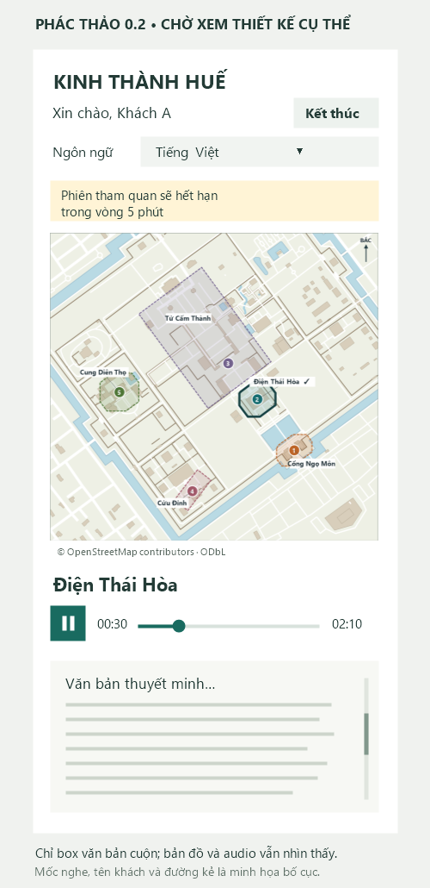
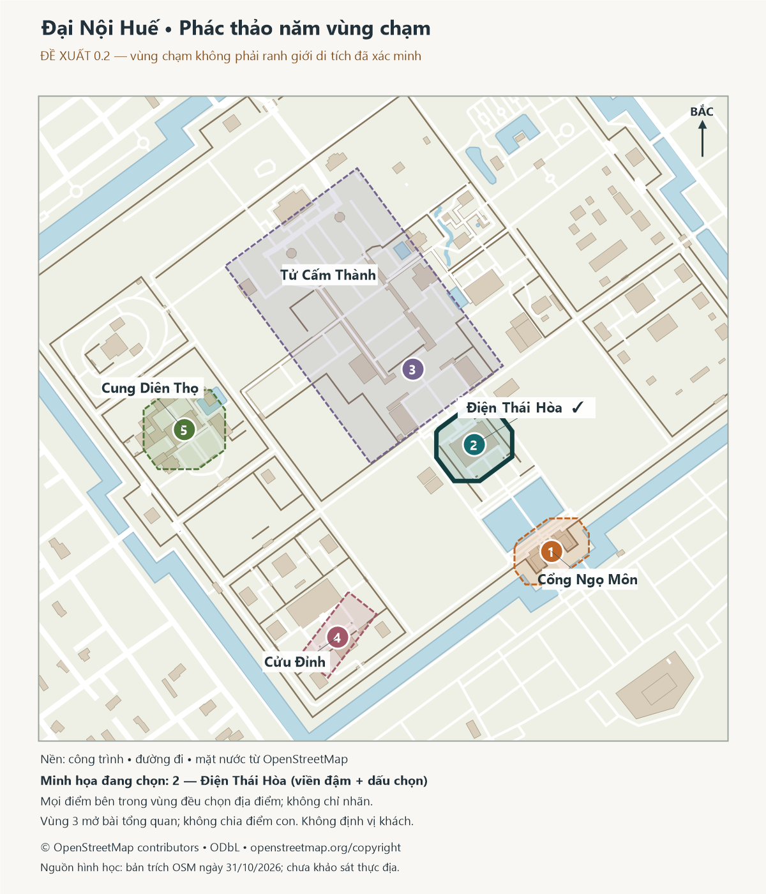

# Thiết kế giao diện — Khách tham quan và Admin

**Phiên bản nội dung:** 0.7.8; biên tập 08/11/2026. **Trạng thái:** các hướng UI-01–UI-05/UI-P01–UI-P04/UI-AP01–UI-AP10 đã xác nhận đúng phần; thiết kế cụ thể và điểm mở còn dự thảo.
**Mục đích:** tra màn hình, bố cục, thao tác, ngoại lệ và đối chiếu nghiệp vụ của khách/Admin. Toàn bộ UI đặt trước nhật ký cuối file.
**Nguồn:** [Business Flow](../02-nghiep-vu/business-flow.md), [PRD](../02-nghiep-vu/PRD.md), [decisions](../02-nghiep-vu/decisions.md), [đầu vào kỹ thuật](../01-tong-quan/technical-inputs.md). Công nghệ được xác nhận riêng, không suy từ ảnh tham khảo.
**Giới hạn:** chưa duyệt toàn bộ đồ họa/câu chữ, nền/vị trí/ranh giới, bản dịch/nội dung/audio/TTS hoặc kỹ thuật; ảnh không là phần mềm đã triển khai. Khách Android/Chrome+iPhone/Safari, Admin Windows/Chrome; hướng thu gọn Admin mobile không là nghiệm thu bắt buộc.
**Lịch sử:** [bản khách 0.1](../99-luu-tru/ui-design-history.md) và [nhật ký](#ui-history); [tài sản/nguồn bản đồ](design-assets/README.md) giữ nguyên.

**Mục lục:** [1. Màn hình](#ui-screens) · [2. Hành trình](#ui-flow) · [3. Bố cục](#ui-layout) · [4. Audio/ngôn ngữ](#ui-interactions) · [5. Trạng thái](#ui-states) · [6. Hướng UI đã xác nhận](#ui-proposals) · [7. Bản đồ năm vùng](#ui-map) · [8. Truy vết](#ui-trace) · [9. Admin — địa điểm/vùng](#ui-admin-round1) · [10. Admin — nội dung/audio](#ui-admin-round2) · [11. Admin — phiên/thống kê/QR](#ui-admin-round3) · [12. Phụ thuộc triển khai](#ui-next-technical) · [13. Nhật ký cuối file](#ui-history)

<a id="ui-screens"></a>

## 1. Màn hình và mục đích

| Mã giữ nguyên | Màn hình / trạng thái | Hiện hành |
| --- | --- | --- |
| UI-K01 | Trang bắt đầu riêng | Tên bắt buộc 1–50 theo D02-BS, bộ chọn Ngôn ngữ vi/en/fr/ru mặc định vi, “Bắt đầu tham quan”; không đặt dưới bản đồ lớn. |
| UI-K02 | Trang tham quan, chưa chọn | Đầu gọn/tên khách/Kết thúc tách Ngôn ngữ; khung bản đồ, hướng dẫn chọn vùng ở phần bài/audio; không nội dung giả. |
| UI-K03 | Trang tham quan, đã chọn | Cùng khung UI-K02: bản đồ → tên điểm → một nút audio và thanh tua → box văn bản cuộn riêng. |
| UI-K04 | Box ứng viên trên trang | Box nhỏ đúng danh sách + Hủy; nền không thao tác, bài cũ phát tiếp/pause giữ pause; Hủy không đổi bài/tua/phát lại/lượt. Hết hạn đóng danh sách/chuyển UI-K05. |
| UI-K05 | Hết hạn — box trong khung bản đồ | Toàn nền bản đồ mờ/khóa, ngôn ngữ khóa; không chặn toàn trang, tên/audio còn thấy và văn bản cuộn đọc. Chỉ bài đang phát ở mốc hết hạn được nghe hết/pause-resume, không tua/Nghe lại. |
| UI-K06 | Sau chủ động kết thúc — box toàn trang | Chỉ sau thành công, box “Đã kết thúc tham quan”/“Bắt đầu phiên mới”; nền toàn trang mờ/khóa, không Hủy/đóng/ngoài/Esc để đóng. Nút về UI-K01 tên trống/vi; không là màn riêng theo đề xuất cũ. |

Không yêu cầu mỗi trạng thái là một URL. Một QR chung/URL dự phòng ở bản in dẫn UI-K01; không thêm quét QR trong trang, định vị/GPS, Khoảng cách tới tâm, mã phiên hoặc thông tin kỹ thuật nội bộ không giúp thao tác. Nhãn hiển thị chuyển theo ngôn ngữ; tên khách giữ nguyên.

<a id="ui-flow"></a>

## 2. Hành trình — giữ nghiệp vụ, bổ sung đúng UI-01

1. QR/URL → UI-K01, nhập tên/chọn ngôn ngữ; không tự tạo phiên chỉ vì mở trang.
2. Bấm Bắt đầu → phản hồi đang xử lý/chặn gửi lặp do bấm nhiều. Chỉ có căn cứ thành công mới tạo phiên của tab và mở UI-K02. Lỗi giữ tên/ngôn ngữ để sửa/thử lại, phân biệt lỗi xác định/chưa biết kết quả, không tự tạo thêm phiên.
3. Còn hiệu lực, chạm trong vùng → đúng điểm; nhiều vùng → box UI-K04 đúng ứng viên + Hủy, nền khóa; bài cũ phát tiếp/pause giữ pause. Chọn cùng điểm theo P06, Hủy không đổi bài/tua/phát lại/lượt; không chọn tùy ý.
4. Mở vùng lần đầu của lần mở hoặc chọn điểm khác → văn bản đúng ngôn ngữ, yêu cầu phát audio từ đầu khi sẵn sàng/được phép; đổi điểm dừng bài cũ. Lựa chọn mới nhất thắng, không phát nhiều audio.
5. Đọc bằng cuộn **bên trong box**; bản đồ, tên điểm, audio vẫn thấy. Kéo/phóng bản đồ trong khung không vô tình chọn vùng/phát audio.
6. Một nút audio và thanh tua theo mục 4; bấm lại vùng vẫn P06, không cộng lượt vì nghe lại/tua.
7. Đổi bộ chọn Ngôn ngữ → giao diện khách và nội dung/audio cùng phạm vi lựa chọn, giữ tên/điểm/phiên; dừng/về đầu/không tự phát. Thiếu dịch khách chọn thay thế, không tự chuyển.
8. Tải lại còn hiệu lực → khôi phục điểm/ngôn ngữ/mốc gần nhất đã lưu cùng bài, tạm dừng/no autoplay/no lượt mới, không đòi chính xác từng giây. Mất mốc/bài đổi → đầu và báo; lỗi audio thử lại từ đầu, khác tải lại.
9. Còn trên 0 đến 5 phút → cảnh báo không gián đoạn, đúng nghĩa/câu nguồn D04-BS; đã hết hạn thì thông báo hết hạn thay cảnh báo.
10. Kết thúc → phản hồi xử lý/chặn lặp; chỉ thành công có căn cứ mới dừng/xóa tên điền sẵn-trạng thái tab và box UI-K06 chặn toàn trang. Không Hủy/đóng/ngoài/Esc để đóng, không hỏi xác nhận trước. Bắt đầu phiên mới mở UI-K01 tên trống/vi; không tự tạo phiên hoặc chặn trình duyệt/đóng tab.
11. Đúng bắt đầu + 8 tiếng → phiên hết hạn/UI-K05, đóng box ứng viên nếu mở. Box hết hạn chỉ trong bản đồ/nền toàn bản đồ mờ-khóa, ngôn ngữ khóa; bài vẫn cuộn đọc. Chỉ bài đang phát tại mốc được nghe hết/pause-resume, không tua/Nghe lại/bài khác hoặc khôi phục quyền sau tải lại. Nút mới dừng bài cũ trước rời nghe → UI-K01 **điền sẵn tên/ngôn ngữ nếu còn hợp lệ, được sửa và phải xác nhận Bắt đầu thành công**. Không gia hạn/phiên/lượt mới, 30 ngày vẫn từ mốc hết hạn.
12. Không tìm thấy/không tiếp tục được phiên trước → thông báo P02, không khẳng định đã hết hạn thiếu căn cứ hoặc tìm bằng tên; chỉ bấm Bắt đầu thành công mới tạo phiên.

Số phiên không phải người duy nhất. Lượt chỉ khi chủ động mở và văn bản thành công; đổi ngôn ngữ/tải lại/audio/thử lại/bấm lại cùng lần mở không cộng; A→B→A hoặc về bản đồ rồi chủ động mở lại là lần mở mới theo D04. Cuộn box/kéo bản đồ/mở bảng ứng viên không tự tạo lượt.

<a id="ui-layout"></a>

## 3. Bố cục trang đã xác nhận về hướng

### 3.1. Trang bắt đầu riêng — UI-K01

```text
┌───────────────────────────────────┐
│ KINH THÀNH HUẾ                    │
│ Tên hiển thị *                    │
│ [Nhập tên                      ]  │
│ [Lỗi nhập liệu nếu có]            │
│ Ngôn ngữ [Tiếng Việt ▾]           │
│ [       Bắt đầu tham quan       ] │
│ [Phản hồi đang xử lý/lỗi nếu có]  │
└───────────────────────────────────┘
```

Quy tắc tên không đổi: chuẩn hóa khoảng trắng, Unicode/số/dấu câu thông thường, không toàn trắng/xuống dòng/điều khiển; trùng được phép. Không xác minh tên thật. Không đặt form dưới một bản đồ lớn; chưa chốt bộ màu/kích thước hoặc nguyên văn mọi lỗi.

### 3.2. Trang tham quan — UI-K02/UI-K03

```text
┌───────────────────────────────────┐
│ KINH THÀNH HUẾ                    │
│ Xin chào, [Tên khách]  [Kết thúc] │
│ Ngôn ngữ [Tiếng Việt ▾]           │
├───────────────────────────────────┤
│ [Cảnh báo/lỗi khi cần]            │
├───────────────────────────────────┤
│                                   │
│       BẢN ĐỒ — CÁC VÙNG CHỌN      │
│                                   │
├───────────────────────────────────┤
│ [Tên địa điểm đang chọn]          │
│ [▶/❚❚/↻] 00:30 ──●────── 02:10   │
├───────────────────────────────────┤
│ ┌──────────────────────────────┐  │
│ │ Văn bản thuyết minh…        ▲│  │
│ │                             █│  │
│ │ Chỉ phần văn bản cuộn       ▼│  │
│ └──────────────────────────────┘  │
└───────────────────────────────────┘
```



**Giới hạn ảnh:** giữ nguyên tài sản 0.2, chưa mô tả đầy đủ trạng thái mới; đối chiếu sơ đồ văn bản 3.4 và bảng quyền P01 hiện hành.

- **Đã chốt:** chỉ nội dung box cuộn khi đọc; bản đồ/tên điểm/audio vẫn thấy; điều khiển ngoài và trên box. Trong khung bản đồ, kéo/phóng thay đổi bản đồ, không vô tình chọn/phát. Chiều cao các phần thích ứng điện thoại còn chỗ đọc, chưa chốt pixel.
- **Đã chốt:** đầu gọn, Kết thúc tách bộ chọn Ngôn ngữ. Không chia tiêu đề/mô tả thành cột hẹp gây xuống dòng nhiều. Trước chọn chỉ hướng dẫn phù hợp, không bài/audio giả.
- **Đã chốt:** bỏ hai dòng thường trực Văn bản/Audio và dòng Trạng thái. Bộ chọn chung thể hiện đúng ngôn ngữ đang áp dụng; vẫn có phản hồi tải/thiếu/lỗi khi cần.
- **Chưa duyệt:** kích thước/đồ họa cụ thể trong ảnh, nền/vị trí/ranh giới vùng, cách trình bày các bản dịch. Mốc 00:30/02:10 và tên Khách A chỉ minh họa bố cục, không thời lượng bắt buộc hoặc nội dung thật đã được duyệt. Nền bản đồ xem nguồn/giới hạn tại mục 7.
- Ảnh thể hiện trường hợp có cảnh báo 5 phút; bình thường không hiện cảnh báo. Không yêu cầu đếm ngược từng giây hoặc nút gia hạn.
- Khi chỉ đọc/cuộn box, không đóng lần mở địa điểm hoặc cộng lượt. Lối quay bản đồ trong nhánh thiếu dịch vẫn D03, không đồng nhất với cuộn văn bản.

### 3.3. Danh sách chồng lấn — UI-K04

UI-P01/UI-02 đã chốt box nhỏ đúng ứng viên + Hủy, nền trang không thao tác; audio đang phát tiếp tục, pause giữ pause. Hủy chỉ đóng box, không đổi điểm/bài/tua/phát lại/lượt. Chọn ứng viên theo P06 nếu cùng điểm. Hết hạn đóng danh sách, chuyển UI-K05/P01 không nhận điểm mới. Cách đóng khác ngoài Hủy chưa được suy rộng thành yêu cầu đã duyệt.

### 3.4. Ba box — sơ đồ văn bản bổ sung UI-02

**Ảnh phác thảo 0.2 phía trên chỉ mô tả bố cục cơ sở/cảnh báo 5 phút, chưa có ba box này hoặc đủ trạng thái nút hết hạn.** Không coi ảnh cũ đã mô tả đầy đủ; chưa có bản cập nhật ảnh, nền hoặc hình học vùng thay thế. Sơ đồ văn bản dưới ghi đúng phạm vi chặn đã xác nhận, chưa duyệt pixel/đồ họa cụ thể.

**Chủ động kết thúc thành công — UI-K06/UI-P04:**

```text
┌──────── TOÀN TRANG ỨNG DỤNG ────────┐
│ Nền trang làm mờ, không thao tác    │
│    ┌──────────────────────────┐     │
│    │ Đã kết thúc tham quan    │     │
│    │ [Bắt đầu phiên mới]      │     │
│    └──────────────────────────┘     │
│ Không Hủy/đóng; ngoài/Esc không đóng│
└─────────────────────────────────────┘
```

Nút mở UI-K01 tên trống/vi, chưa tạo phiên; audio dừng/thông tin khôi phục xóa. Không chặn trình duyệt/đóng tab, không thêm hộp xác nhận trước kết thúc. UI-K06 giữ mã trạng thái để truy vết, nay là box trên trang thay màn kết thúc riêng.

**Tự hết hạn — UI-K05/P01:**

```text
┌─────────────────────────────────────┐
│ Tiêu đề / lời chào                  │
│ Ngôn ngữ — khóa                     │
├─────────────────────────────────────┤
│ KHUNG BẢN ĐỒ — toàn nền mờ/khóa     │
│   ┌────────────────────────────┐    │
│   │ Phiên tham quan đã hết hạn │    │
│   │ [Bắt đầu phiên mới]        │    │
│   └────────────────────────────┘    │
├─────────────────────────────────────┤
│ Tên địa điểm đang xem               │
│ Audio vẫn thấy: chỉ pause/resume (*)│
│ Tua/Nghe lại/phát mới — khóa        │
├─────────────────────────────────────┤
│ Box văn bản — vẫn cuộn và đọc       │
└─────────────────────────────────────┘
```

(*) Chỉ đúng bài đang phát tại thời điểm hết hạn, tới cuối; khi không đủ điều kiện hoặc đã hết bài, không Phát/Nghe lại. Không nút đóng/Hủy trong box. Không làm mờ/chặn phần ngoài bản đồ. Nút mới dừng bài cũ trước mở UI-K01 điền sẵn nếu hợp lệ/xác nhận lại, không để audio cũ sang phiên mới. Cảnh báo 5 phút vẫn nhẹ trước mốc, không dùng box này thay cảnh báo.

**Ứng viên chồng lấn — UI-K04/UI-P01, phiên còn hiệu lực:**

```text
┌──────── NỀN TRANG KHÔNG THAO TÁC ──┐
│    ┌──────────────────────────┐    │
│    │ Chọn địa điểm            │    │
│    │ [Đúng ứng viên 1]        │    │
│    │ [Đúng ứng viên 2]        │    │
│    │ [Hủy]                    │    │
│    └──────────────────────────┘    │
│ Audio cũ: tiếp tục / giữ pause     │
└────────────────────────────────────┘
```

Hủy chỉ đóng box; chọn cùng điểm theo P06. Hết hạn khi box đang mở: đóng danh sách, chuyển UI-K05; chỉ bài đang phát đúng mốc được ngoại lệ, không nhận điểm mới. Cách đóng khác bằng Esc/quay lại/chạm ngoài chưa được xác nhận ở UI-P01, không mặc định kế thừa đề xuất cũ.

<a id="ui-interactions"></a>

## 4. Audio, ngôn ngữ và tác vụ phiên

### 4.1. Một nút ba trạng thái — UI-P02/UI-P03 và giới hạn P01

Các dòng Phát/Tạm dừng/hết bài/tua thông thường dưới đây áp dụng khi phiên còn hiệu lực; dòng hết hạn và ngoại lệ P01/UI-02 giới hạn quyền sau mốc, không cho Nghe lại.

| Trạng thái | Chính nút duy nhất | Kết quả |
| --- | --- | --- |
| Đang phát | Biểu tượng Tạm dừng | Dừng tại mốc đang nghe; nút thành Phát. |
| Đang tạm dừng | Biểu tượng Phát | Nghe tiếp từ mốc giữ; nút thành Tạm dừng. |
| Kết thúc bình thường | Biểu tượng Nghe lại mũi tên vòng; thanh ở cuối | Bấm Nghe lại → từ đầu bài hiện tại, nút Tạm dừng; không cộng lượt. |
| Đã hết bài rồi tua về trước cuối | Biểu tượng Phát, tạm dừng ở mốc vừa chọn | Bấm Phát → từ mốc mới, nút Tạm dừng. |
| Phiên hết hạn, bài đã tải trọn và đang phát đúng mốc | Chỉ Phát/Tạm dừng chính bài từ dữ liệu tạm tab; tua bị khóa | Nghe hết không tải lại file cũ; pause trước expiry/đang tải/chưa phát/response muộn không được ngoại lệ. Hết bài không Nghe lại; form mới dừng/nhả dữ liệu cũ phù hợp. |

Nút có tên chức năng đọc màn hình, không buộc chữ thường trực; không nút thứ hai/dòng Đã phát hết/popup/dải kết thúc bài. **UI-P02 đã chốt khi còn hiệu lực:** tua đang phát thì tiếp tục từ mốc mới khi sẵn sàng; tua đang pause vẫn pause chờ Phát; sau hết bài tua về trước vẫn pause/nút Phát. P06 bấm lại vùng chỉ khi phiên cho phép. **Hết hạn không có bài đang phát ở mốc, hoặc bài đó đã hết:** không Phát/Nghe lại/tua. Bài pause trước mốc/đang tải chưa phát không tự được cấp ngoại lệ; tải lại không khôi phục quyền. Lỗi audio chỉ retry từ đầu khi còn hiệu lực.

Chọn vùng lần đầu/điểm khác yêu cầu phát từ đầu; đổi ngôn ngữ và tải lại không tự phát. Đổi điểm dừng bài cũ; tối đa một audio/tab và kết quả muộn không thay lựa chọn mới.

**TECH-04 đã chốt hướng tải:** khi chọn vùng còn quyền, hiện phản hồi đang tải trong khu bài/audio, tải trọn MP3 rồi phát đúng bản; không nội dung giả hoặc dòng trạng thái thường trực mới. Đổi tiếng tải bài mới nhưng không tự phát, kết quả cũ đến muộn không gắn/phát. Reload trước hạn theo P03 pause/không lượt; sau hạn không khôi phục Blob/quyền nghe tiếp. Chỉ giữ bài hiện tại theo vòng đời TDD 10, không kho offline. Câu chữ/biểu đồ tải cụ thể vẫn thiết kế, không thêm ngưỡng MB/giây.

### 4.2. Ngôn ngữ chung — UI-01.3 đã chốt

- Một bộ chọn “Ngôn ngữ” cho giao diện khách và văn bản/audio vi/en/fr/ru; nhãn/tiêu đề/hướng dẫn/nút/thông báo chuyển theo lựa chọn, tên khách nguyên vẹn.
- Bộ chọn phản ánh đúng ngôn ngữ áp dụng; khi chuyển không để tiêu đề/nội dung/audio cũ dưới lựa chọn mới gây nhầm. Dừng/về đầu/không tự phát theo D07.
- Không tự chuyển ngôn ngữ khi thiếu; chỉ liệt kê ngôn ngữ có văn bản được phép để khách chọn hoặc về bản đồ. Không biến phản hồi thiếu nội dung thành giảm bộ chuẩn.
- Giữ câu vi D03-BS/D04-BS/P02 làm căn cứ đối chiếu nghĩa, chuẩn bị bản dịch tương ứng và rà soát trước dùng. Nhãn/tên điểm/tiêu đề/thông báo chưa được duyệt sẵn; ví dụ “Cité impériale de Hué” không là bản dịch đã duyệt.
- **Đề xuất thể hiện chuyển tiếp, chờ xem thiết kế cụ thể:** dừng audio cũ, thay khung bài bằng phản hồi đang tải theo lựa chọn mới; khi thành công mới đưa bài mới vào. Nếu thiếu/lỗi thì phản hồi rõ thay vì trình bày bài cũ như ngôn ngữ mới. Nếu còn giữ bài cũ để phục hồi lỗi P04 thì phải chỉ rõ đó là nội dung cũ, không dùng làm audio của lựa chọn mới. Đây là hướng trình bày đáp ứng nghĩa vụ đã chốt, chưa tự áp thành nguyên văn UC/AC mới hoặc chốt một cơ chế kỹ thuật.

### 4.3. Bắt đầu/Kết thúc — UI-01.4 đã chốt

| Tình huống | Hành vi được xác nhận | Phác thảo câu chữ, chưa duyệt nguyên văn |
| --- | --- | --- |
| Đang xử lý | Có phản hồi và ngăn gửi lặp do bấm nhiều cho cả hai thao tác. | “Đang bắt đầu…” / “Đang kết thúc…” |
| Lỗi đã xác định | Không báo thành công; bắt đầu lỗi giữ tên/ngôn ngữ để sửa/thử lại, không tự tạo thêm phiên. | Thông báo thao tác chưa thành công và lối sửa/thử lại phù hợp. |
| Chưa biết kết quả | Phân biệt với thất bại xác định; không tự coi là đã thành công hoặc gửi thao tác mới tạo thêm phiên. | “Chưa xác định được kết quả…”; cách kiểm tra/khôi phục để TDD thiết kế, không tự hứa đã hủy yêu cầu cũ. |
| Thành công có căn cứ | Bắt đầu mở tham quan; kết thúc dừng/xóa tên điền sẵn-trạng thái tab, bản ghi Admin theo D08. | UI-P04 đã chốt box chặn toàn trang như 3.4; không hộp xác nhận trước. |

Không tự thêm hộp xác nhận kết thúc. Giữ hạn phiên bắt đầu + 8 tiếng, cảnh báo 5 phút và các quy tắc P01–P04. Cơ chế chống lặp/đối chiếu kết quả là phần thiết kế kỹ thuật, không chọn trong tài liệu này.

<a id="ui-states"></a>

## 5. Trạng thái quan trọng và ngoại lệ

| Trạng thái | Thể hiện / hành vi hiện hành | Nguồn / giới hạn |
| --- | --- | --- |
| Chưa chọn địa điểm | Bài/audio chỉ hướng dẫn, không nội dung giả. | UI-01.1 |
| Tải bản đồ/bài/audio | Phản hồi đúng phần đang tải, không giả đang phát; nhấn lặp lúc tải không tạo yêu cầu lặp. | P06/P08, UI-01.3; câu chữ còn thiết kế |
| Điểm không khả dụng | Thông báo rõ, chọn vùng khác; không tự gần nhất. | D01-BS/A07 |
| Thiếu bản dịch | Báo thiếu ngôn ngữ, chỉ lựa chọn có văn bản được phép; nếu không có thì về bản đồ, không tự đổi. | D03/BS; chọn ngôn ngữ thay thế không tự phát |
| Thiếu audio khớp được phép | Văn bản vẫn đọc; “Audio chưa sẵn sàng” ở vi hoặc bản dịch tương ứng được rà soát, khóa Phát; không dùng audio cũ/sai ngôn ngữ. | D03-BS, A04.3, UI-01.3 |
| Audio tải/phát lỗi hoặc trình duyệt cản phát | Còn hiệu lực báo/thử lại từ đầu; hết hạn không cấp quyền retry từ đầu, chỉ giữ ngoại lệ đủ điều kiện nếu vẫn phát được. Không hứa mạng/browser/file bảo đảm nghe tiếp. | D03-BS/P04, O-03 |
| Mất mạng/lỗi dịch vụ | Giữ nội dung/lựa chọn, báo/thử lại; audio đã tải còn phát được không ép dừng. Hết hạn chỉ giữ ngoại lệ đúng bài theo P01; không retry từ đầu/tua/Nghe lại. Nối lại kiểm tra trạng thái/quyền trước tác vụ, không ghi lặp/gia hạn/offline/gửi bù. | P04; giữ nội dung cũ khi đổi ngôn ngữ phải rõ, không làm sai ngôn ngữ áp dụng |
| Tải lại còn hiệu lực | Cùng bài/mốc gần nhất, tạm dừng; mất mốc/bài đổi thì đầu và báo; không lượt mới. | P03; khác thử lại lỗi audio |
| Chạm lại/ngoài/kéo-phóng/liên tục | P06/P07/P08 giữ nguyên, mới nhất thắng, một audio/tab; không lượt do thao tác không đủ điều kiện. | UI-01 không mở lại |
| Chồng lấn | Box nhỏ đúng ứng viên/Hủy, nền khóa; bài cũ đang phát tiếp tục, pause giữ pause; Hủy không đổi/tua/phát lại/lượt. Hết hạn đóng danh sách/chuyển UI-K05. | P08/UI-P01/UI-02 |
| Còn trên 0 đến 5 phút | “Phiên tham quan sẽ hết hạn trong vòng 5 phút” là câu nguồn vi; dải nhẹ không che/chặn/ngắt audio/bắt đóng; một lần trong lần dùng, tải lại/quay tab vẫn nhận biết. | D04-BS, UI-01.3; bản dịch phải rà soát |
| Đủ 8 tiếng | Box “Phiên tham quan đã hết hạn”/nút mới chỉ trong khung bản đồ, toàn nền bản đồ mờ/khóa; không đóng/Hủy, không chặn toàn trang. Ngôn ngữ khóa, tên/audio vẫn thấy, bài cuộn đọc. Chỉ bài đang phát lúc mốc nghe hết/pause-resume; không tua/Nghe lại/phát bài khác. Mở form mới dừng bài cũ. | P01/UI-02; không gia hạn/phiên/lượt mới, mốc 30 ngày không theo hết bài |
| Quay lại hết hạn | Điền sẵn tên/ngôn ngữ nếu còn hợp lệ, được sửa và phải xác nhận trước tạo mới. | P02 |
| Không tìm thấy phiên | “Không thể tiếp tục phiên trước. Vui lòng bắt đầu phiên mới” là câu nguồn vi; không khẳng định hết hạn thiếu căn cứ/tìm bằng tên. | P02/UI-01.3 |
| Chủ động kết thúc | Phản hồi xử lý/chống lặp; chỉ thành công mới box chặn toàn trang UI-K06, dừng/xóa khôi phục tab. Nền mờ-khóa, không đóng/Hủy/ngoài/Esc để đóng; chỉ nút về UI-K01 tên trống/vi. | P02/UI-P04/UI-02; không ngăn tab/trình duyệt hoặc hồi sinh khi tải lại |

Ẩn/đổi nội dung Admin có hiệu lực lần tải/chọn tiếp theo; không đẩy tức thì/ngắt phiên, nội dung hợp lệ đã tải có thể dùng trong hạn A07. Audio đổi không áp mốc bài cũ; P01/UI-02 chỉ cho đúng bài đang phát tại mốc hết hạn nghe tiếp. Hạn file 8 tiếng không gia hạn phiên; TDD phải đối chiếu phục vụ file/đọc tiếp/dọn file, chưa hứa mạng/browser luôn đáp ứng. Nội dung chỉ phục vụ bản được phép theo D09; không đặt nhãn “dự thảo” để thay điều kiện đó.

<a id="ui-proposals"></a>

## 6. UI-P01–UI-P04 đã xác nhận đúng phạm vi — UI-02

| Mã | Xác nhận hiện hành | Giới hạn tiếp tục giữ |
| --- | --- | --- |
| UI-P04 | Sau kết thúc thành công dùng box chặn toàn trang ứng dụng, “Đã kết thúc tham quan” và một nút “Bắt đầu phiên mới”; không Hủy/đóng/ngoài/Esc để đóng, nền mờ-khóa. Nút về UI-K01 tên trống/vi, chỉ Bắt đầu hợp lệ/thành công tạo phiên. | Không hộp xác nhận trước kết thúc, không ngăn đóng tab/trình duyệt, không hồi sinh phiên khi tải lại/quay lại. Thay đề xuất màn kết thúc riêng 0.2. |
| UI-P01 | Box nhỏ đúng ứng viên + Hủy, nền khóa; bài cũ phát tiếp/pause giữ pause. Hủy không đổi bài/tua/phát lại/lượt; chọn ứng viên theo P06 nếu cùng điểm. | Hết hạn đóng danh sách/chuyển UI-K05, không nhận điểm mới. Không suy rộng cách đóng khác chưa nêu hoặc mọi thiết kế đồ họa đã duyệt. |
| UI-P02 | Còn hiệu lực: tua đang phát tiếp tục từ mốc mới khi sẵn sàng; đang pause giữ pause chờ Phát. Nhánh sau hết bài tua về trước pause/nút Phát giữ nguyên. | Không vượt P01 khi hết hạn: không tua/Nghe lại hoặc phát bài chưa có quyền. |
| UI-P03 | Còn hiệu lực: một nút Nghe lại dạng vòng khi hết bình thường; từ đầu khi bấm; không thông báo/nút thứ hai. | Hết bài sau mốc hết hạn không cho Nghe lại trước phiên mới. |
| P01/UI-02 | Hết hạn box chỉ trong khung bản đồ, bài cuộn đọc; chỉ bài đang phát ở mốc được nghe tới cuối/pause-resume. | Vẫn hết hạn +8 tiếng, không phiên/lượt mới; 30 ngày không theo hết bài. Mở form dừng bài cũ; không khôi phục ngoại lệ khi tải lại hoặc quyền retry từ đầu. |

Không yêu cầu duyệt lại các hành vi trên. Thiết kế cụ thể/kích thước/đồ họa, cách thể hiện chuyển ngôn ngữ, bản dịch, UI Admin và nền/vị trí/ranh giới vẫn xem xét riêng. Phục vụ file/đồng hồ/tab nền/đúng bài/chặn tải muộn là phụ thuộc TDD, không tự chọn giải pháp hoặc đổi A02.3.

<a id="ui-map"></a>

## 7. Bản đồ năm vùng — ĐỀ XUẤT CHỜ XEM XÉT



Bản lớn: [PNG](design-assets/hue-five-regions-proposal.png) / [SVG](design-assets/hue-five-regions-proposal.svg). [Nguồn, cách dựng và giới hạn](design-assets/README.md); [bản trích nền OSM](design-assets/hue-osm-source.json); [đa giác đề xuất](design-assets/hue-touch-regions-proposal.geojson). Các file chỉ là tài sản tài liệu, không cấu hình ứng dụng.

| Vùng | Địa điểm / cách đề xuất | Phần chưa kiểm chứng |
| --- | --- | --- |
| MAP-Z01 / 1 | Cổng Ngọ Môn: đa giác theo công trình OSM, mở vùng chạm quanh hình. | Không là toàn bộ ranh giới bảo vệ/di tích. |
| MAP-Z02 / 2 | Điện Thái Hòa: đa giác quanh công trình OSM; minh họa đang chọn bằng viền đậm + dấu ✓ và số vùng. | Không chốt kích thước/mức mở rộng hoặc trạng thái mặc định khi vào trang. |
| MAP-Z03 / 3 | Tử Cấm Thành: một vùng tổng quan theo các mốc OSM Tử Cấm Thành/Cần Chánh/Kiến Trung để phân biệt các điểm khác. Cần Chánh way/285990343 là tham chiếu bên ngoài, không có trong bản trích hiện lưu; chưa lấy/kiểm chứng lại ngày 01/11/2026, xem hồ sơ nguồn. | Đa giác do người soạn đề xuất, **không toàn bộ ranh giới lịch sử/pháp lý đã xác minh**; vẫn một bài tổng quan, không điểm con. |
| MAP-Z04 / 4 | Cửu Đỉnh: dải quanh các mốc đỉnh tại sân gần Hiển Lâm Các trên OSM, đối chiếu vị trí sân Thế Miếu từ nguồn du lịch Huế. | Chưa đo kiểm vị trí cả chín đỉnh/ranh giới sân; không vùng định vị khách. |
| MAP-Z05 / 5 | Cung Diên Thọ: công trình chính mang tên trên OSM làm mốc, mở vùng chạm đại diện. | Chưa là ranh giới toàn khu cung; cần người dùng xem có muốn vùng rộng hơn theo tư liệu đáng tin cậy. |

- Nền là công trình/đường đi/mặt nước từ **OpenStreetMap**, bản trích 31/10/2026; nguồn vị trí và mã đối tượng cụ thể trong README. Dữ liệu cộng đồng, chưa khảo sát thực địa/đối chiếu bản đo ranh giới chính thức. Không mặc định tất cả hình nền là hiện trạng đúng.
- Hình này chưa có chồng lấn nội bộ giữa năm đa giác đề xuất theo đối chiếu hình học của chính bản vẽ; không bảo đảm mọi bản sửa/địa điểm thêm sau không chồng lấn. Nếu khớp nhiều vùng vẫn P08 hỏi ứng viên, không ưu tiên tùy ý.
- Chạm bất kỳ vị trí trong vùng đều chọn, nhãn/số chỉ giúp nhận biết. Dấu ✓/viền đậm/số là dấu vùng đang chọn, không chỉ dựa vào màu. Không có ghim vị trí khách; bản đồ không xin GPS hoặc chỉ đường thực tế.
- Năm vùng là bộ chuẩn do người dùng chọn, không trần số địa điểm. Điểm thêm sau theo A02.5; không thêm quản lý ngôn ngữ.
- Dùng OSM làm nguồn nền cho **phác thảo này** không chốt nhà cung cấp/công nghệ bản đồ ứng dụng. Tỷ lệ ảnh/khoảng đệm đa giác chỉ là tham số bản vẽ, chưa là ngưỡng bắt buộc.
- Chưa gắn audio thật hoặc triển khai chạm/kéo/phóng trong ứng dụng. Ảnh tĩnh cho xem vị trí và vùng; hành vi chạm toàn vùng đã chốt vẫn là yêu cầu cần triển khai/chứng minh sau.

<a id="ui-trace"></a>

## 8. Truy vết giao diện khách

| Phần | PRD / nguồn |
| --- | --- |
| Bố cục/box cuộn/khung bản đồ và giới hạn kế thừa | UI-01.1/UI-01.5 → FR-K03/NFR-01; AC-K01/K05/K07/K09 |
| Audio một nút ba trạng thái | UI-01.2/UI-P03 → FR-K05, UC-K03, AC-K12/K13; P06 không đổi |
| Ngôn ngữ chung và phản hồi | UI-01.3 → BR-05/FR-K06/NFR-05; UC-K03, AC-K10/K11/K14; D03/D07/D09 |
| Bắt đầu/Kết thúc xử lý/chống lặp | UI-01.4 → FR-K01/K09; UC-K01/K05; AC-K03/K20; hạn D04/5 phút không đổi |
| UI-P01/UI-P02/UI-P04 đã xác nhận | UI-02 → FR-K03/K05/K09; UC-K02/K03/K05; AC-K09/K12/K18/K20. R06 còn phụ thuộc khác, không đóng theo gói. |
| Nền/vị trí/ranh giới/thiết kế cụ thể | MAP-Z01–Z05 và README là đề xuất; không duyệt ngầm theo UI-01 |

Tiếp theo hoàn thiện thiết kế chi tiết ba box và các trạng thái audio/quyền đọc sau hết hạn theo hành vi đã chốt; không hỏi lại UI-P01/UI-P02/UI-P04. Xem xét nền/vùng cụ thể riêng và đánh giá phụ thuộc phục vụ file trong [PRD 9.5](../02-nghiep-vu/PRD.md#prd-expiry-delivery), không tự đổi hạn A02.3 hoặc chọn kỹ thuật. Phần Admin lượt 1 tại [mục 9](#ui-admin-round1) đã được xác nhận **đúng hướng UI-AP01–UI-AP03 theo UI-03**; chi tiết còn lại chưa duyệt theo gói. Lượt 2 nội dung/bản dịch/audio/mức đầy đủ tại [mục 10](#ui-admin-round2) đã chốt đúng hướng UI-04; lượt 3 phiên/thống kê/QR tại [mục 11](#ui-admin-round3) đã chốt đúng hướng UI-05. Công việc còn lại phân loại tại [mục 12](#ui-next-technical), không yêu cầu duyệt lại UI-AP01–UI-AP10. Công nghệ nền theo TECH-01; TTS/chi phí/phiên bản-tương thích/môi trường-ngưỡng, log/bản sao lưu/dọn file và nội dung tiếp tục theo [PRD 9](../02-nghiep-vu/PRD.md#prd-open-classification), [prd-review 7.3](../02-nghiep-vu/prd-review.md#review-open-final). Chưa soạn toàn bộ TDD/roadmap hoặc thao tác ứng dụng/cấu hình/database/kiểm thử/Git/triển khai.

<a id="ui-admin-round1"></a>

## 9. UI Admin — khung quản trị, địa điểm và vùng

### 9.1. Cách đọc, phạm vi và mã thiết kế

**Nguồn gốc:** dự thảo ngày 01/11/2026. **Hiện hành 02/11/2026:** người dùng xác nhận đúng UI-AP01–UI-AP03 và làm rõ thứ tự vùng tại [UI-03](../02-nghiep-vu/decisions.md#ui-admin-confirmed-01). Nghiệp vụ A01/A02/A02.1–A02.6/A07/Q1–Q3 giữ nguyên. Chỉ các hướng được nêu rõ đã chốt; sơ đồ/câu chữ/đồ họa và chi tiết khác vẫn đề xuất, không duyệt trọn mục 9 hoặc UI Admin các lượt sau.

Phần khách tại mục 1–7 giữ nguyên. Mã **UI-A01–UI-A12** là mã màn hình/khu vực/box thiết kế, khác UI-K của khách và khác A/FR-A/UC-A/AC-A nghiệp vụ. Không yêu cầu mỗi mã có một URL. UI-AP01–UI-AP03 giữ mã để truy vết các hướng đã được xác nhận theo UI-03; không còn là câu hỏi cần duyệt lại. Những mô tả cũ bị thay được giữ tại [decisions lịch sử UI-03](../99-luu-tru/decisions-history.md#ui-03-history).

**Nguồn đọc:** [Business Flow Admin](../02-nghiep-vu/business-flow.md#bf-4), [ngoại lệ Admin](../02-nghiep-vu/business-flow.md#bf-admin-errors), [quyết định Admin](../02-nghiep-vu/decisions.md#dec-5), [Q1](../02-nghiep-vu/decisions.md#q1), [Q2](../02-nghiep-vu/decisions.md#q2), [Q3](../02-nghiep-vu/decisions.md#q3); [UC-A01](../02-nghiep-vu/PRD.md#uc-a01), [UC-A02](../02-nghiep-vu/PRD.md#uc-a02), [UC-A06](../02-nghiep-vu/PRD.md#uc-a06).

| Mã UI — trạng thái theo phạm vi UI-03 | Loại / mục đích | Truy cập |
| --- | --- | --- |
| UI-A01 | Trang đăng nhập, dùng lại cho xác thực khi cần | Mở quản trị khi chưa có quyền; không đăng ký công khai |
| UI-A02 | Khung quản trị, điều hướng và đăng xuất | Sau đăng nhập; mở ngay Địa điểm, không dashboard mới |
| UI-A03 | Trang danh sách địa điểm | Mục Địa điểm trong menu |
| UI-A04 | Trang thêm/sửa thông tin địa điểm | Thêm địa điểm hoặc Sửa thông tin từ danh sách |
| UI-A05 | Khu vực điều kiện và thao tác ẩn/hiện | Trên hàng danh sách và trang của đúng địa điểm |
| UI-A06 | Box xác nhận xóa | Bấm Xóa trên đúng địa điểm |
| UI-A07 | Trang vẽ/sửa vùng | Bấm Vùng tương tác của địa điểm đã lưu |
| UI-A08 | Chế độ xem trước trong trang vùng | Bấm Xem trước, không rời công việc đang vẽ |
| UI-A09 | Khu vực xem xét/Áp dụng bản sửa đã lưu | Từ bản sửa đã lưu trong UI-A07/UI-A08 |
| UI-A10 | Box hết phiên/đăng nhập lại, che nội dung quản trị | Hết 30 phút không hoạt động theo Q3 |
| UI-A11 | Box bảo vệ thay đổi chưa lưu / đăng xuất | Điều hướng, Bỏ thay đổi hoặc đăng xuất có nguy cơ mất phần đang soạn |
| UI-A12 | Khu vực kết quả xóa và trạng thái file | Sau xác nhận xóa, nằm trong danh sách; không trang quản trị file mới |

**Giới hạn lượt 1:** không thêm dashboard, quản trị tài khoản, ngôn ngữ mới, xóa hàng loạt hoặc công cụ bản đồ nâng cao. Nội dung & audio/mức đầy đủ theo hướng UI-04 tại mục 10; Phiên & thống kê/QR theo hướng UI-05 tại mục 11; chi tiết chưa nêu vẫn cần hoàn thiện.

### 9.2. Quy ước chung và cách thu gọn

- Ưu tiên máy tính: menu trái, đầu trang gọn, vùng làm việc bên phải; thao tác chính gần tiêu đề công việc. Không chốt pixel, màu, font hoặc công nghệ.
- Điện thoại: menu thu thành nút “Menu”; danh sách thành thẻ có tên/mã/trạng thái và các hành động của đúng điểm. Biểu mẫu một cột; trình vùng dành khung lớn cho bản đồ, thông tin/bước ở dưới hoặc chuyển khu vực trong cùng trang. Không phải UI khách với các vùng chiều cao cố định.
- Trạng thái dùng chữ và dấu hiệu, không chỉ màu: “Ẩn/Đang hiển thị”, “Chưa lưu”, “Đã giữ tạm — chưa lưu”, “Bản sửa đã lưu — chưa áp dụng”, “Vùng đang dùng”. Bản tạm gần nhất chỉ được ghi nhận là đã giữ tạm khi có căn cứ; chưa ghi nhận thì báo giới hạn bảo vệ qua tải lại.
- Mỗi tác vụ có phản hồi tại chỗ và chặn bấm lặp trong khi xử lý. Lỗi xác định khác chưa biết kết quả: chưa rõ thì kiểm tra kết quả hiện có trước cho gửi lại, đặc biệt thêm/xóa/áp dụng; không tự thử lại hoặc báo thành công. Đây là đề xuất phản hồi UI để đáp ứng NFR-04, không chọn cơ chế chống lặp.
- Trong lúc gửi thao tác thay đổi, đề xuất không cho đổi đối tượng hoặc sửa tiếp phần đang gửi để tránh hiểu nhầm bản được xử lý; không làm mất giá trị đang soạn. Hết phiên ưu tiên UI-A10, không cho kết quả đến muộn tự kích hoạt thao tác khác.
- Box có tiêu đề, tên chức năng nút, tiêu điểm vào nội dung phù hợp và trả về hành động mở box khi hủy. Không dùng chỉ biểu tượng/màu để diễn đạt thao tác nguy hiểm. Phương án thao tác bàn phím cụ thể vẫn thiết kế, không suy ra tiêu chuẩn định lượng chưa chốt.
- Giữ tạm, Lưu địa điểm, Lưu bản sửa vùng và Áp dụng là bốn kết quả khác nhau; không dùng một thông báo “Đã lưu” cho mọi loại.

### 9.3. UI-A01/UI-A02 — đăng nhập, khung quản trị và đăng xuất

**Căn cứ đã chốt:** A01/Q2/Q3; FR-A01, UC-A01, AC-A01/A02, NFR-03/NFR-04.

**UI-A01 — trang riêng:** tách khỏi khung có dữ liệu Admin; không thêm Đăng ký/Quên mật khẩu khi chưa có yêu cầu.
```text
┌───────────────────────────────────────────┐
│ KINH THÀNH HUẾ — Đăng nhập quản trị       │
│ Tài khoản  [                           ]  │
│ Mật khẩu   [                           ]  │
│ [Lỗi đăng nhập / lỗi kết nối khi có]      │
│                            [Đăng nhập]    │
└───────────────────────────────────────────┘
```

Tên tài khoản/mật khẩu là thông tin xác thực tài khoản cấp trước, không là mẫu chính sách mật khẩu mới. Bấm Đăng nhập → hiện “Đang đăng nhập…”, ngăn gửi lặp. Có căn cứ thành công → UI-A02/UI-A03; sai → ở lại, báo không đăng nhập được và cho sửa; lỗi kết nối/chưa rõ kết quả → báo đúng trạng thái, kiểm tra phiên trước thử lại. Đề xuất không giữ mật khẩu trong bản giữ tạm hoặc hiển thị lỗi kỹ thuật nhạy cảm. Đã có phiên hợp lệ thì mở công việc quản trị, không bắt đăng nhập lại vô cớ.

**UI-A02 — khung dùng chung:**
```text
┌───────────────────────────┬───────────────────────────────────┐
│ QUẢN TRỊ KINH THÀNH HUẾ   │ Địa điểm       Admin: [tài khoản] │
│ Địa điểm                 │                       [Đăng xuất] │
│ Nội dung & audio (*)     ├───────────────────────────────────┤
│ Phiên & thống kê (*)     │ Phản hồi công việc / lỗi khi cần  │
│ QR chung (*)             │ Nội dung trang đang làm           │
└───────────────────────────┴───────────────────────────────────┘
(*) Nội dung & audio: hướng UI-04, mục 10; Phiên & thống kê/QR:
    hướng UI-05, mục 11. Không báo đã triển khai.
```

Sau đăng nhập mặc định vào Địa điểm để có việc làm ngay; không dashboard thêm. Đăng xuất khi không có phần chưa lưu: xử lý/chống lặp, có căn cứ kết thúc quyền mới về UI-A01; không xóa bản nghiệp vụ đã lưu. Còn phần chưa lưu → UI-A11 trước. Nếu chưa rõ kết quả đăng xuất, báo “Chưa xác nhận đã đăng xuất”, kiểm tra quyền trước tác vụ tiếp; không tiếp tục hiển thị như đã đăng xuất thành công.

Không thêm đồng hồ đếm ngược hoặc cảnh báo sắp hết phiên Admin như yêu cầu bắt buộc; hạn 30 phút đã chốt được thể hiện qua UI-A10 khi hết hạn. Không dùng cảnh báo 5 phút của khách cho Admin.

### 9.4. UI-A03 — danh sách địa điểm

**Mục đích:** thấy tên/mã/trạng thái, đi đúng thao tác; một điểm mới không thay đổi bộ năm điểm chuẩn. **Nguồn:** A02/Q1/A02.5/A07; FR-A02/A03, UC-A02, AC-A03–A06.

```text
Địa điểm                                   [Thêm địa điểm]
[Mức đầy đủ văn bản/audio: UI-A19 dự thảo tại mục 10]
Tên / Mã             Hiển thị        Vùng               Thao tác
Cổng Ngọ Môn / <mã>   Đang hiển thị   Đang dùng + bản sửa [Sửa thông tin]
                                                        [Vùng tương tác]
                                                        [Ẩn] [Xóa]
<Điểm khác> / <mã>    Ẩn              Chưa có             [Sửa thông tin]
                                                        [Vùng tương tác]
                                                        [Bật hiển thị] [Xóa]
[Phản hồi kết quả gần nhất / file chờ xử lý nếu vừa xóa]
```

Dữ liệu trong sơ đồ là minh họa bố cục, không khẳng định repo đã có dữ liệu hoặc bản sửa. Danh sách thực tế tải từ hệ thống khi được triển khai; không giới hạn năm hàng. Không hiển thị các số đếm giả.

| Hành động / trạng thái | Chuyển tiếp và phản hồi đề xuất |
| --- | --- |
| Mở danh sách | Vùng danh sách báo đang tải; lỗi hiện lỗi + Thử lại, không giả danh sách rỗng |
| Chưa có địa điểm | “Chưa có địa điểm” + Thêm địa điểm; không cần dữ liệu mẫu để che rỗng |
| Thêm / Sửa thông tin | Sang UI-A04; nhận biết rõ Thêm mới hay đúng tên/mã đã có |
| Vùng tương tác | Sang UI-A07 đúng mã; có bản sửa đã lưu thì ghi rõ để chọn tiếp tục bản sửa, không âm thầm ghi đè bằng vùng đang dùng |
| Ẩn / Bật hiển thị | UI-A05; giữ hàng/đối tượng trong lúc xử lý, chỉ cập nhật trạng thái có căn cứ |
| Xóa | UI-A06; dữ liệu chỉ bỏ khỏi danh sách sau xác nhận xóa thành công |
| Lỗi tải sau thao tác | Phân biệt thao tác đã có kết quả với danh sách chưa tải lại được, không tuyên bố thao tác thất bại chỉ vì lỗi làm mới |

Không có dữ liệu đang nhập trên danh sách thì không bật cảnh báo bỏ thay đổi. Nếu chuyển tới đây từ trình soạn còn thay đổi, UI-A11 bảo vệ trước.

### 9.5. UI-A04 — thêm/sửa thông tin địa điểm

**Hướng trang riêng đã xác nhận theo UI-AP03; bố trí chi tiết còn đề xuất:** tránh box dài và để chừa chỗ cho điều kiện hiển thị, liên kết vùng/nội dung. Tên không bị trộn với bài thuyết minh. **Nguồn:** Q1/Q2/A02.5; FR-A02, UC-A02, AC-A02/A03/A04 và [ca Q1](../02-nghiep-vu/PRD.md#ac-place-detail).

```text
[Địa điểm] / Thêm địa điểm  hoặc  Sửa: <tên> / <mã>
Mã: Hệ thống cấp khi tạo thành công  hoặc  <mã chỉ đọc>
Trạng thái: Chưa hiển thị            hoặc  <trạng thái đã lưu>
Tên địa điểm * [                                           ]
Bắt buộc, tối đa 100 ký tự hiển thị.
[Bộ đếm: 0/100 khi chưa nhập; lỗi ngay cạnh trường khi có]
[Cảnh báo trùng tên: <tên>, mã <mã khác>; vẫn có thể lưu]
[Chưa lưu / Đã giữ tạm — chưa lưu / lỗi giữ tạm]
[Bỏ thay đổi]                          [Lưu địa điểm]
--- Sau khi điểm đã được lưu ---
[Vùng tương tác] [Nội dung & audio — UI-A13 dự thảo lượt 2]
Điều kiện hiển thị / [Bật hiển thị hoặc Ẩn]  → UI-A05
```

- Bộ đếm bắt đầu 0 chỉ phản ánh chưa nhập; tên rỗng vẫn không hợp lệ theo Q1. Chỉ Tên là trường Admin bắt buộc nhập. Mã chỉ đọc sau khi tạo; không có mã giả trước thành công, không sửa mã khi đổi tên.
- Tên dài 1–100 ký tự hiển thị sau bỏ khoảng trắng đầu/cuối, gộp khoảng trắng giữa; giữ dấu/chữ hoa; Unicode/số/dấu câu thông thường được nhận. Không nhận rỗng/toàn khoảng trắng, xuống dòng/điều khiển; không âm thầm bỏ ký tự lỗi. Trống dùng “Vui lòng nhập tên địa điểm”; quá giới hạn nêu rõ 100 và giữ dữ liệu để sửa.
- Trùng sau chuẩn hóa, không phân biệt hoa/thường nhưng giữ dấu → cảnh báo kèm mã khác, không chặn, không gộp hoặc tự thêm hậu tố. Mã ổn định phân biệt điểm trùng tên, kể cả bản ghi mới cùng tên điểm đã xóa.
- **Thêm:** Lưu thành công → ở lại trang sửa của mã vừa tạo, hiện “Đã lưu địa điểm — đang ẩn”, xóa bản tạm công việc thêm tương ứng; mở được Vùng tương tác. Chưa vùng/bài không ngăn lưu. Không tự bật hiện.
- **Sửa:** tải dữ liệu đã lưu trước; tải lỗi chưa có căn cứ thì không đưa form trống để lưu đè. Lưu thành công → ở lại, phản hồi “Đã lưu địa điểm”, giữ trạng thái hiện/ẩn của nó; không áp dụng bản sửa vùng/bài.
- Lưu đang xử lý chặn bấm lặp; lỗi xác định giữ phần đang nhập, “Chưa lưu được”; chưa rõ kết quả “Chưa xác nhận đã lưu”, kiểm tra bản ghi/kết quả trước thử lại. Không tạo hai địa điểm do bấm lại.
- Bỏ thay đổi hoặc điều hướng gây mất phần chưa lưu → UI-A11. Q2 giữ biểu mẫu thêm/sửa qua các tình huống trong phạm vi; khôi phục điểm mới chưa lưu không đồng nghĩa đã tạo điểm.

### 9.6. UI-A05 — điều kiện và ẩn/hiện tại chỗ

**Đề xuất khu vực trong cùng trang**, không trang cấu hình riêng hay công tắc tự đổi màu trước thành công. Nguồn A02.5/A07/Q1; FR-A02, UC-A02, AC-A04.

```text
Hiển thị cho khách: Ẩn
Điều kiện
  ✓ Thông tin địa điểm hợp lệ
  ! Vùng chưa hợp lệ/chưa được xem xét hoặc áp dụng
  ! Chưa có cặp văn bản/audio tiếng Việt được duyệt và áp dụng
[Đến Vùng tương tác]  [Đến Nội dung & audio]
[Bật hiển thị]
Thiếu audio để có cặp vi thì chưa bật; không đợi đủ ngôn ngữ khác.
Đủ điều kiện bật hiện không đồng nghĩa đủ bộ nội dung nghiệm thu.
```

Bấm Bật hiển thị → kiểm tra điều kiện hiện hành, báo cụ thể phần thiếu ngay tại khu vực/hàng, giữ ẩn nếu chưa đủ; đủ mới cập nhật “Đang hiển thị”. Giao diện không tự suy ra ranh giới đã được người dùng xem xét chỉ vì vẽ/lưu xong; xem xét/áp dụng theo hướng UI-03 đã xác nhận tại UI-A08/A09; chi tiết đồ họa còn đề xuất. Điểm đang dùng vùng hợp lệ không bị coi thiếu chỉ vì có bản sửa chưa áp dụng.

Đề xuất giữ nút Bật hiển thị để Admin có thể bấm xem đầy đủ lý do chưa bật được; không yêu cầu đi qua nhiều box. Điều kiện chưa tải được thì báo chưa kiểm tra được, không đánh dấu đạt. Khi đang tải/kiểm tra/thay đổi: khóa gửi lặp; lỗi giữ trạng thái đã biết, chưa rõ kết quả thì kiểm tra lại. Phản hồi thành công chỉ có căn cứ.

Ẩn: đề xuất bấm trực tiếp, không thêm hộp xác nhận cho thao tác có thể bật lại; báo đang xử lý rồi “Đã ẩn — ngừng truy cập mới ở lần tải/chọn tiếp theo”. Không hứa thu hồi tức thì bài/vùng hợp lệ đã tải hoặc ngắt audio/phiên khách. Từ biểu mẫu còn thay đổi, trước thao tác có thể làm mất phần soạn áp dụng UI-A11; không lén lưu thông tin đang nhập để bật hiện.

### 9.7. UI-A06/UI-A12 — xóa và kết quả file tách riêng

**Nguồn đã chốt:** A02.1/A02.2/A02.3/A04.4/D08; FR-A02/A06/A08/A09, UC-A06, AC-A16–A21. Xác nhận xóa là nghiệp vụ đã chốt; thiết kế box/câu chữ dưới là dự thảo.

```text
┌────────────────────────────────────────────────────┐
│ Xóa địa điểm?                                      │
│ <Tên địa điểm> — Mã <mã>                           │
│ Xóa điểm cùng văn bản, bản nháp, bản ghi audio      │
│ và liên kết vùng thuộc riêng điểm.                 │
│ Lịch sử phiên/lượt xem vẫn giữ theo chính sách     │
│ 30 ngày; không chuyển sang điểm khác trùng tên.    │
│ Không xóa hồ sơ duyệt trong tài liệu/tài nguyên    │
│ dùng chung. File audio được xử lý riêng khi đủ     │
│ điều kiện, có thể còn chờ sau khi xóa điểm.         │
│ [Hủy]                              [Xóa địa điểm] │
└────────────────────────────────────────────────────┘
```

Không đưa khóa ngoại/SQL/giao dịch vào box. Không yêu cầu nhập lại tên để xác nhận. Hủy → đóng, trở lại đối tượng, không xóa. Xác nhận → nút “Đang xóa…”, ngăn gửi lặp; trong lúc chưa có kết quả đề xuất không cho đóng box bằng nền/Esc và luôn báo trạng thái, tránh tưởng hủy được tác vụ đã nhận. Không hứa chặn tab/trình duyệt hoặc có khả năng hủy yêu cầu đã tiếp nhận.

Thành công có căn cứ → đóng box, về UI-A03, bỏ đúng điểm khỏi danh sách; hiện UI-A12 tại danh sách:
```text
Đã xóa địa điểm <tên> / <mã>.
Dữ liệu địa điểm: Đã xóa.
File audio liên quan: <Chờ đủ điều kiện / Chờ thử lại /
                      Đã dọn khi có căn cứ / Không có file cần dọn>.
Lịch sử còn được giữ theo D08.
```

Chỉ thể hiện trạng thái thực sự đã biết; chưa có thông tin thì “Chưa có kết quả dọn file”, không dùng “Đã xóa toàn bộ”. A02.3 chỉ dọn sau dữ liệu xóa thành công, file không còn tham chiếu **và** không dùng chung, đủ bảo vệ 8 tiếng từ ngừng áp dụng cuối cùng; không biến UI thành bộ quản lý file hay tự thêm nút xóa ép/thử lại file bằng tay. Cách chạy/thử lại dọn thuộc thiết kế kỹ thuật, trạng thái chờ/lỗi phải được phản ánh đúng.

Lỗi xóa xác định → box còn, báo không xóa được và giữ danh sách đúng trạng thái có căn cứ; không báo mất một phần dữ liệu nếu nguồn quy định hoàn tác. Chưa rõ kết quả → kiểm tra trước thử lại, không tự gửi xóa lặp. Đối tượng đã thay đổi/mất trong lúc chờ → tải lại trạng thái và giải thích, không khôi phục bản ghi cũ bằng tên. Điểm bị xóa không được kết quả TTS muộn phục hồi.

### 9.8. UI-A07 — trình vẽ/sửa vùng, trang riêng

**Lý do:** cần không gian cho bản đồ, thao tác đỉnh và phân biệt bản sửa/đang dùng; box nhỏ khó thao tác. Nguồn A02.4/A02.6/Q2/P08; FR-A03, UC-A02, AC-A02/A05/A06. Các hình hiện có MAP-Z01–Z05 vẫn đề xuất, không được duyệt qua trình này.

```text
Địa điểm / <tên> — <mã> / Vùng tương tác       [Về địa điểm]
Đang sửa: Bản sửa chưa lưu   |   Khách đang dùng: Vùng hiện hành
┌──────────────────────────────────┬───────────────────────────┐
│ KHUNG BẢN ĐỒ                     │ Bản đang sửa              │
│ Vùng đang dùng: nét đứt + nhãn    │ [Di chuyển bản đồ]        │
│ Bản sửa: nét liền + đỉnh + nhãn   │ [Vẽ vùng] [Sửa đỉnh]      │
│ Không chỉ phân biệt bằng màu.    │ [Bỏ đỉnh vừa đặt]          │
│ Không hiển thị vị trí thật khách.│ [Vẽ lại…]                 │
│                                  │ [Xem trước]               │
│                                  │ [Lưu bản sửa]             │
└──────────────────────────────────┴───────────────────────────┘
[Trạng thái giữ tạm/chưa lưu/lỗi]
[Vùng đang dùng / Bản sửa đã lưu] → khu vực UI-A09
```

**UI-AP01 — hướng đã xác nhận theo UI-03:** mỗi địa điểm một đa giác kín đơn giản; bấm/chạm lần lượt đặt đỉnh rồi chủ động “Khép vùng”. Sửa bằng chọn/kéo đỉnh; có Bỏ đỉnh vừa đặt và Vẽ lại; tách Di chuyển bản đồ/Vẽ/Sửa đỉnh. Chưa gồm vùng có lỗ hoặc nhiều mảnh tách rời. Hình đang dở giữ tạm Q2; hình lưu phải khép và xem trước được. Không duyệt vị trí/ranh giới, công nghệ hoặc cấm mọi chồng lấn. Cách bố trí nút/câu chữ xác nhận Vẽ lại còn là chi tiết UI đề xuất.

- Tách chế độ Di chuyển bản đồ / Vẽ / Sửa đỉnh bằng nút có chữ và chỉ dẫn ngắn. Kéo/phóng không đặt đỉnh/chọn địa điểm vô tình; xem trước không gọi audio khách. Điện thoại dùng thanh công cụ trên khung và chọn đỉnh trước khi kéo, chưa chốt kích thước vùng chạm.
- Chưa có vùng → “Chưa có vùng”, bắt đầu vẽ; không lấy các hình minh họa làm bản đang dùng. Nếu có bản sửa đã lưu → cho mở đúng bản sửa có nhãn; nếu chưa có bản sửa thì tạo từ vùng hiện hành để sửa, không thay vùng hiện hành.
- Hình đang mở/chưa khép vẫn được Q2 giữ tạm các đỉnh đã ghi nhận; hình lưu phải khép và xem trước được theo UI-AP01 đã xác nhận. Đa giác đơn giản không tự cắt; hình không đáp ứng thì báo để chỉnh, không âm thầm sửa. Cách kiểm tra/dung sai là thiết kế sau, không tự thêm ngưỡng bắt buộc hoặc coi mọi chồng lấn giữa hai vùng là lỗi.
- Tải nền/vùng lỗi → phân biệt phần lỗi, không đưa hình trống ghi đè vùng thật; giữ phần đang vẽ nếu có, cho tải lại phần lỗi chủ động. Nếu không có nền đủ tin cậy thì không báo đã xem xét chính xác vị trí.
- Lưu bản sửa đang xử lý → chặn gửi lặp. Thành công → ở lại, “Bản sửa đã lưu — chưa áp dụng”, xóa tạm tương ứng; khách vẫn dùng vùng cũ. Lỗi/chưa rõ giữ hình, báo đúng/kiểm tra trước thử lại.
- Luồng đã xác nhận: **Vẽ/sửa → Xem trước → Lưu bản sửa → Áp dụng đúng bản đã xem**. Lưu không đổi hình đã xem thì không bắt xem trước lại chỉ vì vừa lưu. Sửa tiếp hoặc bản lưu khác hình đã xem thì phải lưu và xem lại đúng bản trước áp dụng; không âm thầm lưu phần đang sửa.
- Về địa điểm/menu/Bỏ thay đổi có nguy cơ mất phần chưa lưu → UI-A11. Không xóa bản sửa đã lưu chỉ vì hủy phần vẽ thêm chưa lưu. Khôi phục vùng đích đã xóa hoặc bản bị thay đổi phải theo UI-A10, không ghi đè im lặng.

### 9.9. UI-A08/UI-A09 — xem trước, xem xét và chủ động áp dụng

**Hướng cùng trang vùng đã xác nhận theo UI-AP02; sơ đồ chi tiết còn đề xuất.** Dùng chế độ Xem trước để còn đúng đối tượng/hình, tránh điều hướng làm mất phần đang soạn. Nguồn A02.4/A02.5/A02.6/Q2; FR-A03, UC-A02, AC-A05/A06.

```text
Xem trước vùng của <tên> / <mã>
[Bản sửa]  [Vùng đang dùng]     (chọn xem, nhãn và kiểu nét khác)
┌─────────────────────────────────────────────────────────────┐
│ Bản đồ xem trước — chạm trong hình để thử điểm chọn          │
│ Đang chọn: <tên> / <mã>, đường viền + dấu chọn, không chỉ màu │
│ Nếu khớp nhiều vùng: danh sách ứng viên minh họa, không tự chọn│
└─────────────────────────────────────────────────────────────┘
Đây là xem trước Admin, không phát audio/ghi lượt khách.
[Quay lại chỉnh sửa] [Lưu bản sửa nếu chưa lưu]

Bản sửa đã lưu — chưa áp dụng
Đối chiếu hình trước khi thay vùng đang dùng.
[Áp dụng bản sửa này]
```

**UI-AP02 — đã xác nhận theo UI-03:** **Vẽ/sửa → Xem trước → Lưu bản sửa → Áp dụng đúng bản đã xem**. Xem trước/Áp dụng trong cùng trang vùng; phân biệt hình đang sửa, bản sửa đã lưu và vùng khách đang dùng. Áp dụng chủ động riêng, **không thêm box xác nhận thứ hai**. Nút ghi rõ bản/đối tượng, chú thích “Khách nhận vùng này ở lần tải bản đồ tiếp theo”. Không tự bật hiện điểm hoặc đẩy thay đổi vào phiên khách đang mở. Giữ xem xét thực tế theo A02.5/A02.6; mở xem trước không tự chứng minh ranh giới đã được duyệt.

Nếu lưu không làm thay đổi hình đã xem trước, không bắt Admin mở lại xem trước chỉ vì vừa lưu. Nếu sửa hình tiếp hoặc bản được lưu khác hình đã xem, phải **lưu và xem lại đúng bản** trước áp dụng. Khi thiếu bản đã lưu hoặc chưa xem đúng bản, giải thích bước còn thiếu; không âm thầm lưu phần đang sửa. Cách nhận biết bản/hình để thực hiện quy tắc là thiết kế kỹ thuật sau, không chọn công nghệ qua UI này.

Bấm Áp dụng → xử lý/chặn lặp; thành công ở lại và đổi nhãn “Vùng đang dùng”, nêu hiệu lực lần tải bản đồ tiếp theo. Thất bại giữ vùng hiện hành/bản sửa để kiểm tra hoặc thử lại chủ động; chưa rõ thì kiểm tra bản hiện hành trước gửi tiếp. Không tự đẩy bản đồ/ngắt audio/ép hết phiên khách.

Với điểm ẩn, chuẩn bị/lưu/áp dụng vùng không tự bật hiện. Bật hiện vẫn kiểm tra đủ A02.5 tại UI-A05, gồm cặp vi đã duyệt/áp dụng; không bắt bổ sung audio/ngôn ngữ khác để lưu điểm ẩn. Nếu chạm thử khớp nhiều vùng, theo quy tắc danh sách ứng viên; chồng lấn không tự bị coi là lỗi cấm áp dụng vì P08 đã có xử lý, người dùng xem xét vùng riêng. Không tự thay hình học để loại chồng lấn hoặc thêm bài con.

### 9.10. UI-A10 — hết phiên, xác thực lại và phục hồi cùng tab

**Nguồn:** A01/Q2/Q3/A04.4; FR-A01/A02/A03, UC-A01/UC-A02, AC-A01/A02/A05/A06; [tình huống Q2/Q3](../02-nghiep-vu/PRD.md#ac-a02-detail).

**Hướng UI-AP03 đã xác nhận:** hết phiên dùng box đăng nhập lại che nội dung quản trị. **Chi tiết bố trí box còn đề xuất:** giữ công việc ở phía sau nhưng che nội dung soạn, không chỉ làm mờ có thể đọc; không cho xem bản tạm nếu chưa xác thực đúng tài khoản. Đây là thiết kế xác thực lại, không phải tự lưu hoặc phiên mới theo tab.
```text
┌─────────────────────────────────────────────────────┐
│ Phiên quản trị đã hết hạn                           │
│ Đăng nhập lại để tiếp tục công việc trong tab này.  │
│ Phần chưa lưu chỉ khôi phục từ bản tạm đã ghi nhận. │
│ Tài khoản [                                      ] │
│ Mật khẩu  [                                      ] │
│ [Lỗi xác thực / kết nối nếu có]                     │
│ [Đăng nhập lại]  [Về trang đăng nhập]               │
└─────────────────────────────────────────────────────┘
```

Không đóng bằng bấm nền/Esc để tiếp tục quản trị khi chưa có quyền. Đề xuất Về trang đăng nhập là đường thoát rõ; nếu làm mất phần tạm phải đi UI-A11, không ngầm bỏ dữ liệu. Không hiển thị tên/nội dung công việc tạm cho tài khoản khác. Không thêm yêu cầu đăng nhập công khai hoặc mô hình phiên giữa tab.

| Tình huống | Kết quả UI đề xuất bám nguồn đã chốt |
| --- | --- |
| Đủ 30 phút từ hoạt động chủ động được ghi nhận gần nhất | Hiện UI-A10, chặn tác vụ cần quyền. Giữ bản tạm Q2, không tự lưu/áp dụng hoặc báo lần lưu đang chờ thành công |
| Đang vẽ/nhập khi phát hiện hết hạn | Khóa thao tác cần quyền, không hồi sinh phiên do chạm tiếp; giữ phần đã ghi nhận theo Q2, không hứa mọi nét/phím cuối đã vào bản tạm |
| Đăng nhập lại cùng tài khoản | Đang xử lý/chặn lặp; thành công kiểm tra đối tượng/bản hiện hành rồi về đúng UI-A04/UI-A07 hoặc công việc soạn tương ứng, báo “Đã khôi phục bản tạm — chưa lưu” nếu đúng có căn cứ. Không tự gửi lại thao tác |
| Không có tạm cần khôi phục | Quay lại đúng công việc nếu còn đối tượng, tải dữ liệu đã lưu; không giả thông báo đã khôi phục |
| Tài khoản khác đăng nhập thành công | Không thấy bản tạm cũ; loại bỏ tạm tài khoản trước theo Q2, vào danh sách của phiên có quyền; không mang nội dung soạn cũ qua tài khoản khác |
| Đối tượng đã xóa | Báo không thể tiếp tục lưu vào điểm đã xóa, cho bỏ tạm/về danh sách; không tự tạo lại điểm theo tên |
| Dữ liệu hiện hành đã thay đổi | Báo cần đối chiếu, giữ phần tạm trong phạm vi quyền nhưng chặn ghi đè im lặng. Đề xuất xem phần đã lưu cạnh phần chưa lưu hoặc quay lại dữ liệu hiện hành sau xác nhận bỏ; không nút tự gộp/tự ghi đè |
| Đăng nhập sai/lỗi mạng | Ở box, báo đúng lỗi và giữ phần tạm; không mở nội dung nhạy cảm hoặc báo đã lưu. Nối lại kiểm tra quyền/kết quả trước tác vụ |
| Tải lại bình thường cùng tab | Xác thực khi cần rồi khôi phục mốc tạm gần nhất đúng công việc, vẫn Chưa lưu. Đóng tab/crash/thiết bị khác ngoài cam kết, không kho phục hồi dài hạn |

Hoạt động tính theo Q3: nhập/sửa/vẽ, chọn chức năng/đối tượng/bộ lọc, chủ động xem/cuộn, Lưu/Áp dụng/ẩn-hiện/Xóa/xác nhận, yêu cầu hoặc kiểm tra/thử lại TTS và điều khiển nghe thử. Không tính tự giữ tạm, tự tải trạng thái, TTS nền, audio tự chạy, chỉ mở trang/con trỏ/đổi tiêu điểm. Ví dụ hoạt động cuối 09:20 → hết hạn 09:50 nếu không có hoạt động được ghi nhận tiếp. Mất mạng không ghi bù để hồi sinh phiên; không tự chọn kỹ thuật bắt sự kiện.

TTS đã tiếp nhận tiếp tục độc lập; đăng nhập lại không tự gửi lại/áp dụng. UI-04/UI-AP07 đã chốt nghe thử Admin phải dừng khi hết phiên, che nội dung/yêu cầu đăng nhập lại và không tự phát sau xác thực; không áp ngoại lệ khách. Xem UI-A17 mục 10.7, không còn để hành vi này ở trạng thái chưa xác nhận.

### 9.11. UI-A11 — bảo vệ phần chưa lưu và đăng xuất

**Nguồn:** Q2/A01; FR-A01/A02/A03/A04, UC-A01/UC-A02/UC-A03, AC-A02. Cách dùng chung giữ Q2; trình văn bản nay có dự thảo lượt 2 tại mục 10.

```text
┌──────────────────────────────────────────┐
│ Bạn có thay đổi chưa lưu                │
│ Chuyển công việc sẽ bỏ phần đang soạn.  │
│ [Quay lại soạn] [Bỏ thay đổi và tiếp tục]│
└──────────────────────────────────────────┘
Khi đăng xuất:
[Quay lại soạn] [Đăng xuất và bỏ thay đổi]
```

UI-AP03 đã xác nhận không thêm “Lưu và đi tiếp”; giữ lựa chọn Quay lại soạn hoặc xác nhận bỏ. Quay lại soạn → đóng box về đúng form/trình vẽ và giữ dữ liệu. Xác nhận bỏ → xóa tạm tương ứng rồi làm điều hướng dự định; bỏ trên cùng form → về bản đã lưu, không xóa bản ghi nghiệp vụ/bản sửa đã lưu. Đăng xuất xác nhận → kết thúc quyền và xóa phần tạm theo Q2, về UI-A01 có căn cứ; không xóa nháp/bản sửa vùng đã lưu hoặc hủy TTS đã nhận. Lỗi/chưa rõ kết quả cần báo đúng, không ngầm xóa trước khi Admin xác nhận bỏ.

Đề xuất bấm nền/Esc khi chưa gửi hành động tương đương Quay lại soạn, không xác nhận bỏ. Nếu phiên đã hết hạn, quay lại nghĩa là về bước đăng nhập lại UI-A10 trước khi xem/sửa; không cho box này vượt kiểm tra quyền. Trình duyệt có thể hỗ trợ cảnh báo đóng tab nhưng không bảo đảm; không dùng lời hứa khôi phục tab đã đóng thay Q2.

**Phân biệt cần nhìn thấy trong form/vùng:**
```text
Chưa lưu
Đã giữ tạm trong tab — chưa lưu          (chỉ khi đã ghi nhận)
Đã lưu địa điểm / Đã lưu bản sửa — chưa áp dụng
Đã áp dụng vùng
```
Lưu thành công hoặc xác nhận bỏ xóa đúng tạm; lỗi/mạng/chưa rõ kết quả giữ tạm, không tự tác vụ. Khôi phục không tự áp dụng hoặc sửa bản đang phục vụ. UI không chọn nơi lưu tạm, chu kỳ ghi hay thời gian lưu dài hạn.

### 9.12. Luồng kết nối và bảng truy vết lượt 1

```text
UI-A01 → UI-A02 / UI-A03
  ├─ Thêm → UI-A04 → Lưu thành công: điểm ẩn / mã mới
  ├─ Sửa → UI-A04 → Lưu thành công: ở lại / giữ trạng thái
  ├─ Vùng → UI-A07 → UI-A08 xem trước → Lưu bản sửa
  │                              → UI-A09 Áp dụng đúng bản đã xem
  ├─ Ẩn/Bật hiện → UI-A05 → cập nhật có căn cứ / chỉ rõ thiếu
  └─ Xóa → UI-A06 → UI-A03 + UI-A12 kết quả riêng dữ liệu/file
Có phần chưa lưu + điều hướng/đăng xuất → UI-A11
Hết phiên từ mọi trang cần quyền → UI-A10 → cùng tài khoản → đúng việc
```

Luồng chuẩn: **Vẽ/sửa → Xem trước → Lưu bản sửa → Áp dụng đúng bản đã xem**. Bản sửa đã lưu đúng hình vừa xem không phải mở xem trước lại chỉ vì lưu; nếu sửa tiếp hoặc bản lưu khác thì lưu/xem lại đúng bản trước áp dụng. Không bắt vẽ mới mỗi lần. Vùng đang dùng được giữ suốt soạn/lưu/khôi phục. Thay đổi áp dụng không ép phiên khách nhận ngay. Thêm điểm không tăng số bài chuẩn 20+20/không sinh QR riêng.

| Màn hình/khu vực UI dự thảo | Nguồn đã chốt | FR / UC / AC hiện có |
| --- | --- | --- |
| UI-A01/A02 | A01/Q2/Q3 | FR-A01; UC-A01; AC-A01/A02 |
| UI-A03/A04 | A02/Q1/Q2/A02.5 | FR-A02; UC-A02; AC-A02/A03/A04 |
| UI-A05 | A02.5/A07/Q1 | FR-A02; UC-A02; AC-A04 |
| UI-A06/A12 | A02.1–A02.3/A04.4/D08 | FR-A02/A06/A08/A09; UC-A06; AC-A16–A21 |
| UI-A07/A08/A09 | A02.4–A02.6/Q2, P08 | FR-A03; UC-A02; AC-A02/A05/A06 |
| UI-A10/A11 | A01/Q2/Q3/A04.4 | FR-A01/A02/A03/A04; UC-A01/A02/A03; AC-A01/A02/A05/A06/A07 |
| Giới hạn quyền/báo đúng/khôi phục | Q2/Q3, A01 | NFR-03/NFR-04; không đặt ngưỡng mới |

Các dẫn chiếu là căn cứ thiết kế, không chứng minh UI đã được duyệt hoặc phần mềm đã đạt AC. Không đổi BR/DR/FR/UC/AC/NFR hay quyết định nguồn trong lượt thiết kế này.

### 9.13. Phạm vi UI-AP01–UI-AP03 đã được xác nhận

**Đã xác nhận ngày 02/11/2026 theo [UI-03](../02-nghiep-vu/decisions.md#ui-admin-confirmed-01), không hỏi duyệt lại.** Chỉ hướng dưới đây đã chốt, không toàn bộ chi tiết mục 9.

| Mã giữ nguyên | Hướng hiện hành đã xác nhận | Giới hạn |
| --- | --- | --- |
| UI-AP01 | Một đa giác kín đơn giản/địa điểm; đặt đỉnh rồi Khép vùng; chọn/kéo đỉnh, Bỏ đỉnh vừa đặt/Vẽ lại; tách Di chuyển/Vẽ/Sửa đỉnh. Hình dở giữ tạm; hình lưu khép và xem trước được. | Không lỗ/nhiều mảnh trong phạm vi này; không duyệt ranh giới/công nghệ hoặc cấm mọi chồng lấn. |
| UI-AP02 | Vẽ/sửa → Xem trước → Lưu bản sửa → Áp dụng đúng bản đã xem trong cùng trang, không box xác nhận thứ hai. Lưu cùng hình không bắt xem lại; sửa tiếp/bản lưu khác thì lưu và xem lại đúng bản. | Chỉ áp dụng bản đã lưu, không âm thầm lưu; xem xét thực tế vẫn cần, không tự bật hiện hoặc cập nhật tức thì phiên khách. |
| UI-AP03 | Sau đăng nhập mở danh sách địa điểm, không dashboard; form/trình vùng trang riêng; hết phiên có box đăng nhập lại che nội dung. Cảnh báo chưa lưu: Quay lại soạn hoặc xác nhận bỏ, không Lưu và đi tiếp. | Giữ Q2/Q3, không tự Lưu/Áp dụng/gửi lại sau xác thực; không duyệt toàn bộ đồ họa/câu chữ hoặc các lượt UI Admin sau. |

Bảng đề xuất UI 0.4 và câu mô tả trình tự cũ giữ tại [decisions lịch sử UI-03](../99-luu-tru/decisions-history.md#ui-03-history), không bộ yêu cầu song song. Thiết kế cụ thể/ranh giới, TTS/kỹ thuật và nội dung vẫn xem xét riêng. Lượt 2 tại mục 10 nay chốt đúng hướng UI-04; lượt 3 tại mục 11 nay có hướng UI-05 đã xác nhận, không duyệt toàn bộ chi tiết.

<a id="ui-admin-round2"></a>

## 10. UI Admin — nội dung, bản dịch và audio

### 10.1. Phạm vi, cơ sở và cách đọc

**Hiện hành theo UI-04 ngày 02/11/2026:** chỉ các hướng UI-AP04/UI-AP05/UI-AP07 và UI-AP06 thay thế đã được xác nhận; chi tiết đồ họa/câu chữ/các phần chưa nêu vẫn đề xuất. UI-A18 chỉ áp dụng cả cặp, không còn hai nút riêng. Nguồn A03/A04/A07/D03/D06/D09/Q2/Q3 và PRD 0.7, không duyệt toàn bộ mục 10 theo gói.

Bản đề xuất ban đầu dựa PRD 0.6/UI 0.4; lượt xác nhận UI-04 đã đọc bản thực tế PRD 0.6/UI 0.5 trước cập nhật. Hồ sơ hiện hành vẫn ghi năm bài tiếng Việt là **người dùng đã chuẩn bị nháp, chờ cung cấp/rà soát**; chưa có thư mục hồ sơ nội dung hoặc bản được duyệt trong bộ tài liệu đã kiểm tra. Không tự nhập lại năm bài, không coi ví dụ trong sơ đồ là bài thật hoặc bản dịch đã duyệt. Việc rà soát này chỉ phản ánh hồ sơ trong repo đã đọc, không kết luận về tài liệu người dùng giữ bên ngoài.

**Nguồn:** [Business Flow tạo/áp dụng audio](../02-nghiep-vu/business-flow.md#bf-admin-audio), [quyết định A03](../02-nghiep-vu/decisions.md#a03), [A04](../02-nghiep-vu/decisions.md#a04), [A07](../02-nghiep-vu/decisions.md#a07), [D09](../02-nghiep-vu/decisions.md#d09), [Q2](../02-nghiep-vu/decisions.md#q2), [Q3](../02-nghiep-vu/decisions.md#q3). Giữ các mốc thời gian và quy tắc khách đã chốt, không chọn TTS/công nghệ/chi phí/giọng hoặc tuyên bố hỗ trợ thực tế đủ bốn ngôn ngữ.

| Mã UI dự thảo mới | Màn hình / khu vực | Truy cập |
| --- | --- | --- |
| UI-A13 | Trang Nội dung & audio: chọn địa điểm/ngôn ngữ | Menu Nội dung & audio hoặc từ đúng địa điểm |
| UI-A14 | Trang soạn văn bản/bản dịch và đối chiếu bản đang dùng | Chọn điểm/ngôn ngữ tại UI-A13 hoặc ô mức đầy đủ |
| UI-A15 | Hồ sơ duyệt của cặp nội dung, tham chiếu riêng từng đối tượng | Cùng công việc UI-A14, rõ bản văn/audio/ngôn ngữ |
| UI-A16 | Khu vực tạo audio và kiểm tra yêu cầu | Trong UI-A14, luôn ghi rõ bản văn/ngôn ngữ đích |
| UI-A17 | Khu vực nghe thử kết quả của đúng bản | Khi audio đã tạo thành công và tải được |
| UI-A18 | Một nút Áp dụng văn bản và audio của cả cặp | Cùng công việc, sau đối chiếu đầy đủ hồ sơ cặp |
| UI-A19 | Trang mức đầy đủ theo địa điểm × vi/en/fr/ru | Liên kết Mức đầy đủ trong nhóm Nội dung & audio |

Mã tiếp nối UI-A01–UI-A12, không đổi mã FR/UC/AC hay mã khách. Không yêu cầu mỗi khu vực có URL. UI-A13/A19 là công việc quản lý nội dung, **không dashboard mới**, không phải thống kê lượt khách. Phiên khách/thống kê/QR theo hướng UI-05 tại mục 11; không được UI-04 hoặc UI-05 duyệt ngầm toàn bộ chi tiết.

### 10.2. Nhãn phiên bản và ba chiều trạng thái

**Đề xuất UI:** luôn thấy tên + mã địa điểm, ngôn ngữ và dấu nhận biết bản văn/audio. Ký hiệu “V1/V2”, “Audio A1” trong sơ đồ chỉ giúp giải thích, chưa chọn cách cấp mã hoặc yêu cầu kho lịch sử phức tạp.

| Chiều cần phân biệt | Nhãn đề xuất | Không được suy ra |
| --- | --- | --- |
| Nội dung đang nhập | Chưa lưu / Đã giữ tạm trong tab — chưa lưu | Chưa thành bản nháp đã lưu hoặc được phép phục vụ khách |
| Lưu nghiệp vụ | Nháp đã lưu / Đang sửa từ bản đang dùng | Lưu không tự tạo audio, duyệt hoặc áp dụng |
| Đối chiếu hồ sơ duyệt | Chưa ghi tham chiếu / Đã ghi tham chiếu duyệt — Admin đối chiếu hồ sơ | Phần mềm đã thẩm định nguồn, năng lực người dịch hoặc tự xác nhận việc duyệt ngoài hệ thống |
| Phục vụ khách | Cặp chưa áp dụng / Cặp đang dùng cho khách | Không phát hành nửa cặp hoặc suy từ trạng thái tạo/ghi tham chiếu/màn hình đang mở |
| Tạo audio | Chưa tạo / Đang tạo / Thành công / Lỗi | Thành công chưa phải được duyệt, nghe trọn hoặc áp dụng |
| Độ khớp của audio | Thuộc văn bản V1, ngôn ngữ fr; khớp hoặc không khớp bản văn đang dùng | Không dùng audio cũ cho bản sửa mới hoặc ngôn ngữ khác |

“Được người dùng duyệt” là căn cứ ngoài phần mềm theo D09; UI chỉ thể hiện việc Admin ghi/đối chiếu tham chiếu của đúng bản. Nếu hiển thị nhãn “Đã được duyệt theo hồ sơ”, phải đi cùng tham chiếu và cách hiểu này, không là chứng nhận tự động. Mỗi lần sửa văn bản đã duyệt cần rà soát lại phần bị ảnh hưởng; không mang nguyên trạng thái duyệt cũ sang bản mới.

### 10.3. UI-A13 — chọn địa điểm và ngôn ngữ

**Mục đích:** đi đúng bài, tránh sửa nhầm hai điểm trùng tên. **Căn cứ:** A03/Q1/D06, FR-A04/FR-A12, UC-A03/UC-A08, AC-A07/A25/A26.

**Đề xuất trang chọn gọn**, dùng trong khung UI-A02; chưa mở trình soạn nếu chưa xác định được điểm và ngôn ngữ.
```text
Nội dung & audio                              [Mức đầy đủ]
Địa điểm [<tên> — <mã> ▾]
Ngôn ngữ [Tiếng Việt (vi) ▾]   vi / en / fr / ru
Hiển thị địa điểm: <Ẩn / Đang hiển thị>
Văn bản: <Chưa có / Có nháp / Đang dùng bản ...>
Audio:   <Chưa có / Đang tạo / Có kết quả / Đang dùng ...>
[ Mở nội dung ]
```

- Từ trang địa điểm: điền đúng mã điểm, đề xuất mặc định vi khi chưa có lựa chọn làm việc; từ ô ma trận: đúng điểm/ngôn ngữ của ô. Đây là mặc định UI Admin dự thảo, không sửa ngôn ngữ khách hoặc tự dịch.
- Bốn lựa chọn cố định vi/en/fr/ru, không có Thêm ngôn ngữ. Chọn một ngôn ngữ không tự tạo bản dịch, bản nháp hoặc tác vụ audio.
- Mở nội dung → UI-A14 đúng điểm/ngôn ngữ. Điểm ẩn vẫn được soạn; không bắt bật hiện trước khi chuẩn bị bài.
- Đang tải danh sách/trạng thái → phản hồi đúng phần; lỗi có Thử lại, không giả “Chưa có”. Không có điểm → giải thích cần lưu địa điểm trước, liên kết sang UI-A03/UI-A04; không tự tạo điểm từ tên nhập trong bộ chọn.
- Điểm đã xóa/không còn tồn tại → báo và trở lại lựa chọn; không phục hồi từ kết quả cũ hoặc gộp theo tên.
- Chuyển lựa chọn từ công việc chưa lưu phải qua UI-A11, không tự bỏ hoặc tự lưu. Trên điện thoại xếp bộ chọn một cột, luôn giữ tên/mã/ngôn ngữ dễ nhận biết.

### 10.4. UI-A14 — soạn và lưu văn bản/bản dịch

**Hướng UI-AP04 đã xác nhận:** máy tính có Bản đang soạn và Bản khách đang dùng chỉ đọc; sửa không thay trực tiếp phần khách. Bố cục chi tiết dưới còn cần xem xét. **Căn cứ:** A03/D09/Q2/Q3; FR-A01/FR-A04, UC-A01/UC-A03, AC-A02/A07, NFR-03/NFR-04.

```text
Nội dung / <tên điểm> — <mã> / Français (fr)
[Đổi địa điểm/ngôn ngữ]                         [Mức đầy đủ]
┌─────────────────────────────────┬────────────────────────────┐
│ BẢN ĐANG SOẠN — <bản đích>       │ BẢN ĐANG DÙNG CHO KHÁCH    │
│ Nháp đã lưu / Chưa lưu           │ Văn bản <V1> / chưa có     │
│ [Vùng nhập văn bản ...]          │ [Chỉ đọc, không sửa tại đây]│
│ [Trạng thái giữ tạm hoặc lỗi]    │ Audio <A1> thuộc V1/fr     │
│ [Bỏ thay đổi] [Lưu nháp]         │ [Tham chiếu hồ sơ nếu có]  │
└─────────────────────────────────┴────────────────────────────┘
Hồ sơ duyệt bản đang chọn                         → UI-A15
Audio thuộc bản đã lưu <...>/fr                    → UI-A16/A17
Áp dụng đúng bản                                 → UI-A18
```

**Trường và chuyển tiếp đề xuất:**

- Tên điểm/mã/ngôn ngữ là ngữ cảnh, không nhập một bản thuyết minh thứ hai vào form địa điểm. Thiết kế đề xuất ô văn bản đơn giản, không công cụ tự dịch hoặc trình biên tập nội dung nâng cao.
- Chưa có bài → khung soạn rỗng + “Chưa có văn bản cho ngôn ngữ này”; không chèn bài vi như bản fr hoặc dùng nội dung giả. Lưu/áp dụng bản rỗng không được báo thành công; cách kiểm tra đầu vào vượt giới hạn dịch vụ còn ở O-01/O-03, chưa đặt số ký tự/thời lượng mới.
- Đề xuất hai phần: Bản đang soạn có thể sửa; Bản đang dùng chỉ đọc. Có nháp thay thế đã lưu thì mở rõ nháp; nếu muốn sửa bản đang dùng thì chọn “Soạn bản thay thế” để vào phần soạn, không sửa đè phần đang dùng. Không mở kho phiên bản nhiều cấp; dấu nhận biết bản chỉ đủ phân biệt nháp, bản tạo audio và bản phục vụ.
- Nhập/sửa → nhãn Chưa lưu, giữ tạm theo Q2. “Lưu nháp” chủ động → Đang lưu/chặn gửi lặp → có căn cứ thành công thì ở lại, nhãn Nháp đã lưu và xóa tạm đúng công việc; không tự tạo audio/áp dụng.
- Lỗi xác định → “Chưa lưu được”; chưa rõ kết quả → “Chưa xác nhận đã lưu”, kiểm tra đúng bản trước thử lại. Giữ phần soạn và bản đang phục vụ; tải dữ liệu lỗi không mở ô trống để ghi đè.
- Sửa nháp sau tạo audio vẫn phải phân biệt nội dung mới với bản từng dùng tạo; kết quả cũ không tự gắn vào nội dung mới. Nếu bản đã có hồ sơ duyệt bị sửa, nhắc cần rà soát lại phần ảnh hưởng; không sao chép nhãn duyệt sang bản thay thế.
- Bỏ thay đổi/đổi điểm/đổi ngôn ngữ/menu/đăng xuất làm mất phần chưa lưu → UI-A11. Khôi phục trong tab theo Q2 trở về đúng điểm/ngôn ngữ/bản đang sửa, rõ chưa lưu; không khôi phục điểm đã xóa hoặc ghi đè im lặng dữ liệu đã thay đổi. Hết phiên → UI-A10.
- Trên điện thoại phần đang soạn ở trên, Bản đang dùng là khu vực mở/thu gọn có nhãn rõ bên dưới; ngữ cảnh điểm/ngôn ngữ vẫn dễ thấy. Không áp bố cục box cuộn của khách cho trang soạn.

### 10.5. UI-A15 — Hồ sơ duyệt của cặp nội dung

**Hướng UI-AP05 đã xác nhận theo UI-04; bố trí/câu chữ chi tiết vẫn cần xem xét.** Gom trong cùng công việc, không màn hình phê duyệt nhiều cấp hoặc nút duyệt thay người dùng. **Nguồn:** D09/A03/A04.3/UI-04; FR-A07/FR-A12, UC-A05, AC-A02/A14/A25/A26.

```text
HỒ SƠ DUYỆT CỦA CẶP NỘI DUNG — <điểm, mã> / fr
Văn bản <V2 đã lưu>
  Tham chiếu [<đường dẫn/mã tài liệu + mục>]
Audio <A2 thuộc V2/fr, đã tạo>
  Tham chiếu [<đường dẫn/mã tài liệu + mục>]
Giới hạn rà soát [<nếu cần; đúng hồ sơ người dùng duyệt>]
[Ghi tham chiếu]
Ghi nhận không đồng nghĩa duyệt hoặc áp dụng.
```

- Hai tham chiếu riêng đúng bản/ngôn ngữ; được chung một mục nếu xác định rõ cả văn bản/audio đã được người dùng duyệt. Không bắt nhập lại ngày/người duyệt nếu hồ sơ có; không tự điền tên/ngày hoặc khẳng định đã có hồ sơ.
- Chỉ ghi cho đối tượng đã lưu; audio chưa có thì thể hiện chưa có đối tượng, không giả tham chiếu của file chưa sinh. Không âm thầm lưu văn bản đang sửa, không chuyển hồ sơ cũ sang nội dung đã đổi.
- Phần mềm không tự thẩm định tài liệu ngoài, năng lực người dịch hoặc chất lượng lịch sử/giọng. Bản dịch giới hạn cần người dùng duyệt rõ cùng giới hạn D09; audio phải có căn cứ nghe trọn/khớp/không trống-cắt cụt, không tự đánh dấu bằng tiến độ player.
- Phần tham chiếu đang nhập bảo vệ cùng công việc soạn theo UI-AP05/Q2, cảnh báo trước mất, cùng tab/tài khoản và giới hạn phục hồi; không kho dài hạn/mọi biểu mẫu. Ghi thành công dọn tạm đúng phần đã ghi, không xóa văn bản đang sửa chưa lưu. Hết phiên theo UI-A10, không tự ghi sau xác thực.
- Đang ghi chặn lặp; thành công chỉ báo Đã ghi tham chiếu, không tự duyệt/áp dụng. Lỗi hoặc chưa rõ giữ phần đang nhập, báo đúng/kiểm tra kết quả trước thử lại. Thiếu hồ sơ nêu rõ chưa đủ điều kiện áp dụng cặp.
- Điện thoại một cột trong cùng khu vực hồ sơ cặp, luôn có tên đối tượng/ngôn ngữ trước từng trường. Không tách thành quy trình duyệt mới hoặc form tạo dữ liệu thuyết minh trùng.

### 10.6. UI-A16 — tạo audio và theo dõi yêu cầu

**Đề xuất khu vực cùng trang nội dung**, không thêm danh sách tác vụ toàn hệ thống. **Nguồn:** A04.1–A04.4/Q3; FR-A05/FR-A06, UC-A04, AC-A08–A13/A15/A18.

```text
Tạo audio cho: <điểm, mã> — fr — Văn bản V2 ĐÃ LƯU
Trạng thái tạo: <Chưa tạo / Đang tạo / Thành công / Lỗi>
[ Tạo audio ] hoặc [ Kiểm tra kết quả ] hoặc [ Thử lại ]
[Thông báo chưa xác định kết quả / lỗi khi có]
Khách đang dùng: V1 + Audio A1/fr (không đổi khi tạo V2)
Kết quả V1 đến muộn chỉ thuộc V1, không gắn sang V2.
```

**Đề xuất khi có phần sửa chưa lưu:** chưa cho Tạo audio từ nội dung đang gõ; nhắc Lưu nháp trước. Không âm thầm tạo từ bản cũ trong khi làm Admin tưởng đang dùng bản mới. Trạng thái yêu cầu đã nhận của bản cũ vẫn có thể xem với nhãn đúng bản; việc gõ nội dung mới không hủy hoặc chuyển yêu cầu đó sang bản mới. Không tự tạo sau mỗi lần lưu.

| Trạng thái nghiệp vụ / tình huống | Nút và phản hồi UI dự thảo | Kết quả / giới hạn |
| --- | --- | --- |
| Chưa tạo, văn bản đã lưu | Tạo audio | Bấm chủ động, phản hồi đang gửi/chặn lặp; chỉ có căn cứ tiếp nhận mới ghi Đang tạo |
| Đang tạo | Hiện Đang tạo; Tạo/Thử lại không nhận yêu cầu lặp; có Kiểm tra kết quả chủ động | Tự tải trạng thái nếu có không tính hoạt động Q3; không hiện phần trăm hoặc thời gian hứa hẹn khi không có dữ liệu |
| Thành công | Hiện đúng bản/ngôn ngữ, mở UI-A17 nghe thử; nhắc chưa tự được duyệt/áp dụng | Không tự chuyển khách sang file mới hoặc tự ghi đã nghe trọn |
| Lỗi đã xác định | Thông báo dễ hiểu + Thử lại chủ động | Thử lại đúng bản/ngôn ngữ; giữ bản đang phục vụ. Không tự gửi lại liên tục |
| Chưa rõ tiếp nhận/kết quả do mất mạng/chờ lâu | Dải “Chưa xác định được kết quả” + Kiểm tra yêu cầu cũ; không giả trạng thái Lỗi hoặc cho tạo trùng ngay | Đây là thông tin về độ chắc chắn khi kiểm tra, không thêm trạng thái tạo thứ năm. Chỉ cho tạo/thử lại khi đã đối chiếu yêu cầu cũ theo A04.2; kỹ thuật xác định để TDD |
| Kiểm tra kết quả lỗi | Giữ trạng thái cuối đã biết kèm chưa cập nhật được, cho kiểm tra lại chủ động | Không báo tác vụ thất bại hoặc sinh yêu cầu mới chỉ vì lỗi kiểm tra |
| Đổi văn bản khi đang tạo hoặc đã tạo | Nhận biết rõ yêu cầu/kết quả thuộc bản cũ; bản sửa cần audio khớp riêng | Không gắn file V1 sang V2, không làm hỏng bản hợp lệ đang dùng |
| Hết phiên/đóng trang sau tiếp nhận | UI-A10 khi hết phiên; tác vụ tiếp tục độc lập | Đăng nhập lại chọn đúng bản để xem kết quả; không tự tạo lại/áp dụng |
| Điểm bị xóa, kết quả đến muộn | Không còn đối tượng để mở nội dung; thông báo phù hợp, về lựa chọn/danh sách | Không phục hồi điểm; file không dùng vào cơ chế dọn đã chốt, không hứa dịch vụ ngoài luôn hủy được |

Không có bộ chọn nhà cung cấp/giọng, giá tiền hoặc nút cấu hình TTS trong thiết kế này; chưa có bằng chứng hỗ trợ thực tế đủ vi/en/fr/ru. Lỗi do đầu vào/giới hạn thực tế chỉ thông báo đúng khi có căn cứ; không đặt dung lượng, độ dài bài hoặc số phút chờ tùy ý. Trên điện thoại giữ ngữ cảnh bản/ngôn ngữ trên các nút, trình bày trạng thái theo chiều dọc.

### 10.7. UI-A17 — nghe thử đúng audio trong Admin

**Đề xuất khu vực dưới kết quả tạo**, không popup che văn bản cần đối chiếu. **Nguồn:** A04.1/A04.3/D09/Q3; FR-A05/FR-A06/FR-A07, UC-A04/UC-A05, AC-A13/A14/A15.

```text
Nghe thử — Audio A2 — thuộc V2/fr — <điểm, mã>
[Phát/Tạm dừng]  <mốc nghe> ──●──── <thời lượng nếu tải được>
Văn bản dùng tạo V2/fr: [Mở/đối chiếu bản đã lưu]
Hồ sơ audio: Chưa ghi / Tham chiếu <...>             → UI-A15
Tạo thành công chưa đồng nghĩa được phép phát cho khách.
```

- Chỉ tải/nghe kết quả đúng bản/ngôn ngữ; nghe thử từ nháp được phép trong Admin, không ghi lượt xem/lượt nghe khách. Không tự phát khi tác vụ vừa xong hoặc đăng nhập lại.
- Đề xuất một bộ Phát/Tạm dừng và thanh tua để đối chiếu; sau hết bài có thể nghe lại từ đầu bằng cùng nút. Chưa thêm tốc độ, nghe nền, tải audio về hoặc thư viện audio độc lập.
- Đang tải → báo đúng phần; tải/phát lỗi → báo/cho thử tải nghe lại chủ động từ đầu. Lỗi phát không tự gọi Tạo audio lần nữa; trạng thái tạo Thành công vẫn khác trạng thái file có phát được hay không.
- Đổi điểm/ngôn ngữ/bản/audio nghe thử → đề xuất dừng bài trước, không phát nhiều audio Admin cùng lúc hoặc để tưởng V2 đang phát khi thực tế là V1. Không áp quyền khách đã hết hạn vào nghe thử Admin.
- **UI-AP07 đã chốt:** hết phiên Admin dừng audio nghe thử, che nội dung và yêu cầu đăng nhập lại qua UI-A10. Sau xác thực không tự phát/gửi lại; giữ soạn/tham chiếu theo Q2/UI-AP05. Không áp ngoại lệ nghe tiếp khách; TTS đã tiếp nhận vẫn tiếp tục độc lập.
- Nghe tới cuối trong player không tự chứng minh đã rà soát chất lượng hoặc đã được người dùng duyệt. Admin/người rà soát phải nghe trọn, đối chiếu nội dung/ngôn ngữ và ghi nhận theo D09.
- Trên điện thoại bộ nghe thử đặt sát tên bản/ngôn ngữ, văn bản đối chiếu ở khu vực mở/thu gọn; không giấu ngữ cảnh audio trong menu.

### 10.8. UI-A18 — một nút áp dụng cả cặp — UI-AP06 hiện hành

**Đã chốt theo UI-04:** một cặp đúng bản văn/audio khớp của một địa điểm, một ngôn ngữ. Chỉ áp dụng cả cặp; phương án hai nút riêng của UI 0.5 đã chuyển sang [lịch sử](../99-luu-tru/decisions-history.md#ui-04-history). **Nguồn:** FR-A07/FR-A12, UC-A05, AC-A14/A15/A26 và [ca đối chiếu](../02-nghiep-vu/PRD.md#ac-pair-apply).

```text
ÁP DỤNG VĂN BẢN VÀ AUDIO — <điểm, mã> / fr
CẶP KHÁCH ĐANG DÙNG        CẶP CHUẨN BỊ THAY
Văn bản V1 + Audio A1      Văn bản V2 + Audio A2 của V2/fr
hoặc: Chưa có cặp         Hồ sơ văn bản: <tham chiếu>
                          Hồ sơ audio: <tham chiếu>
[Phần còn thiếu / lỗi kiểm tra nếu có]
[ Áp dụng văn bản và audio ]
Thay đổi ở lần tải/chọn tiếp theo; không tự bật hiện địa điểm.
```

Điều kiện: văn bản đã lưu/được người dùng duyệt theo hồ sơ; audio đã nghe trọn/duyệt/khớp bản/ngôn ngữ theo D09. Nêu phần thiếu cụ thể và chưa cho áp dụng khi chưa đủ, không chỉ khóa nút không giải thích. Đang sửa chưa lưu thì phải lưu/đối chiếu đúng bản trước; không âm thầm lưu hoặc tự áp dụng sau Lưu/Tạo audio/Ghi tham chiếu.

| Trạng thái/hành động | Kết quả hiện hành |
| --- | --- |
| Cặp đích đủ điều kiện, Admin chủ động bấm | Phản hồi Đang áp dụng, ngăn gửi lặp, không đổi cặp chỉ vì bắt đầu yêu cầu |
| Có căn cứ thành công | Chuyển cả cặp nhất quán, cập nhật Bản khách đang dùng; không nửa cặp mới hoặc tự bật hiện |
| Lỗi xác định | Giữ cặp cũ; nêu chưa áp dụng được. Chưa có cặp cũ thì nội dung mới chưa phục vụ |
| Chưa rõ kết quả | Báo chưa xác định, kiểm tra cặp thực tế trước thử lại; không tự gửi lại/báo thành công hoặc thất bại thiếu căn cứ |
| Chỉ thay audio | Ghép văn bản hiện tại không đổi với audio mới đã nghe trọn/duyệt/khớp rồi dùng cùng nút; không bắt sửa/duyệt lại văn bản không đổi |
| Ba ngôn ngữ khác còn thiếu | Không chặn áp dụng cặp đủ điều kiện của ngôn ngữ đang làm |
| Cặp đã áp dụng nhưng audio thực tế không sẵn sàng/tải-phát lỗi | Văn bản vẫn đọc; xử lý thiếu/lỗi theo D03/BS/P04 và quyền phiên, không audio cũ/khác ngôn ngữ |

Không còn nút Áp dụng văn bản riêng/Áp dụng audio riêng hoặc phát hành văn bản mới thiếu audio vì chỉ áp dụng một nửa. Ghi tham chiếu không khiến phần mềm tự biết phê duyệt bên ngoài. Cách chuyển cặp nhất quán là yêu cầu quan sát; cơ chế/giao dịch chi tiết chưa thiết kế, công nghệ nền theo TECH-01.

A07/P01/UI-02 giữ nguyên: hiệu lực lần tải/chọn tiếp theo, không ngắt bài đang nghe có quyền; audio mới không dùng mốc bài cũ. Điểm ẩn vẫn ẩn sau áp dụng; bật hiện cần thông tin hợp lệ, vùng hợp lệ xem xét/áp dụng và ít nhất cặp vi duyệt/áp dụng. Không đợi đủ bốn ngôn ngữ để bật điểm, không giảm bộ chuẩn 20+20 hoặc coi file còn tồn tại là bảo đảm phát liên tục.

Điện thoại tóm tắt cặp cũ/cặp mới xếp dọc, đúng điểm/ngôn ngữ ngay trước **một nút** áp dụng; không hai nút gây hiểu nhầm. Kích thước/đồ họa/chi tiết câu chữ vẫn chưa duyệt theo gói.

### 10.9. UI-A19 — mức đầy đủ văn bản/audio

**Đề xuất trang ma trận trong nhóm Nội dung & audio**, không lẫn với thống kê phiên/lượt khách. **Nguồn:** D06/D09/A03/A02.5; FR-A12/FR-A07, UC-A08/UC-A05, AC-A25/A26.

```text
Mức đầy đủ nội dung
[Xem bộ năm điểm chuẩn] [Xem mọi địa điểm đang quản lý]
                      vi              en              fr              ru
<tên điểm> / <mã>      Văn bản: ...    Văn bản: ...    Văn bản: ...    Văn bản: ...
                      Audio: ...     Audio: ...     Audio: ...     Audio: ...
...
Bộ chuẩn: Văn bản <số đã ghi nhận đủ hồ sơ/đang dùng>/20
         Audio   <số khớp bản, đủ hồ sơ/đang dùng>/20
Nháp/file sinh ra chưa duyệt/áp dụng không tính hoàn thành.
```

Không điền số thực tế trong sơ đồ vì chưa có dữ liệu/bằng chứng; số sau triển khai chỉ phản ánh hồ sơ/trạng thái đã ghi nhận, không chứng nhận độc lập chất lượng lịch sử/dịch/giọng. Trước nghiệm thu vẫn cần đối chiếu hồ sơ và nghe trọn theo D09.

| Trạng thái ô / chuyển tiếp | Cách thể hiện đề xuất |
| --- | --- |
| Văn bản chưa có / có nháp / chưa ghi hồ sơ / đang dùng đúng bản | Chữ riêng cho văn bản; bấm mở UI-A14 đúng mã/ngôn ngữ, không tạo bản mới chỉ vì mở ô |
| Audio chưa tạo / đang tạo / lỗi / thành công chưa ghi hồ sơ / chưa áp dụng / đang dùng khớp bản | Chữ riêng cho audio và bản văn đích; bấm mở đúng khu vực UI-A16/A17/A18 |
| Có nháp thay thế trong khi bản cũ vẫn dùng | Ghi cả “Đang dùng V1” và “Có nháp V2”; không coi bản đang dùng biến mất hoặc nháp là đã hoàn thành |
| Audio của nháp mới chưa khớp/chưa duyệt | Nháp/cặp đích chưa đủ điều kiện áp dụng, cặp đang dùng không bị thay. Không tính hoàn thành chỉ vì có file |
| Audio của cặp đã áp dụng thực tế thiếu/tải-phát lỗi | Giữ nhận biết cặp đã áp dụng và văn bản đọc được, báo thiếu/lỗi đúng D03/BS; trạng thái ghi nhận không là bằng chứng audio đã đạt nghiệm thu |
| Đang tải / lỗi tải | Đang tải hoặc lỗi + Thử lại; không dùng số 0/ô Chưa có để thay lỗi |
| Không có điểm | Hướng dẫn thêm địa điểm, không tạo bộ dữ liệu giả; xem bộ chuẩn vẫn chỉ rõ chưa đủ dữ liệu |
| Bộ chuẩn thiếu điểm/nội dung | Giữ mục tiêu năm điểm × vi/en/fr/ru = 20 văn bản + 20 audio. Không gộp/đổi lịch sử theo tên hoặc tự hạ mẫu số khi thiếu; không thêm chức năng quản lý bộ nghiệm thu mới |

Bộ năm điểm vẫn Cổng Ngọ Môn, Điện Thái Hòa, Tử Cấm Thành, Cửu Đỉnh, Cung Diên Thọ; không trần số địa điểm hệ thống. Điểm thêm ngoài bộ chuẩn xuất hiện khi xem mọi địa điểm, không tự tăng số bài phải chuẩn bị nghiệm thu. Tên/mã phân biệt điểm trùng tên; chưa thêm quản lý ngôn ngữ. Ma trận không lấy “Điểm đang hiển thị” làm đồng nghĩa đủ 20+20: A02.5/UI-04 cần cặp vi; D06 cần đủ bộ 20+20, hai điều kiện khác nhau.

Điện thoại: đề xuất mỗi điểm một thẻ, bên trong bốn hàng ngôn ngữ, mỗi hàng tách trạng thái văn bản/audio; không ép đọc bảng rộng bằng cuộn ngang toàn trang. Chọn ô vẫn giữ đúng ngữ cảnh và bảo vệ phần chưa lưu nếu chuyển từ trình soạn.

### 10.10. Phục hồi, thao tác nền và bảng truy vết lượt 2

**Giữ Q2/Q3 và bổ sung UI-AP05 đã chốt:** phần tham chiếu đang nhập cùng công việc được bảo vệ đúng phạm vi; văn bản đang soạn được giữ tạm trong tab, đúng điểm/ngôn ngữ/bản đích; khi lưu lỗi/mạng/hết phiên/tải lại bình thường chỉ phục hồi mốc gần nhất đã ghi nhận. Không hứa phục hồi qua tab đã đóng/crash/thiết bị khác. Tài khoản khác không thấy tạm cũ; đối tượng xóa/đổi phải đối chiếu, không hồi sinh/ghi đè im lặng. UI-A10/UI-A11 dùng lại, không thêm kho lịch sử soạn dài hạn.

Hết phiên dừng nghe thử/che nội dung; đăng nhập lại không tự phát, Lưu, ghi tham chiếu, Tạo audio, Thử lại hoặc Áp dụng. Tác vụ đã nhận tiếp tục độc lập; kiểm tra kết quả cũ trước tạo mới nếu chưa rõ. Nhập/sửa, chọn điểm/ngôn ngữ, chủ động cuộn/xem, Lưu/Áp dụng/kiểm tra/thử lại/Tạo audio hoặc điều khiển nghe thử tính hoạt động theo Q3 khi được ghi nhận lúc còn hạn. Tác vụ nền, tự cập nhật trạng thái, tự giữ tạm và audio tự phát không tính; mất mạng không ghi bù để hồi sinh phiên.

```text
UI-A13 chọn điểm/ngôn ngữ → UI-A14 nhập/sửa → Lưu nháp
   ├─ Hồ sơ văn bản: người dùng duyệt tài liệu → UI-A15 ghi tham chiếu
   ├─ UI-A16 chủ động Tạo audio → kiểm tra yêu cầu → UI-A17 nghe thử
   │    → người dùng duyệt audio theo hồ sơ → UI-A15 tham chiếu audio
   └─ UI-A18 một nút Áp dụng văn bản và audio → cả cặp nhất quán
UI-A19 mức đầy đủ → đúng ô điểm/ngôn ngữ → công việc tương ứng
Hết phiên: UI-A10; có phần chưa lưu khi rời công việc: UI-A11
```

Hai nhánh chuẩn bị hồ sơ và tạo audio có thể tiến hành phù hợp nghiệp vụ; không bắt văn bản nháp phải được duyệt trước khi **tạo/nghe thử**. Trước khi đưa văn bản hoặc audio vào khách mới cần đủ D09. Không có nút duyệt chuyên gia trong phần mềm.

| Mã UI dự thảo | Nguồn đã chốt | Yêu cầu / Use Case / tiêu chí đối chiếu |
| --- | --- | --- |
| UI-A13/A14 | A03/D09/Q1/Q2/Q3 | FR-A04; UC-A03; AC-A02/A07 |
| UI-A15 | D09/A03/A04.3/A07/UI-04/UI-AP05 | FR-A07/FR-A12; UC-A05; AC-A02/A14/A25/A26 |
| UI-A16 | A04.1–A04.4/Q3 | FR-A05/FR-A06; UC-A04; AC-A08–A13/A15/A18 |
| UI-A17 | A04.1/A04.3/D09/Q3/UI-04 | FR-A01/FR-A05/FR-A06/FR-A07; UC-A01/UC-A04/UC-A05; AC-A13/A14/A15 |
| UI-A18 | A03/A04.3/A07/D03/D09 | FR-A07/FR-A12; UC-A05; AC-A13/A14/A15/A26 |
| UI-A19 | D06/D09/A03/A02.5 | FR-A12/FR-A07; UC-A08/UC-A05; AC-A25/A26 |
| Phục hồi/báo đúng/quyền | Q2/Q3/A01/A04.4 | FR-A01/FR-A04/FR-A06; UC-A01/UC-A03/UC-A04; AC-A02/A07/A10/A12; NFR-03/NFR-04/NFR-05 |

Đây là truy vết thiết kế với yêu cầu có sẵn, không thêm yêu cầu để làm đầy bảng hoặc tuyên bố AC đã đạt. Giới hạn văn bản/file, định dạng, thời gian chờ, khả năng dịch vụ và cách bảo vệ/truy cập file còn cần khảo sát/TDD khi được giao; không đưa giá trị tùy ý thành điều kiện bắt buộc.

### 10.11. UI-AP04–UI-AP07 — hướng đã xác nhận, không hỏi duyệt lại

| Mã giữ nguyên | Hiện hành theo UI-04 | Giới hạn |
| --- | --- | --- |
| UI-AP04 | Hai phần Bản đang soạn/Bản khách đang dùng chỉ đọc; cùng công việc hồ sơ/audio/áp dụng; điện thoại xếp dọc/đối chiếu mở-thu gọn; mức đầy đủ trang riêng. | Không toàn bộ đồ họa/câu chữ hoặc các lượt sau. |
| UI-AP05 | Hồ sơ duyệt của cặp: hai tham chiếu riêng đúng bản/ngôn ngữ, được chung mục đủ rõ; ghi chú giới hạn khi cần, không bắt nhập lại ngày/người có trong hồ sơ. Chỉ đối tượng đã lưu; bảo vệ phần nhập cùng công việc Q2. | Ghi không tự duyệt/áp dụng, phần mềm không tự thẩm định; không mọi biểu mẫu/kho tạm dài hạn. |
| UI-AP06 | Một nút Áp dụng văn bản và audio, đủ cặp được duyệt mới áp dụng; nhất quán cả cặp, không riêng. Chỉ đổi audio không bắt sửa/duyệt lại văn bản không đổi; gate bật hiện cần cặp vi. | Thay phương án hai nút và áp dụng văn bản trước audio. Cặp đã áp dụng nhưng audio thực tế lỗi vẫn giữ D03; không chờ đủ bốn ngôn ngữ. |
| UI-AP07 | Admin hết phiên dừng nghe thử/che nội dung, đăng nhập lại không tự phát/gửi lại; soạn theo Q2, TTS đã nhận tiếp tục. | Không ngoại lệ nghe tiếp khách hoặc đổi hạn 30 phút. |

Nguồn [UI-04](../02-nghiep-vu/decisions.md#ui-admin-confirmed-02), dấu vết trước thay đổi [decisions 7.6](../99-luu-tru/decisions-history.md#ui-04-history). Lượt 3 mục 11 đã chốt đúng hướng UI-05; không duyệt TTS/giới hạn file/ranh giới/nội dung hoặc kỹ thuật theo gói.

<a id="ui-admin-round3"></a>

## 11. UI Admin — phiên khách, thống kê và QR chung

### 11.1. Phạm vi và nguồn đối chiếu

**Hiện hành theo UI-05 ngày 02/11/2026:** UI-AP08–UI-AP10 đã được xác nhận đúng hướng; UI-A21 thay trang riêng bằng box chỉ đọc. Bố cục/đồ họa/câu chữ chi tiết chưa được duyệt theo gói. Bản đề xuất trước xác nhận giữ ở decisions 7.7. Giữ một vai trò Admin, danh sách chỉ đọc và các bộ lọc hiện có; không dashboard, sửa/xóa phiên thủ công, gia hạn thay khách, GPS, xuất báo cáo, bộ lọc mới hoặc thống kê quét/nghe.

Nguồn: [A06](../02-nghiep-vu/decisions.md#a06), [D04](../02-nghiep-vu/decisions.md#d04), [D08](../02-nghiep-vu/decisions.md#d08), [A02.2](../02-nghiep-vu/decisions.md#a02-2), [A05](../02-nghiep-vu/decisions.md#a05), [Q3](../02-nghiep-vu/decisions.md#q3); FR-A10/FR-A11, [UC-A07](../02-nghiep-vu/PRD.md#uc-a07)/[UC-A08](../02-nghiep-vu/PRD.md#uc-a08), AC-A17/A22/A23/A24/AC-D02. Mã UI tiếp nối lượt 2, không đổi mã yêu cầu.

| Mã UI giữ nguyên | Trang/khu vực — phạm vi UI-05 | Truy cập |
| --- | --- | --- |
| UI-A20 | Danh sách phiên khách và bộ lọc | Menu Phiên & thống kê → Phiên khách |
| UI-A21 | Box chi tiết phiên chỉ đọc trên danh sách | Bấm Xem/chọn đúng phiên UI-A20; đóng box giữ bộ lọc |
| UI-A22 | Thống kê phiên/lượt xem với chú thích | Trong nhóm Phiên & thống kê → Thống kê |
| UI-A23 | Xem, tải/in một QR chung và URL dự phòng | Menu QR chung |

Không yêu cầu mỗi mã là một URL. Có phiên Admin hợp lệ mới xem dữ liệu; hết phiên che nội dung/đăng nhập lại UI-A10, không coi tự tải/làm mới là hoạt động Q3. Không tự Lưu/Tạo audio/Áp dụng hoặc gửi lại thao tác sau xác thực.

### 11.2. UI-A20 — danh sách phiên khách

**Mục đích:** nhận biết phiên bằng mã độc lập tên, lọc theo ngày/trạng thái/tên-mã như A06. Đề xuất trang danh sách trong khung UI-A02, không bảng điều khiển tổng quan mới.

```text
Phiên & thống kê       [Phiên khách] [Thống kê]
Ngày bắt đầu phiên — Asia/Saigon
Từ ngày [hôm nay]  Đến ngày [hôm nay]
Trạng thái [Tất cả ▾]   Tên hoặc mã phiên [              ]
[Áp dụng bộ lọc] [Về hôm nay]
Mã phiên  Tên   Ngôn ngữ ban đầu  Bắt đầu   Trạng thái   [Xem]
<...>     <...> <vi/en/fr/ru>      <...>      <...>       [Xem]
Chỉ dữ liệu còn giữ; phiên không phải số người duy nhất.
```

**UI-AP08/UI-AP09 đã xác nhận:** Từ/Đến mặc định cả hai hôm nay theo Asia/Saigon, ngày đầu/cuối đều tính trọn ngày. Danh sách dùng thời điểm bắt đầu phiên, không ngày lượt xem. Không thêm bộ lọc hoặc thời hạn mới.

- Trạng thái gồm Tất cả và các trạng thái nghiệp vụ còn hiệu lực/đã chủ động kết thúc/đã hết hạn; không suy ra đang hiện diện hoặc đang nghe từ còn hiệu lực. Không thêm trạng thái “đang online” không có bằng chứng.
- Tên hoặc mã là bộ lọc đã có, không trường tìm người duy nhất. Tên trùng có thể ra nhiều mã, không gộp; không tìm phiên khách bằng tên để khôi phục quyền.
- Bấm Áp dụng bộ lọc → tải dữ liệu đúng lựa chọn/chặn gửi lặp trong lúc tải. Kết quả đến muộn không thay dữ liệu của bộ lọc mới hơn. Khoảng ngày đầu sau ngày cuối thì đề xuất báo để sửa, chưa thay danh sách đã tải; không tự đặt giới hạn khoảng ngày hoặc giới hạn tên tìm kiếm chưa chốt.
- Bấm Xem/chọn đúng phiên → mở box UI-A21 trên danh sách, nền không nhận thao tác. Đóng box trở về danh sách giữ bộ lọc, không mở trang chi tiết riêng hoặc tạo kho lịch sử truy vấn/đồng bộ thiết bị.
- Về hôm nay đặt lại hai ngày về hôm nay; tại danh sách giữ trạng thái/tên-mã đang lọc, không sửa dữ liệu hoặc gia hạn phiên.
- Đang tải có phản hồi, không giả bảng rỗng. Rỗng: “Không có dữ liệu phiên còn được giữ phù hợp bộ lọc”, cho đổi bộ lọc; không khẳng định chưa từng có khách. Lỗi: báo tải chưa được, giữ bộ lọc/cho Thử lại; nếu giữ bảng cũ phải ghi rõ chưa cập nhật theo lựa chọn mới, không trình bày như kết quả mới.
- Không có hành động Sửa/Xóa/Gia hạn/Kết thúc phiên khách. Trên điện thoại mỗi phiên một thẻ tên+mã+ngôn ngữ ban đầu+bắt đầu+trạng thái+Xem, bộ lọc xếp dọc; không lẫn mã Admin hoặc dữ liệu hạ tầng.
- Truy vết: FR-A11, UC-A08, AC-A23/A24/AC-D02, D04/D08/A06; nguồn ngày/múi giờ không đổi.

### 11.3. UI-A21 — box chi tiết phiên chỉ đọc

**UI-AP08 đã xác nhận theo UI-05:** box mở trên danh sách, nền không nhận thao tác; có nút Đóng, phần dài cuộn trong box. Đóng giữ bộ lọc, không trang riêng. Chi tiết kích thước/đồ họa chưa chốt. **Nguồn:** DR-01/DR-02/DR-03, FR-A11, UC-A08, AC-A17/A24, A02.2/D08.

```text
NỀN DANH SÁCH — KHÔNG NHẬN THAO TÁC KHI BOX MỞ
┌──────────────────────────────────────────────────────────┐
│ Chi tiết phiên <mã>                              [Đóng]  │
├──────────────────────────────────────────────────────────┤
│ VÙNG CUỘN TRONG BOX                                      │
│ Tên: <...>             Ngôn ngữ ban đầu: <...>            │
│ Bắt đầu: <...>         Hết hạn: <bắt đầu + 8 tiếng>        │
│ Kết thúc chủ động: <nếu đã ghi nhận / —>                  │
│ Trạng thái: <...>      Múi giờ: Asia/Saigon               │
│ LƯỢT XEM ĐÃ ĐƯỢC TÍNH                                  │
│ Thời điểm  Địa điểm/nhận biết lịch sử         Ngôn ngữ   │
│ <...>      <Tên/mã hoặc tên cũ — đã xóa>       <...>      │
│ Không phải lịch sử nghe/quét QR                          │
└──────────────────────────────────────────────────────────┘
Đóng → danh sách giữ nguyên bộ lọc.
```

- Chỉ hiển thị dữ liệu nghiệp vụ đã chốt: mã/tên/ngôn ngữ ban đầu, mốc bắt đầu/kết thúc/hết hạn/trạng thái và địa điểm/ngôn ngữ/thời điểm các lượt xem được tính. Không thêm tọa độ, điện thoại/email, log từng lần tua/phát, người duy nhất hoặc thiết bị/IP.
- Không bịa thời điểm kết thúc từ đóng tab hoặc lần xem cuối. Chưa có kết thúc chủ động hiển thị —; hết hạn theo bắt đầu +8 tiếng, không lúc audio nghe hết. Ngôn ngữ ban đầu khác ngôn ngữ ghi ở từng lượt xem, không dùng giá trị đang xem để viết lại lịch sử.
- Lượt của điểm đã xóa giữ nhận biết lịch sử theo A02.2 đến hạn lưu; điểm mới trùng tên không gộp, không nối sang trang điểm mới chỉ vì cùng tên. Đề xuất ghi “địa điểm đã xóa” cạnh tên cũ.
- Đang tải/lỗi: phản hồi/Thử lại, không đưa trường trống như dữ liệu thật. Không tìm thấy/không còn dữ liệu: báo “Không còn dữ liệu để xem phiên này” trong box, nút Đóng về danh sách giữ bộ lọc; không khẳng định nguyên nhân cụ thể hoặc trạng thái hết hạn nếu thiếu căn cứ.
- Không có lượt xem được tính: hiển thị rõ rỗng, không suy ra khách chưa nghe/đọc hoặc chưa mở trang; không tạo sự kiện bù.
- Không có nút sửa/xóa/gia hạn hay mở phiên thay khách. Hết phiên Admin → UI-A10; đăng nhập lại chỉ tải thông tin còn được giữ nếu còn quyền.
- Điện thoại box vừa chiều rộng màn hình, vùng cuộn phù hợp; các trường xếp dọc, lượt xem có thể thành thẻ đủ thời điểm/địa điểm/ngôn ngữ. Không bắt mở trang khác hoặc thêm bộ lọc trong chi tiết. Trạng thái đang tải/lỗi/rỗng/dữ liệu không còn đều ở trong box; có nút Đóng. Hết phiên Admin ưu tiên UI-A10 che nội dung/chặn quyền.

### 11.4. UI-A22 — thống kê đúng hai loại số đếm

**Hướng UI-AP09 đã xác nhận:** trang thống kê trong nhóm hiện có, hai bảng/hai tổng riêng; chưa cần biểu đồ/dashboard. Đồ họa chi tiết chưa duyệt theo gói. **Nguồn:** BR-07/BR-08, D04/D08/A06/A02.2, FR-A11, UC-A08, AC-A17/A23/AC-D02.

```text
Phiên & thống kê        [Phiên khách] [Thống kê]
Khoảng ngày — Asia/Saigon
Từ ngày [hôm nay] Đến ngày [hôm nay] [Xem thống kê] [Về hôm nay]
Số phiên bắt đầu trong khoảng: <...>
Lượt xem được tính trong khoảng: <...>

PHIÊN — THEO THỜI ĐIỂM BẮT ĐẦU
Ngày                   Số phiên bắt đầu
<...>                  <...>
Tổng số phiên bắt đầu:  <...>

LƯỢT XEM — THEO THỜI ĐIỂM XEM, ĐỊA ĐIỂM VÀ NGÔN NGỮ ĐÃ GHI
Ngày        Địa điểm / nhận biết lịch sử       Ngôn ngữ   Lượt
<...>       <...>                               <...>      <...>
Tổng lượt xem: <...>

Chỉ phản ánh dữ liệu còn được giữ theo D08.
Phiên ≠ người duy nhất; lượt xem ≠ lượt nghe hoặc lượt quét.
```

**UI-AP09 đã xác nhận:** hai bảng và hai tổng tương ứng riêng, không cộng hai loại số đếm; nhiều ngày nhóm theo ngày; khoảng ngày cùng cách nhập với UI-A20 nhưng **mốc tính khác nhau**. Bảng phiên theo bắt đầu; bảng lượt theo thời điểm xem/điểm/ngôn ngữ của từng lượt đã ghi. Không đếm số phiên theo địa điểm rồi cộng như người duy nhất, hoặc dùng ngôn ngữ ban đầu phiên thay ngôn ngữ lượt.

Ví dụ giải thích cách tính, không dữ liệu thật: phiên bắt đầu hôm qua, một lượt xem được tính hôm nay → thống kê hôm nay có thể cộng 0 phiên bắt đầu và 1 lượt xem từ phiên đó. Nghe tiếp sau hết hạn không cộng lượt/đổi mốc, số liệu không lấy lịch sử audio.

- Không thêm bộ lọc địa điểm/ngôn ngữ mới: chúng là chiều nhóm của bảng lượt theo yêu cầu, không ô lọc mới. Không xuất báo cáo hoặc thống kê quét.
- Điểm đã xóa có dòng nhận biết riêng; điểm mới trùng tên không gộp. Chỉ dữ liệu còn hạn D08 góp số; không âm thầm bỏ nhóm lịch sử vì điểm gốc đã mất.
- D08 giữ/xóa theo **30 ngày từ kết thúc hoặc hết hạn từng phiên**, không đơn giản đổi thành bộ lọc “chỉ 30 ngày lịch gần nhất”. Không tự chặn mọi ngày cũ hơn 30 ngày, suy ra dữ liệu đã xóa chỉ từ một bảng rỗng hoặc hứa log/bản sao lưu đã xóa.
- Đang tải không giả số 0. Lỗi hiển thị chưa có kết quả mới, cho Thử lại và giữ bộ lọc; nếu giữ số cũ thì ghi rõ thuộc khoảng đã tải trước. Dữ liệu rỗng sau tải thành công báo không có dữ liệu còn giữ phù hợp; tổng 0 chỉ là kết quả trong dữ liệu còn giữ, không khẳng định lịch sử chưa từng có hoạt động.
- Từ/Đến mặc định hôm nay theo Asia/Saigon; ngày đầu/cuối đều được tính trọn ngày. Về hôm nay đặt lại hai ngày, không thay định nghĩa phiên/lượt.
- Điện thoại hai nhóm xếp dọc, dòng lượt thành thẻ ngày/điểm/ngôn ngữ/số lượt. Không dùng cuộn ngang dài để đọc hai nhóm số khác nhau.
- Giới hạn 30 ngày/cách tính luôn có chú thích; không thêm yêu cầu log chi tiết hoặc kho số liệu tổng hợp giữ vô hạn sau khi xóa dữ liệu nguồn.

### 11.5. UI-A23 — một QR chung, tải/in cùng URL dự phòng

**Hướng UI-AP10 đã xác nhận:** trang QR chung đơn giản, không nút QR theo mỗi địa điểm hoặc tùy biến/trang trí ngoài nhu cầu. **Nguồn:** A05/D01-BS, FR-A10, UC-A07, AC-A22/AC-K01.

```text
QR chung — Kinh thành Huế
┌────────────────────────────────────────┐
│ [KHUNG GIỮ CHỖ, KHÔNG PHẢI MÃ QUÉT]    │
│ Chỉ có hình QR khi đã xác định URL thật│
└────────────────────────────────────────┘
Đường dẫn trang bắt đầu: <URL triển khai chưa xác định>
[Tải QR] [Xem bản in / In QR và đường dẫn]
QR dùng cho mọi địa điểm/ngôn ngữ, kể cả điểm thêm sau.
```

Sơ đồ chỉ là chữ, **không sinh QR từ URL giả**. Chưa có URL triển khai được chọn thì báo chưa sẵn sàng, các thao tác tải/in mã thật chưa khả dụng; không tạo ảnh giả có vẻ dùng thật hoặc chọn dịch vụ chuyển hướng. Cách cấp URL và sinh/lưu hình QR để TDD/triển khai sau.

- Khi có URL thực tế, hiển thị URL trang bắt đầu đúng với QR; không QR riêng theo điểm hoặc ngôn ngữ. URL chỉ đọc trên trang này, không form đổi cấu hình triển khai hoặc tham số theo dõi.
- **UI-AP10 đã xác nhận:** tải PNG; bản in gọn gồm tên hệ thống, đúng một QR chung và URL dự phòng đọc được. Không thêm trang trí/tùy biến; không chốt thư viện, URL hoặc nhà cung cấp qua hướng này.
- Bấm Tải → phản hồi chuẩn bị/ngăn gửi lặp khi cần; lỗi báo/Thử lại, không khẳng định file đã lưu trên thiết bị nếu chỉ biết đã gửi yêu cầu tải. Bấm In → xem bản in/hộp in trình duyệt; không báo “Đã in thành công” chỉ vì mở hộp in, Hủy in không thay QR/URL.
- Bản in không kèm menu, thông tin phiên khách hoặc dữ liệu nhạy cảm. Chưa chốt pixel/kích thước bản in; khả năng quét/URL đúng cần bằng chứng khi có bản thực tế và môi trường nghiệm thu, không suy từ phác thảo.
- Lỗi tải QR tách khỏi thiếu URL: có URL nhưng ảnh lỗi thì vẫn hiện URL dự phòng và báo lỗi; không giả QR mới từ địa điểm đang chọn. Thêm/ẩn/xóa điểm không tạo lại QR riêng.
- Điện thoại QR nằm trên URL/nút xếp dọc; URL có thể xuống dòng nhưng không mất ký tự. Không thêm nút quét QR trên trang khách đã truy cập, thống kê quét hoặc hệ thống chuyển hướng.
- Hết phiên Admin che nội dung, yêu cầu xác thực trước tác vụ quản trị tiếp; bản in/tài sản đã tải không được tuyên bố tự thu hồi khỏi thiết bị.

### 11.6. Truy vết và phạm vi UI-AP08–UI-AP10 đã xác nhận

| Mã UI lượt 3 — hướng UI-05 đã xác nhận | Yêu cầu/Use Case/tiêu chí nguồn |
| --- | --- |
| UI-A20 | FR-A11; UC-A08; AC-A23/A24/AC-D02; A06/D04/D08 |
| UI-A21 | FR-A11; UC-A08; AC-A17/A24; DR-01/DR-02/DR-03; A02.2 |
| UI-A22 | FR-A11; UC-A08; AC-A17/A23/AC-D02; BR-07/BR-08 |
| UI-A23 | FR-A10; UC-A07; AC-A22/AC-K01; A05/D01-BS |
| Quyền/khôi phục và phản hồi | FR-A01; UC-A01; AC-A01/A02; Q2/Q3; không tạo dữ liệu chưa lưu khi chỉ xem/lọc |

Các dẫn chiếu không thêm chức năng hoặc chứng minh AC đã đạt. Không bổ sung người duy nhất/lượt nghe/lượt quét, vị trí thực, lọc mới, xuất báo cáo, sửa/xóa/gia hạn phiên, dashboard, QR riêng/chuyển hướng hoặc số liệu giữ vô hạn. Công nghệ nền đã chọn theo TECH-01; URL, môi trường/giới hạn, tương thích và chính sách log/bản sao lưu chưa chốt.

| Mã giữ nguyên | Hướng đã xác nhận theo UI-05 | Giới hạn |
| --- | --- | --- |
| UI-AP08 | UI-A21 là box chỉ đọc trên danh sách, nền khóa, có Đóng/cuộn trong box; đóng giữ lọc; điện thoại vừa chiều rộng, không trang riêng. | Giữ các trạng thái tải/lỗi/rỗng/không còn dữ liệu/hết phiên; không quản lý phiên thay khách. |
| UI-AP09 | Từ/Đến trọn cả ngày theo Asia/Saigon, mặc định hôm nay; hai bảng/tổng riêng, nhiều ngày nhóm theo ngày. Về hôm nay đổi hai ngày, danh sách giữ trạng thái/tên-mã. | Không cộng phiên+lượt hoặc suy người/nghe/quét, không thêm lọc điểm/ngôn ngữ/xuất báo cáo/dashboard/kho vô hạn. |
| UI-AP10 | Một QR/URL chỉ đọc, tải PNG, bản in gọn tên hệ thống+QR+URL dự phòng. | Chưa có URL thật thì chưa sẵn sàng/không QR giả; chưa chọn URL/thư viện hoặc xác minh quét/in/tải. |

Nguồn [UI-05](../02-nghiep-vu/decisions.md#ui-admin-confirmed-03), đề xuất cũ tại [lịch sử 7.7](../99-luu-tru/decisions-history.md#ui-05-history). Không hỏi duyệt lại UI-AP01–UI-AP10 hoặc nghiệp vụ đã rõ. Đồ họa/câu chữ chi tiết và phần còn mở được phân loại tại mục 12, không coi mọi việc đều là điều kiện chặn TDD.

### 11.7. Chuyển tiếp danh sách — box — thống kê — QR

```text
UI-A20 danh sách + bộ lọc
  → Xem/chọn đúng phiên → UI-A21 BOX, nền danh sách không thao tác
  → Đóng box → UI-A20, giữ bộ lọc
Trong box: tải / dữ liệu / lỗi / không lượt / không còn dữ liệu
Hết phiên Admin từ trang hoặc box → UI-A10 che nội dung/xác thực lại
Menu Thống kê → UI-A22: hai bảng/hai tổng, không thao tác sửa phiên
Menu QR chung → UI-A23: URL thật mới có QR để tải/in; chưa có thì chờ
```

UI-A21 giữ mã để truy vết, không có đường đi bắt buộc sang trang chi tiết riêng. Phương thức đóng khác ngoài nút Đóng/tiêu điểm/kích thước cụ thể chưa được duyệt theo gói; có thể hoàn thiện khi thiết kế/triển khai theo hành vi đã rõ, không tự tạo vòng duyệt nghiệp vụ mới.

<a id="ui-next-technical"></a>

## 12. Phụ thuộc thiết kế và triển khai giao diện

### 12.1. Hướng đã chốt, không cần duyệt lại

UI-01/UI-02 và UI-P01–UI-P04 đã chốt đúng hành vi khách. UI-03/UI-04/UI-05 chốt đúng UI-AP01–UI-AP10: khung Admin/địa điểm/vùng, soạn-hồ sơ-cặp/audio, phiên/thống kê/QR. Đọc trạng thái từng phần, không suy ra mọi pixel/câu chữ hoặc nội dung đều được duyệt.

Các điểm giữ làm đầu vào TDD: hai loại box kết thúc/hết hạn khách khác nhau; ngoại lệ nghe tiếp chỉ cho khách đúng điều kiện; Admin hết phiên dừng nghe thử; Lưu vùng khác Áp dụng và không bắt xem lại hình không đổi sau lưu; chỉ áp dụng cặp, gate cặp vi; hồ sơ không tự thẩm định/áp dụng; phiên/lượt/30 ngày và một QR chung không mở rộng chức năng. UI-A21 là **box**, không trang riêng.

### 12.2. Việc còn lại và thời điểm cần xử lý

Bảng này tổng hợp [PRD mục 9](../02-nghiep-vu/PRD.md#prd-open-classification), [phụ thuộc phục vụ audio](../02-nghiep-vu/PRD.md#prd-expiry-delivery) và [R06](../02-nghiep-vu/prd-review.md#review-open-final), không tạo yêu cầu/giá trị bắt buộc mới.

| Nội dung còn làm | Trước khi viết/chốt TDD chi tiết | Trong TDD hoặc trước triển khai/nghiệm thu | Người đề xuất / xác nhận |
| --- | --- | --- | --- |
| Công nghệ đã chọn, tương thích và môi trường trình diễn còn mở | IN-P01 đã chọn mốc phiên bản; IN-P02 chốt Android/Chrome+iPhone/Safari, Admin Windows/Chrome; nhóm có hai loại điện thoại. IN-P04 chọn thử ngrok, không Funnel. | Ghi model/OS/build thực và kiểm khả dụng/tương thích, QR/trang trung gian/khác mạng; CD-L01 đã chọn theo TECH-05, cần kiểm SSH/quyền Docker Desktop. Không cam kết mọi thiết bị/ngưỡng chưa chốt. | Người triển khai đề xuất/kiểm khi được giao; không hỏi lại nền tảng/stack/mốc đã chọn, đổi phải có căn cứ. |
| TTS/giọng/chi phí, khả thi vi/en/fr/ru và giới hạn | TTS-01 model/Charon và IN-P03 WAV nguồn/MP3 khách/FFmpeg-Linux đã chọn; Windows/VS Code/PowerShell giữ. | Chưa quota thực/pipeline/chất lượng bốn tiếng/20 cặp được duyệt; bitrate/ngưỡng/worker trong TDD, kiểm file không thay nghe trọn. | Người triển khai kiểm có quyền; người dùng duyệt nội dung/giới hạn mới cần thiết, không chọn lại định dạng. |
| Chính sách dữ liệu/file — phần còn lại | DATA-01 đã chốt file chưa áp dụng 24 giờ đủ ba điều kiện, tạm 1 giờ đủ an toàn, log/backup 7 ngày/restore lọc mốc gốc/đuôi gần 37 ngày. | DATA-03 chốt DB + WAV/MP3 còn tham chiếu + manifest, cuối ngày có thay đổi/trước deploy-schema, cục bộ tách dữ liệu phục vụ; còn path/quyền/công cụ/checkpoint nhất quán/RPO-RTO và cơ chế dọn. Giữ 8 giờ/30 ngày và quyền nghe tiếp, không dùng TTL chung. | Người triển khai thiết kế/đề xuất đúng phần còn mở; người dùng xác nhận chính sách mới nếu phát sinh. |
| Nghe tiếp khách, file và tính nhất quán cặp | TECH-04 chọn tải trọn MP3 vào tab trước phát; chỉ A1 đang phát đúng expiry pause/resume. | TDD hiện hành mục 10 nêu Blob/generation/hủy tải/revoke/clock-background; kiểm Android/Chrome+iPhone/Safari thật. Không đổi 8 giờ hoặc khôi phục sau reload, không auto cấp quyền cho bài pause/đang tải. | Người triển khai cụ thể hóa/kiểm, không hỏi lại hướng hoặc dùng file còn tồn tại làm bằng chứng nghe tiếp. |
| Nền/vị trí/ranh giới vùng và UI cụ thể | Không cần chốt pixel/mọi ranh giới để viết TDD nền tảng. Chưa duyệt nền/vùng hiện có; xác định dữ liệu nền phù hợp và phạm vi xem xét trước triển khai bản đồ/vùng cuối. | Hoàn thiện vùng/nhãn/dấu chọn/cuộn/khung thích ứng và thao tác không chọn nhầm trên môi trường chọn. Nút Đóng/focus/vùng cuộn box cụ thể là chi tiết để làm theo hành vi, không vòng duyệt nghiệp vụ mới. Cách đóng khác chưa xác nhận của box khách không được suy rộng là đã chốt. | Người thiết kế đề xuất, người dùng xem xét nền/ranh giới và chi tiết có ảnh hưởng; đồ họa nhỏ không tự thành chốt chặn tiến độ. |
| Nội dung và hồ sơ | Năm bản nháp vi đã được báo cáo là có, vẫn là nháp chờ xác minh bản lưu/rà soát/duyệt. Khuyến nghị nhận một bài và nguồn làm mẫu trước khảo sát giọng/thiết kế hồ sơ; chưa cần đủ 20+20 để viết TDD. Không tự tái tạo hoặc duyệt nội dung. | Chuẩn bị nguồn/bản dịch/hồ sơ đúng bản, nêu giới hạn rà soát theo D09; đủ cặp được duyệt trước áp dụng, đủ bộ năm điểm × bốn ngôn ngữ trước nghiệm thu. | Người dùng cung cấp/duyệt; người có năng lực phù hợp rà soát hoặc ghi rõ giới hạn. |
| Q2/Q3, QR/URL và bằng chứng | Phạm vi giữ tạm/hoạt động, QR/PNG/bản in đã chốt, không hỏi lại. URL triển khai/thư viện và bằng chứng quét chưa có; không dùng URL giả thay quyết định. | TDD mô tả giữ tạm/dọn vòng đời/đúng tài khoản, ghi nhận hoạt động, kiểm tra quyền, sinh/tải/in QR; URL thật và bản in phải kiểm tra khi có môi trường. Kết quả phần mềm chỉ được ghi sau kiểm tra thực tế được giao. | Người triển khai đề xuất kỹ thuật/URL theo môi trường; người dùng xác nhận địa chỉ/bản in và tiêu chí cần thiết. |

### 12.3. Thứ tự tiếp tục và giới hạn hiện tại

1. **Đầu vào đã được xác nhận:** TECH-05/DATA-03/G03 cùng technical-inputs hiện hành bổ sung CD riêng/phạm vi-nhịp backup; không hỏi lại hướng đã chọn. [TDD hiện hành](../03-ky-thuat/TDD.md) giữ thiết kế dự thảo và ranh giới kiểm chứng.
2. **Hoàn thiện thiết kế kỹ thuật:** rà soát [API/giao dịch hiện hành](../03-ky-thuat/api-transactions.md), ánh xạ schema/DTO, vòng đời receipt/grant/owner/worker/file, checkpoint backup; không đổi nghiệp vụ để khớp giải pháp.
3. **Tiếp tục phần thực hành theo phụ thuộc:** kiểm SSH/account Docker/CD và browser/audio, hoàn thiện nền/vùng/nội dung trước sử dụng; chưa thực hiện trong lượt tài liệu này, không chờ mọi pixel/20+20 mới thiết kế nền.

Hiện có TDD hiện hành/API 0.4/model 0.3/operations 0.3, roadmap 0.11/đầu vào 0.7. DATA-05 chốt vé Bắt đầu ký 24 giờ xử lý ở nền, không context/generation hoặc bước/màn hình/đồng hồ mới. Vé hết trước gửi đầu chuẩn bị mới nền/giữ form; pending giữ vé/key/quyền, không tự S2; lookup đã tạo vẫn kiểm đủ dù vé hết hạn. DATA-04/REC/backup và các hướng UI khác giữ, không JWT Admin. Backend đã có mã và kiểm thử theo [handoff](../01-tong-quan/handoff.md#next-step). UI ứng dụng, browser/audio và đồ họa cụ thể chưa có bằng chứng tích hợp hoặc được duyệt theo gói; ảnh thiết kế không thay kiểm thử giao diện.


<a id="ui-guest-source-result"></a>

### 12.4. Nguồn giao diện khách ngày 09/11/2026

[Frontend Vue khách](../../frontend/README.md) đã có nguồn form bắt đầu, phiên/owner document, vùng từ API/chọn ứng viên, bài đọc/audio, cảnh báo và box hết hạn/kết thúc. Không lấy tài sản vùng đề xuất tại mục 7 làm ranh giới phục vụ, chưa nền bản đồ được duyệt. 13 ca logic Playback đạt với đối tượng audio/clock giả và script qua kiểm cú pháp; chưa resolve dependency, lockfile, build Vue, compile template/CSS/DOM, browser, điện thoại hoặc duyệt các nhãn dịch trong source.

Các hướng UI-01–UI-05, mã màn hình và điều kiện nghiệm thu giữ nguyên. Đây là mốc nguồn triển khai T04, không hình đã duyệt hoặc phần mềm đã được kiểm trên thiết bị; T06/Admin chưa triển khai giao diện. Tiếp tục kiểm build/API/owner/audio/expiry và phần lỗi chưa rõ/version, khả năng tiếp cận theo [handoff 2.24](../01-tong-quan/handoff.md#guest-content-frontend-result).

<a id="ui-history"></a>

## 13. Nhật ký và dấu vết thay thế


Nhật ký theo thời điểm được giữ nguyên trong [hồ sơ biên tập](../99-luu-tru/document-history.md#official-20261107-04-giao-dien-ui-design-journal). Phần hiện hành không thay thế kết quả hoặc căn cứ lịch sử.
