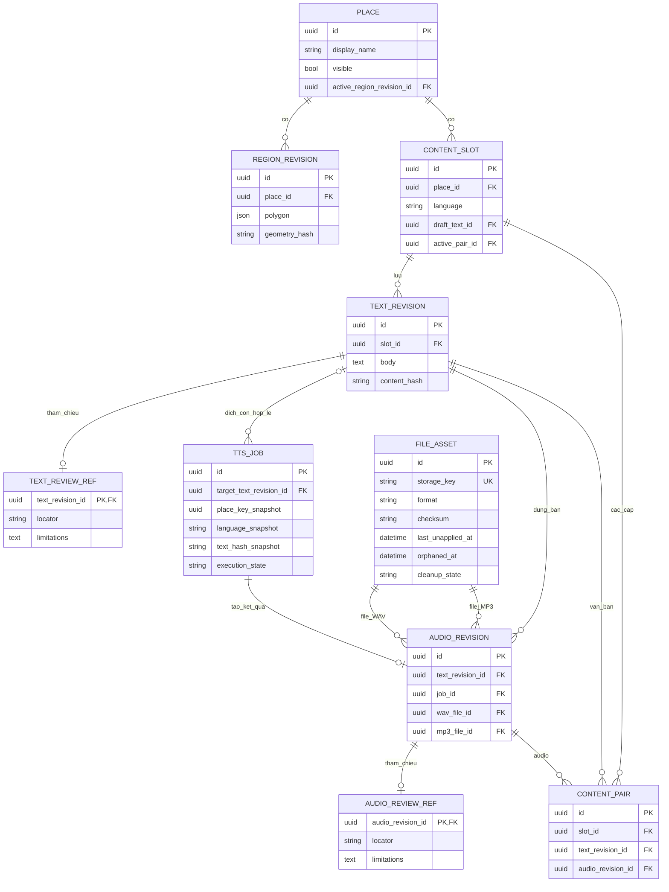
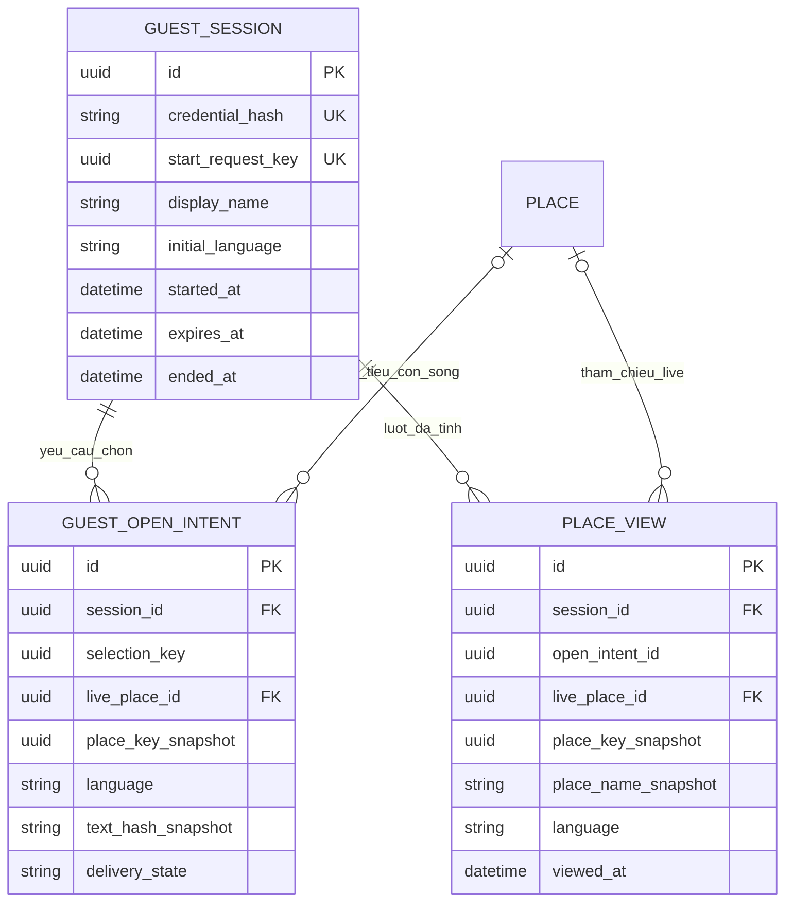
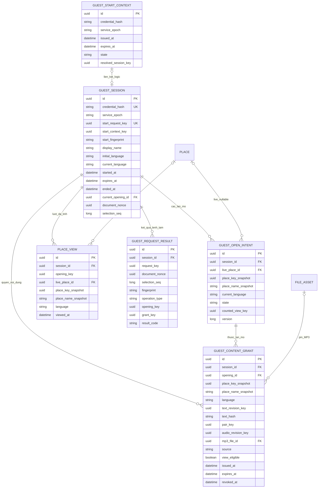
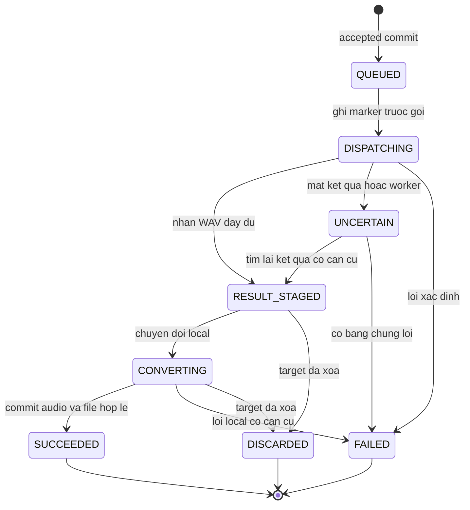
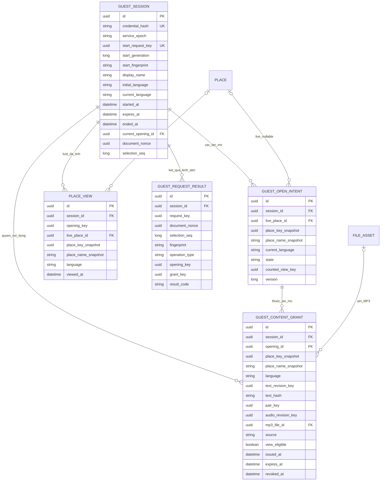

> **Tổ chức lưu trữ 05/11/2026:** chuyển từ docs/03-ky-thuat/data-model-history.md; giữ nguyên nội dung bản cũ và trạng thái theo thời điểm. [Tài liệu hiện hành](../03-ky-thuat/data-model.md) mới là nguồn dùng triển khai. [Mục lục lưu trữ](README.md). Không duyệt lại mô hình/UI hoặc phục hồi phương án cũ.

# Lịch sử mô hình dữ liệu TDD 0.3 — KHÔNG ÁP DỤNG TRIỂN KHAI

**Lưu ngày:** 03/11/2026, nguyên phần mô hình mục 11–12 đọc từ TDD 0.3 trước lượt hoàn thiện. Giữ nội dung để truy vết, không nguồn yêu cầu hoặc mô hình hiện hành thứ hai. Xem [mô hình hiện hành](../03-ky-thuat/data-model.md) và [TDD](../03-ky-thuat/TDD.md); không ghép bảng dưới đây vào schema mới.

## 11. Mô hình dữ liệu — ERD logic dự thảo

Phần này **chưa được duyệt và chưa có database/migration**. Mô hình giữ số bảng vừa đủ để tách nháp/áp dụng, tạo/duyệt audio, xóa DB/file và phiên/người. Không thêm màn lịch sử phiên bản phức tạp hoặc chức năng quản lý ngôn ngữ.

**Quy ước:** id là định danh hệ thống ổn định, không lấy từ tên; đề xuất UUID ở mức logic, kiểu vật lý/index MySQL sẽ cụ thể hóa trước migrations. PK là khóa chính, FK là tham chiếu có kiểm tra; UK là tổ hợp không được trùng. Năm điểm là dữ liệu chuẩn, không điều kiện số lượng bảng; ngôn ngữ chỉ vi/en/fr/ru.

### 11.1. ERD địa điểm, nội dung và tác vụ

Mũi tên “các cặp/các bản” là liên kết nội bộ cần giữ đúng bản, **không yêu cầu UI lịch sử đầy đủ**. active_region_revision_id/active_pair_id/draft_text_id là con trỏ hiện hành; để sơ đồ dễ đọc, ràng buộc ngược được giải thích ở 11.3. Thông tin bản đang vẽ dở/Q2 nằm ở tab, không bị ghi thành REGION_REVISION hợp lệ. map_space_key nhận biết hệ tọa độ/nền demo tương ứng; chưa chọn nền hoặc mặc định tọa độ JSON là vị trí khách. Mapping polygon/coordinate space phải thống nhất Leaflet, không tự biến vùng thành ranh giới di tích đã duyệt.

### 11.2. Giải thích từng nhóm bằng ví dụ

| Bảng logic | Dữ liệu chính / quan hệ | Ví dụ và lý do |
| --- | --- | --- |
| PLACE | id PK; display_name đã chuẩn hóa theo Q1; visible mặc định false; active_region_revision_id nullable; version kiểm cạnh tranh; created/updated | Hai điểm cùng tên vẫn hai id; đổi tên không đổi id. Lưu điểm ẩn được dù không có vùng/cặp. Không thêm ảnh/tọa độ khách/mô tả bắt buộc. |
| REGION_REVISION | id, place_id FK, polygon JSON, map_space_key, geometry_hash, saved_at; bản đã được áp dụng không bị sửa tại chỗ | R1 phục vụ khách; Admin vẽ R2/xem trước/lưu, PLACE vẫn trỏ R1. Áp dụng đúng R2 đã xem/lưu mới đổi con trỏ. Xem trước không tự chứng minh ranh giới đã được người dùng duyệt. |
| CONTENT_SLOT | id, place_id FK, language thuộc bộ 4; UK(place_id, language); draft_text_id nullable; active_pair_id nullable; version | Một “ngăn nội dung” như Ngọ Môn/vi. Tối đa một cặp phục vụ cho ngăn; chưa đủ bốn ngôn ngữ vẫn áp dụng riêng một cặp hợp lệ. |
| TEXT_REVISION | id, slot_id FK, body, content_hash, saved_at; định danh bản bất biến khi đã được job/audio/cặp tham chiếu | T1 đang dùng; sửa/lưu thành T2 làm nháp. T1 không đổi để A1 vẫn khớp; văn bản chưa lưu chỉ Q2. Có thể tạo bản mới mỗi lần Lưu rõ ràng; không cần màn rollback/lịch sử. |
| TEXT_REVIEW_REF / AUDIO_REVIEW_REF | Mỗi đối tượng đã lưu có locator, limitations khi cần, recorded_by Admin và recorded_at; không bắt nhập lại người/ngày duyệt ngoài hồ sơ | Text T2 và audio A2 có tham chiếu riêng, có thể cùng một mục nếu hồ sơ xác định cả hai. Nhập locator không làm hệ thống tự biết đã duyệt hoặc tự Áp dụng. |
| TTS_JOB | id, target_text_revision_id nullable FK, snapshot điểm/bản/hash/ngôn ngữ/model/voice (body lấy từ TEXT_REVISION bất biến, không cần kho text trùng riêng), request_key UK, phase, accepted/updated/terminal_at, provider_request_id nếu có, outcome_uncertain, target_valid, worker ownership | Admin bấm tạo T2/vi: job giữ đúng snapshot, không lấy phần T3 đang gõ sau đó. Job tồn tại qua hết phiên Admin; không tự phát hành. Không lưu key hoặc log prompt. |
| AUDIO_REVISION | id, text_revision_id FK, job_id FK/UK, wav_file_id/mp3_file_id FK, created_at; audio bất biến | A2 chỉ thuộc T2, không chuyển sang T3. Một kết quả thành công có WAV và MP3; ffprobe không thay nghe trọn. Lỗi giữa chừng chỉ là job/file tạm, chưa là audio sẵn sàng. |
| CONTENT_PAIR | id, slot_id FK, text_revision_id FK, audio_revision_id FK, created_at; có thể UK ba thành phần để chống tạo bản cặp giống hệt | Cặp C2=(T2,A2) đủ hồ sơ; đổi CONTENT_SLOT.active_pair_id trong một giao dịch. Chỉ đổi audio thì C3=(T2,A3), không bắt sửa/duyệt lại T2 không đổi. |
| FILE_ASSET | id, storage_key UK không là đường client tùy nhập, format, checksum, size/duration đã kiểm, cleanup_state, retry/error, last_unapplied_at/orphaned_at | Giữ metadata file sau xóa AUDIO_REVISION để dọn thật và báo chờ/thử lại. Hai tham chiếu dùng chung file không được xóa theo một điểm. Giá trị size/duration là kết quả đo, không ngưỡng mới. |
| ADMIN_ACCOUNT | id, login_name UK, password_hash, enabled; không mật khẩu rõ | Một vai trò cấp trước. Phiên Admin do Spring Security/session server quản lý; chưa buộc tạo bảng lưu HttpSession qua restart. Mốc hoạt động Q3 không tính theo mọi HTTP request. |

Không dùng content_hash thay id bản: hai đoạn giống chữ vẫn có thể là hai đối tượng cần đối chiếu khác; checksum không tự chứng minh duyệt. Không xóa bản nháp/các hồ sơ tham chiếu chỉ vì chưa duyệt hoặc vừa có cặp mới. Các bản nội bộ không còn tham chiếu chỉ được xử lý có kiểm soát; không tự đặt TTL văn bản/hồ sơ hoặc giữ lịch sử vô hạn làm chức năng mới.

### 11.3. Các ràng buộc cần thể hiện khi chuyển thành schema

1. UK CONTENT_SLOT(place_id, language). Dữ liệu một điểm/ngôn ngữ không bị nhân thành hai “ngăn”.
2. TEXT_REVISION có khóa ứng viên (id, slot_id). Cặp trỏ đúng text của ngăn bằng FK tổ hợp; AUDIO_REVISION có khóa ứng viên (id, text_revision_id), cặp trỏ đúng audio của chính text bằng FK tổ hợp. Không chỉ kiểm hai ID đều tồn tại.
3. CONTENT_PAIR có khóa ứng viên (id, slot_id); CONTENT_SLOT(active_pair_id, id) trỏ cặp thuộc đúng slot. REGION_REVISION tương tự (id, place_id); PLACE(active_region_revision_id, id) chỉ trỏ vùng của mình. draft_text_id cũng trỏ text cùng slot.
4. Các pointer nullable cho lúc tạo: tạo PLACE/SLOT chưa có con trỏ → tạo revision/cặp → chủ động áp dụng mới cập nhật pointer. Khi xóa, bỏ pointer trước rồi xóa con; không tắt FK để né vòng tham chiếu.
5. AUDIO_REVISION(job_id, text_revision_id) chỉ gắn kết quả job của đúng text qua khóa ứng viên tương ứng; Job target nullable chỉ sau vô hiệu có kiểm soát, khi đó không có audio hợp lệ còn phụ thuộc.
6. FK ở quan hệ cần chặn dùng RESTRICT/NO ACTION theo InnoDB; không ON DELETE CASCADE hoặc JPA cascade-remove/orphanRemoval làm xóa ngầm quan hệ cần bảo vệ. Service điều phối thứ tự/giao dịch, Repository không tự duyệt.
7. version ở aggregate PLACE/SLOT và điều kiện expected revision/hash giúp chống ghi đè dữ liệu đã đổi; một người làm không là lý do bỏ cạnh tranh hai tab/Admin.
8. Chuẩn hóa tên/đếm ký tự hiển thị là kiểm tra Service theo Q1/D02-BS; độ dài cột không thay đếm grapheme. Unicode/collation và index chọn khi mapping, tên không UNIQUE.

MySQL yêu cầu index/khóa tham chiếu phù hợp; InnoDB không dùng deferred constraints để tạm để FK sai trong giao dịch. Bộ khóa ứng viên/đường xóa ở trên phải kiểm thật trên MySQL đã chọn. Đây là cơ sở thiết kế, **chưa có DDL/Flyway hoặc ràng buộc được chạy**. [MySQL 8.4 FK](https://dev.mysql.com/doc/refman/8.4/en/create-table-foreign-keys.html).

## 12. Phiên/lượt xem, trạng thái tác vụ và lịch sử khi xóa

### 12.1. ERD phiên và lượt xem

| Bảng | Khóa / trường cần giữ | Giới hạn |
| --- | --- | --- |
| GUEST_SESSION | id server cấp; credential_hash UK; start_request_key UK + fingerprint bắt đầu; display_name, initial_language, started_at, expires_at=started_at+8 giờ, ended_at nullable | Tên không UNIQUE. effective status suy từ ended_at/thời gian server, không tin status client. ended_at chỉ được ghi khi kết thúc còn hiệu lực, không trước started_at/không sau expires_at; retention_anchor=ended_at nếu kết thúc hợp lệ, ngược lại expires_at; purge_due_at=anchor+30 ngày, không từ audio hết/restore. |
| GUEST_OPEN_INTENT | session_id FK, selection_key, UK(session_id, selection_key), target live nullable và snapshot id/tên/tiếng/bản văn, created_at/delivery state | Đây là kỹ thuật chống lặp/xác nhận tải, không lượt xem mới hoặc lịch sử audio. Mỗi chủ động mở mới có key; reload/đổi ngôn ngữ/nghe lại không tự tạo intent đếm lượt. |
| PLACE_VIEW | session_id FK, open_intent_id chỉ là khóa tương quan, UK(session_id, open_intent_id), viewed_at server ghi khi chấp nhận xác nhận văn bản, language, snapshot điểm; live_place_id nullable FK | Chỉ một bản ghi cho intent đã tính; không tọa độ/IP/điện thoại/email/thao tác audio. Không bắt FK tới text/audio để giữ các bản đó vô hạn. |
| ADMIN_ACCOUNT / HttpSession | Tài khoản băm mật khẩu và ngữ cảnh xác thực, active timestamp theo Q3 | Tách GUEST_SESSION; logout Admin không tự kết thúc phiên khách và ngược lại. Không mô hình số người duy nhất. |

**Chống đếm sai:** chỉ server gửi HTTP response chưa chứng minh văn bản đã đến tab. Đề xuất hai bước: server cấp intent khi chọn hợp lệ, tab nhận/hiển thị văn bản rồi xác nhận đúng intent; server kiểm credential/phiên/bản/intent thuộc chính phiên và UNIQUE trước ghi PLACE_VIEW; không nhận intent của tab/phiên khác. Audio chưa tải hoặc tải lỗi không ngăn tính lượt nếu văn bản đã thành công. Nếu ACK mất thì kiểm intent hiện tại trước thử lại, không ghi lặp; không gửi bù hàng chờ offline hoặc hồi sinh phiên hết hạn. Mốc viewed_at là thời gian server chấp nhận ghi nhận, không backdate bằng đồng hồ client. Hợp đồng ACK/lỗi/chưa rõ kết quả được cụ thể hóa dự thảo ở API 3/5/6/7; độ trễ/chứng minh thực tế vẫn cần kiểm, không dựng lượt chưa được xác nhận.

**Ví dụ:** mở Ngọ Môn thành công → V1; bấm lại/nghe lại/đổi tiếng/reload không thêm. Chọn Thái Hòa thành công → V2, quay lại Ngọ Môn thành công → V3. Hai tab bắt đầu dù tên trùng vẫn hai session_id; thống kê đếm hai phiên, không kết luận hai người duy nhất.

### 12.2. Nhận biết điểm đã xóa và thứ tự giao dịch

PLACE_VIEW lưu place_key_snapshot bất biến + place_name_snapshot tại lúc xem; live_place_id dùng FK RESTRICT nhưng được **ứng dụng chủ động đặt NULL trong giao dịch xóa**. Sau đó UI nhận biết “địa điểm đã xóa”. Thống kê nhóm theo snapshot id và ngôn ngữ/ngày, không theo tên; nếu cùng id từng đổi tên, danh sách lượt hiện tên snapshot lúc xem; thống kê đề xuất dùng tên snapshot mới nhất trong nhóm làm nhãn, vẫn nhóm theo id chứ không tên. Không cần thêm lịch sử đổi tên hoặc gộp id. Điểm mới trùng tên luôn id khác, không gộp.

Quy trình đề xuất, hoàn tác toàn bộ phần DB nếu bất kỳ bước thất bại:
1. Khóa/kiểm PLACE và version, ngăn áp dụng/bật hiện hoặc job mới vào mục tiêu đang xóa.
2. Vô hiệu TTS_JOB còn liên quan: target_valid=false; chuẩn bị bỏ target_text_revision_id sau khi xử lý con theo FK, không giữ raw text riêng sau xóa điểm; giữ tối thiểu job id/provider id/phase/workspace để theo dõi kết quả muộn. Job unknown không bị đánh đồng rác, không tự hủy được provider.
3. Bỏ active_region/draft_text/active_pair pointers; xử lý CONTENT_PAIR, review-ref **trong DB**/AUDIO_REVISION/TEXT_REVISION/SLOT/REGION thuộc riêng điểm theo thứ tự FK. Hồ sơ duyệt file tài liệu bên ngoài không bị xóa.
4. Giữ PLACE_VIEW snapshot và session, đặt live_place_id NULL; không cấp opening/grant mới cho điểm đã xóa; giữ đối chiếu tối thiểu của grant đã cấp để ACK hợp lệ của lần chọn gốc có thể ghi snapshot với live_place_id NULL, không tạo lại PLACE/text. Chi tiết ở API TX-K03/TX-A05; không giữ failed intent làm lịch sử nghiệp vụ.
5. Ghi yêu cầu/trạng thái dọn file qua FILE_ASSET, giữ metadata/tham chiếu còn dùng chung/last_unapplied_at; xóa PLACE, commit.
6. Sau commit mới worker kiểm điều kiện/giữ hạn và dọn file; lỗi file để chờ/thử lại, không đảo ngược kết quả xóa điểm đã commit hoặc báo file đã mất khi chưa dọn.

Điểm 2 cần bỏ FK job sau khi audio/cặp phụ thuộc đã xử lý đúng thứ tự; không hiểu danh sách là yêu cầu cập nhật target FK trước khi xóa các con còn tham chiếu tổ hợp. Worker luôn kiểm lại target_valid và target tồn tại trước ghi kết quả; phản hồi muộn chỉ bàn giao orphan file, không tạo lại PLACE/TEXT. Không xóa asset dùng chung. Không giữ lịch sử lượt quá D08 chỉ để nhận biết điểm cũ.

### 12.3. Trạng thái tạo, áp dụng và file

| Đối tượng | Trạng thái / sự kiện | Không được suy ra |
| --- | --- | --- |
| Job | Chưa tạo là chưa có job phù hợp; accepted/processing hiển thị đang tạo, success khi có kết quả hợp lệ, failed khi lỗi xác định. outcome_uncertain/target_invalid là cờ kỹ thuật để reconcile hoặc bỏ kết quả, không tự gọi là success/failed khi chưa rõ. | Không retry provider tự động, không tạo lần hai do Admin đăng nhập lại; timeout không tự chứng minh provider chưa xử lý. |
| Text/audio/hồ sơ | Lưu đúng đối tượng, có tham chiếu đối chiếu hồ sơ; khớp bản/tiếng; cặp candidate khác active pointer | Không boolean “AI verified”, không tạo xong tự coi duyệt hoặc locator không rỗng là thẩm định ngoài hệ thống. |
| Áp dụng cặp/vùng | Kiểm source expected version/hash và điều kiện, chuyển pointer trong giao dịch; lỗi giữ pointer cũ | Không âm thầm lưu phần đang gõ, không ép khách đang mở nhận ngay hoặc tự bật hiện. |
| FILE_ASSET | Tham chiếu còn tồn tại thì giữ; active apply bỏ gần nhất cập nhật last_unapplied_at; chưa từng áp dụng chỉ có orphaned_at khi đủ ba điều kiện | 8 giờ từ last-unapply khác 24 giờ orphan; WAV/MP3 dùng chung phải kiểm mọi ref/job, không chỉ một counter cũ. |
| Dọn file | pending/retry/deleted sau thao tác thật; chỉ dọn sau DB thành công, đủ hạn và kiểm lại không ref/không dùng chung/không worker | Không coi xóa AUDIO_REVISION là đã xóa bytes; không giữ một transaction DB xuyên thao tác file. |

**Cụ thể hóa ở lượt API thuộc TDD 0.3:** intent đóng vai opening hiện tại; sau ACK giữ phần tối thiểu để backend nhận biết P06/đổi tiếng/reload, không xóa current context ngay; chủ động quay lại bản đồ kết thúc lần mở, khác kéo/phóng/chạm ngoài hoặc mở-hủy box ứng viên. Grant nội dung riêng pin text/audio/file/snapshot cho ACK đang bay và full MP3; OPERATION_RECEIPT giải quyết lệnh Admin mất response. Chi tiết canonical ở [API 7.1](../03-ky-thuat/api-transactions.md#api-jobs). Đây là bổ sung kỹ thuật so với 0.2, không chức năng lịch sử mới. Opening cũ/grant dọn khi không còn cần/kết thúc-hết hạn, không giữ failed intent 30 ngày; PLACE_VIEW dùng khóa tương quan không FK bắt giữ context. Credential/sổ bắt đầu theo phiên vẫn dọn D08. Không lưu audio event history hoặc thêm PII. Dọn job/ref nội bộ không được xóa nháp còn tham chiếu hoặc gán một TTL tùy ý; chi tiết job restart/unknown và asset handoff được định hướng ở API 7, còn khép state/claim/schema và kiểm chứng.

---

# Phụ lục lịch sử đề xuất backup TDD 0.3 — KHÔNG ÁP DỤNG NHƯ MẶC ĐỊNH

Giữ nguyên đoạn dưới để truy vết phương án cũ; xem [operations-design](../03-ky-thuat/operations-design.md#ops-backup) cho khuyến nghị mới, không coi pause mọi ghi là đã duyệt.

## 15. Backup cục bộ — phạm vi/nhịp đã chốt, cơ chế còn dự thảo

**DATA-02 đã chốt phạm vi:** bản chấm không bắt có ổ ngoài/nơi ngoài laptop; backup nằm tách dữ liệu chạy, giữ từng bản bảy ngày, bảo vệ/dọn/restore riêng và lọc hạn gốc theo DATA-01. Không mục tiêu cứu được khi mất/hỏng toàn laptop.

**DATA-03 đã chốt:** DB + WAV/MP3 đang được tham chiếu + manifest cần phục hồi; cuối ngày có thay đổi và trước deploy/schema; cục bộ tách dữ liệu chạy, từng bản bảy ngày/restore lọc mốc gốc. **Cơ chế chi tiết vẫn thiết kế**, không coi snapshot/CD/restore đã chạy:

- Một kho backup cục bộ ngoài working tree/repo, ngoài volume dữ liệu chạy và image app; path/quyền cụ thể định khi cấu hình. Tách vị trí không bảo vệ lỗi toàn ổ hoặc xóa cả laptop.
- Snapshot gồm dump MySQL + các file WAV/MP3 còn tham chiếu cần phục hồi + manifest phiên bản schema/app/hash/danh sách file/thời điểm/hạn bản sao. Không backup Blob/memento khách, file job tạm hoặc secret vào gói chia sẻ.
- Chụp cuối ngày có thay đổi và trước thay đổi deploy/schema; bản mới tạo khi checkpoint/dump và file nhất quán. Kho DB/file phải phối hợp để không backup con trỏ tới file chưa có: đề xuất tạm ngừng thao tác ghi/thực hiện job liên quan trong lúc tạo snapshot, chưa chọn công cụ/lệnh hoặc thời gian gián đoạn.
- Chỉ đánh dấu snapshot hoàn chỉnh khi đủ DB/file/manifest/kiểm hash. Backup lỗi giữ bản trước còn hạn, báo lỗi; không báo đã bảo vệ chỉ vì bắt đầu job. Dọn bản đúng hạn, không tự giữ thêm vì bản mới lỗi.
- Restore ra database và volume/path riêng, đối chiếu phiên bản/hash, lọc hết hạn theo timestamp gốc rồi kiểm tra trước switch phục vụ. Không nhập đè hệ thống đang chạy hoặc reset anchor theo ngày restore.
- Kiểm phục hồi lỗi thao tác/deploy còn bản sao: bản văn/cặp/file khớp, phiên/lượt quá hạn không xuất hiện; log/provider/secret được kiểm riêng. RPO/RTO chưa cam kết hoặc đo đạt.

**Ví dụ minh họa đúng hạn:** B được chụp khi phiên S đã kết thúc được 29 ngày và vẫn còn hạn lưu. Hai ngày sau phục hồi B: **B mới hai ngày tuổi, vẫn trong hạn bảy ngày**, nhưng S đã 31 ngày từ ended_at gốc nên S và lượt liên quan phải bị lọc trong môi trường restore trước phục vụ. Không chờ tới lúc B hết hạn hoặc tính lại 30 ngày từ lúc phục hồi; ví dụ không là dữ liệu/test thực.

---

# Lịch sử phương án TDD 0.4 — BỊ THAY ĐÚNG PHẦN NGÀY 04/11/2026

Đoạn nguyên văn dưới lưu phương án trước xác nhận DATA-04: context/10 phút chưa được duyệt; BKP-P01 online không còn mặc định; LIFE-P02/P03/REC-P01 đã xác nhận tại decisions. Không áp các trạng thái “chờ” bên dưới như hiện hành. Xem [mô hình hiện hành](../03-ky-thuat/data-model.md) và [operations](../03-ky-thuat/operations-design.md).

## Mô hình phiên/context cũ

## 3. Phiên theo tab, lần mở, quyền tải và lượt xem

| Bảng / con trỏ | Ràng buộc hiện hành đề xuất | Vòng đời và giới hạn |
| --- | --- | --- |
| GUEST_START_CONTEXT | id PK, credential_hash, issued_at/expires_at, state OPEN/RESOLVED, resolved_session_key logical nullable; không tên/IP/nội dung | Ngữ cảnh chống xử lý lại Bắt đầu, chưa là phiên tham quan. POST khởi tạo ngữ cảnh không tăng số phiên; TTL mới chỉ đề xuất LIFE-P01. |
| GUEST_SESSION | UK(start_request_key), UK(start_context_key); start_fingerprint là hash tên đã chuẩn hóa + tiếng + credential hash; current_language/document_nonce/selection_seq là metadata phiên đang dùng, null/dọn sau end/expiry; current_opening FK tổ hợp (id,current_opening_id) tới (session_id,id) của opening | started/expiresAt gốc 8 giờ; endedAt chỉ khi kết thúc còn hạn. retention_anchor=endedAt nếu có, ngược lại expiresAt; hạn xóa anchor+30 ngày. Context cũ không là FK bắt giữ context tới 30 ngày. |
| GUEST_OPEN_INTENT | Giữ tên bảng 0.2 để truy vết, nghĩa hiện hành là **opening**; UK(id,session_id); created_at/closed_at; counted_view_key logical, không FK ngược tới view | Sau ACK vẫn giữ current opening để P06/đổi tiếng/reload không thêm lượt. Chọn điểm khác hoặc chủ động quay bản đồ đóng opening; opening/grant kỹ thuật giữ tối đa tới kết thúc/hết hạn rồi dọn an toàn, không lịch sử thất bại 30 ngày. |
| GUEST_CONTENT_GRANT | FK tổ hợp (opening_id,session_id); file FK RESTRICT nullable; text/pair/audio/điểm cũ là id snapshot logical, không FK cản xóa nội dung | Một grant gắn đúng text/tiếng/MP3 của một response; server kiểm session+credential+grant owner. expiresAt không vượt hạn phiên, revoked khi kết thúc. Không phải URL public/token độc lập, không cấp lại audio sau hạn. |
| GUEST_REQUEST_RESULT | UK(session_id,request_key), UK(session_id,document_nonce,selection_seq); fingerprint/action + opening/grant key logical + kết quả tối thiểu, không body text | Giữ kết quả K06/K07/K10 tới end/expiry để replay không đổi current selection hoặc tạo grant/lượt mới. Bản gốc mất thì báo không còn khả dụng, không thay bản khác âm thầm; không lịch sử nghe 30 ngày. |
| PLACE_VIEW | UK(session_id,opening_key); session FK, live_place nullable FK; **không FK tới opening/grant/text/audio** | ACK theo grant server và UNIQUE mới tạo một lượt; viewedAt server. Opening/grant được dọn sau hạn, view giữ D08. Không dùng tên gộp điểm/người. |
| document_nonce/selection_seq | Nonce document mới khi resume thành công; seq tăng trong document, kiểm dưới khóa session; không là bằng chứng quyền | Cùng credential mà sai document/seq cũ không đổi lựa chọn mới. Web Locks/owner bên tab vẫn phải kiểm, không dùng cookie chung thay credential. |

ERD chỉ vẽ liên kết logic START_CONTEXT→SESSION; đó là **logical receipt**, không FK bắt giữ context sau hết hạn. Nhờ khóa context trong K01, worker dọn context không thể xóa trong lúc Bắt đầu đang commit; sau dọn, key đã hết cửa sổ không được dùng để tạo phiên mới.

**Lượt đầu và reload:** SELECT/LANGUAGE grant có thể viewEligible=true khi opening chưa tính; RESTORE luôn false. ACK đầu đúng văn bản đã hiển thị lấy điểm/tên/tiếng/hash từ grant, không client tự khai. Nếu thiếu dịch lúc đầu rồi chủ động chọn tiếng có bài, lần đầu văn bản thành công tính đúng một lượt; các lần đổi sau không cộng. ACK đang bay của lựa chọn thật có thể ghi snapshot sau điểm bị xóa khi phiên còn hạn; không phải gửi bù offline. Server không thể chứng minh con người thực sự đọc: ACK là hợp đồng giữa client đã kiểm và server, cần thử race/hiển thị thực.

**Giữ lịch sử khi xóa:** giữ snapshot id/tên của lượt đã tính, đặt live_place_id NULL. Một điểm mới cùng tên có UUID khác; nhóm theo snapshot id/ngày/tiếng. Nhãn thống kê đề xuất dùng snapshot mới nhất trong nhóm nếu tên từng đổi, không gộp theo tên hoặc thêm lịch sử đổi tên mới.

## Vòng đời/backup/restore trước xác nhận — nguyên văn

## 1. Tạo, giữ, vô hiệu và dọn — phân biệt hạn quyền với thời điểm dọn

| Đối tượng | Tạo / giữ | Vô hiệu / dọn | Căn cứ hoặc đề xuất |
| --- | --- | --- | --- |
| Guest start context | Khi tab cần chuẩn bị Bắt đầu; chỉ hash credential/ngữ cảnh, chưa tên hoặc GUEST_SESSION. K01 khóa context; một context tạo tối đa một phiên | Đề xuất hết cửa sổ sau 10 phút từ cấp. Sau hạn không tạo lần đầu; nếu đã tạo thì tìm theo key + credential trả đúng phiên cũ. Dọn context dưới khóa sau hạn, không đụng session/credential ledger đang giữ D08 | **LIFE-P01 — CHỜ XÁC NHẬN** 10 phút. Form lâu được cấp context mới trước yêu cầu đầu tiên; đang chưa rõ kết quả không tự đổi key/context |
| GUEST_SESSION/start ledger | Bắt đầu thành công; giữ start_request_key/context key/fingerprint/hash credential cùng session | Hết quyền ở endedAt hoặc startedAt+8 giờ. Xóa cùng lượt tại anchor+30 ngày; credential chỉ còn để đọc trạng thái/kết quả cũ phù hợp, không tải nội dung mới | D04/D08; không TTL mới. Key cũ gắn context đã hết hạn không tạo phiên lại sau khi ledger bị dọn |
| Current opening | Chọn thật tạo, cùng điểm P06 giữ opening; đổi tiếng/reload không tạo lượt | Chọn điểm khác/Quay bản đồ đóng current. Đóng không xóa ngay ACK/grant đang bay. Giữ phần kỹ thuật tối thiểu tới end/expiry rồi vô hiệu/dọn khi không còn đọc đang xử lý | D04/P06/TECH-04. Không lịch sử mở thất bại 30 ngày |
| GUEST_REQUEST_RESULT | Cùng TX K06/K07/K10; UK key/nonce-seq + fingerprint, result ids/state tối thiểu | Giữ tới end/expiry; replay không đổi current selection mới hơn, dọn cùng ngữ cảnh kỹ thuật, không TTL mới | Không receipt Admin/lịch sử audio; bản gốc mất thì báo unavailable, không tự ghép bản khác |
| Grant | Cấp snapshot text/MP3 đúng bản khi còn hạn; RESTORE không viewEligible. File pin chỉ metadata tối thiểu, không body text trùng | Quyền tối đa tới expiresAt phiên, end thu hồi ngay. Sau deadline không GET audio/ACK mới. Đợi request đọc đã nhận kết thúc rồi tháo file FK/xóa grant; sau đó mới opening, không chạm PLACE_VIEW | Không TTL mới; không dùng việc bytes còn trên server để cho tải sau hạn. Blob đủ điều kiện nghe tiếp ở tab độc lập grant |
| Document nonce/sequence | Resume đúng owner đổi nonce, session lưu seq mới; client cũng dùng generation | Nonce cũ không đổi lựa chọn; end/expiry không nhận mutate. Dọn cùng ngữ cảnh kỹ thuật, không lưu hoạt động audio | Cơ chế đề xuất, cần kiểm thật hai tab |
| Admin command window + receipt | Window server cấp cho tài khoản đang xác thực; key=(windowId,randomId). Receipt + lệnh DB một TX | Đề xuất window 24 giờ từ cấp; tra/replay chỉ trong cửa sổ, không gia hạn qua login/hoạt động. Hết hạn hoặc không tìm thấy window: **không** diễn giải key thành lệnh mới. Dọn receipt rồi window khi không còn TX đang dùng; job độc lập | **LIFE-P02 — CHỜ XÁC NHẬN** 24 giờ. Hết window không logout Admin; lệnh mới nhận window mới, lệnh cũ cần đối chiếu trạng thái, không auto gửi lại |
| TTS job | A18 accepted tạo job; TEXT.active_tts_job_id bảo vệ active/unknown; snapshot đúng bản | Thành công có audio/current result còn tham chiếu thì giữ; unknown/worker còn chạy không bị TTL xóa. Đề xuất metadata job cũ không còn dùng/terminal rõ giữ 7 ngày từ terminalAt rồi dọn khi mọi điều kiện an toàn đạt | **LIFE-P03 — CHỜ XÁC NHẬN** 7 ngày cho job cũ; độc lập log/backup 7 ngày, không áp lên unknown hoặc bản nháp còn tham chiếu |
| File đọc/worker claim | Trước đọc/finalize, xác nhận READY và owner/task; cleaner kiểm cùng protocol | Release khi stream/task thực kết thúc. Worker chết phải có chứng cứ owner instance đã dừng; thiếu heartbeat một mình chưa là bằng chứng. Không tự xóa file hoặc gọi lại provider vì lease hết | Không thêm TTL đã chốt; heartbeat/timeout kỹ thuật sẽ đo, fail-closed khi chưa rõ |
| Blob/memento/Q2 | Giữ trong đúng tab/đúng tài khoản và công việc | Theo TDD 13–14/Q2. Không đưa Blob vào backup, receipt hoặc lịch sử nghe. Admin hết phiên dừng preview; guest chỉ đúng bài đang phát được nghe tiếp | Quy tắc đã chốt, không giữ dài hạn mới |

LIFE-P01/P02 là thời gian được phép **tạo/replay**, không phải lời hứa dữ liệu bị xóa vật lý đúng mili giây đó. API chặn ngay theo server clock dù worker dọn chưa chạy. Khi thống nhất lịch dọn phải nêu độ trễ quan sát được, không tự kéo mốc 8 giờ/30 ngày/7 ngày đã chốt.

**Tại sao cần window tồn tại:** xóa receipt rồi nhận cùng key như lệnh mới có thể áp dụng/xóa/gọi tạo lần nữa. Server phải kiểm window trước nhận lệnh chưa có receipt; window không còn thì từ chối thực hiện, chỉ đối chiếu target/job còn có. Start context tương tự: một retry cũ không biến thành phiên mới sau khi xóa ledger D08. Không cần hỏi người dùng chọn cách tạo UUID/header.

## 2. State machine tác vụ và phối hợp file

**Chưa tạo** là không có job phù hợp; QUEUED/DISPATCHING/RESULT_STAGED/CONVERTING hiển thị đang tạo. UNCERTAIN hiển thị chưa xác định kết quả và hướng kiểm tra, không gán thành lỗi xác định để mở nút gửi lại. Một lần Retry tạo job/attempt mới, không reset job cũ hoặc tráo text T1 thành T2.

1. **Accept:** Service khóa text/active job và operation window; persist snapshot + job + receipt 202. Marker chưa commit không được dispatch.
2. **Dispatch:** worker giành owner_token/phase_version, ghi DISPATCHING trước gọi. Crash sau marker nhưng không rõ đã gửi hay chưa → UNCERTAIN, không tự gửi Gemini lần hai. QUEUED chắc chưa dispatch có thể xử lý lần đầu theo tác vụ đã tiếp nhận, không phải retry provider.
3. **Stage:** WAV hoàn chỉnh có manifest kỹ thuật jobId/hash/checksum; không prompt/key. Khi WAV đã kiểm đủ, đăng ký FILE_ASSET READY và TTS_JOB.source_wav_file_id trong TX trước convert; FK này giữ WAV cho local retry/backup, không để chỉ một path trong RAM. Có bằng chứng kết quả gốc thì tiếp tục convert local, không gọi TTS lại. Nếu chỉ còn bytes không đủ đối chiếu thì cách ly/kiểm, không tự gắn audio.
4. **Convert/finalize:** FFmpeg/ffprobe ngoài TX; tạo file key mới bất biến, hoàn tất bytes trước metadata READY/AUDIO_REVISION. Khi AUDIO_REVISION đã giữ WAV/MP3 thì tháo source_wav_file_id của job nếu không còn cần; lỗi local giữ đúng WAV để retry, target xóa tháo khi worker thật đã dừng. Trong TX kiểm lại owner token, target_valid/text/hash/ngôn ngữ; target đã xóa không insert PLACE/TEXT lại.
5. **Lỗi local sau WAV thành công:** job nêu failureStage và retryAction=REPROCESS_LOCAL nếu WAV còn hợp lệ; Retry chủ động có thể xử lý lại local, không tạo chi phí provider mới. Lỗi xác định trước kết quả có retryAction=CREATE_PROVIDER_ATTEMPT. Chưa rõ chỉ INSPECT_ONLY; thiếu căn cứ provider không hứa tra lại được.
6. **Xóa điểm/đóng trang/hết phiên:** job đã nhận không phụ thuộc HttpSession. Xóa làm target_invalid và kết quả muộn DISCARDED; nếu còn cuộc gọi/worker chưa rõ thì vẫn giữ cờ uncertain/claim, không dọn chỉ vì target mất.
7. **Dọn:** bản đầy đủ WAV/MP3 đã kiểm nhưng không dùng thuộc file hoàn chỉnh chưa áp dụng, áp DATA-01 24 giờ đủ điều kiện. Chunk/đầu ra dở trong workspace mới theo 1 giờ khi terminal/không worker/an toàn. Không đổi tên một WAV hoàn chỉnh thành “file tạm” để xóa sau 1 giờ. Bản nháp còn tham chiếu giữ.

Server không tự thẩm định hồ sơ D09: success → nghe thử/nghe trọn → người dùng duyệt đúng bản/hồ sơ → Admin áp dụng cả cặp là các việc khác nhau.

**File và race:** mọi download tạo claim trước stream; cleaner đánh dấu DELETING dưới khóa và chỉ khi không refs/claim + đủ hạn. Bên thêm ref/download không nhận asset DELETING. File delete ngoài TX, finalize kết quả thật hoặc retry. Kết quả unlink chưa rõ giữ DELETING, không READY cho tải/ref mới tới khi kiểm tồn tại/checksum; file thật đã absent mới finalize DELETED. FILE_ASSET.ever_applied/last_unapplied_at giữ đúng mốc tham chiếu áp dụng cuối của cả WAV/MP3. Service xóa điểm chỉ tháo refs, không unlink file trong TX.

## 3. BKP-P01 — Khuyến nghị backup online, phối hợp với dọn file

**Đây là thiết kế đề xuất, chưa chạy hoặc duyệt hiệu năng.** Thay khuyến nghị cũ “tạm dừng mọi thao tác ghi suốt lúc chụp” bằng phương án không chủ động chặn thao tác khách/Admin trong khi backup. Đổi lại phải tạm giữ **dọn file vật lý** và dùng thêm một MySQL tạm để đọc đúng bản dump; tốn RAM/disk/I/O trên laptop 16 GB, cần đo.

**Điều kiện thiết kế:**

- Tất cả bảng nghiệp vụ InnoDB. Dùng snapshot nhất quán của mysqldump với single-transaction; không Flyway/DDL/deploy đồng thời. Đây là đề xuất công cụ, chưa câu lệnh/cấu hình thực thi.
- File đã READY bất biến, key không tái dùng; rename/công bố sau bytes hoàn tất. Không đường xóa ngoài cleaner có kiểm soát. Backup và cleaner dùng cùng gate/owner, không chỉ một cờ trong RAM có thể mất khi app restart.
- Nơi backup cục bộ riêng live volumes/repo/image; quyền đọc hạn chế, không public qua ngrok hoặc commit vào Git. Nơi tạm và gói hoàn chỉnh cũng chứa dữ liệu nhạy cảm cần bảo vệ.
- Gói không được coi hoàn chỉnh nếu dump/manifest/hash/file thiếu. Khóa điều phối không là giao dịch database kéo dài qua copy file.

### 3.1. Trình tự và tính nhất quán

1. Tạo BACKUP_RUN=PREPARING cục bộ với createdAt/expiresAt gốc, ghi owner instance và marker điều phối bền; cập nhật OPS_GUARD dưới khóa rồi commit để cleaner nhìn thấy. Giành khóa vận hành không DDL/deploy/backup khác, bật gate không cho cleaner unlink; chờ lượt unlink đã bắt đầu kết thúc và kiểm trạng thái. App vẫn nhận guest/Admin và job.
2. Chụp dump database nhất quán → DUMPING. Mọi snapshot được chọn bởi chính transaction của dump; không query live DB ở thời điểm khác rồi gọi là cùng snapshot. Trong lúc này, thay cặp/xóa điểm vẫn commit bình thường nhưng **bytes cũ chưa được cleaner xóa**.
3. Restore **chính dump vừa chụp** vào MySQL tạm, tách live, không ứng dụng/worker/scheduler/TTS/ngrok → CATALOGING. Từ database này dựng danh sách file được tham chiếu (WAV/MP3 của AUDIO_REVISION, MP3 grant còn trong dump, file hoàn chỉnh còn được job dùng nếu có). Đây là bản kê khớp dump, không danh sách đoán từ live.
4. Copy các storage_key đó vào staging backup → COPYING; nguồn bất biến và cleaner bị gate nên file đã hiện trong dump vẫn còn, kể cả live DB đã bỏ ref sau snapshot. Bytes đang tạo chưa READY chưa được dump tham chiếu; không cần backup workspace dở để hứa tiếp tục provider.
5. VERIFYING: kiểm dump/schema/app version, file key/size/checksum, manifest có createdAt/expiresAt/snapshot identity/hashes và thành phần đủ để phục hồi. Không đặt lại createdAt ở cuối copy để kéo thêm bảy ngày. Xác nhận không thiếu file được bản dump tham chiếu.
6. Chỉ sau kiểm mới đánh dấu COMPLETE và công bố gói bằng chuyển tên trạng thái/thư mục có kiểm soát. Dọn DB tạm, bỏ gate/khóa trong finally có kiểm tra owner; tác vụ dọn tiếp tục với mốc gốc. Backup đầy đủ giữ bảy ngày, không phải bảy bản.
7. Lỗi/disk đầy: FAILED, không cho phục hồi gói dở. Dọn staging khi đã xác nhận owner dừng, giữ thông báo lỗi tối thiểu theo log đã chốt; bản trước chỉ giữ nếu còn hạn. Không trì hoãn hạn bản cũ vì snapshot mới lỗi.
8. Crash/restart: trước bật cleaner phải đối chiếu BACKUP_RUN/marker và xác nhận tiến trình copy/dump có còn chạy không; không nhả gate chỉ vì mất heartbeat. Gói chưa COMPLETE không dùng phục hồi. Không tự gửi lại job TTS đã DISPATCHING.

**Vì sao copy sau dump vẫn đúng:** file đã có ở snapshot không bị ghi đè hoặc unlink cho tới hết copy. Bản kê được đọc từ chính snapshot đã restore tạm. Thay đổi DB sau thời điểm snapshot không làm một bộ DB cũ ghép với danh sách audio mới. File thiếu/hash lệch là backup thất bại, không lờ đi.

**Tác động và giới hạn:** pause cleaner có thể làm chậm thời điểm dọn file đã đủ điều kiện trong lúc backup đang đọc; không đổi mốc đủ hạn hoặc cho phép giữ vô hạn. DB xóa phiên/lượt D08 vẫn chạy, bản dump nhất quán giữ đúng trạng thái snapshot rồi restore lọc lại. Chi phí I/O có thể làm thao tác chậm; chưa có số đo. Nếu thiết bị không chịu được phương án online và buộc chặn ghi/đọc ứng dụng đáng kể, **trình thời gian/ảnh hưởng và xin xác nhận riêng trước thay đổi đó**, không âm thầm dùng chế độ bảo trì.

Căn cứ công cụ kiểm ngày 03/11/2026: [MySQL mysqldump](https://dev.mysql.com/doc/refman/8.4/en/mysqldump.html) mô tả snapshot InnoDB với single-transaction và cảnh báo DDL đồng thời; không tự làm snapshot file audio. Gate/DB tạm/manifest là thiết kế của dự án, chưa được MySQL hoặc thực nghiệm bảo đảm.

## 4. Phục hồi — lọc trước mở phục vụ

**DATA-01–03 đã chốt:** chỉ B còn hạn, restore riêng, lọc phiên/lượt quá hạn theo timestamp gốc trước phục vụ, bảo vệ/dọn bản sao bảy ngày; không cứu mất toàn laptop.

1. Chọn B còn trong hạn, kiểm manifest/checksum/schema/app version và đủ WAV/MP3 được tham chiếu. Gói thiếu/dở/hết hạn không dùng như backup hợp lệ.
2. Restore DB/audio vào container/volume/path riêng; không provider, app public, worker, cleaner hoặc migration tự động chạy. Giữ live tách biệt trong lúc chuẩn bị.
3. Tính current time thật và anchor gốc: endedAt hợp lệ, ngược lại startedAt+8 giờ. Xóa phiên có anchor+30 ngày đã đến hạn và toàn bộ lượt/metadata phụ thuộc; không đổi started/ended/expires/last-unapply/createdAt backup về hôm nay. Lặp bước lọc ở ngay trước switch nếu chuẩn bị kéo dài.
4. Opening/grant đã hết hạn hoặc end thì vô hiệu/tháo refs; không phục hồi Blob/quyền nghe tiếp. Loại read/worker claim cũ sau xác nhận instance cũ không còn chạy, không tiếp quản lease trong dump như đang thực.
5. Job QUEUED/processing/unknown trong snapshot phải **reconcile**, không tự gửi provider. Công việc có thể đã thực hiện sau B mà B không biết; không phát sinh chi phí hoặc gắn kết quả mù. Audio success có file/hash khớp mới dùng, vẫn cần hồ sơ theo D09.
6. Kiểm ràng buộc/cặp/gate/file/name lịch sử và kết quả lọc bằng truy vấn/đường Admin phù hợp; lập báo cáo restore với B, thời điểm gốc, số lượng loại bỏ, lỗi. Dữ liệu kiểm không cần đưa tên khách vào báo cáo chia sẻ.
7. Trước switch phải dừng/fence app và worker cũ để không cùng ghi hai kho; checkpoint mới, đổi runtime sang kho đã kiểm, kiểm lại không quá hạn rồi mới mở. Đây là giai đoạn có thể gián đoạn; thời gian thực chưa đo/không hứa RTO. Không tự xóa kho cũ/backup còn hạn hoặc coi chạy image cũ là rollback schema.
8. Sau switch theo dõi lỗi/cleanup/worker, dọn B và bản tạm đúng hạn/quyền. Chỉ ghi đã phục hồi khi có bằng chứng, không chỉ import SQL thành công.

### 4.1. REC-P01 — Đề xuất cần người dùng quyết định về phiên và lệnh cũ

Snapshot B có thể được tạo **trước** một thao tác kết thúc phiên/xóa/áp dụng/TTS ngoài hệ thống. Restore chỉ biết trạng thái ở B; không hứa giữ mọi thao tác sau B nếu không có journal bổ sung. Quy tắc “TTS muộn không phục hồi điểm đã xóa” vẫn áp dụng job, không phải phép khôi phục lịch sử toàn DB được chủ động chọn.

**Khuyến nghị:** mỗi lần restore thật đổi service_epoch, thu hồi quyền khách/Admin và command windows cũ trước mở phục vụ; vẫn giữ session/view hợp lệ cho thống kê theo mốc gốc. Khách cũ nhận nhánh không thể tiếp tục và phải xác nhận Bắt đầu phiên mới; không gán endedAt giả hoặc tạo phiên tự động. Admin đăng nhập lại, Q2 chỉ phục hồi phần soạn nếu target/version còn hợp lệ; kiểm trạng thái thực trước thao tác, không replay receipt từ epoch cũ. service_epoch được giữ trong metadata vận hành cục bộ tách gói restore và so với session/context/window; không lấy epoch cũ từ B làm epoch hiện hành. Triển khai/restart app thông thường **không** đổi epoch hoặc tự thu hồi phiên khách theo phương án này; Admin vẫn có thể cần login lại nếu HttpSession không lưu qua restart.

**Ảnh hưởng cần duyệt:** phiên khách còn hạn trong B cũng không tiếp tục qua lần kiểm quyền sau restore; thống kê không bị sửa cho khớp quyền mới. Đổi epoch chặn quyền request phía server, không tuyên bố xóa Blob/văn bản hoặc đẩy ngắt tức thì vào mọi tab đã tải; client vẫn giữ giới hạn 8 giờ/P01. Trạng thái/mốc phiên gốc không bị gán kết thúc giả chỉ vì credential bị thu hồi. Người dùng/nhóm phải biết thay đổi sau snapshot có thể mất; không tự hứa đồng bộ không mất dữ liệu. Đây là hành vi phục hồi chưa được các xác nhận backup trước bao gồm, **CHỜ XÁC NHẬN**, không ghi là đã chốt. Việc dừng/fence để switch là cần thiết cho restore, cách và thời gian phải kiểm; nếu cần bảo trì đáng kể, trình riêng trước thực hiện.

| 04/11/2026 | Lưu nguyên mô hình context/vòng đời/backup/restore TDD 0.4 để truy vết thay thế theo DATA-04. | Chỉ lịch sử, không mô hình/nguồn yêu cầu hiện hành. |

---

# Lịch sử trước DATA-05 — start_generation TDD 0.5/model 0.2 — KHÔNG ÁP DỤNG

Lưu ngày 04/11/2026 sau xác nhận LIFE-P01 vé ký 24 giờ. Phần generation không được chọn làm cơ chế hiện hành, thay bằng [model hiện hành](../03-ky-thuat/data-model.md) và [operations 1.1](../03-ky-thuat/operations-design.md#ops-start-simple). service_epoch/REC-P01 vẫn giữ; không coi bỏ generation là bỏ thu hồi quyền sau restore. Nội dung dưới là nguyên văn phương án cũ, không điều kiện triển khai song song.

## Trích mô hình phiên trước thay thế

## 3. Phiên theo tab, lần mở, quyền tải và lượt xem

| Bảng / con trỏ | Ràng buộc hiện hành đề xuất | Vòng đời và giới hạn |
| --- | --- | --- |
| Vé Bắt đầu (không bảng riêng) | Ticket ký gồm nonce/key, credentialHash, startGeneration, serviceEpoch; server kiểm, không PII/form body | Đề xuất LIFE-P01 bỏ GUEST_START_CONTEXT/TTL 10 phút; không session row trước Bắt đầu, không thao tác khách mới |
| GUEST_SESSION | UK(start_request_key), credential_hash UK; start_generation + fingerprint normalized name/lang/credential; current_language/document nonce/seq dọn theo end/expiry; current_opening FK tổ hợp | Mốc 8 giờ/anchor+30 ngày giữ. Trước xóa start ledger purge tăng generation cùng TX; ledger còn trả gốc, ledger mất và mã cũ bị từ chối, không thêm kho PII sau D08 |
| GUEST_OPEN_INTENT | Giữ tên bảng 0.2 để truy vết, nghĩa hiện hành là **opening**; UK(id,session_id); created_at/closed_at; counted_view_key logical, không FK ngược tới view | Sau ACK vẫn giữ current opening để P06/đổi tiếng/reload không thêm lượt. Chọn điểm khác hoặc chủ động quay bản đồ đóng opening; opening/grant kỹ thuật giữ tối đa tới kết thúc/hết hạn rồi dọn an toàn, không lịch sử thất bại 30 ngày. |
| GUEST_CONTENT_GRANT | FK tổ hợp (opening_id,session_id); file FK RESTRICT nullable; text/pair/audio/điểm cũ là id snapshot logical, không FK cản xóa nội dung | Một grant gắn đúng text/tiếng/MP3 của một response; server kiểm session+credential+grant owner. expiresAt không vượt hạn phiên, revoked khi kết thúc. Không phải URL public/token độc lập, không cấp lại audio sau hạn. |
| GUEST_REQUEST_RESULT | UK(session_id,request_key), UK(session_id,document_nonce,selection_seq); fingerprint/action + opening/grant key logical + kết quả tối thiểu, không body text | Giữ kết quả K06/K07/K10 tới end/expiry để replay không đổi current selection hoặc tạo grant/lượt mới. Bản gốc mất thì báo không còn khả dụng, không thay bản khác âm thầm; không lịch sử nghe 30 ngày. |
| PLACE_VIEW | UK(session_id,opening_key); session FK, live_place nullable FK; **không FK tới opening/grant/text/audio** | ACK theo grant server và UNIQUE mới tạo một lượt; viewedAt server. Opening/grant được dọn sau hạn, view giữ D08. Không dùng tên gộp điểm/người. |
| document_nonce/selection_seq | Nonce document mới khi resume thành công; seq tăng trong document, kiểm dưới khóa session; không là bằng chứng quyền | Cùng credential mà sai document/seq cũ không đổi lựa chọn mới. Web Locks/owner bên tab vẫn phải kiểm, không dùng cookie chung thay credential. |

**LIFE-P01 tối giản hiện hành đề xuất:** không bảng context; OPS_GUARD.start_generation được khóa ngắn bởi Bắt đầu và purge. Ticket ký gắn nonce/credential/thế hệ. Ledger còn trả session gốc, không còn thì chỉ thế hệ hiện hành được tạo lần đầu; trước xóa ledger tăng thế hệ cùng TX. Không nhận UUID/key tự khai như bằng chứng thời điểm mới. [Protocol/gate](../03-ky-thuat/operations-design.md#ops-start-simple) là vị trí chính, không thêm hạn 10 phút.

**Lượt đầu và reload:** SELECT/LANGUAGE grant có thể viewEligible=true khi opening chưa tính; RESTORE luôn false. ACK đầu đúng văn bản đã hiển thị lấy điểm/tên/tiếng/hash từ grant, không client tự khai. Nếu thiếu dịch lúc đầu rồi chủ động chọn tiếng có bài, lần đầu văn bản thành công tính đúng một lượt; các lần đổi sau không cộng. ACK đang bay của lựa chọn thật có thể ghi snapshot sau điểm bị xóa khi phiên còn hạn; không phải gửi bù offline. Server không thể chứng minh con người thực sự đọc: ACK là hợp đồng giữa client đã kiểm và server, cần thử race/hiển thị thực.

**Giữ lịch sử khi xóa:** giữ snapshot id/tên của lượt đã tính, đặt live_place_id NULL. Một điểm mới cùng tên có UUID khác; nhóm theo snapshot id/ngày/tiếng. Nhãn thống kê đề xuất dùng snapshot mới nhất trong nhóm nếu tên từng đổi, không gộp theo tên hoặc thêm lịch sử đổi tên mới.

## Trích protocol và lifecycle trước thay thế

### 1.1. LIFE-P01 — Đề xuất tối giản, không start context/TTL 10 phút

**Đã duyệt ngày 04/11/2026:** tìm cách đơn giản hơn nhưng giữ Bắt đầu lặp/mất phản hồi không tạo thêm phiên; không thêm bước hoặc đồng hồ cho khách. **Cơ chế dưới đây là đề xuất kỹ thuật**, chưa coi toàn TDD hoặc riêng cơ chế này được duyệt/kiểm. Không cần giữ GUEST_START_CONTEXT nếu triển khai được protocol này.

| Phương án | Đánh giá |
| --- | --- |
| Chỉ UUID/key do client gửi + UNIQUE session | Đơn giản nhưng không đủ: xóa ledger D08 rồi nhận lại request cũ có thể tạo phiên mới. Tên/IP/cookie chung không giải quyết và không đúng độc lập tab. |
| Giữ mã đã dùng vô hạn | Chặn replay nhưng thêm kho metadata dài hạn/độ lớn tăng mãi; không khuyến nghị hoặc ngầm duyệt chính sách này. |
| Bảng start context + 10 phút của 0.4 | Chặn replay nếu expiry đúng, nhưng thêm bảng/trạng thái/dọn/TTL chưa được duyệt. Chỉ giữ trong lịch sử, không làm mặc định. |
| **Khuyến nghị: vé Bắt đầu có chữ ký + thế hệ dọn** | Không bảng phụ theo khách/TTL mới. Dùng ledger trong session còn giữ D08 và một giá trị start_generation dùng chung, tăng có kiểm soát trước xóa ledger. Giải thích/kiểm dưới đây; key không tự biến thành phiên. |

**Thành phần tối thiểu:**

- API-K11 giữ mã truy vết nhưng đổi thành cấp **start ticket** kỹ thuật ở nền; không GUEST_SESSION hoặc số người/lượt quét, không thêm màn hình. Ticket chứa nonce ngẫu nhiên làm startRequestKey, credentialHash gắn tab, startGeneration, serviceEpoch, signature của máy chủ. Đề xuất HMAC với khóa runtime được bảo vệ; đây không JWT Admin hoặc quyền đăng nhập mới.
- OPS_GUARD có start_generation tăng đơn điệu, lưu bền qua restart/deploy/backup thường. GUEST_SESSION giữ start_request_key UK/fingerprint/credential hash và start_generation lúc tạo. **Không thêm expiresAt riêng cho ticket** hoặc tái dùng 8 giờ làm hạn ticket chưa duyệt.
- Chữ ký/credential binding ngăn client tự sửa generation/nonce của một request cũ để biến nó thành request mới. Ticket/header không ghi log, query URL hoặc tài liệu; generation không phải secret/quyền.

**Thứ tự Bắt đầu trong giao dịch:**

1. Kiểm chữ ký/format, serviceEpoch hiện hành và credential hash; key phải là nonce đã ký. Chuẩn hóa/kiểm tên/ngôn ngữ theo D02-BS. Body lỗi giữ form, chưa tạo phiên. Trường hợp cùng credential nhưng ticket/key khác mà đã có session (UK credential) phải báo/đối chiếu phiên đã tạo qua credential, không insert thứ hai hoặc trả dữ liệu khi thiếu quyền; không lấy mã mới để né request đang pending.
2. Khóa ngắn hàng start gate trong OPS_GUARD, rồi tìm session ledger theo key. Nếu có, đối chiếu fingerprint/quyền và trả **cùng session/mốc gốc/trạng thái hiện tại**, kể cả ticket generation đã cũ; không gia hạn hoặc đổi tên/tiếng của phiên gốc.
3. Nếu không có ledger: chỉ tạo lần đầu khi ticket.startGeneration bằng giá trị hiện hành. Generation đã nghỉ → START_REQUEST_RETIRED, **không insert**. Tương lai/sai chữ ký từ chối, không tin ID/client clock.
4. Insert session/UK/fingerprint và commit, startedAt từ lúc Bắt đầu thành công + expiresAt đúng 8 giờ. Hai request cùng key serialize nên chỉ một row. Hai tab bắt đầu riêng có nonce/credential/session khác.
5. Trước khi dọn bất kỳ start ledger/session nào theo D08, tác vụ purge khóa **cùng gate**, tăng start_generation trong chính TX xóa, rồi xử lý con/session đúng FK. Rollback phải hoàn tác cả generation và xóa. Vì vậy mã của row đã xóa luôn thuộc thế hệ đã nghỉ. Chọn candidate trước cũng phải kiểm lại dưới khóa; không đường xóa ledger bỏ qua gate.

**Sau dọn:** request G1 từng tạo S1; purge tăng G1→G2 và xóa S1 quá hạn. Replay G1 không còn ledger nên bị từ chối; không S2. Nếu S3 còn giữ nhưng ticket G1, replay đúng credential vẫn trả S3, không bị gộp với người khác. Key mới có chữ ký G2 chỉ được gửi cho **lần Bắt đầu mới mà khách chủ động xác nhận**.

Form bỏ lâu có thể giữ ticket generation cũ vì một đợt purge: nếu tab **chưa gửi yêu cầu lần đầu**, chuẩn bị ticket hiện hành tự động rồi gửi sau bấm hợp lệ; không thêm thao tác/đồng hồ. Nếu đã gửi mà kết quả chưa rõ, giữ đúng ticket/key/credential để đối chiếu; không tự cấp ticket mới rồi gửi lại như một lượt Bắt đầu khác. Nếu mã đã nghỉ và không còn ledger, báo không thể tiếp tục theo P02, giữ tên/tiếng hợp lệ để khách xác nhận lần mới; không nói chắc đã hết hạn khi không có căn cứ.

Không xoay serviceEpoch khi backup/restart thường; REC-P01 chỉ restore thật mới thu hồi quyền cũ. Không giảm D08 hoặc giữ PII phụ sau purge. Khóa/gate có thêm chi phí serialize ngắn ở start/purge, phải kiểm contention và mọi đường xóa, không giữ khóa qua HTTP/TTS/file. start_generation khác document_nonce/selectionSeq: nó chỉ chặn Bắt đầu rất cũ sau purge, không đổi ngôn ngữ/trạng thái tab hoặc phục hồi quyền.

**Điều kiện trước triển khai:** protocol start/purge phải qua V-START01; khóa ký phải sống qua restart thường và được quản lý ngoài repo, ticket không bị persist/share sai giữa tab. Nếu không bảo đảm gate được dùng ở mọi đường dọn, chưa được bỏ context rồi chỉ dựa UNIQUE. Nếu sau kiểm buộc quay lại context/TTL, trình lý do/ảnh hưởng riêng; **hiện không đề nghị người dùng duyệt hạn 10 phút**.

| Ngày | Thay đổi | Trạng thái |
| --- | --- | --- |
| 04/11/2026 | Lưu phương án start_generation/gate purge TDD 0.5 trước DATA-05. | Chỉ lịch sử, không đã duyệt/hiện thực hoặc cơ chế hiện hành. |
